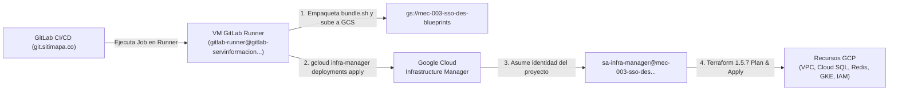

# Sistema de Autenticación Centralizado SSO / Conecta MINEDEC (Subcomponente C2.2)

Guía arquitectónica, operativa y de gobierno del **Sistema de Autenticación Centralizado SSO / Conecta MINEDEC (Subcomponente C2.2)** bajo la **Constitución MINEDEC v2.11.0**.

---

## Tabla de Contenidos

1. [Principios de Gestión de Repositorios (Un Repositorio por Microservicio / IaC / Gobernanza)](#1-principios-de-gestión-de-repositorios-un-repositorio-por-microservicio--iac--gobernanza)
2. [Ajustes en la Constitución (v2.11.0) para el GitLab Empresarial (`git.sitimapa.co`)](#2-ajustes-en-la-constitución-v2110-para-el-gitlab-empresarial-gitsitimapaco)
3. [Cómo Trabajar con Google Antigravity en Múltiples Carpetas y Repositorios](#3-cómo-trabajar-con-google-antigravity-en-múltiples-carpetas-y-repositorios)
4. [Configuración de CI/CD en GitLab con la Service Account Corporativa](#4-configuración-de-cicd-en-gitlab-con-la-service-account-corporativa)
5. [Segmentación y Manejo de Terraform (`iac-terraform`) en Repositorio Independiente](#5-segmentación-y-manejo-de-terraform-iac-terraform-en-repositorio-independiente)
6. [Segmentación Oficial de Red en GCP (`/20`, `/23`, `/24`) y Optimización FinOps en `des`](#6-segmentación-oficial-de-red-en-gcp-20-23-24-y-optimización-finops-en-des)
7. [Sincronización entre los 8 Repositorios de GitLab y el Monorepo de GitHub](#7-sincronización-entre-los-8-repositorios-de-gitlab-y-el-monorepo-de-github)

---

## 1. Principios de Gestión de Repositorios (Un Repositorio por Microservicio / IaC / Gobernanza)

Conforme a los **Principios IV y XVIII de la Constitución (`.specify/memory/constitution.md`)**, el proyecto prohíbe mezclar código de infraestructura, gobernanza documental y distintos microservicios dentro de un mismo repositorio de despliegue en GitLab. La arquitectura se divide en **3 dominios de repositorios**:

### 1.1 Mapa de Repositorios en GitLab (`git.sitimapa.co`)

| # | Carpeta Local / Monorepo | Ruta en GitLab (`c2-sso/*`) | Project ID | Tipo / Rol |
|---|--------------------------|-----------------------------|------------|------------|
| 1 | [`minedec-sso/`](./minedec-sso) | `c2-sso/minedec-sso` | `2855` | **Gobernanza y Especificaciones**: Constitución (`constitution.md`), Base de Conocimiento OKF (`knowledge/`), Spec Kit (`specs/001..005/`), esquemas DBML (`docs/esquemas-bd/`). **Cero archivos `.tf` o código ejecutable.** |
| 2 | [`iac-terraform/`](./iac-terraform) | `c2-sso/devops/iac-terraform` | `2856` | **Infraestructura como Código (IaC)**: Exclusivamente Terraform HCL `1.5.7` en 3 capas (`modulos/`, `plantillas/`, `despliegues/`) gobernado por Google Cloud Infrastructure Manager. |
| 3 | [`microservicios/shared/`](./microservicios/shared) | `c2-sso/microservicios/shared` | `2857` | **Librería Transversal (`@minedec/shared`)**: Publicada en el **GitLab NPM Package Registry** del proyecto `2857` para consumo versionado por todos los microservicios. |
| 4 | [`microservicios/pip-identity-service/`](./microservicios/pip-identity-service) | `c2-sso/microservicios/pip-identity-service` | `2858` | **Microservicio PIP (GKE)**: Directorio interno (`GET /internal/v1/identities/*`) con caché L2 en Memorystore Redis y persistencia en PostgreSQL 16. |
| 5 | [`microservicios/sincronizador/`](./microservicios/sincronizador) | `c2-sso/microservicios/sincronizador` | `2859` | **Microservicio Sincronizador (Cloud Run Service)**: Receptor push/pull de eventos desde Google Workspace / Cloud Identity (100 % solo lectura). |
| 6 | [`microservicios/conciliacion-job/`](./microservicios/conciliacion-job) | `c2-sso/microservicios/conciliacion-job` | `2860` | **Job de Conciliación (Cloud Run Job)**: Reconciliación programada e invalidación determinista de accesos y sesiones (`<= 300 s`). |
| 7 | [`microservicios/sso-oidc/`](./microservicios/sso-oidc) | `c2-sso/microservicios/sso-oidc` | `2861` | **Identity Broker OIDC (GKE, `DA-11`)**: `Node.js 22 + Express 5 + oidc-provider` certificado; único cliente OAuth 2.0 ante Google Cloud Identity. |
| 8 | [`microservicios/motor-pdp/`](./microservicios/motor-pdp) | `c2-sso/microservicios/motor-pdp` | `2862` | **Motor Central de Autorización PDP (GKE)**: Evaluación RBAC/ABAC (`/api/v1/access/evaluation`) y emisión M2M (`/api/v1/oauth/token`). |

### 1.2 Reglas del Principio «Un Repositorio por Microservicio»

1. **Autonomía de Construcción y Despliegue**: Cada microservicio en `microservicios/<servicio>` posee su propio `package.json`, `tsconfig.json`, `Dockerfile` multi-etapa (`node:22-alpine` con usuario sin privilegios `USER node`), suite de pruebas (`Jest + Supertest` con cobertura `>= 70%`) y pipeline `.gitlab-ci.yml`.
2. **Prohibición de Dependencias por Ruta Local en CI**: Ningún microservicio referencia `../shared` mediante rutas de sistema de archivos en producción/CI. Todos instalan `@minedec/shared` desde el **GitLab NPM Package Registry** usando su archivo `.npmrc`:
   ```ini
   @minedec:registry=https://git.sitimapa.co/api/v4/projects/2857/packages/npm/
   //git.sitimapa.co/api/v4/projects/2857/packages/npm/:_authToken=${CI_JOB_TOKEN}
   ```
3. **Gobierno de Ramas Unificado**:
   - **`main`**: Rama por defecto (`default_branch`) y protegida; representa el estado productivo (`pro`).
   - **`qa`**: Rama protegida para preproducción/certificación (`pre`).
   - **`develop`**: Rama protegida de integración continua para el ambiente de desarrollo (`des`).
   - **`spec/00X-<slug>`**: Ramas de *feature* sincronizadas entre `minedec-sso`, `iac-terraform` y los microservicios afectados por dicha especificación.

---

## 2. Ajustes en la Constitución (v2.11.0) para el GitLab Empresarial (`git.sitimapa.co`)

Para alinear la gobernanza con la plataforma corporativa de GitLab y las políticas de GCP del proyecto, se ratificaron los siguientes ajustes en [`minedec-sso/.specify/memory/constitution.md`](./minedec-sso/.specify/memory/constitution.md) y [`minedec-sso/AGENTS.md`](./minedec-sso/AGENTS.md):

1. **Adopción de GitLab Corporativo (`git.sitimapa.co`) como SCM y Orquestador CI/CD Único**:
   - Sustitución de cualquier referencia a flujos aislados por pipelines `.gitlab-ci.yml` alojados en el grupo `ministerio-de-educaci-n-deporte-y-cultura-de-ecuador/c2-sso`.
2. **Separación Multirrepositorio Estricta (Principios IV y XVIII)**:
   - Separación física en repositorios independientes de GitLab para especificación (`minedec-sso`), infraestructura (`devops/iac-terraform`), paquete compartido (`microservicios/shared`) y cada microservicio (`microservicios/*`).
3. **Autenticación *Zero-Key* con la Service Account Existente del GitLab Runner**:
   - Se incorporó en la Constitución el uso obligatorio de la cuenta de servicio corporativa ya asignada a la VM del Runner de GitLab:
     `gitlab-runner@gitlab-servinformacion.iam.gserviceaccount.com`
   - Queda **estrictamente prohibido** exportar o almacenar llaves JSON (`GOOGLE_APPLICATION_CREDENTIALS`) en variables de GitLab CI/CD; toda autenticación contra GCP ocurre vía el **Metadata Server** de Compute Engine del Runner.
4. **Delegación de Estado y Despliegue IaC a Google Cloud Infrastructure Manager**:
   - En lugar de ejecutar `terraform apply` directamente desde el contenedor efímero del Runner con credenciales amplias, el Runner invoca el servicio gestionado **Google Cloud Infrastructure Manager (`config.googleapis.com`)**, el cual asume la cuenta de servicio dedicada del proyecto (`sa-infra-manager@<project_id>.iam.gserviceaccount.com`) y administra el estado remoto de forma nativa.
5. **Segmentación Oficial de Red (`/20`, `/23`, `/24`) y Flexibilidad de VPC en `des`**:
   - Formalización de las **3 únicas máscaras oficiales permitidas (`/20`, `/23`, `/24`)** y soporte dual para operar con VPC local en el proyecto de desarrollo (`mec-003-sso-des`) mientras se preserva el consumo de Shared VPC (`mec-003-sha-net-*`) para los ambientes `pre` y `pro`.

---

## 3. Cómo Trabajar con Google Antigravity en Múltiples Carpetas y Repositorios

### 3.1 Estructura del Espacio de Trabajo Multi-Repositorio en Antigravity

Para que Antigravity tenga visibilidad transversal tanto de las especificaciones como del código de los microservicios y de Terraform, la carpeta local de trabajo se organiza así:

```text
Desarrollo/                           <-- Directorio de trabajo raíz en Antigravity
├── minedec-sso/                      <-- Repo Git #1 (Gobernanza, OKF y Spec Kit)
│   ├── .specify/memory/constitution.md
│   ├── AGENTS.md
│   ├── knowledge/                    <-- Base de conocimiento OKF (index.md, log.md)
│   └── specs/001..005/               <-- Artefactos por feature (spec, plan, tasks)
├── iac-terraform/                    <-- Repo Git #2 (Terraform 1.5.7 en 3 capas)
│   ├── modulos/
│   ├── plantillas/{devops,data,apps}/
│   └── despliegues/{des,pre,pro}/{devops,data,apps}/
└── microservicios/
    ├── shared/                       <-- Repo Git #3 (@minedec/shared)
    ├── pip-identity-service/         <-- Repo Git #4
    ├── sincronizador/                <-- Repo Git #5
    ├── conciliacion-job/             <-- Repo Git #6
    ├── sso-oidc/                     <-- Repo Git #7
    └── motor-pdp/                    <-- Repo Git #8
```

En Antigravity se agregan como **Active Workspaces** la carpeta raíz `Desarrollo` junto con `minedec-sso`, `iac-terraform` y cada carpeta dentro de `microservicios/*`. Las reglas de [`minedec-sso/AGENTS.md`](./minedec-sso/AGENTS.md) le indican automáticamente al agente que las especificaciones viven en `minedec-sso/specs/00X-slug/`, que la infraestructura vive en `../iac-terraform` y que el código de cada servicio vive en `../microservicios/<servicio>`.

### 3.2 Comandos y Skills de Spec Kit en Antigravity

El ciclo de vida de cada requerimiento o ajuste arquitectónico se ejecuta desde `minedec-sso` siguiendo el flujo oficial de **Spec Kit**:

| Orden | Comando / Skill en Antigravity | Propósito y Artefactos que Genera o Actualiza |
|-------|-------------------------------|-----------------------------------------------|
| **0** | `/speckit-constitution` | Crea o actualiza principios normativos en `.specify/memory/constitution.md` y sincroniza `AGENTS.md` y las plantillas de `.specify/templates/`. |
| **1** | `/speckit-specify` | Crea o actualiza `specs/00X-slug/spec.md` con historias de usuario (`US1..USN`), requerimientos funcionales (`FR-XXX`) y criterios de éxito (`SC-XXX`), consultando primero `knowledge/index.md`. |
| **2** | `/speckit-clarify` | Detecta puntos subespecificados en `spec.md`, formula hasta 5 preguntas de opción múltiple y codifica las respuestas directamente en la sección `Clarifications` de `spec.md`. |
| **3** | `/speckit-plan` | Consulta obligatoriamente **Google Developer Knowledge (`retrieving-developer-knowledge`)** y genera `plan.md`, `research.md` (con citas `documents/...`), `data-model.md`, `quickstart.md` y `contracts/*.yaml`. |
| **4** | `/speckit-checklist` | Genera listas de verificación de calidad de requerimientos en `specs/00X-slug/checklists/`. |
| **5** | `/speckit-tasks` | Genera `specs/00X-slug/tasks.md` ordenado por fases y dependencias, indicando para cada tarea (`T001..T0NN`) la ruta exacta del archivo en `../microservicios/<servicio>` o `../iac-terraform`. |
| **6** | `/speckit-analyze` | Ejecuta un análisis de consistencia cruzada (solo lectura) entre `constitution.md`, `spec.md`, `plan.md` y `tasks.md`. |
| **7** | `/speckit-implement` | Ejecuta secuencialmente las tareas de `tasks.md` modificando los repositorios destino (`../microservicios/*`, `../iac-terraform`) y marcando `[X]` en `tasks.md`. |
| **8** | `/speckit-converge` | Audita el código real de los repositorios frente a `spec.md`, `plan.md` y `tasks.md`; si detecta trabajo faltante, agrega nuevas tareas de convergencia a `tasks.md`. |

### 3.3 Comandos para Mantener la Base de Conocimiento OKF (`knowledge/`)

Cada vez que cambia una decisión arquitectónica, topología de red o esquema en `minedec-sso/knowledge/`, se ejecutan los scripts de la skill `okf-skill`:

```powershell
# 1. Regenerar la tabla de contenidos canónica en knowledge/index.md
python minedec-sso/.agents/skills/okf-skill/scripts/generate_index.py minedec-sso/knowledge

# 2. Registrar la entrada de auditoría en knowledge/log.md
python minedec-sso/.agents/skills/okf-skill/scripts/log_entry.py minedec-sso/knowledge `
  --type update `
  --summary "Descripción concisa del cambio arquitectónico" `
  --paths arquitecturas/infraestructura-permisos-c22.md index.md

# 3. Validar conformidad del bundle OKF (frontmatter YAML, enlaces rotos y huérfanos)
python minedec-sso/.agents/skills/okf-skill/scripts/validate.py minedec-sso/knowledge
```

### 3.4 Comandos Git Multi-Repositorio desde la Raíz (`Desarrollo/`)

Al tener 8 repositorios independientes, usamos `-C <ruta>` desde PowerShell en la carpeta raíz `Desarrollo/` para operar sobre cualquiera de ellos o sobre todos en lote sin cambiar de directorio:

```powershell
# Ver el estado y último commit de los 8 repositorios simultáneamente
$repos = @("minedec-sso", "iac-terraform", "microservicios/shared", "microservicios/pip-identity-service", "microservicios/sincronizador", "microservicios/conciliacion-job", "microservicios/sso-oidc", "microservicios/motor-pdp")
foreach ($r in $repos) {
  Write-Host "=== $r ===" -ForegroundColor Cyan
  git -C $r status -s
  git -C $r log -1 --oneline
}

# Subir cambios de un repositorio a las 4 ramas en GitLab disparando UN SOLO pipeline (en develop)
# Nota: -o ci.skip evita lanzar pipelines duplicados en main, qa y spec/*
git -C iac-terraform push origin HEAD:develop
git -C iac-terraform push -o ci.skip origin HEAD:main HEAD:qa HEAD:spec/005-autenticacion-m2m-rotacion
```

---

## 4. Configuración de CI/CD en GitLab con la Service Account Corporativa

### 4.1 Modelo de Identidad en el GitLab Runner (`gitlab-runner@gitlab-servinformacion.iam.gserviceaccount.com`)

El Runner compartido de la empresa en `git.sitimapa.co` se ejecuta sobre una instancia de Google Compute Engine que tiene adjunta la cuenta de servicio corporativa:

```text
gitlab-runner@gitlab-servinformacion.iam.gserviceaccount.com
```

Gracias a esto, **ningún repositorio almacena llaves JSON de GCP**. Dentro de `.gitlab-ci.yml`, los jobs con imagen `google/cloud-sdk:alpine` obtienen credenciales automáticamente del **Metadata Server** local de la VM (`http://metadata.google.internal`).



### 4.2 Permisos IAM Configurados para el Flujo CI/CD

Para que el Runner corporativo pueda desplegar en cada proyecto (`mec-003-sso-des`, `mec-003-sso-pre`, `mec-003-sso-pro`), el esquema de permisos se divide en dos identidades:

1. **Sobre `gitlab-runner@gitlab-servinformacion.iam.gserviceaccount.com`** (quien invoca el despliegue y construye imágenes):
   - `roles/config.admin`: Permite invocar a Google Cloud Infrastructure Manager (`deployments apply`).
   - `roles/iam.serviceAccountUser` sobre `sa-infra-manager@<project_id>.iam.gserviceaccount.com`: Permite encargarle a Infrastructure Manager que ejecute Terraform usando `sa-infra-manager`.
   - `roles/storage.admin` (sobre el bucket `<project_id>-blueprints`): Permite que `scripts/bundle.sh` suba el artefacto empaquetado de Terraform y lea los logs de Cloud Build.
   - `roles/cloudbuild.builds.editor`, `roles/artifactregistry.writer` y `roles/serviceusage.serviceUsageConsumer`: Permiten ejecutar `gcloud builds submit` en los repositorios de microservicios para publicar imágenes Docker en `sso-containers`.

2. **Sobre `sa-infra-manager@<project_id>.iam.gserviceaccount.com`** (quien aplica los recursos de Terraform dentro del proyecto):
   - Permisos de administración de infraestructura dentro del proyecto destino (`roles/compute.networkAdmin`, `roles/compute.securityAdmin`, `roles/container.admin`, `roles/cloudsql.admin`, `roles/redis.admin`, `roles/pubsub.admin`, `roles/cloudtasks.admin`, `roles/bigquery.admin`, `roles/secretmanager.admin`, `roles/storage.admin`, `roles/artifactregistry.admin`, `roles/cloudscheduler.admin`, `roles/iam.serviceAccountAdmin`, `roles/resourcemanager.projectIamAdmin`, `roles/servicenetworking.networksAdmin`).

### 4.3 Estructura del Pipeline `.gitlab-ci.yml` en `iac-terraform`

El pipeline de [`iac-terraform/.gitlab-ci.yml`](./iac-terraform/.gitlab-ci.yml) define dos etapas:
- **`validate` (Automática en cada push/MR)**:
  - `validate:devops`, `validate:data`, `validate:apps`: Instalan Terraform `1.5.7`, verifican formato (`terraform fmt -check -recursive`) y ejecutan `terraform init -backend=false` + `terraform validate` sobre cada stack.
- **`deploy` (Manual controlada por orden de dependencia)**:
  - `deploy:devops`, `deploy:data`, `deploy:apps`: Seleccionan el ambiente según la rama (`develop` → `des`, `qa` → `pre`, `main` → `pro`), ejecutan `./scripts/bundle.sh <ambiente> <stack> <bucket-blueprints>` y lanzan `gcloud infra-manager deployments apply`.

### 4.4 Estructura del Pipeline `.gitlab-ci.yml` en Microservicios

Cada repositorio dentro de `microservicios/*` cuenta con 3 etapas en su `.gitlab-ci.yml`:
1. **`lint_and_sast`**: Ejecuta `npm run lint` (ESLint), `npm run build` (`tsc --noEmit`) y `npm audit --omit=dev --audit-level=high` (SCA).
2. **`test`**: Ejecuta `npm test -- --ci --coverage` exigiendo el umbral constitucional de cobertura `>= 70%`.
3. **`build_and_publish`**:
   - En `microservicios/shared`: Publica el paquete `@minedec/shared` en el **GitLab NPM Package Registry** (`projects/2857/packages/npm/`) autenticándose con `${CI_JOB_TOKEN}`.
   - En los demás microservicios: Construye y publica la imagen contenedor en Artifact Registry (`us-east1-docker.pkg.dev/<project_id>/sso-containers/<servicio>:$CI_COMMIT_SHA`) mediante `gcloud builds submit`.

---

## 5. Segmentación y Manejo de Terraform (`iac-terraform`) en Repositorio Independiente

### 5.1 Arquitectura de 3 Capas en Terraform `1.5.7` (HCL Puro, Sin Terragrunt)

El repositorio [`iac-terraform/`](./iac-terraform) está diseñado exclusivamente en **Terraform HCL `1.5.7`** y organizado en **3 capas jerárquicas**:

```text
iac-terraform/
├── scripts/
│   └── bundle.sh                       <-- Empaquetador oficial para Infrastructure Manager
├── modulos/                            <-- CAPA 1: Módulos técnicos reutilizables
│   ├── alloydb/
│   ├── artifact-registry/
│   ├── bigquery/
│   ├── cloud-armor/
│   ├── cloud-run-job/
│   ├── cloud-run-service/
│   ├── cloud-tasks/
│   ├── cloudsql/
│   ├── gitlab-ce/
│   ├── gke/
│   ├── iam/
│   ├── pubsub/
│   ├── redis/
│   ├── secrets/
│   ├── storage/
│   └── vpc/
├── plantillas/                         <-- CAPA 2: Composición por Stack (Ciclo de vida)
│   ├── devops/                         <-- Red base, IAM, Secret Manager, Artifact Registry, GCS
│   ├── data/                           <-- Cloud SQL / AlloyDB, Redis, Pub/Sub, Tasks, BigQuery, WORM
│   └── apps/                           <-- Clúster GKE Autopilot/Standard y WAF Cloud Armor
└── despliegues/                        <-- CAPA 3: Instanciación por Ambiente (des, pre, pro)
    ├── des/{devops,data,apps}/
    ├── pre/{devops,data,apps}/
    └── pro/{devops,data,apps}/
```

### 5.2 ¿Por qué se segmenta en 3 Stacks (`devops`, `data`, `apps`)?

Cada ambiente (`des`, `pre`, `pro`) se divide en **3 stacks independientes** que corresponden a 3 despliegues separados en Google Cloud Infrastructure Manager (`sso-<env>-devops`, `sso-<env>-data`, `sso-<env>-apps`):

| Orden | Stack | Deployment en Infra Manager | Qué Aprovisiona | Por qué está separado |
|-------|-------|-----------------------------|-----------------|-----------------------|
| **1.º** | **`devops`** | `sso-<env>-devops` | VPC local (o enlace a Shared VPC), subred primaria y rangos secundarios (`/20`, `/23`, `/24`), Private Services Access (`psa-sso-<env>`), Cloud Router/NAT, Artifact Registry (`sso-containers`), bucket de blueprints, Service Accounts (`sa-sso-*`) y contenedores de Secret Manager. | Es el cimiento de red, identidad y contenedores de secretos que tanto las bases de datos como los servicios necesitan antes de existir. |
| **2.º** | **`data`** | `sso-<env>-data` | Cloud SQL PostgreSQL 16 (`des`) o AlloyDB (`pre`/`pro`), jobs de Cloud Scheduler (encendido/apagado en `des`), Memorystore for Redis, tópicos/suscripciones de Cloud Pub/Sub, colas de Cloud Tasks, dataset BigQuery (`auditoria_sso`) y bucket WORM (`-audit-worm`). | Aísla los almacenes con estado (*stateful*). Un cambio en la capa de aplicaciones nunca pone en riesgo ni recalcula las instancias de base de datos o colas. |
| **3.º** | **`apps`** | `sso-<env>-apps` | Clúster GKE (`sso-gke-<env>-ue1`) con plano de control privado vía Private Service Connect (`master_ipv4_cidr_block = null`) y política WAF de Cloud Armor (`sso-oidc-waf-policy`). | Depende de la red y de las cuentas de servicio de `devops`, y tiene su propio ciclo de escalado y actualización de nodos/workloads. |

### 5.3 Empaquetado sin Dependencias Externas (`scripts/bundle.sh`)

Como cada directorio en `despliegues/<ambiente>/<stack>/main.tf` invoca a `../../../plantillas/<stack>` y este a su vez invoca a `../../modulos/<modulo>` usando **rutas relativas hacia arriba (`../`)**, el script [`iac-terraform/scripts/bundle.sh`](./iac-terraform/scripts/bundle.sh) utiliza el comando oficial de Google Cloud SDK:

```bash
gcloud alpha infra-manager artifacts bundle \
  --local-source="." \
  --starting-dir="despliegues/${ENV}/${STACK}" \
  --tf-version-constraint="1.5.7" \
  --output-directory="${OUTPUT_Uri}"
```

Este comando resuelve automáticamente todas las referencias `../plantillas` y `../modulos`, genera un artefacto autocontenido en Cloud Storage (`gs://<project_id>-blueprints/bundles/<env>-<stack>/`) e inyecta el `terraform.tfvars` del ambiente como `terraform.auto.tfvars` dentro del módulo raíz del bundle.

---

## 6. Segmentación Oficial de Red en GCP (`/20`, `/23`, `/24`) y Optimización FinOps en `des`

### 6.1 Uso Exclusivo de las 3 Máscaras Oficiales (`/20`, `/23`, `/24`)

La red del Subcomponente C2.2 utiliza **única y exclusivamente 3 segmentos de red con las máscaras oficiales `/20`, `/23` y `/24`** (sin bloques `/28` adicionales gracias al uso de Private Service Connect `master_ipv4_cidr_block = null` en GKE):

| Máscara Oficial | Bloque Asignado | Subdivisión / Uso en la Arquitectura GCP |
|-----------------|-----------------|------------------------------------------|
| **`/20`** (`4 096` IPs) | `10.10.16.0/20` | **Rango secundario `pods`** de la subred `snet-sso-ue1` para todos los Pods de GKE (`sso-oidc`, `motor-pdp`, `api-pap`, `frontend`, `pip-identity-service`). |
| **`/24`** (`256` IPs) | `10.10.2.0/24` | **Rango secundario `services`** de la subred `snet-sso-ue1` para los `ClusterIP` Services de GKE. |
| **`/23`** (`512` IPs) | `10.10.0.0/23` | Subdividido de forma contigua y sin traslape en dos mitades `/24`:<br>• **1.ª mitad (`10.10.0.0/24`)**: Rango primario de la subred `snet-sso-ue1` (nodos GKE, Internal Load Balancers y Cloud Run Direct VPC Egress).<br>• **2.ª mitad (`10.10.1.0/24`)**: Rango reservado `psa-sso-<ambiente>` para **Private Services Access** (`servicenetworking.googleapis.com`, donde reciben IP privada Cloud SQL / AlloyDB y Memorystore Redis). |

### 6.2 Configuración FinOps Temporal en Desarrollo (`mec-003-sso-des`)

Para minimizar costos durante las pruebas en el ambiente `des` (`mec-003-sso-des`) sin perder la configuración objetivo de producción:
- **VPC Local en `des` (`create_local_vpc = true`)**: Se aprovisiona la VPC local `vpc-mec-sha-des` dentro de `mec-003-sso-des` manteniendo comentada la referencia al proyecto host de Shared VPC (`mec-003-sha-net-des`).
- **Cloud SQL for PostgreSQL 16 (`db-f1-micro`) con Apagado/Encendido Automático**: En `despliegues/des/data/`, la configuración de AlloyDB permanece comentada y se activa una instancia económica de **Cloud SQL PostgreSQL 16 (`sso-postgres-des`, `db-f1-micro`, `ZONAL`)** gobernada por **4 jobs de Cloud Scheduler** en zona horaria `America/Bogota` (lunes a viernes únicamente; apagada fines de semana):
  - **08:00 AM (L–V)**: Encendido (`activationPolicy: ALWAYS`).
  - **01:00 PM (L–V)**: Apagado (`activationPolicy: NEVER`).
  - **02:00 PM (L–V)**: Encendido (`activationPolicy: ALWAYS`).
  - **05:00 PM (L–V)**: Apagado (`activationPolicy: NEVER`).

---

## 7. Sincronización entre los 8 Repositorios de GitLab y el Monorepo de GitHub

Para actualizar este monorepo en GitHub (`https://github.com/GLDevKike/minedec-sso`) en cualquier momento sin tocar los `.git` de los 8 repositorios de GitLab, ejecuta desde la carpeta raíz `Desarrollo/`:

```powershell
$gitDir = ".github-monorepo.git"
$repos = @(
  @{ Path = "minedec-sso"; Ref = "minedec-sso" },
  @{ Path = "iac-terraform"; Ref = "iac-terraform" },
  @{ Path = "microservicios/shared"; Ref = "shared" },
  @{ Path = "microservicios/pip-identity-service"; Ref = "pip-identity-service" },
  @{ Path = "microservicios/sincronizador"; Ref = "sincronizador" },
  @{ Path = "microservicios/conciliacion-job"; Ref = "conciliacion-job" },
  @{ Path = "microservicios/sso-oidc"; Ref = "sso-oidc" },
  @{ Path = "microservicios/motor-pdp"; Ref = "motor-pdp" }
)

git --git-dir=$gitDir --work-tree=. read-tree --empty
foreach ($r in $repos) {
  $refName = "refs/remotes/local/$($r.Ref)"
  git --git-dir=$gitDir fetch "./$($r.Path)" "HEAD:$refName"
  git --git-dir=$gitDir --work-tree=. read-tree --prefix="$($r.Path)/" $refName
}

$readmeBlob = git --git-dir=$gitDir hash-object -w "README.md"
git --git-dir=$gitDir update-index --add --cacheinfo "100644,$readmeBlob,README.md"

$treeSha = git --git-dir=$gitDir write-tree
$parentSha = git --git-dir=$gitDir rev-parse refs/heads/main
$commitSha = git --git-dir=$gitDir commit-tree $treeSha -p $parentSha -m "chore(monorepo): sincronizar estado de los 8 repositorios con GitHub"

git --git-dir=$gitDir update-ref refs/heads/main $commitSha
git --git-dir=$gitDir update-ref refs/heads/develop $commitSha
git --git-dir=$gitDir update-ref refs/heads/qa $commitSha
git --git-dir=$gitDir update-ref refs/heads/spec/005-autenticacion-m2m-rotacion $commitSha
git --git-dir=$gitDir push origin main develop qa spec/005-autenticacion-m2m-rotacion
```
