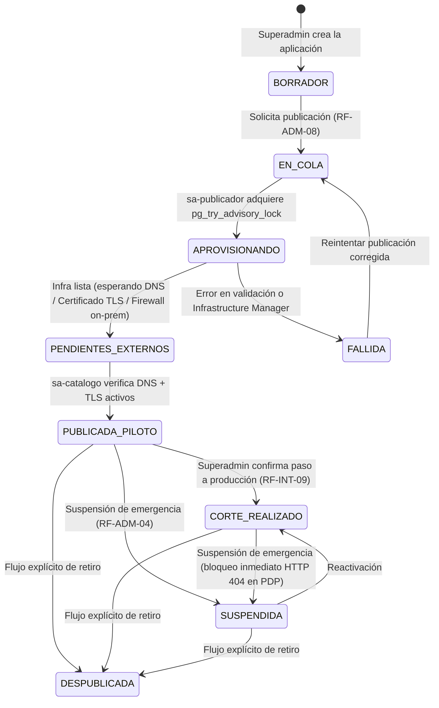

# Gobierno y Ciclo de Vida de Aplicaciones desde la Consola Web (`C2-50` §4 y `RF-ADM-08`)

## 1. Principio de Gobierno sin Acceso Manual a la Consola de GCP

Uno de los pilares del **Subcomponente C2.2** (`DA-09`, `RF-ADM-08`, `RF-AUZ-17`) es que el **Superadministrador (Seguridad Informática)** puede incorporar nuevas aplicaciones al ecosistema SSO, configurar su catálogo de rutas, generar sus credenciales M2M, aprovisionar su borde perimetral (Patrón 2), pasarlas a piloto, suspenderlas o despublicarlas **íntegramente desde la Consola Web del Sistema de Autenticación Centralizado SSO / Conecta MINEDEC**, sin ejecutar comandos manuales ni editar infraestructura a mano en la consola de Google Cloud.

Al mismo tiempo, por seguridad (**Principio de Privilegio Mínimo**, `RNF-SEG-07`), el pod de la API de Administración en GKE (`sa-conecta`) **no tiene permisos para crear balanceadores, certificados ni proxies en GCP**. En su lugar, delega la ejecución en dos componentes aislados:
1. **`sa-publicador` (Cloud Run Job)**: Ejecuta cambios de infraestructura de forma secuencial y segura a través de **Google Cloud Infrastructure Manager (Terraform `>= 1.5.0`)**.
2. **`sa-catalogo` (Cloud Run Service)**: Sondea en modo de **solo lectura** el estado real de los certificados TLS, registros DNS, balanceadores y proxies en Apigee/Envoy para mostrar diagnósticos en vivo en la consola.

---

## 2. Máquina de Estados del Ciclo de Vida de una Aplicación (`C2-50` §4.2)

### Diferencia de Publicación según el Patrón de Integración (`PATRON_1_NATIVO` vs. `PATRON_2_PERIMETRAL` — `DA-11`)

| Aspecto Operativo | `PATRON_1_NATIVO` (`PATRON_1_DIRECTA` — Aplicaciones Nuevas / Con Código Fuente) | `PATRON_2_PERIMETRAL` (Aplicaciones Legadas con Proxy / LB delante) |
| :--- | :--- | :--- |
| **¿Qué se crea en AlloyDB al registrar la aplicación?** | Se registra el **cliente OIDC de la aplicación** (`SSO_OIDC_CLIENT_ID`, hash del secreto y `redirect_uris` para el servicio `sso-oidc`) y su **credencial M2M** (`SSO_CLIENT_ID` y hash `SHA-256` de `SSO_CLIENT_SECRET` para `/api/v1/oauth/token`). | Se registra la aplicación en el catálogo y su configuración perimetral (hosts, backends, nivel `PROTEGIDA`/`INTEGRADA`). El PEP Perimetral actúa como un único cliente OIDC frente a `sso-oidc`. |
| **¿Se crea un cliente OAuth 2.0 en Google Cloud?** | **No.** Solo el servicio `sso-oidc` del SSO tiene **1 único cliente OAuth 2.0** en Google Cloud (`DA-11`). | **No.** El PEP delega el inicio de sesión en `sso-oidc` (`DA-11`). |
| **¿Ejecuta Terraform (`sa-publicador` / Infrastructure Manager)?** | **No.** No requiere levantar balanceadores, IPs públicas, certificados TLS ni proxies perimetrales en GCP. | **Sí.** `sa-publicador` genera `apps.auto.tfvars.json` y ejecuta Preview + Apply en Google Cloud Infrastructure Manager para aprovisionar el borde perimetral (LB, certificado TLS, Hybrid NEG y ruta en el PEP). |
| **Transición al Publicar en la Consola** | **Inmediata en Base de Datos y Caché**: pasa directamente de `BORRADOR` a `PUBLICADA_PILOTO` / `CORTE_REALIZADO` en AlloyDB e invalida la caché L2 en Memorystore Redis vía Pub/Sub. | **Asíncrona por Infraestructura**: pasa por `BORRADOR -> EN_COLA -> APROVISIONANDO -> PENDIENTES_EXTERNOS -> PUBLICADA_PILOTO -> CORTE_REALIZADO`. |

### Descripción de cada Estado
1. **`BORRADOR`**: La aplicación está registrada en AlloyDB; se pueden configurar sus administradores de aplicativo, catálogo de rutas (`RF-AUZ-17`), roles y perfiles, pero aún no acepta tráfico productivo (el PDP responde `HTTP 404` si se la consulta).
2. **`EN_COLA` *(exclusivo `PATRON_2_PERIMETRAL`)* **: El Superadministrador solicitó publicar o actualizar la configuración perimetral de una aplicación de Patrón 2.
3. **`APROVISIONANDO` *(exclusivo `PATRON_2_PERIMETRAL`)* **: El Cloud Run Job `sa-publicador` está ejecutando la vista previa (`Preview`) y aplicación (`Apply`) en Infrastructure Manager.
4. **`PENDIENTES_EXTERNOS` *(exclusivo `PATRON_2_PERIMETRAL`)* **: Los recursos en GCP (IP reservada, certificado administrado, NEG híbrido, proxy PEP) ya fueron creados, pero falta una acción externa verificada por `sa-catalogo` (por ejemplo, apuntar el registro DNS público hacia la IP del balanceador o habilitar en el firewall del backend el paso desde la subred `proxy-only` según `RNF-SEG-09`).
5. **`PUBLICADA_PILOTO`**: El contrato (y el borde perimetral en Patrón 2) están operativos para pruebas controladas con usuarios piloto antes del paso definitivo a producción (`RF-INT-09`). En `PATRON_1_NATIVO` se alcanza de forma inmediata al publicar desde `BORRADOR`.
6. **`CORTE_REALIZADO`**: La aplicación opera oficialmente en producción bajo el Sistema de Autenticación Centralizado SSO.
7. **`SUSPENDIDA`**: Bloqueo operativo inmediato en el motor PDP (`RF-ADM-04`: cualquier llamada a `POST /api/v1/access/evaluation` para esa aplicación devuelve `HTTP 404` al instante y purga Redis) sin destruir aún su infraestructura.
8. **`FALLIDA`**: La prevalidación o ejecución en Infrastructure Manager detectó un error; la consola muestra el diagnóstico detallado al Superadministrador.
9. **`DESPUBLICADA`**: La aplicación fue retirada mediante el flujo explícito de despublicación.

---

## 3. Flujo Seguro de Publicación Perimetral con `sa-publicador` e Infrastructure Manager (`PATRON_2_PERIMETRAL` — `DA-09`, `R-04`)

Cuando la aplicación utiliza el **`PATRON_2_PERIMETRAL`** (aplicaciones legadas que requieren aprovisionar balanceador, certificado TLS, Hybrid NEG y proxy PEP), para evitar condiciones de carrera al publicar o editar desde la consola, `sa-publicador` sigue una secuencia estricta de **5 candados de seguridad**:

1. **Bloqueo Consultivo en AlloyDB (`pg_try_advisory_lock`)**:
   - Al iniciar, `sa-publicador` intenta adquirir un bloqueo exclusivo a nivel de base de datos (`SELECT pg_try_advisory_lock(LOCK_ID_PUBLICADOR)`).
   - Esto garantiza que **solo se ejecute una publicación a la vez** en todo el proyecto (`RF-ADM-08`). Si hay otra en curso, las solicitudes adicionales permanecen en estado `EN_COLA` y se procesan secuencialmente.
2. **Generación Determinista de `apps.auto.tfvars.json`**:
   - `sa-publicador` lee de AlloyDB el catálogo completo de aplicaciones activas/en aprovisionamiento y genera el archivo declarativo `apps.auto.tfvars.json`.
   - Sube el artefacto al bucket de Cloud Storage de blueprints (`gs://minedec-sso-blueprints-...`) el cual tiene **Object Versioning obligatorio** activado para auditoría y reversión inmediata a la versión previa (`RF-ADM-08`).
3. **Vista Previa Obligatoria (`Preview`) y Regla Anti-Destrucción (`R-04`)**:
   - Antes de aplicar cualquier cambio, `sa-publicador` solicita un **Preview** a **Google Cloud Infrastructure Manager**.
   - Analiza el plan JSON resultante: **si el plan intenta destruir (`delete` / `replace`) recursos pertenecientes a otra aplicación distinta a la que se está modificando (o si intenta destruir recursos fuera de un flujo explícito de `DESPUBLICAR`), `sa-publicador` aborta inmediatamente la operación**, marca la solicitud como `FALLIDA` y registra una alerta crítica (`RF-AUD-09`).
4. **Aplicación Controlada (`Apply`)**:
   - Solo si la vista previa supera la validación anti-destrucción, `sa-publicador` ordena a Infrastructure Manager aplicar el despliegue con la cuenta `sa-infra-manager`.
5. **Verificación Continua con `sa-catalogo`**:
   - El servicio `sa-catalogo` consulta periódicamente (usando los roles de solo lectura `catalogo_lb`, `catalogo_certificados` y `catalogo_apigee`) si el certificado Google-managed SSL ya pasó a estado `ACTIVE`, si los backends del Hybrid NEG reportan salud (`HEALTHY`) y actualiza el semáforo de estado en la Consola Web.

---

## 4. Segregación entre los 3 Roles de la Consola Web (`RF-ADM-07`, `C2-50` Tabla 13)

Dentro de la Consola Web y la API PAP, el control de acceso interno impone una separación estricta de funciones entre tres actores administrativos:

- **1. Superadministrador (Seguridad Informática)**:
  - Crear la ficha de la aplicación, elegir el patrón (`PATRON_1_NATIVO` o `PATRON_2_PERIMETRAL`), configurar hosts, IPs de backend y certificados.
  - Definir la **regla por defecto del catálogo de rutas** (`AUTENTICADA`, `PROTEGIDA` o `PUBLICA`) y las **excepciones de rutas públicas** (`RF-AUZ-17`, evitando que un administrador funcional exponga accidentalmente una ruta privada sin autenticación).
  - Emitir y rotar credenciales M2M (`client_id` / `client_secret`).
  - Disparar transiciones de publicación, suspensión, reversión o despublicación (`RF-ADM-08`).
  - Designar qué usuarios tienen el rol de **Administrador de Aplicativo** o **Auditor**.
- **2. Administrador de Aplicativo (acotado exclusivamente a sus `uuid_aplicacion` asignados)**:
  - Registrar las rutas funcionales protegidas de su sistema y sus métodos HTTP.
  - Crear y mantener **Permisos Atómicos**, **Roles**, **Perfiles**, **Grupos Lógicos** y **Reglas ABAC**.
  - Asignar o revocar roles y contextos territoriales/temporales a los usuarios de su aplicación.
- **3. Auditor (`C2-50` Tabla 13 — Solo Lectura)**:
  - Consultar y filtrar la pista de auditoría inmutable (`RF-AUD-05`), revisar reportes de cumplimiento y recertificación (`RF-AUD-07`) y exportar evidencias (`RF-AUD-06`), **sin permiso para modificar ninguna configuración, rol ni aplicación**.

---

## 5. Documentos Relacionados

- [Componentes del Núcleo Central del Sistema de Autenticación Centralizado SSO (C2.2)](componentes-pdp-core.md)
- [Infraestructura GCP, Red Híbrida y Matriz IAM de C2.2](infraestructura-permisos-c22.md)
- [Actores, Poblaciones de Usuarios y Ciclo de Vida de Identidades](../dominio/actores-y-poblaciones.md)
