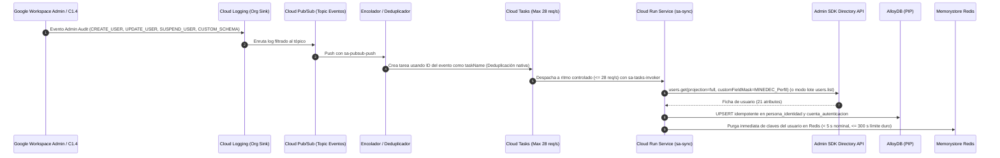

# Sincronización de Identidades, Protección de Cuotas y Registro en Caliente (`C2-50` §6)

## 1. El Reto de Escala y las Cuotas de Google Admin SDK (`DA-05`, `R-02`, `RNF-REN-05`)

El ecosistema del MINEDEC abarca aproximadamente **2,28 millones de cuentas internas** (~2.106.969 estudiantes + ~160.000 docentes/directivos + ~10.000 administrativos), mientras que la **API Directory de Google Admin SDK** impone un límite estricto de cuota por defecto de **2.400 solicitudes por minuto (~40 solicitudes por segundo)**.

Si el Sistema de Autenticación Centralizado SSO / Conecta MINEDEC consultara a Google Admin SDK durante el inicio de sesión o durante la evaluación de permisos (por ejemplo, en el inicio de clases o cierre de quimestre con miles de sesiones concurrentes), **agotaría la cuota en pocos segundos** y provocaría una caída generalizada (`HTTP 403 userRateLimitExceeded` / `HTTP 429 Too Many Requests`).

Por ello, el **Subcomponente C2.2** implementa tres mecanismos combinados (`DA-05`, `R-02`):
1. **Cero llamadas a Google en el camino crítico** de autenticación y autorización (`RF-GI-05`, `RNF-REN-05`).
2. **Sincronización incremental basada en eventos** regulada por una cola de **Cloud Tasks y gobernador en Redis al 70% de la cuota (`<= 28 req/s`)** para propagar bajas y cambios dentro de la ventana máxima obligatoria de **`<= 300 segundos`** (`RF-GI-06`, `< 5 s` en camino nominal).
3. **Conciliación masiva y carga inicial en lote** mediante un **Cloud Run Job** particionado por dominio y `orgUnitPath` (`RNF-REN-08`).

---

## 2. Vía 1: Sincronización Incremental en Casi Tiempo Real (Eventos)

### Reglas Técnicas del Sincronizador de Eventos (`sa-sync`)
- **Tope de velocidad (Rate Limiting)**: La cola de **Cloud Tasks** y el gobernador distribuido en Redis se configuran con `maxDispatchesPerSecond = 28` (el **70% de la cuota de 40 req/s** de Google Admin SDK), dejando un 30% de margen de seguridad para otras operaciones administrativas de Workspace (`R-02`).
- **Deduplicación de eventos repetidos**: Se asigna el identificador único del evento de auditoría de Google (o hash SHA-256 de la ventana de coalescencia) como nombre de la tarea en Cloud Tasks (`task_id`), impidiendo reprocesar eventos duplicados dentro de la ventana de deduplicación.
- **Conmutación automática a modo lote (`users.list`)**: Si la profundidad de la cola supera el umbral de ráfaga (por ejemplo, durante cambios masivos de matrícula), el servicio agrupa las consultas o conmuta a consultas paginadas `users.list` (que traen hasta **500 usuarios por cada 1 llamada de cuota**).
- **Delegación de dominio con privilegio mínimo (`C2-50` §9.2 y `BR-20`)**: `sa-sync` **no tiene archivo JSON de clave privada**. Solicita en tiempo de ejecución a la API IAM Credentials (`iam.serviceAccounts.signJwt`) firmar un JWT de corta duración en nombre de `sa-workspace-reader`, la cual solo posee el scope de **solo lectura** `https://www.googleapis.com/auth/admin.directory.user.readonly`.

---

## 3. Vía 2: Carga Masiva Inicial y Conciliación Nocturna (`Cloud Run Job`)

Para poblar inicialmente los ~2,28 millones de cuentas y conciliar diariamente cualquier posible desfase (`RNF-REN-08`):

- **Ejecutor**: **Cloud Run Job (`sa-sync-job`)** disparado por **Cloud Scheduler** (`sa-scheduler`) en ventana nocturna de baja demanda.
- **Duración extendida y particionamiento paralelo**:
  - Cloud Run Jobs soporta ejecuciones de hasta **168 horas (7 días)** sin cortes por timeout HTTP.
  - El trabajo se divide en **tareas paralelas particionadas por dominio** (`estudiante.edu.ec`, dominio docente, dominio administrativo según `D-21`) y por **Unidad Organizativa (`orgUnitPath`)**.
  - Cada petición `users.list` recupera páginas de **500 usuarios por llamada** (`maxResults=500`, `projection=custom`, `customFieldMask=MINEDEC_Perfil`). A razón de 500 usuarios por llamada y ~20 llamadas/s dedicadas al job, **2,28 millones de usuarios se recorren en ~4.560 llamadas (~4 minutos de cuota efectiva de API)**.
- **Checkpointing en AlloyDB (`sync_checkpoint`)**:
  - Cada página de 500 usuarios se inserta/actualiza en AlloyDB mediante `INSERT ... ON CONFLICT DO UPDATE` en lote y actualiza en la misma transacción el `nextPageToken` en la tabla `sync_checkpoint`.
  - Si una tarea del Job se reinicia, retoma exactamente desde el último `page_token` confirmado sin repetir desde cero.

---

## 4. Resiliencia, Backoff Exponencial y Dead-Letter Queue (`C2-50` §6.4)

Tanto `sa-sync` como `sa-sync-job` aplican obligatoriamente la siguiente política de reintentos ante errores transitorios de Google Admin SDK:

- **Códigos sujetos a reintento**: `HTTP 403` con razón `userRateLimitExceeded` o `quotaExceeded`, `HTTP 429 Too Many Requests` y errores de servidor `HTTP 500`, `502`, `503`, `504`.
- **Fórmula de espera exponencial con jitter**:
  $$\text{Espera}(n) = (2^n)\text{ segundos} + \text{aleatorio}(0..1000\text{ ms}), \quad n \in \{0, 1, 2, 3, 4\}$$
- **Respeto de cabecera `Retry-After`**: Si la respuesta `429` o `503` de Google incluye la cabecera `Retry-After`, el cliente espera el máximo entre el valor de `Retry-After` y el cálculo exponencial.
- **Cola de Mensajes Fallidos (Dead-Letter Queue — DLQ)**: Si tras los 5 intentos (`n=0..4`) el evento sigue fallando o presenta un error de datos irrecuperable (ej. cuenta sin `numero_identificacion` válido), el mensaje se envía al tópico/suscripción **DLQ en Pub/Sub** y se registra en la bandeja de anomalías (`sync_anomalia_identidad`) y en Cloud Monitoring sin detener la cola principal.

---

## 5. Registro en Caliente (*Just-In-Time Fallback* en AlloyDB)

¿Qué ocurre si una cuenta acaba de ser creada en Google Workspace hace pocos segundos y el usuario inicia sesión inmediatamente antes de que la tarea de Cloud Tasks termine de sincronizar su ficha en AlloyDB?

1. El usuario completa su autenticación OIDC o SAML ante Google Cloud Identity.
2. El PEP o la aplicación Patrón 1 invoca `POST /api/v1/access/evaluation` enviando los atributos básicos obtenidos de la sesión/token autenticado.
3. Si el PDP/PIP no encuentra la cuenta en Redis ni en AlloyDB, **NO llama a la API de Google Admin SDK** (para mantener cero llamadas a Google en el camino crítico).
4. En su lugar, ejecuta el **Registro en Caliente** en AlloyDB insertando un registro provisional con `origen_registro = 'REGISTRO_CALIENTE'` a partir de los atributos verificados del token/aserción, evalúa las reglas aplicables (por ejemplo, rutas `AUTENTICADA` o reglas ABAC básicas) y permite que, segundos después, el Sincronizador de Identidades complete/actualice la ficha oficial (`origen_registro = 'SYNC_EVENTO'`).

---

## 6. Documentos Relacionados

- [Componentes del Núcleo Central del Sistema de Autenticación Centralizado SSO (C2.2)](componentes-pdp-core.md)
- [Esquema de Identidad `MINEDEC_Perfil` y Modelo de Datos en AlloyDB](../dominio/identidad-esquema-minedec-perfil.md)
- [Infraestructura GCP, Red Híbrida y Matriz IAM de C2.2](infraestructura-permisos-c22.md)
