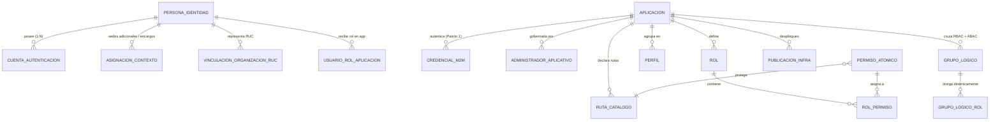

# Esquema de Identidad `MINEDEC_Perfil` y Modelo de Datos en AlloyDB

## 1. Articulación entre la Matriz de Atributos de GWS y AlloyDB (`5.3.1` + `Matriz de Atributos GWS`)

El motor de autorización de **Conecta MINEDEC (C2.2)** evalúa el cruce **RBAC + ABAC** alimentándose de dos capas que trabajan en conjunto:

1. **Capa Base Sincronizada desde Google Workspace (`customSchemas.MINEDEC_Perfil`)**:
   - Contiene los **21 atributos canónicos** definidos en la [Matriz Maestra Canónica de Atributos GWS](matriz-atributos-gws-catalogos.md) (`knowledge/fuentes-oficiales/Matriz de Atributos GWS _ SSO (3).xlsx`: 5 atributos estándar de Google + 16 atributos personalizados de `MINEDEC_Perfil`).
   - Con Cloud IAP o login OIDC estándar, las aplicaciones solo reciben en el token primario el `email`, el `sub` (ID de Google) y el dominio `hd`. El **Sistema de Autenticación Centralizado SSO / Conecta MINEDEC** mantiene sincronizados los 21 atributos en AlloyDB y Memorystore Redis (`TTL <= 300 s`) para enriquecer la identidad y evaluar políticas con respuesta ágil (`RNF-REN-02`, `D-06`) sin consultar a las APIs de Google en tiempo de login.
2. **Capa de Extensión y Enriquecimiento Dinámico en AlloyDB (Conecta MINEDEC)**:
   - Resuelve los casos donde un usuario requiere atributos multi-valuados o específicos por aplicación que superan un campo simple en Google Workspace:
     - **Docentes Multisede (`docenteMultisede = true`)**: En Google Workspace (`codigoInstitucion`) reside el código AMIE del plantel principal (`amie_titular`), mientras que en AlloyDB (`asignacion_contexto`) se almacenan todas las **sedes o planteles complementarios (`amies_asignados`)**, cargos por plantel y sus vigencias.
     - **Múltiples cuentas para una misma persona física**: Vinculadas mediante `numeroIdentificacion` e `idInterno` (`UUID v4` inmutable).
     - **Permisos atómicos, roles específicos de cada aplicación y catálogo de rutas**.

---

## 2. Los 21 Atributos del Esquema en Google Cloud Identity (`Matriz de Atributos GWS`)

### 2.1 Atributos Estándar de Google Workspace (5 atributos)

| # | Campo en Admin SDK (`fieldName`) | Tipo | Claim OIDC / SAML | Descripción y Uso en Conecta MINEDEC |
| :--- | :--- | :--- | :--- | :--- |
| **1.0** | `primaryEmail` | `STRING` | `email` / `nameID` | Correo institucional con el que el usuario inicia sesión (`email_autenticado`). |
| **2.0** | `name.givenName` | `STRING` | `given_name` | Nombres normalizados (`primerNombre + segundoNombre`). |
| **3.0** | `name.familyName` | `STRING` | `family_name` | Apellidos normalizados (`primerApellido + segundoApellido`). |
| **4.0** | `orgUnitPath` | `STRING` | `org_unit_path` | Ruta jerárquica de OU derivada de `gradoCurso` y `tipoUsuario` (usada para políticas de Workspace y particionamiento del sincronizador). |
| **5.0** | `suspended` | `BOOL` | `is_suspended` | Estado de suspensión de la cuenta (`true` bloquea inmediatamente toda autorización en Conecta MINEDEC). |

### 2.2 Atributos Personalizados de `customSchemas.MINEDEC_Perfil` (16 atributos exactos)

| # | `fieldName` en `MINEDEC_Perfil` | Tipo | Indexado | Claim / Alias | Regla de Negocio y Rol en RBAC / ABAC |
| :--- | :--- | :--- | :---: | :--- | :--- |
| **6.0** | `idInterno` | `STRING` | SÍ | `uid` | **UUID v4 inmutable universal**. Evita romper sesiones y tablas de aplicaciones cuando un estudiante cambia de `CODIGO_MINEDEC` a `CEDULA`. Conecta MINEDEC mantiene el mapeo `(idInterno, google_sub, primaryEmail, numeroIdentificacion)`. |
| **7.0** | `tipoIdentificacion` | `STRING` | SÍ | `doc_type` | Catálogo cerrado: `CEDULA`, `PASAPORTE`, `CODIGO_MINEDEC`, `RUC`. |
| **8.0** | `numeroIdentificacion` | `STRING` | SÍ | `doc_number` / `cedula` | **Clave natural de negocio** (tipo `TEXT` estricto para preservar ceros iniciales de provincias `01` a `09`). `CEDULA`: 10 dígitos Módulo 10; `RUC`: 13 dígitos. |
| **9.0** | `tipoUsuario` | `STRING` | SÍ | `user_type` | **RBAC (Roles Base)**: `ESTUDIANTE`, `DOCENTE`, `ADMINISTRATIVO`, `EXTERNO`. |
| **10.0** | `subtipoUsuario` | `STRING` | SÍ | `user_subtype` | **RBAC / Políticas Laborales**: `REGULAR`, `LOSEP`, `COD_TRABAJO`, `HONORARIOS_PROFESIONALES`, `BECARIO`, `DEVENGANTE`, `PASANTE`, `CONTRATISTA`, `JUBILADO`, `REPRESENTANTE_LEGAL`, `DIRECTIVO`, `ADMINISTRATIVO_SEDE`. |
| **11.0** | `cargoFuncion` | `STRING` | SÍ | `role` / `job_title` | **RBAC Fino**: 17 valores canónicos (`DOCENTE_AULA`, `RECTOR`, `VICERRECTOR`, `INSPECTOR_GENERAL`, `SUBINSPECTOR`, `DOCENTE_TUTOR`, `ORIENTADOR_DECE`, `ASESOR_EDUCATIVO`, `ANALISTA_DISTRITAL`, `COORDINADOR_ZONAL`, `DIRECTOR_PLANTA_CENTRAL`, `SUPER_ADMIN_MINEDEC`, `AUDITOR_SISTEMAS`, `TECNICO_SOPORTE`, `CONSULTOR_EXTERNO`, `PROVEEDOR_TI`, `AUDITOR_CONTROL_INTERNO`). |
| **12.0** | `gradoCurso` | `STRING` | SÍ | `grade_code` | **Fuente Maestra Académica (ABAC)**: `EGB_1` a `EGB_10`, `BGU_1` a `BGU_3`, `SUPERIOR_1` a `SUPERIOR_3`, `SIN_NIVEL`. |
| **13.0** | `nivelAcademico` | `STRING` | SÍ | `academic_level` | **ABAC Académico** (derivado automáticamente de `gradoCurso`): `EGB_PREPARATORIA`, `EGB_ELEMENTAL`, `EGB_MEDIA`, `EGB_SUPERIOR`, `BGU`, `EDUCACION_SUPERIOR`, `SIN_NIVEL`. |
| **14.0** | `codigoInstitucion` | `STRING` | SÍ | `amie_code` | **ABAC Territorial / Escuela**: Código AMIE oficial (`^[0-9]{2}[A-Z][0-9]{5}$`, ej. `17H00001`). Aplica a estudiantes y docentes. |
| **15.0** | `codigoDependenciaAdmin` | `STRING` | SÍ | `admin_code` | **ABAC Administrativo**: Sede administrativa ministerial donde labora el funcionario (`PLANTA_CENTRAL`, `ZONA_9`, `DIST_17D01`), separado del código AMIE. |
| **16.0** | `zonaDistritoCircuito` | `STRING` | SÍ | `territory_scope` | **ABAC Scoping Territorial**: Formato `ZONA_[0-9]{1,2} \| DIST_[0-9]{2}D[0-9]{2} \| CIRC_[0-9]{2}` (ej. `ZONA_9 \| DIST_17D01 \| CIRC_01`). |
| **17.0** | `viceministerio` | `STRING` | SÍ | `portfolio` | **ABAC Segregación Multicartera**: `EDUCACION`, `DEPORTE`, `CULTURA`. |
| **18.0** | `docenteMultisede` | `BOOL` | SÍ | `is_multisite` | **Gestión de Plazas Múltiples**: `TRUE` / `FALSE`. Si es `TRUE`, las sedes adicionales del docente se consultan en `asignacion_contexto` de AlloyDB. |
| **19.0** | `fechaInicioVigencia` | `DATE` | NO | `valid_from` | **ABAC Vigencia Inicial (`YYYY-MM-DD`)**: Obligatoria para `EXTERNO` y subtipos temporales (`BECARIO`, `DEVENGANTE`, `PASANTE`, `CONTRATISTA`, `HONORARIOS_PROFESIONALES`). |
| **20.0** | `fechaFinVigencia` | `DATE` | NO | `valid_to` | **ABAC Vigencia Final (`YYYY-MM-DD`)**: Fecha de expiración obligatoria para `EXTERNO` y subtipos temporales. |
| **21.0** | `representanteLegalCedula` | `STRING` | SÍ | `guardian_id` | **Tutela Legal de Menores (LOPDP)**: Cédula (10 dígitos Módulo 10) del representante legal para estudiantes menores de edad. |

---

## 3. Modelo Relacional en AlloyDB for PostgreSQL 16 (`5.3.3`)

### Detalles Clave de las Tablas de Identidad y Contexto en AlloyDB
1. **`persona_identidad`**:
   - `id_interno` (`UUID` PK — corresponde al atributo `idInterno` inmutable `6.0` de la Matriz GWS).
   - `tipo_identificacion` (`VARCHAR(20)` — `CEDULA`, `PASAPORTE`, `CODIGO_MINEDEC`, `RUC`).
   - `numero_identificacion` (`VARCHAR(32)` — almacenado estrictamente como texto para conservar el `0` inicial de provincias `01` a `09`).
   - `codigo_minedec_anterior` (`VARCHAR(32)` nullable — trazabilidad cuando un menor pasa de `CODIGO_MINEDEC` a `CEDULA` sin cambiar su `id_interno`).
   - `nombres`, `apellidos`, `representante_legal_cedula` (`VARCHAR(10)` nullable).
2. **`cuenta_autenticacion`**:
   - Vincula cada cuenta de Google (`google_sub`, `primary_email`, `org_unit_path`, `suspended`) con `persona_identidad.id_interno`.
   - Promueve a columnas indexadas los atributos de la Matriz GWS usados intensivamente en el cruce RBAC + ABAC:
     - **Columnas RBAC base**: `tipo_usuario`, `subtipo_usuario`, `cargo_funcion`.
     - **Columnas ABAC base**: `grado_curso`, `nivel_academico`, `codigo_institucion`, `codigo_dependencia_admin`, `zona_distrito_circuito`, `viceministerio`, `docente_multisede`, `fecha_inicio_vigencia`, `fecha_fin_vigencia`.
   - Conserva además el documento íntegro en `minedec_perfil_raw` (`JSONB`) y metadatos de sincronización (`origen_registro`, `ultima_sincronizacion_at`).
3. **`asignacion_contexto` (Resolución de `docenteMultisede = TRUE` y encargos temporales)**:
   - Cuando `docente_multisede = TRUE` o un servidor tiene encargos/subrogaciones adicionales, esta tabla registra las plazas complementarias (`amies_asignados`, `cargo_funcion_adicional`, `zona_distrito_circuito`, `vigente_desde`, `vigente_hasta`).

---

## 4. Documentos Relacionados

- [Matriz Maestra Canónica de Atributos GWS, Catálogos Cerrados, OUs y Scopes API](matriz-atributos-gws-catalogos.md)
- [Modelo de Autorización Híbrido RBAC + ABAC y Grupos Lógicos](modelo-autorizacion-rbac-abac.md)
- [Actores, Poblaciones de Usuarios y Ciclo de Vida de Identidades](actores-y-poblaciones.md)
