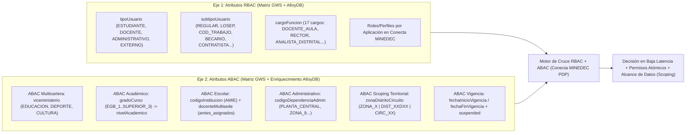

# Modelo de Autorización Híbrido RBAC + ABAC y Cruce con la Matriz de Atributos GWS

## 1. Cómo Funciona el Cruce `RBAC + ABAC` en Conecta MINEDEC (`5.3.4` + `Matriz de Atributos GWS`)

En **Conecta MINEDEC (Subcomponente C2.2)** la autorización **nunca** se decide únicamente por un rol plano ni únicamente por un atributo aislado: **toda decisión sobre una ruta protegida es el resultado del cruce entre el eje RBAC (qué función/rol ejerce el usuario) y el eje ABAC (en qué cartera, nivel académico, plantel AMIE, sede administrativa, jurisdicción territorial y ventana de vigencia lo ejerce)**, alimentados por los atributos de la [Matriz Maestra Canónica de Atributos GWS](matriz-atributos-gws-catalogos.md) y enriquecidos en AlloyDB.

---

## 2. Desglose de las Dimensiones del Cruce `RBAC × ABAC`

### 2.1 Eje RBAC (Proveniente de la Matriz GWS y Conecta MINEDEC)
1. **Nivel 1 — Tipología Macro (`tipoUsuario`, ID `9.0`)**:
   - Define el rol base institucional (`ESTUDIANTE`, `DOCENTE`, `ADMINISTRATIVO`, `EXTERNO`).
2. **Nivel 2 — Régimen o Condición Jurídica (`subtipoUsuario`, ID `10.0`)**:
   - Permite acotar permisos según la relación contractual (`REGULAR`, `LOSEP`, `COD_TRABAJO`, `HONORARIOS_PROFESIONALES`, `BECARIO`, `DEVENGANTE`, `PASANTE`, `CONTRATISTA`, `JUBILADO`, `REPRESENTANTE_LEGAL`, `DIRECTIVO`, `ADMINISTRATIVO_SEDE`).
   - *Ejemplo de cruce*: Un usuario con `cargoFuncion == 'ANALISTA_DISTRITAL'` pero `subtipoUsuario == 'PASANTE'` puede tener permiso de consulta en una aplicación, pero bloqueada la acción de aprobación definitiva.
3. **Nivel 3 — Cargo o Función Institucional (`cargoFuncion`, ID `11.0`)**:
   - Provee los **17 cargos canónicos de RBAC fino** (`DOCENTE_AULA`, `RECTOR`, `VICERRECTOR`, `INSPECTOR_GENERAL`, `SUBINSPECTOR`, `DOCENTE_TUTOR`, `ORIENTADOR_DECE`, `ASESOR_EDUCATIVO`, `ANALISTA_DISTRITAL`, `COORDINADOR_ZONAL`, `DIRECTOR_PLANTA_CENTRAL`, `SUPER_ADMIN_MINEDEC`, `AUDITOR_SISTEMAS`, `TECNICO_SOPORTE`, `CONSULTOR_EXTERNO`, `PROVEEDOR_TI`, `AUDITOR_CONTROL_INTERNO`).
4. **Nivel 4 — Roles y Permisos Atómicos Propios de cada Aplicación (en AlloyDB)**:
   - Cada Administrador de Aplicativo puede mapear automáticamente los atributos RBAC/ABAC de la Matriz GWS hacia **Roles y Permisos Atómicos** de su sistema mediante **Grupos Lógicos**, o asignar roles específicos adicionales en `usuario_rol_aplicacion`.

### 2.2 Eje ABAC (Condiciones Contextuales y Scoping de Datos de la Matriz GWS)
1. **ABAC de Segregación Multicartera (`viceministerio`, ID `17.0`)**:
   - Separa el acceso entre las tres carteras ministeriales (`EDUCACION`, `DEPORTE`, `CULTURA`). Una aplicación o módulo exclusivo de `DEPORTE` rechaza solicitudes de usuarios cuya cartera sea distinta, aun si comparten el mismo `cargoFuncion`.
2. **ABAC Académico (`gradoCurso` ID `12.0` y `nivelAcademico` ID `13.0`)**:
   - Permite que los **~2,1 millones de estudiantes** accedan a plataformas según su subnivel (`EGB_PREPARATORIA`, `EGB_ELEMENTAL`, `EGB_MEDIA`, `EGB_SUPERIOR`, `BGU`, `EDUCACION_SUPERIOR`) **sin insertar millones de filas en tablas de roles** (`D-06`).
   - Si un estudiante cae en `SIN_NIVEL`, el motor aplica la política restrictiva de fallback y genera alerta para reclasificación.
3. **ABAC Territorial Escolar y Plazas Múltiples (`codigoInstitucion` ID `14.0` + `docenteMultisede` ID `18.0`)**:
   - Acota los datos que un `RECTOR`, `INSPECTOR_GENERAL` o `DOCENTE_AULA` puede ver o modificar al código AMIE de su establecimiento (`17H00001`).
   - Cuando `docenteMultisede == TRUE`, Conecta MINEDEC cruza el `codigoInstitucion` principal de la Matriz GWS con la lista de planteles complementarios en `asignacion_contexto` de AlloyDB y devuelve ambos en `amie_titular` y `amies_asignados` (cabeceras `X-Minedec-AMIE` y `X-Minedec-AMIEs`).
4. **ABAC Administrativo (`codigoDependenciaAdmin` ID `15.0`)**:
   - Para `tipoUsuario == 'ADMINISTRATIVO'`, separa el ámbito de trabajo (`PLANTA_CENTRAL`, `ZONA_9`, `DIST_17D01`) de los códigos AMIE escolares.
5. **ABAC de Alcance Jurisdiccional (`zonaDistritoCircuito` ID `16.0`)**:
   - Formato canónico `ZONA_[0-9]{1,2} | DIST_[0-9]{2}D[0-9]{2} | CIRC_[0-9]{2}`.
   - Permite que un `COORDINADOR_ZONAL` tenga alcance sobre todos los distritos y planteles de su `ZONA_9`, mientras que un `ANALISTA_DISTRITAL` solo tenga alcance sobre `DIST_17D01`, y un `RECTOR` solo sobre su `codigoInstitucion`.
6. **ABAC de Vigencia Programada (`fechaInicioVigencia` ID `19.0` y `fechaFinVigencia` ID `20.0`)**:
   - Obligatorio para `tipoUsuario == 'EXTERNO'` y para los subtipos temporales (`BECARIO`, `DEVENGANTE`, `PASANTE`, `CONTRATISTA`, `HONORARIOS_PROFESIONALES`).
   - Como Google Cloud Identity e IAP no bloquean automáticamente el inicio de sesión por estas dos fechas personalizadas, **Conecta MINEDEC evalúa en cada llamada a `POST /api/v1/access/evaluation` que `fecha_actual BETWEEN fechaInicioVigencia AND fechaFinVigencia`** (devolviendo `autorizado: false` con `AUTHZ_OUTSIDE_VALIDITY_WINDOW` si está fuera de rango), además del proceso programado de suspensión al vencer.

---

## 3. Ejemplos Reales de Reglas de Cruce `RBAC + ABAC` en Grupos Lógicos

| Caso de Uso | Expresión Declarativa del Grupo Lógico en Conecta MINEDEC (RBAC + ABAC) | Resultado Entregado en `/api/v1/access/evaluation` |
| :--- | :--- | :--- |
| **1. Estudiante de Bachillerato ingresando a plataforma de orientación vocacional** | `tipoUsuario == 'ESTUDIANTE' && subtipoUsuario == 'REGULAR' && nivelAcademico == 'BGU' && viceministerio == 'EDUCACION'` | `autorizado: true`, `roles: ["ESTUDIANTE_BGU"]`, `amie_titular: codigoInstitucion` |
| **2. Docente multisede registrando calificaciones** | `tipoUsuario == 'DOCENTE' && cargoFuncion in ['DOCENTE_AULA', 'DOCENTE_TUTOR'] && subtipoUsuario in ['LOSEP', 'COD_TRABAJO', 'REGULAR']` | `autorizado: true`, `roles: ["DOCENTE_CALIFICADOR"]`, `amie_titular: "17H00001"`, `amies_asignados: ["17H00001", "17H00456"]` (resuelto en AlloyDB porque `docenteMultisede == true`) |
| **3. Analista Distrital validando distributivo de su distrito** | `tipoUsuario == 'ADMINISTRATIVO' && cargoFuncion == 'ANALISTA_DISTRITAL' && zonaDistritoCircuito.contains('DIST_')` | `autorizado: true`, `roles: ["VALIDADOR_DISTRITAL"]`, `nivel_jurisdiccion: "DISTRITAL"`, `distrito: "17D01"` (solo ve datos de su distrito) |
| **4. Consultor Externo o Pasante con contrato temporal** | `cargoFuncion == 'CONSULTOR_EXTERNO' && subtipoUsuario in ['CONTRATISTA', 'PASANTE', 'HONORARIOS_PROFESIONALES'] && HOY >= fechaInicioVigencia && HOY <= fechaFinVigencia` | Si está dentro de fechas: `autorizado: true`. Si `HOY > fechaFinVigencia`: `autorizado: false` (`AUTHZ_OUTSIDE_VALIDITY_WINDOW`). |

---

## 4. Normalización Estricta y Evaluación del Catálogo de Rutas (`5.1.4`)

Antes de ejecutar el cruce RBAC + ABAC sobre `ruta_solicitada`, el motor PDP aplica una tubería determinista de **normalización de rutas**:
1. Decodifica secuencias percent-encoded válidas y rechaza con **`HTTP 400 Bad Request`** cualquier ruta ambigua, con doble codificación maliciosa, bytes nulos (`%00`) o intento de *path traversal* (`..` fuera de raíz).
2. Evalúa el catálogo de rutas por orden de especificidad (**Exacta** → **Prefijo más largo** → **Extensión** → **Regla por defecto de la aplicación**: `PUBLICA`, `AUTENTICADA` o `PROTEGIDA`).
3. Si la ruta es `PROTEGIDA`, ejecuta el cruce **RBAC + ABAC** usando la ficha en caché de **Memorystore Redis (`TTL = 300 s`)** y retorna la decisión junto con el `idInterno`, `numeroIdentificacion`, `roles` y `contexto_territorial` enriquecido.

---

## 5. Documentos Relacionados

- [Matriz Maestra Canónica de Atributos GWS, Catálogos Cerrados, OUs y Scopes API](matriz-atributos-gws-catalogos.md)
- [Esquema de Identidad `MINEDEC_Perfil` y Modelo de Datos en AlloyDB](identidad-esquema-minedec-perfil.md)
- [Contrato Formal de Autorización PEP–PDP](../arquitectura/contrato-autorizacion-pep-pdp.md)
