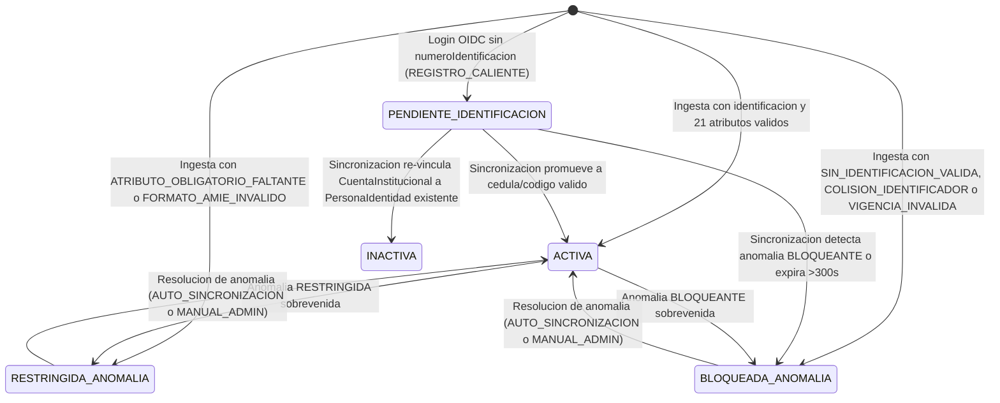
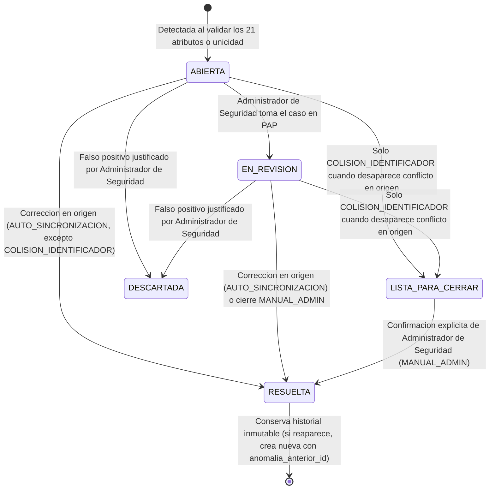

# Data Model: Base de Identidades en Dos Niveles, Catálogos Parametrizables y Esquema MINEDEC_Perfil

**Feature**: `001-modelo-identidades-perfil` | **Date**: 2026-10-19 | **Spec**: [spec.md](file:///C:/Users/anarvaez/Documents/Projects/MINEDEC/SSO/Desarrollo/minedec-sso/specs/001-modelo-identidades-perfil/spec.md) | **Research**: [research.md](file:///C:/Users/anarvaez/Documents/Projects/MINEDEC/SSO/Desarrollo/minedec-sso/specs/001-modelo-identidades-perfil/research.md) | **DBML Etapa 1**: [etapa-1-identidad-pip-auditoria.dbml](file:///C:/Users/anarvaez/Documents/Projects/MINEDEC/SSO/Desarrollo/minedec-sso/docs/esquemas-bd/etapa-1-identidad-pip-auditoria.dbml) | **DDL**: [001_init_pip_identity_schema.sql](file:///C:/Users/anarvaez/Documents/Projects/MINEDEC/SSO/Desarrollo/microservicios/pip-identity-service/migrations/001_init_pip_identity_schema.sql)

---

## 1. Visión General de Almacenamiento (3FN Pura — Alcance Exclusivo Personas Naturales)

El modelo de datos del **Policy Information Point (PIP)** de Conecta MINEDEC (Subcomponente C2.2) en la Feature `001-modelo-identidades-perfil` está normalizado en **Tercera Forma Normal (3FN) pura** y se divide en dos capas:

1. **Capa de Persistencia Primaria (AlloyDB for PostgreSQL 16)**:
   - **Separación estricta en 3FN de 3 niveles de datos**:
     1. **`persona_identidad` (Nivel 1 — Raíz Civil y Demográfica)**: Almacena exclusivamente los atributos intrínsecos de la **persona física / natural** (`id_interno` UUID v4 como llave primaria técnica inmutable, `(tipo_identificacion, numero_identificacion)` en `CEDULA`, `PASAPORTE` o `CODIGO_MINEDEC`, `codigo_minedec_anterior`, `nombre_completo`, `fecha_nacimiento`, `representante_legal_cedula`, `estado_persona`). No mezcla roles ni sedes en la raíz civil, evitando anomalías de actualización cuando un docente es simultáneamente estudiante o administrativo en otro subdominio del tenant.
     2. **`cuenta_institucional` (Nivel 2 — Perfil Poblacional por Subdominio)**: Almacena la cuenta de Google Workspace (`google_sub_id`, `email_principal`, `dominio` referenciando `dominio_institucional`, `org_unit_path`, `given_name`, `family_name`) y el perfil poblacional/académico/temporal de esa cuenta (`tipo_usuario`, `subtipo_usuario`, `cargo_funcion`, `grado_curso`, `nivel_academico_derivado`, `docente_multisede`, `fecha_inicio_vigencia`, `fecha_fin_vigencia`, `suspended_en_gws`, `estado_sincronizacion`, `origen_ultima_sincronizacion`).
     3. **`asignacion_contexto` + `catalogo_territorio_sede` (Nivel 3 — Contexto Territorial y Multisede en 3FN)**: Almacena las asignaciones territoriales/organizacionales (`GWS_PRIMARIO` y `PAP_DELEGADO`) vinculadas mediante llave foránea a `catalogo_territorio_sede(codigo_amie)`.
   - **Defensa en Profundidad en el Motor AlloyDB**:
     - Trigger `trg_enforce_cedula_immutability` (`BEFORE UPDATE ON persona_identidad`): Garantiza físicamente que una vez consolidada `tipo_identificacion = 'CEDULA'`, ni el tipo ni el número de documento puedan mutar (`Principio X.2`).
     - Trigger `trg_enforce_auditoria_append_only` (`BEFORE UPDATE OR DELETE ON auditoria_evento`): Garantiza físicamente que la bitácora transaccional sea `append-only` (`Principio XV`).
     - Serialización de la cadena hash SHA-256 mediante bloqueo consultivo transaccional `SELECT pg_advisory_xact_lock(2026022001)` antes de leer `hash_evento_sha256` previo.
     - Índices funcionales `uq_cuenta_email_lower` (`LOWER(email_principal)`) y `uq_dominio_lower` (`LOWER(dominio)`) para evitar *Sequential Scans* en un universo de ~4,5 millones de usuarios.
2. **Capa de Caché L2 de Baja Latencia (Memorystore for Redis)**:
   - Almacena proyecciones serializadas de identidad y contexto (`minedec:pip:*`) con **`TTL <= 300 segundos`** duro e innegociable (`RF-AU-09`, `Constitución IV`).
   - Invalidación reactiva en **`< 5 segundos`** (camino nominal) mediante borrado atómico `UNLINK` y notificación en Cloud Pub/Sub (`sso-pip-cache-invalidation`).

---

## 2. Diagrama Entidad-Relación (AlloyDB for PostgreSQL 16 — 3FN Pura)

```mermaid
erDiagram
    DOMINIO_INSTITUCIONAL ||--o{ CUENTA_INSTITUCIONAL : "clasifica (dominio)"
    CATALOGO_ATRIBUTO_MINEDEC ||--o{ CATALOGO_ATRIBUTO_MINEDEC : "jerarquia (codigo_padre)"
    CATALOGO_TERRITORIO_SEDE ||--o{ ASIGNACION_CONTEXTO : "sede asignada (codigo_amie)"
    PERSONA_IDENTIDAD ||--o{ CUENTA_INSTITUCIONAL : "posee (1:N)"
    PERSONA_IDENTIDAD ||--o{ ASIGNACION_CONTEXTO : "opera en (1:N multisede)"
    CUENTA_INSTITUCIONAL ||--o{ ASIGNACION_CONTEXTO : "vincula contexto primario (0:N)"
    PERSONA_IDENTIDAD ||--o{ ANOMALIA_IDENTIDAD : "registra (0:N)"
    CUENTA_INSTITUCIONAL ||--o{ ANOMALIA_IDENTIDAD : "origina (0:N)"
    ANOMALIA_IDENTIDAD ||--o| ANOMALIA_IDENTIDAD : "recurrencia (anomalia_anterior_id)"
    PERSONA_IDENTIDAD ||--o{ AUDITORIA_EVENTO : "actor (actor_id_interno)"

    DOMINIO_INSTITUCIONAL {
        varchar dominio PK "VARCHAR(120) educacion.gob.ec | docentes.educacion.gob.ec | estudiante.edu.ec"
        varchar google_customer_id "VARCHAR(64) NOT NULL (ej. C01MINEDEC01)"
        varchar tipo_poblacion "ESTUDIANTE | DOCENTE | ADMINISTRATIVO | MIXTO"
        boolean es_subdominio "NOT NULL DEFAULT false"
        boolean activo "NOT NULL DEFAULT true"
        timestamptz creado_en
        timestamptz actualizado_en
    }

    CATALOGO_ATRIBUTO_MINEDEC {
        uuid catalogo_id PK "DEFAULT gen_random_uuid()"
        varchar categoria_atributo "11 categorias canonicas"
        varchar codigo_valor "VARCHAR(64) NOT NULL"
        varchar codigo_padre "VARCHAR(64) NULL"
        varchar etiqueta_visible "VARCHAR(160) NOT NULL"
        varchar nivel_academico_derivado "VARCHAR(32) NULL"
        boolean requiere_vigencia_temporal "NOT NULL DEFAULT false"
        jsonb metadatos_regla "NOT NULL DEFAULT '{}' (incluye sinonimosOrigen)"
        boolean activo "NOT NULL DEFAULT true"
        timestamptz creado_en
        timestamptz actualizado_en
    }

    CATALOGO_TERRITORIO_SEDE {
        varchar codigo_amie PK "VARCHAR(8) regex ^(0[1-9]|1[0-9]|2[0-4]|90)[A-Z][0-9]{5}$"
        varchar nombre_institucion "VARCHAR(200) NOT NULL"
        varchar codigo_zona "VARCHAR(4) NOT NULL (01..09, 10..24, 90)"
        varchar codigo_distrito "VARCHAR(8) NULL"
        varchar codigo_circuito "VARCHAR(12) NULL"
        varchar provincia_dpa "VARCHAR(2) NULL"
        varchar canton_dpa "VARCHAR(4) NULL"
        varchar parroquia_dpa "VARCHAR(6) NULL"
        varchar regimen_escolar "COSTA_GALAPAGOS | SIERRA_AMAZONIA | NO_APLICA"
        varchar sostenimiento "FISCAL | FISCOMISIONAL | MUNICIPAL | PARTICULAR"
        varchar modalidad_educativa "PRESENCIAL | SEMIPRESENCIAL | A_DISTANCIA | VIRTUAL | NO_APLICA"
        varchar jornada "MATUTINA | VESPERTINA | NOCTURNA | INTENSIVA | NO_APLICA"
        boolean activo "NOT NULL DEFAULT true"
        timestamptz creado_en
        timestamptz actualizado_en
    }

    PERSONA_IDENTIDAD {
        uuid id_interno PK "PK tecnica inmutable UUID v4"
        varchar tipo_identificacion "CEDULA | PASAPORTE | CODIGO_MINEDEC"
        varchar numero_identificacion UK "VARCHAR(64) NOT NULL (inmutable si CEDULA)"
        varchar codigo_minedec_anterior UK "VARCHAR(64) NULL"
        varchar nombre_completo "VARCHAR(250) NOT NULL"
        date fecha_nacimiento "DATE NULL"
        varchar representante_legal_cedula "VARCHAR(10) NULL"
        varchar estado_persona "ACTIVA | PENDIENTE_IDENTIFICACION | RESTRINGIDA_ANOMALIA | BLOQUEADA_ANOMALIA | INACTIVA"
        timestamptz creado_en
        timestamptz actualizado_en
    }

    CUENTA_INSTITUCIONAL {
        uuid cuenta_id PK "DEFAULT gen_random_uuid()"
        uuid id_interno FK "NOT NULL REFERENCES persona_identidad(id_interno)"
        varchar google_sub_id UK "VARCHAR(64) NOT NULL UNIQUE"
        varchar email_principal UK "VARCHAR(254) NOT NULL UNIQUE"
        varchar dominio FK "VARCHAR(120) NOT NULL REFERENCES dominio_institucional(dominio)"
        varchar org_unit_path "VARCHAR(512) NOT NULL DEFAULT '/'"
        varchar given_name "VARCHAR(120) NULL"
        varchar family_name "VARCHAR(120) NULL"
        varchar tipo_usuario "ESTUDIANTE | DOCENTE | ADMINISTRATIVO | EXTERNO"
        varchar subtipo_usuario "VARCHAR(40) NULL"
        varchar cargo_funcion "VARCHAR(64) NULL"
        varchar grado_curso "VARCHAR(32) NULL"
        varchar nivel_academico_derivado "VARCHAR(32) NULL"
        boolean docente_multisede "NOT NULL DEFAULT false"
        date fecha_inicio_vigencia "DATE NULL"
        date fecha_fin_vigencia "DATE NULL"
        boolean suspended_en_gws "NOT NULL DEFAULT false"
        varchar estado_sincronizacion "SINCRONIZADA | REGISTRO_CALIENTE | SUSPENDIDA_GWS | VIGENCIA_VENCIDA | BLOQUEADA_ANOMALIA"
        varchar origen_ultima_sincronizacion "VARCHAR(40) NULL"
        timestamptz ultima_sincronizacion_en
        timestamptz creado_en
        timestamptz actualizado_en
    }

    ASIGNACION_CONTEXTO {
        uuid asignacion_id PK "DEFAULT gen_random_uuid()"
        uuid id_interno FK "NOT NULL REFERENCES persona_identidad(id_interno)"
        uuid cuenta_id FK "NULL REFERENCES cuenta_institucional(cuenta_id)"
        varchar origen_datos "GWS_PRIMARIO | PAP_DELEGADO"
        boolean es_sede_primaria "NOT NULL DEFAULT false"
        varchar nivel_estructura "PLANTA_CENTRAL | ZONA | DISTRITO | CIRCUITO | INSTITUCION_EDUCATIVA"
        varchar viceministerio "EDUCACION | DEPORTE | CULTURA | GESTION_EDUCATIVA | NO_APLICA"
        varchar codigo_zona "VARCHAR(4) NOT NULL"
        varchar codigo_distrito "VARCHAR(8) NULL"
        varchar codigo_circuito "VARCHAR(12) NULL"
        varchar codigo_amie FK "VARCHAR(8) NULL REFERENCES catalogo_territorio_sede(codigo_amie)"
        varchar codigo_dependencia_admin "VARCHAR(160) NULL"
        varchar regimen_escolar "COSTA_GALAPAGOS | SIERRA_AMAZONIA | NO_APLICA"
        varchar modalidad_educativa "PRESENCIAL | SEMIPRESENCIAL | A_DISTANCIA | VIRTUAL | NO_APLICA"
        varchar jornada "MATUTINA | VESPERTINA | NOCTURNA | INTENSIVA | NO_APLICA"
        boolean activo "NOT NULL DEFAULT true"
        varchar asignado_por_identificacion "VARCHAR(64) NULL"
        text motivo_asignacion "TEXT NULL"
        timestamptz creado_en
        timestamptz actualizado_en
    }

    ANOMALIA_IDENTIDAD {
        uuid anomalia_id PK "DEFAULT gen_random_uuid()"
        uuid anomalia_anterior_id FK "NULL REFERENCES anomalia_identidad(anomalia_id)"
        uuid id_interno FK "NULL REFERENCES persona_identidad(id_interno)"
        uuid cuenta_id FK "NULL REFERENCES cuenta_institucional(cuenta_id)"
        varchar google_sub_id "VARCHAR(64) NOT NULL"
        varchar email_principal "VARCHAR(254) NOT NULL"
        varchar dominio "VARCHAR(120) NOT NULL"
        varchar codigo_causal "SIN_IDENTIFICACION_VALIDA | COLISION_IDENTIFICADOR | VIGENCIA_INVALIDA | ATRIBUTO_OBLIGATORIO_FALTANTE | FORMATO_AMIE_INVALIDO"
        varchar efecto_acceso "BLOQUEANTE | RESTRINGIDA"
        varchar estado_anomalia "ABIERTA | EN_REVISION | LISTA_PARA_CERRAR | RESUELTA | DESCARTADA"
        varchar origen_resolucion "AUTO_SINCRONIZACION | MANUAL_ADMIN"
        varchar resuelta_por_identificacion "VARCHAR(64) NULL"
        text motivo_resolucion "TEXT NULL"
        jsonb valor_anterior "JSONB NULL"
        jsonb valor_nuevo "JSONB NULL"
        text detalle_tecnico "TEXT NOT NULL"
        timestamptz detectada_en
        timestamptz resuelta_en
    }

    AUDITORIA_EVENTO {
        uuid evento_id PK "DEFAULT gen_random_uuid()"
        varchar tipo_evento "VARCHAR(64) NOT NULL"
        uuid actor_id_interno FK "NULL REFERENCES persona_identidad(id_interno)"
        varchar actor_identificacion "VARCHAR(64) NOT NULL"
        varchar sujeto_identificacion "VARCHAR(64) NULL"
        varchar correo_afectado "VARCHAR(254) NULL"
        varchar origen_canal "PIP_INGEST | LOGIN_JIT | PAP_ADMIN"
        varchar entidad_afectada "VARCHAR(64) NOT NULL"
        varchar registro_afectado_id "VARCHAR(128) NOT NULL"
        jsonb valores_anteriores "JSONB NULL"
        jsonb valores_nuevos "JSONB NULL"
        char hash_evento_anterior_sha256 "CHAR(64) NOT NULL"
        char hash_evento_sha256 UK "CHAR(64) NOT NULL UNIQUE"
        timestamptz fecha_evento
    }
```

---

## 3. Especificación de las 8 Tablas Relacionales (AlloyDB — Etapa 1)

### 3.1. `dominio_institucional` (`DominioInstitucional`)

Catálogo de dominios y subdominios institucionales de correo gestionados en modo de solo lectura dentro del **único tenant corporativo de Google Workspace** (`RF-GI-01`, `D-01`, `D-21`, `FR-001`).

| Columna | Tipo PostgreSQL | Restricciones | Descripción |
|---------|-----------------|---------------|-------------|
| `dominio` | `VARCHAR(120)` | `PRIMARY KEY` | Dominio o subdominio en minúsculas (`educacion.gob.ec`, `docentes.educacion.gob.ec`, `estudiante.edu.ec`) |
| `google_customer_id` | `VARCHAR(64)` | `NOT NULL` | Customer ID del único tenant de Google Workspace del MINEDEC (`C01MINEDEC01`) |
| `tipo_poblacion` | `VARCHAR(40)` | `NOT NULL CHECK (tipo_poblacion IN ('ESTUDIANTE', 'DOCENTE', 'ADMINISTRATIVO', 'MIXTO'))` | Segmentación poblacional del subdominio dentro del tenant único |
| `es_subdominio` | `BOOLEAN` | `NOT NULL DEFAULT false` | `true` para subdominios dedicados por población dentro del mismo tenant |
| `activo` | `BOOLEAN` | `NOT NULL DEFAULT true` | Estado de habilitación para sincronización y resolución |
| `creado_en` | `TIMESTAMPTZ` | `NOT NULL DEFAULT NOW()` | Fecha de registro |
| `actualizado_en` | `TIMESTAMPTZ` | `NOT NULL DEFAULT NOW()` | Fecha de última modificación |

- **Índices**:
  - `CREATE UNIQUE INDEX uq_dominio_lower ON dominio_institucional (LOWER(dominio));`
  - `CREATE INDEX idx_dominio_customer_activo ON dominio_institucional (google_customer_id, activo);`

---

### 3.2. `catalogo_atributo_minedec` (`CatalogoAtributoMinedec`)

Catálogo parametrizable en base de datos (3FN) para validar los valores permitidos de `MINEDEC_Perfil` (`D-03`, `FR-004`, `FR-005`), derivar `nivel_academico_derivado` desde `GRADO_CURSO` y homologar sinónimos de origen (`sinonimosOrigen` en `metadatos_regla` para `FO-DNTIC-20`).

| Columna | Tipo PostgreSQL | Restricciones | Descripción |
|---------|-----------------|---------------|-------------|
| `catalogo_id` | `UUID` | `PRIMARY KEY DEFAULT gen_random_uuid()` | Identificador de la entrada de catálogo |
| `categoria_atributo` | `VARCHAR(40)` | `NOT NULL CHECK (...)` | `TIPO_IDENTIFICACION`, `TIPO_USUARIO`, `SUBTIPO_USUARIO`, `CARGO_FUNCION`, `GRADO_CURSO`, `NIVEL_ACADEMICO`, `VICEMINISTERIO`, `NIVEL_ESTRUCTURA`, `REGIMEN_ESCOLAR`, `MODALIDAD_EDUCATIVA`, `JORNADA` |
| `codigo_valor` | `VARCHAR(64)` | `NOT NULL` | Valor canónico en mayúsculas (ej. `DOCENTE_NOMBRAMIENTO`, `8EGB`, `EDUCACION_SUPERIOR`) |
| `codigo_padre` | `VARCHAR(64)` | `NULL` | Para `SUBTIPO_USUARIO`, referencia el código de `TIPO_USUARIO` padre (`ESTUDIANTE`, `DOCENTE`, `ADMINISTRATIVO`, `EXTERNO`) |
| `etiqueta_visible` | `VARCHAR(160)` | `NOT NULL` | Etiqueta legible en español |
| `nivel_academico_derivado` | `VARCHAR(32)` | `NULL` | Exclusivo para `GRADO_CURSO`: código de `NIVEL_ACADEMICO` derivado determinísticamente |
| `requiere_vigencia_temporal` | `BOOLEAN` | `NOT NULL DEFAULT false` | `true` cuando el subtipo o población exige `fecha_inicio_vigencia` y `fecha_fin_vigencia` |
| `metadatos_regla` | `JSONB` | `NOT NULL DEFAULT '{}'::jsonb` | Diccionario `sinonimosOrigen` y banderas de validación (`requiereRepresentanteMenorEdad`, etc.) |
| `activo` | `BOOLEAN` | `NOT NULL DEFAULT true` | Habilitado para validación (borrado lógico) |
| `creado_en` | `TIMESTAMPTZ` | `NOT NULL DEFAULT NOW()` | Fecha de creación |
| `actualizado_en` | `TIMESTAMPTZ` | `NOT NULL DEFAULT NOW()` | Fecha de última actualización |

- **Restricciones e Índices**:
  - `CONSTRAINT uq_catalogo_categoria_codigo UNIQUE (categoria_atributo, codigo_valor)`
  - `CREATE INDEX idx_catalogo_categoria_activo ON catalogo_atributo_minedec (categoria_atributo, activo);`

---

### 3.3. `catalogo_territorio_sede` (`CatalogoTerritorioSede`)

Tabla maestra en **3FN** que normaliza los atributos propios de la institución educativa (`codigo_amie`) y su jerarquía territorial (`AMIE -> Circuito -> Distrito -> Zona` y DPA INEC), homologada con `FO-DNTIC-20`.

| Columna | Tipo PostgreSQL | Restricciones | Descripción |
|---------|-----------------|---------------|-------------|
| `codigo_amie` | `VARCHAR(8)` | `PRIMARY KEY CHECK (codigo_amie ~ '^(0[1-9]|1[0-9]|2[0-4]|90)[A-Z][0-9]{5}$')` | Código AMIE oficial de 8 caracteres (preserva cero inicial `01`–`09`) |
| `nombre_institucion` | `VARCHAR(200)` | `NOT NULL` | Nombre oficial de la institución educativa |
| `codigo_zona` | `VARCHAR(4)` | `NOT NULL CHECK (codigo_zona ~ '^(0[1-9]|1[0-9]|2[0-4]|90)$')` | Código de zona preservando cero inicial (`01`–`09`, `10`–`24`, `90`) |
| `codigo_distrito` | `VARCHAR(8)` | `NULL` | Código de distrito (ej. `17D05`; anulable para registros `FO-DNTIC-20` sin distrito) |
| `codigo_circuito` | `VARCHAR(12)` | `NULL` | Código de circuito (ej. `17D05C01`; anulable para registros `FO-DNTIC-20` sin circuito) |
| `provincia_dpa` | `VARCHAR(2)` | `NULL` | Provincia DPA INEC (`01`–`24`, `90`) |
| `canton_dpa` | `VARCHAR(4)` | `NULL` | Cantón DPA INEC |
| `parroquia_dpa` | `VARCHAR(6)` | `NULL` | Parroquia DPA INEC |
| `regimen_escolar` | `VARCHAR(24)` | `NOT NULL DEFAULT 'SIERRA_AMAZONIA' CHECK (regimen_escolar IN ('COSTA_GALAPAGOS', 'SIERRA_AMAZONIA', 'NO_APLICA'))` | Régimen escolar canónico |
| `sostenimiento` | `VARCHAR(30)` | `NULL CHECK (sostenimiento IS NULL OR sostenimiento IN ('FISCAL', 'FISCOMISIONAL', 'MUNICIPAL', 'PARTICULAR'))` | Sostenimiento institucional |
| `modalidad_educativa` | `VARCHAR(30)` | `NULL DEFAULT 'PRESENCIAL' CHECK (modalidad_educativa IS NULL OR modalidad_educativa IN ('PRESENCIAL', 'SEMIPRESENCIAL', 'A_DISTANCIA', 'VIRTUAL', 'NO_APLICA'))` | Modalidad educativa |
| `jornada` | `VARCHAR(24)` | `NULL DEFAULT 'MATUTINA' CHECK (jornada IS NULL OR jornada IN ('MATUTINA', 'VESPERTINA', 'NOCTURNA', 'INTENSIVA', 'NO_APLICA'))` | Jornada educativa |
| `activo` | `BOOLEAN` | `NOT NULL DEFAULT true` | Estado operativo del establecimiento |
| `creado_en` | `TIMESTAMPTZ` | `NOT NULL DEFAULT NOW()` | Fecha de creación |
| `actualizado_en` | `TIMESTAMPTZ` | `NOT NULL DEFAULT NOW()` | Fecha de última actualización |

- **Índice**: `CREATE INDEX idx_territorio_jerarquia ON catalogo_territorio_sede (codigo_zona, codigo_distrito, codigo_circuito);`

---

### 3.4. `persona_identidad` (`PersonaIdentidad` — Nivel 1: Raíz Civil en 3FN)

Entidad raíz que representa exclusivamente a la **persona física / natural** (`Constitución v2.7.0`, Principio X.2).

| Columna | Tipo PostgreSQL | Restricciones | Descripción |
|---------|-----------------|---------------|-------------|
| `id_interno` | `UUID` | `PRIMARY KEY DEFAULT gen_random_uuid()` | Llave primaria técnica inmutable UUID v4. Protege FKs y `auditoria_evento` (`append-only`) |
| `tipo_identificacion` | `VARCHAR(20)` | `NOT NULL CHECK (tipo_identificacion IN ('CEDULA', 'PASAPORTE', 'CODIGO_MINEDEC'))` | Tipo de documento de persona natural |
| `numero_identificacion` | `VARCHAR(64)` | `NOT NULL UNIQUE` | Documento con preservación de `0` inicial (`01`–`09`) o marcador `TEMP-<googleSubId>` en `PENDIENTE_IDENTIFICACION`. Estrictamente inmutable una vez consolidado como `CEDULA` |
| `codigo_minedec_anterior` | `VARCHAR(64)` | `NULL UNIQUE` | Conserva el `CODIGO_MINEDEC` previo tras la transición unidireccional a `CEDULA` (`FR-011`) |
| `nombre_completo` | `VARCHAR(250)` | `NOT NULL` | Nombre completo de la persona natural |
| `fecha_nacimiento` | `DATE` | `NULL` | Fecha de nacimiento (prevalece para calcular minoría de edad `< 18 años` en `FR-006`) |
| `representante_legal_cedula` | `VARCHAR(10)` | `NULL` | Cédula de 10 dígitos (Módulo 10) del representante legal para estudiantes menores de edad |
| `estado_persona` | `VARCHAR(32)` | `NOT NULL DEFAULT 'ACTIVA' CHECK (estado_persona IN ('ACTIVA', 'PENDIENTE_IDENTIFICACION', 'RESTRINGIDA_ANOMALIA', 'BLOQUEADA_ANOMALIA', 'INACTIVA'))` | Estado consolidado de la identidad civil |
| `creado_en` | `TIMESTAMPTZ` | `NOT NULL DEFAULT NOW()` | Fecha de creación |
| `actualizado_en` | `TIMESTAMPTZ` | `NOT NULL DEFAULT NOW()` | Fecha de última actualización |

- **Restricciones, Índices y Triggers**:
  - `CONSTRAINT uq_persona_tipo_numero_id UNIQUE (tipo_identificacion, numero_identificacion)`
  - `CONSTRAINT uq_persona_numero_identificacion UNIQUE (numero_identificacion)`
  - `TRIGGER trg_enforce_cedula_immutability BEFORE UPDATE ON persona_identidad` — Impide en el motor de base de datos cualquier mutación de `tipo_identificacion` o `numero_identificacion` cuando `OLD.tipo_identificacion = 'CEDULA'`.

---

### 3.5. `cuenta_institucional` (`CuentaInstitucional` — Nivel 2: Perfil por Subdominio en 3FN)

Vincula cada cuenta de los subdominios del único tenant de Google Workspace con la `persona_identidad` unificada y almacena el perfil poblacional, académico y temporal propio de esa cuenta (`FR-001`, `FR-002`, `FR-012`).

| Columna | Tipo PostgreSQL | Restricciones | Descripción |
|---------|-----------------|---------------|-------------|
| `cuenta_id` | `UUID` | `PRIMARY KEY DEFAULT gen_random_uuid()` | Identificador interno de la cuenta |
| `id_interno` | `UUID` | `NOT NULL REFERENCES persona_identidad(id_interno)` | Persona física titular |
| `google_sub_id` | `VARCHAR(64)` | `NOT NULL UNIQUE` | `id` / `sub` inmutable de Google Workspace Directory API |
| `email_principal` | `VARCHAR(254)` | `NOT NULL UNIQUE` | `primaryEmail` normalizado en minúsculas |
| `dominio` | `VARCHAR(120)` | `NOT NULL REFERENCES dominio_institucional(dominio)` | Subdominio institucional al que pertenece la cuenta |
| `org_unit_path` | `VARCHAR(512)` | `NOT NULL DEFAULT '/'` | `orgUnitPath` en Google Workspace |
| `given_name` | `VARCHAR(120)` | `NULL` | Nombres (`name.givenName`) |
| `family_name` | `VARCHAR(120)` | `NULL` | Apellidos (`name.familyName`) |
| `tipo_usuario` | `VARCHAR(40)` | `NULL CHECK (tipo_usuario IS NULL OR tipo_usuario IN ('ESTUDIANTE', 'DOCENTE', 'ADMINISTRATIVO', 'EXTERNO', 'DOCENTE_ADMINISTRATIVO', 'CIUDADANO_EXTERNO'))` | Población de la cuenta |
| `subtipo_usuario` | `VARCHAR(40)` | `NULL` | Subtipo validado jerárquicamente contra `catalogo_atributo_minedec` |
| `cargo_funcion` | `VARCHAR(64)` | `NULL` | Cargo o función institucional |
| `grado_curso` | `VARCHAR(32)` | `NULL` | Grado o curso (`INICIAL_1..2`, `1EGB..10EGB`, `1BGU..3BGU`, `SUPERIOR_1..3`) |
| `nivel_academico_derivado` | `VARCHAR(32)` | `NULL` | Nivel académico derivado determinísticamente desde `grado_curso` |
| `docente_multisede` | `BOOLEAN` | `NOT NULL DEFAULT false` | Habilita múltiples sedes activas en `asignacion_contexto` |
| `fecha_inicio_vigencia` | `DATE` | `NULL` | Inicio de vigencia temporal para contratos, honorarios y externos |
| `fecha_fin_vigencia` | `DATE` | `NULL` | Fin de vigencia (`CHECK fecha_fin_vigencia >= fecha_inicio_vigencia`) |
| `suspended_en_gws` | `BOOLEAN` | `NOT NULL DEFAULT false` | Estado `suspended` reportado por Google Workspace |
| `estado_sincronizacion` | `VARCHAR(32)` | `NOT NULL DEFAULT 'SINCRONIZADA' CHECK (estado_sincronizacion IN ('SINCRONIZADA', 'REGISTRO_CALIENTE', 'SUSPENDIDA_GWS', 'VIGENCIA_VENCIDA', 'BLOQUEADA_ANOMALIA'))` | Estado operativo de sincronización de la cuenta |
| `origen_ultima_sincronizacion` | `VARCHAR(40)` | `NULL CHECK (...)` | `EVENTO_AUDIT_LOG`, `BARRIDO_DELTA_2MIN`, `CONCILIACION_BATCH`, `CONCILIACION_DIARIA`, `REGISTRO_CALIENTE_PRIORITARIO` |
| `ultima_sincronizacion_en` | `TIMESTAMPTZ` | `NOT NULL DEFAULT NOW()` | Marca de tiempo de la última sincronización |
| `creado_en` | `TIMESTAMPTZ` | `NOT NULL DEFAULT NOW()` | Fecha de creación |
| `actualizado_en` | `TIMESTAMPTZ` | `NOT NULL DEFAULT NOW()` | Fecha de última actualización |

- **Índices**:
  - `CREATE UNIQUE INDEX uq_cuenta_email_lower ON cuenta_institucional (LOWER(email_principal));`
  - `CREATE INDEX idx_cuenta_id_interno ON cuenta_institucional (id_interno);`
  - `CREATE INDEX idx_cuenta_dominio_estado ON cuenta_institucional (dominio, estado_sincronizacion);`
  - `CREATE INDEX idx_cuenta_rbac_tripleta ON cuenta_institucional (tipo_usuario, subtipo_usuario, cargo_funcion);`

---

### 3.6. `asignacion_contexto` (`AsignacionContexto` — Nivel 3: Territorio y Multisede en 3FN)

Permite almacenar el contexto territorial primario (`GWS_PRIMARIO`) y las sedes complementarias delegadas (`PAP_DELEGADO`) referenciando `catalogo_territorio_sede(codigo_amie)` en 3FN (`FR-010`, `US-3`).

| Columna | Tipo PostgreSQL | Restricciones | Descripción |
|---------|-----------------|---------------|-------------|
| `asignacion_id` | `UUID` | `PRIMARY KEY DEFAULT gen_random_uuid()` | Identificador de la asignación |
| `id_interno` | `UUID` | `NOT NULL REFERENCES persona_identidad(id_interno) ON DELETE CASCADE` | Persona física titular |
| `cuenta_id` | `UUID` | `NULL REFERENCES cuenta_institucional(cuenta_id) ON DELETE SET NULL` | Cuenta institucional asociada |
| `origen_datos` | `VARCHAR(24)` | `NOT NULL DEFAULT 'PAP_DELEGADO' CHECK (origen_datos IN ('GWS_PRIMARIO', 'PAP_DELEGADO'))` | Origen de la asignación |
| `es_sede_primaria` | `BOOLEAN` | `NOT NULL DEFAULT false` | `true` para la sede primaria sincronizada desde Google Workspace |
| `nivel_estructura` | `VARCHAR(40)` | `NOT NULL DEFAULT 'INSTITUCION_EDUCATIVA' CHECK (nivel_estructura IN ('PLANTA_CENTRAL', 'ZONA', 'DISTRITO', 'CIRCUITO', 'INSTITUCION_EDUCATIVA'))` | Ámbito estructural |
| `viceministerio` | `VARCHAR(40)` | `NOT NULL DEFAULT 'NO_APLICA' CHECK (viceministerio IN ('EDUCACION', 'DEPORTE', 'CULTURA', 'GESTION_EDUCATIVA', 'NO_APLICA'))` | Viceministerio asociado |
| `codigo_zona` | `VARCHAR(4)` | `NOT NULL CHECK (codigo_zona ~ '^(0[1-9]|1[0-9]|2[0-4]|90)$')` | Conserva ceros a la izquierda (`01`–`09`, `10`–`24`, `90`) |
| `codigo_distrito` | `VARCHAR(8)` | `NULL` | Código de distrito (`17D05`, `09D01`, etc.) |
| `codigo_circuito` | `VARCHAR(12)` | `NULL` | Código de circuito (`17D05C01`, etc.) |
| `codigo_amie` | `VARCHAR(8)` | `NULL REFERENCES catalogo_territorio_sede(codigo_amie)` | Llave foránea en 3FN hacia `catalogo_territorio_sede` |
| `codigo_dependencia_admin` | `VARCHAR(160)` | `NULL` | Dependencia administrativa central/zonal/distrital |
| `regimen_escolar` | `VARCHAR(24)` | `NOT NULL DEFAULT 'NO_APLICA' CHECK (regimen_escolar IN ('COSTA_GALAPAGOS', 'SIERRA_AMAZONIA', 'NO_APLICA'))` | Régimen escolar efectivo en la asignación |
| `modalidad_educativa` | `VARCHAR(30)` | `NOT NULL DEFAULT 'NO_APLICA' CHECK (modalidad_educativa IN ('PRESENCIAL', 'SEMIPRESENCIAL', 'A_DISTANCIA', 'VIRTUAL', 'NO_APLICA'))` | Modalidad educativa efectiva |
| `jornada` | `VARCHAR(24)` | `NOT NULL DEFAULT 'NO_APLICA' CHECK (jornada IN ('MATUTINA', 'VESPERTINA', 'NOCTURNA', 'INTENSIVA', 'NO_APLICA'))` | Jornada efectiva |
| `activo` | `BOOLEAN` | `NOT NULL DEFAULT true` | Estado activo de la asignación |
| `asignado_por_identificacion` | `VARCHAR(64)` | `NULL` | Identificación del actor o administrador que registró la asignación |
| `motivo_asignacion` | `TEXT` | `NULL` | Justificación administrativa |
| `creado_en` | `TIMESTAMPTZ` | `NOT NULL DEFAULT NOW()` | Fecha de creación |
| `actualizado_en` | `TIMESTAMPTZ` | `NOT NULL DEFAULT NOW()` | Fecha de última actualización |

---

### 3.7. `anomalia_identidad` (`AnomaliaIdentidad`)

Bandeja de anomalías de datos de identidad con bloqueo graduado (`BLOQUEANTE` vs `RESTRINGIDA`), auto-resolución (`AUTO_SINCRONIZACION`), cierre manual auditado (`MANUAL_ADMIN`) y encadenamiento por recurrencia (`anomalia_anterior_id`) (`FR-013`).

| Columna | Tipo PostgreSQL | Restricciones | Descripción |
|---------|-----------------|---------------|-------------|
| `anomalia_id` | `UUID` | `PRIMARY KEY DEFAULT gen_random_uuid()` | Identificador único de la anomalía |
| `anomalia_anterior_id` | `UUID` | `NULL REFERENCES anomalia_identidad(anomalia_id)` | Enlaza al registro histórico previo si la misma anomalía reaparece tras haberse resuelto |
| `id_interno` | `UUID` | `NULL REFERENCES persona_identidad(id_interno)` | Persona afectada |
| `cuenta_id` | `UUID` | `NULL REFERENCES cuenta_institucional(cuenta_id)` | Cuenta afectada |
| `google_sub_id` | `VARCHAR(64)` | `NOT NULL` | `sub` / `id` de Google Workspace de la cuenta afectada |
| `email_principal` | `VARCHAR(254)` | `NOT NULL` | Correo electrónico reportado |
| `dominio` | `VARCHAR(120)` | `NOT NULL` | Dominio o subdominio institucional |
| `codigo_causal` | `VARCHAR(40)` | `NOT NULL CHECK (codigo_causal IN ('SIN_IDENTIFICACION_VALIDA', 'COLISION_IDENTIFICADOR', 'VIGENCIA_INVALIDA', 'ATRIBUTO_OBLIGATORIO_FALTANTE', 'FORMATO_AMIE_INVALIDO'))` | Causal canónica de la anomalía |
| `efecto_acceso` | `VARCHAR(20)` | `NOT NULL CHECK (efecto_acceso IN ('BLOQUEANTE', 'RESTRINGIDA'))` | Nivel de bloqueo aplicado |
| `estado_anomalia` | `VARCHAR(24)` | `NOT NULL DEFAULT 'ABIERTA' CHECK (estado_anomalia IN ('ABIERTA', 'EN_REVISION', 'LISTA_PARA_CERRAR', 'RESUELTA', 'DESCARTADA'))` | Estado en el ciclo de vida de la bandeja |
| `origen_resolucion` | `VARCHAR(32)` | `NULL CHECK (origen_resolucion IS NULL OR origen_resolucion IN ('AUTO_SINCRONIZACION', 'MANUAL_ADMIN'))` | Vía por la cual se resolvió |
| `resuelta_por_identificacion` | `VARCHAR(64)` | `NULL` | Identificación del administrador o proceso que cerró la anomalía |
| `motivo_resolucion` | `TEXT` | `NULL` | Justificación de resolución (obligatoria con `>= 10` caracteres en `MANUAL_ADMIN`) |
| `valor_anterior` | `JSONB` | `NULL` | Snapshot de los valores erróneos previos |
| `valor_nuevo` | `JSONB` | `NULL` | Snapshot de los valores corregidos |
| `detalle_tecnico` | `TEXT` | `NOT NULL` | Descripción técnica de la discrepancia |
| `detectada_en` | `TIMESTAMPTZ` | `NOT NULL DEFAULT NOW()` | Fecha y hora de detección |
| `resuelta_en` | `TIMESTAMPTZ` | `NULL` | Fecha y hora de cierre |

---

### 3.8. `auditoria_evento` (`AuditoriaEvento` — Append-Only con Cadena SHA-256)

Tabla transaccional inmutable en AlloyDB (`Constitución XV`, `FR-014`). Protegida por privilegios `INSERT, SELECT`, por el trigger `trg_enforce_auditoria_append_only` y serializada transaccionalmente mediante `SELECT pg_advisory_xact_lock(2026022001)`.

| Columna | Tipo PostgreSQL | Restricciones | Descripción |
|---------|-----------------|---------------|-------------|
| `evento_id` | `UUID` | `PRIMARY KEY DEFAULT gen_random_uuid()` | Identificador único del evento |
| `tipo_evento` | `VARCHAR(64)` | `NOT NULL CHECK (...)` | `IDENTIDAD_SINCRONIZADA`, `IDENTIDAD_SUSPENDIDA`, `TRANSICION_CODIGO_A_CEDULA`, `INTENTO_MUTACION_CEDULA_RECHAZADO`, `REGISTRO_CALIENTE_CREADO`, `REGISTRO_CALIENTE_UNIFICADO`, `ANOMALIA_DETECTADA`, `ANOMALIA_RESUELTA`, `ASIGNACION_CONTEXTO_CREADA`, `ASIGNACION_CONTEXTO_DESACTIVADA`, `CACHE_INVALIDADO`, `CATALOGO_ACTUALIZADO` |
| `actor_id_interno` | `UUID` | `NULL` | Referencia lógica al `id_interno` del actor (sin FK rígida en `003` para permitir eliminar el provisional huérfano en `MERGED_INTO_EXISTING` sin mutar `auditoria_evento` append-only) |
| `actor_identificacion` | `VARCHAR(64)` | `NOT NULL` | Identificación del administrador o cuenta de servicio |
| `sujeto_identificacion` | `VARCHAR(64)` | `NULL` | `numero_identificacion` de la persona afectada |
| `correo_afectado` | `VARCHAR(254)` | `NULL` | Correo electrónico involucrado |
| `origen_canal` | `VARCHAR(32)` | `NOT NULL CHECK (origen_canal IN ('PIP_INGEST', 'LOGIN_JIT', 'PAP_ADMIN'))` | Canal que originó el evento |
| `entidad_afectada` | `VARCHAR(64)` | `NOT NULL` | Nombre de la tabla afectada (`persona_identidad`, `anomalia_identidad`, etc.) |
| `registro_afectado_id` | `VARCHAR(128)` | `NOT NULL` | ID primario del registro afectado |
| `valores_anteriores` | `JSONB` | `NULL` | Estado previo de los atributos |
| `valores_nuevos` | `JSONB` | `NULL` | Nuevo estado de los atributos |
| `hash_evento_anterior_sha256` | `CHAR(64)` | `NOT NULL` | Hash SHA-256 del registro inmediatamente anterior (`000...0` en el evento génesis) |
| `hash_evento_sha256` | `CHAR(64)` | `NOT NULL UNIQUE` | `SHA-256(evento_id \|\| fecha_evento \|\| tipo_evento \|\| actor_identificacion \|\| COALESCE(sujeto_identificacion,'') \|\| COALESCE(valores_nuevos::text,'') \|\| hash_evento_anterior_sha256)` |
| `fecha_evento` | `TIMESTAMPTZ` | `NOT NULL DEFAULT NOW()` | Timestamp UTC |

---

## 4. Máquinas de Estado

### 4.1. Ciclo de Vida de `PersonaIdentidad` (`estado_persona`)

### 4.2. Ciclo de Vida de `AnomaliaIdentidad` (`estado_anomalia`)

---

## 5. Diseño de Caché L2 en Memorystore for Redis (`TTL <= 300 s`)

Todas las claves en Memorystore for Redis aplican un **`TTL = 300 segundos`** máximo (`EX 300`). Ninguna operación puede escribir claves sin expiración (`PERSIST` prohibido). En escenarios multicuenta (`1 PersonaIdentidad : N CuentaInstitucional`), `ResolveIdentityUseCase` evalúa la guarda `enforceFailCloseGuard` sobre la cuenta solicitada **antes** de escribir `minedec:pip:persona:{id_interno}` para evitar que la consulta de una cuenta secundaria suspendida contamine la proyección compartida en caché de las cuentas activas restantes.

| Patrón de Clave Redis | Tipo | Valor Almacenado | Propósito |
|-----------------------|------|------------------|-----------|
| `minedec:pip:persona:{id_interno}` | `STRING` (JSON) | Objeto `CachedIdentityBundle`: `PersonaIdentidad` + arreglo de `CuentaInstitucional` + arreglo de `AsignacionContexto` activas (enriquecidas con `catalogo_territorio_sede`) + anomalías activas (`BLOQUEANTE` / `RESTRINGIDA`) | Lectura en 1 salto para el PDP (`/api/v1/access/evaluation`, `< 15 ms` p95) |
| `minedec:pip:ident:{tipo}:{numero}` | `STRING` | `{id_interno}` | Índice inverso por documento (`CEDULA`, `PASAPORTE`, `CODIGO_MINEDEC`) |
| `minedec:pip:email:{email_principal}` | `STRING` | `{id_interno}` | Índice inverso por correo institucional en minúsculas |
| `minedec:pip:gid:{google_sub_id}` | `STRING` | `{id_interno}` | Índice inverso por `sub` / `google_sub_id` del ID Token OIDC |
| `minedec:pip:catalogo:v1` | `STRING` (JSON) | Entradas activas agrupadas de `catalogo_atributo_minedec` (`TTL = 300 s`) | Homologación y derivación en memoria sin golpear AlloyDB en cada petición |
