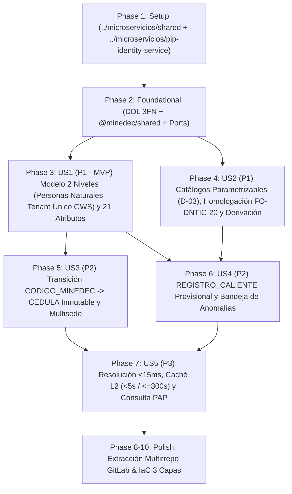

# Tasks: Base de Identidades en Dos Niveles, Catálogos Parametrizables y Esquema MINEDEC_Perfil

**Input**: Documentos de diseño desde `/specs/001-modelo-identidades-perfil/` ([plan.md](file:///C:/Users/anarvaez/Documents/Projects/MINEDEC/SSO/Desarrollo/minedec-sso/specs/001-modelo-identidades-perfil/plan.md), [spec.md](file:///C:/Users/anarvaez/Documents/Projects/MINEDEC/SSO/Desarrollo/minedec-sso/specs/001-modelo-identidades-perfil/spec.md), [research.md](file:///C:/Users/anarvaez/Documents/Projects/MINEDEC/SSO/Desarrollo/minedec-sso/specs/001-modelo-identidades-perfil/research.md), [data-model.md](file:///C:/Users/anarvaez/Documents/Projects/MINEDEC/SSO/Desarrollo/minedec-sso/specs/001-modelo-identidades-perfil/data-model.md), [contracts/identity-profile-internal-api.openapi.yaml](file:///C:/Users/anarvaez/Documents/Projects/MINEDEC/SSO/Desarrollo/minedec-sso/specs/001-modelo-identidades-perfil/contracts/identity-profile-internal-api.openapi.yaml), [quickstart.md](file:///C:/Users/anarvaez/Documents/Projects/MINEDEC/SSO/Desarrollo/minedec-sso/specs/001-modelo-identidades-perfil/quickstart.md)) y esquema 3FN [docs/esquemas-bd/etapa-1-identidad-pip-auditoria.dbml](file:///C:/Users/anarvaez/Documents/Projects/MINEDEC/SSO/Desarrollo/minedec-sso/docs/esquemas-bd/etapa-1-identidad-pip-auditoria.dbml)

**Prerequisites**: `plan.md` (requerido), `spec.md` (requerido para historias de usuario), `research.md`, `data-model.md`, `contracts/`

**Tests**: Se incluyen tareas de pruebas unitarias y de integración por historia de usuario conforme al gate constitucional obligatorio (`cobertura >= 70%` con Jest + Supertest) y a los escenarios de verificación de `quickstart.md`.

**Organization**: Las tareas están agrupadas por historia de usuario (`US1` a `US5`) para permitir la implementación, prueba e integración independiente de cada incremento sobre el modelo relacional en **3FN** acotado exclusivamente a **personas naturales** (`CEDULA`, `PASAPORTE`, `CODIGO_MINEDEC`, con inmutabilidad estricta de `CEDULA` una vez consolidada), subdominios por población dentro de un **único tenant de Google Workspace** (`D-21`), homologación de catálogos/AMIE con fuentes oficiales del MINEDEC (`FO-DNTIC-20`) y arquitectura multirrepositorio en GitLab (`git.sitimapa.co`, subgrupo `c2-sso/microservicios/*` y `c2-sso/devops/iac-terraform`).

## Format: `[ID] [P?] [Story] Description`

- **[P]**: Puede ejecutarse en paralelo (archivos distintos, sin dependencias en tareas incompletas)
- **[Story]**: Historia de usuario a la que pertenece la tarea (`[US1]`, `[US2]`, `[US3]`, `[US4]`, `[US5]`)
- Todas las descripciones incluyen las rutas exactas de los archivos a crear o modificar

## Path Conventions

- **Repositorio Independiente del Paquete Transversal (`c2-sso/microservicios/shared`, mapeado en `../microservicios/shared`)**:
  - Código fuente DRY + SOLID: `../microservicios/shared/src/`
  - Pruebas unitarias del paquete compartido: `../microservicios/shared/tests/`
  - Publicado como `@minedec/shared` en el **GitLab NPM Package Registry** (`https://git.sitimapa.co/api/v4/projects/<PROJECT_ID>/packages/npm/`) mediante `../microservicios/shared/.gitlab-ci.yml`.
- **Repositorio Independiente del Microservicio PIP (`c2-sso/microservicios/pip-identity-service`, mapeado en `../microservicios/pip-identity-service`)**:
  - Código fuente en Arquitectura Hexagonal: `../microservicios/pip-identity-service/src/`
  - Migraciones DDL estáticas: `../microservicios/pip-identity-service/migrations/`
  - Pruebas unitarias e integración: `../microservicios/pip-identity-service/tests/unit/`, `../microservicios/pip-identity-service/tests/integration/`
  - Pipeline CI/CD en GitLab: `../microservicios/pip-identity-service/.gitlab-ci.yml` (ejecutado con `gitlab-runner@gitlab-servinformacion.iam.gserviceaccount.com` vía metadata server, cero llaves JSON, publicando imágenes en Artifact Registry `sso-containers` con `$CI_COMMIT_SHA`).
- **Repositorio Central de Infraestructura en 3 Capas (`c2-sso/devops/iac-terraform`, mapeado en `../iac-terraform`)**:
  - Capa 1 (Módulos reutilizables): `../iac-terraform/modulos/`
  - Capa 2 (Plantillas por stack sin `host`): `../iac-terraform/plantillas/{devops,data,apps}/`
  - Capa 3 (Despliegues por ambiente): `../iac-terraform/despliegues/{des,pre,pro}/{devops,data,apps}/` para los proyectos de servicio `mec-003-sso-des`, `mec-003-sso-pre` y `mec-003-sso-pro` sobre la **Red Compartida (Shared VPC)** administrada por el equipo de redes en los proyectos host `mec-003-sha-net-des`, `mec-003-sha-net-pre` y `mec-003-sha-net-pro-511014`, empaquetado con `../iac-terraform/scripts/bundle.sh` y desplegado en Google Cloud Infrastructure Manager mediante `sa-infra-manager@mec-003-sso-<amb>.iam.gserviceaccount.com`.

---

## Phase 1: Setup (Independent Repositories & Shared Package Infrastructure)

**Purpose**: Inicialización de los repositorios independientes `../microservicios/shared` (`@minedec/shared`) y `../microservicios/pip-identity-service` (`@minedec/pip-identity-service`) con TypeScript 5.8+ (`strict: true`) sobre Node.js 22 LTS, consumo desde GitLab NPM Package Registry, linting arquitectónico y contenedores locales para pruebas.

- [X] T001 Crear la estructura de directorios de los repositorios independientes (`../microservicios/shared/`, `../microservicios/pip-identity-service/migrations/`, `../microservicios/pip-identity-service/tests/`) y configurar `../microservicios/shared/package.json` (`@minedec/shared`) y `../microservicios/pip-identity-service/package.json` (`@minedec/pip-identity-service`) con `.npmrc` apuntando al GitLab NPM Package Registry (`@minedec:registry=https://git.sitimapa.co/api/v4/projects/<PROJECT_ID>/packages/npm/`)
- [X] T002 Configurar TypeScript 5.8+ en modo estricto (`strict: true`, `moduleResolution: "NodeNext"`) en `../microservicios/shared/tsconfig.json` y `../microservicios/pip-identity-service/tsconfig.json`
- [X] T003 [P] Configurar el entorno local de desarrollo y pruebas con PostgreSQL 16 (compatible con AlloyDB) y Redis 7 en `../microservicios/pip-identity-service/docker-compose.dev.yml` y plantilla de variables en `../microservicios/pip-identity-service/.env.example`
- [X] T004 [P] Configurar Jest, Supertest y el umbral mínimo de cobertura (`>= 70%`) en `../microservicios/shared/jest.config.ts` y `../microservicios/pip-identity-service/jest.config.ts`
- [X] T005 [P] Configurar ESLint y reglas de pureza de arquitectura hexagonal (prohibición de importar `inversify` o decoradores en `domain/` y `application/`) en `../microservicios/shared/eslint.config.mjs` y `../microservicios/pip-identity-service/eslint.config.mjs`

---

## Phase 2: Foundational (Blocking Prerequisites)

**Purpose**: Infraestructura transversal en `../microservicios/shared/`, migraciones DDL en 3FN de las 8 tablas del PIP en AlloyDB (`dominio_institucional`, `catalogo_atributo_minedec`, `catalogo_territorio_sede`, `persona_identidad`, `cuenta_institucional`, `asignacion_contexto`, `anomalia_identidad`, `auditoria_evento`), puertos del dominio y configuración base del Composition Root (`container.ts`).

**⚠️ CRITICAL**: Ninguna historia de usuario puede iniciar hasta completar esta fase.

- [X] T006 Crear la migración DDL estática en 3FN pura con las 8 tablas relacionales del PIP (`dominio_institucional` con `tipo_poblacion` en `ESTUDIANTE`/`DOCENTE`/`ADMINISTRATIVO`/`MIXTO` sobre el mismo `google_customer_id`, `catalogo_atributo_minedec` con `metadatos_regla` JSONB, `catalogo_territorio_sede` con `codigo_distrito`/`codigo_circuito`/DPA anulables para fuentes `FO-DNTIC-20` y `NO_APLICA` en `jornada`, `persona_identidad` con PK técnica `id_interno` UUID v4 y clave natural `(tipo_identificacion, numero_identificacion)` libre de atributos de cuenta, `cuenta_institucional`, `asignacion_contexto`, `anomalia_identidad`, `auditoria_evento`), restricciones `CHECK`/`UNIQUE`, índices funcionales `LOWER()` y triggers de defensa en profundidad (`trg_enforce_cedula_immutability`, `trg_enforce_auditoria_append_only`) en `../microservicios/pip-identity-service/migrations/001_init_pip_identity_schema.sql`
- [X] T007 Crear la migración semilla del único tenant de Google Workspace (`google_customer_id` compartido) con sus subdominios por población (`estudiante.edu.ec` → `ESTUDIANTE`, `docentes.educacion.gob.ec` → `DOCENTE`, `educacion.gob.ec` → `ADMINISTRATIVO`), sedes educativas base en `catalogo_territorio_sede` (incluyendo registros homologados con `FO-DNTIC-20`) y valores iniciales del catálogo parametrizable `MINEDEC_Perfil` (`D-03`, incluyendo `EDUCACION_SUPERIOR`, `codigo_padre` y diccionarios `sinonimosOrigen` en `metadatos_regla`) en `../microservicios/pip-identity-service/migrations/002_seed_minedec_catalogs.sql`
- [X] T008 [P] Implementar el pool de conexiones PostgreSQL (`pg`), gestor de transacciones y validador de identificadores SQL por lista blanca (`safe_sql_identifier` + `pg-format`) en `../microservicios/shared/src/db/postgres-client.ts`
- [X] T009 [P] Implementar el cliente Memorystore for Redis (`ioredis`) con aplicación obligatoria de `TTL <= 300 s` (`EX 300`, prohibición de `PERSIST`) y helper de invalidación atómica `UNLINK` en `../microservicios/shared/src/cache/redis-client.ts`
- [X] T010 [P] Implementar el logger estructurado JSON (`pino`) con redacción automática de credenciales/tokens y propagación de `traceId` en `../microservicios/shared/src/observability/logger.ts`
- [X] T011 [P] Implementar el escritor transaccional de auditoría inmutable (`auditoria_evento` en modo `INSERT/SELECT`) con cálculo de cadena hash `SHA-256` (`hash_evento_anterior_sha256` -> `hash_evento_sha256`) serializado mediante bloqueo consultivo transaccional `pg_advisory_xact_lock(2026022001)` en `../microservicios/shared/src/audit/audit-event-writer.ts`
- [X] T012 Definir las interfaces y puertos segregados del dominio (`PersonaIdentidadRepositoryPort`, `CuentaInstitucionalRepositoryPort`, `CatalogoTerritorioSedeRepositoryPort`, `AsignacionContextoRepositoryPort`, `AnomaliaIdentidadRepositoryPort`, `CatalogoAtributoRepositoryPort`, `IdentityCachePort`, `AuditLogPort`, `PrioritySyncQueuePort`) en `../microservicios/pip-identity-service/src/domain/ports/index.ts`
- [X] T013 [P] Implementar el middleware de verificación de JWT interno de servicio (`InternalServiceJwt` con `jose`), cabeceras de seguridad HTTP (`helmet`) y manejador estándar de errores Express 5 en `../microservicios/pip-identity-service/src/infrastructure/http/middleware/auth-security.middleware.ts`
- [X] T014 Configurar los símbolos de inyección (`TYPES`), el contenedor `InversifyJS` exclusivamente en el Composition Root (`decorate(injectable(), ...)` externo sin decoradores en `domain/` ni `application/`) y el servidor HTTP Express 5 base en `../microservicios/pip-identity-service/src/container.ts` y `../microservicios/pip-identity-service/src/index.ts`

**Checkpoint**: Base transversal `@minedec/shared` y esquema de base de datos en 3FN listos — la implementación de las historias de usuario puede comenzar.

---

## Phase 3: User Story 1 - Modelo de Identidad en Dos Niveles para Personas Naturales y Validación de los 21 Atributos Canónicos (Priority: P1) 🎯 MVP

**Goal**: Almacenar y validar las identidades institucionales separando la persona física/natural (`PersonaIdentidad`, identificada por su llave técnica inmutable `idInterno` UUID v4 y su clave natural `CEDULA`, `PASAPORTE` o `CODIGO_MINEDEC`, siendo `CEDULA` estrictamente inmutable una vez consolidada) de sus cuentas institucionales (`CuentaInstitucional` en los distintos subdominios por población del único tenant de Google Workspace) y vinculándola en 3FN con `CatalogoTerritorioSede` (`codigo_amie`), aplicando la preservación de ceros a la izquierda (`01`–`09`), validación Módulo 10 (incluyendo la extracción de la `CEDULA` de 10 dígitos si llega un RUC de persona natural `10 dígitos + 001..999` y el rechazo de RUCs societarios como `SIN_IDENTIFICACION_VALIDA`) y la matriz de obligatoriedad por población sobre los 21 atributos canónicos.

**Independent Test**: Ingresar lotes de perfiles para las 4 poblaciones (`ESTUDIANTE`, `DOCENTE`, `ADMINISTRATIVO`, `EXTERNO`) verificando `0%` de pérdida de ceros iniciales en provincias `01`–`09`, consolidación de múltiples cuentas institucionales en distintos subdominios del mismo tenant (`@estudiante.edu.ec`, `@docentes.educacion.gob.ec`, `@educacion.gob.ec`) bajo una sola `PersonaIdentidad`, inmutabilidad estricta de `CEDULA` consolidada, normalización de RUC de persona natural a `CEDULA` de 10 dígitos (sin tablas de personas jurídicas) y evaluación de la matriz de obligatoriedad (`quickstart.md` Escenarios 1 y 2).

### Tests for User Story 1 ⚠️

- [X] T015 [P] [US1] Crear pruebas unitarias de validación de documentos de persona natural (`CEDULA` con Módulo 10 y preservación de cero inicial en provincias `01`–`09`, inmutabilidad de `CEDULA` consolidada, `PASAPORTE`, `CODIGO_MINEDEC`, extracción de `CEDULA` de 10 dígitos cuando llega un RUC de persona natural `10 dígitos + 001..999` y rechazo de RUC jurídico con tercer dígito `6` o `9`), código AMIE y matriz de obligatoriedad de los 21 atributos por población (incluyendo regla de minoría de edad `< 18 años` para `representanteLegalCedula` y ámbitos de `ADMINISTRATIVO`) en `../microservicios/pip-identity-service/tests/unit/domain/minedec-perfil-validator.spec.ts`
- [X] T016 [P] [US1] Crear pruebas de integración para la unificación multi-subdominio dentro del único tenant de Google Workspace (`@docentes.educacion.gob.ec`, `@educacion.gob.ec` y `@estudiante.edu.ec`), generación de `idInterno` UUID v4, unificación bajo `CEDULA` de 10 dígitos ante cuentas con RUC de persona natural (`HONORARIOS_PROFESIONALES`) y vinculación 3FN con `catalogo_territorio_sede` en `../microservicios/pip-identity-service/tests/integration/pip/multi-domain-unification.spec.ts`

### Implementation for User Story 1

- [X] T017 [P] [US1] Implementar los validadores de documentos de persona natural e identificadores territoriales (preservación de ceros `01`–`09`, Módulo 10 para `CEDULA`, normalización de RUC de persona natural a `CEDULA` de 10 dígitos y rechazo de RUC societario, `PASAPORTE`, `CODIGO_MINEDEC` y expresión regular `codigoAMIE`) en `../microservicios/shared/src/domain/identifiers-validator.ts`
- [X] T018 [P] [US1] Implementar los esquemas Zod y el validador de la matriz de obligatoriedad de los 21 atributos (`5 estándar + 16 MINEDEC_Perfil`) por población (`ESTUDIANTE`, `DOCENTE`, `ADMINISTRATIVO`, `EXTERNO`, vigencias temporales y prelación `fechaNacimiento` vs catálogo para `representanteLegalCedula`) en `../microservicios/shared/src/domain/minedec-perfil-schema.ts`
- [X] T019 [P] [US1] Crear las entidades de dominio puras `PersonaIdentidad`, `CuentaInstitucional`, `DominioInstitucional` (con `tipoPoblacion` en `ESTUDIANTE`/`DOCENTE`/`ADMINISTRATIVO`/`MIXTO` sobre el tenant único) y `CatalogoTerritorioSede` (con `codigoDistrito` y `codigoCircuito` anulables y generación aleatoria local de `idInterno` UUID v4 cuando llega vacío) en `../microservicios/pip-identity-service/src/domain/entities/identity-entities.ts`
- [X] T020 [US1] Implementar el servicio de dominio de unificación de identidad en dos niveles (exclusivo para personas naturales: `CEDULA`, `PASAPORTE`, `CODIGO_MINEDEC`, protegiendo la inmutabilidad estricta de `CEDULA` una vez consolidada), resolución territorial en 3FN contra `CatalogoTerritorioSede` y evaluación de vigencia temporal (`fail-close` cuando `suspended = true` o `fechaFinVigencia` expiró) en `../microservicios/pip-identity-service/src/domain/services/identity-unification.service.ts`
- [X] T021 [P] [US1] Implementar los repositorios PostgreSQL con consultas 100% parametrizadas (`$1, $2`) para `persona_identidad`, `cuenta_institucional`, `dominio_institucional` y `catalogo_territorio_sede` en `../microservicios/pip-identity-service/src/infrastructure/persistence/pg-identity.repository.ts`
- [X] T022 [US1] Implementar el caso de uso transaccional e idempotente de ingestión de perfiles (`UpsertDirectoryIdentityUseCase`) con registro de auditoría inmutable en `../microservicios/pip-identity-service/src/application/upsert-directory-identity.usecase.ts`
- [X] T023 [US1] Implementar el controlador y ruta `PUT /internal/v1/pip/identities/upsert` conforme al contrato OpenAPI en `../microservicios/pip-identity-service/src/infrastructure/http/controllers/upsert-identity.controller.ts`

**Checkpoint**: User Story 1 completamente funcional y verificable de forma independiente (MVP de persistencia 3FN y validación de identidades de personas naturales en el tenant único de GWS).

---

## Phase 4: User Story 2 - Catálogos Parametrizables Jerárquicos (`D-03`), Homologación con Fuentes MINEDEC y Derivación Académica Determinística (Priority: P1)

**Goal**: Gobernar en base de datos los catálogos de valores permitidos para `MINEDEC_Perfil` (`D-03`) con soporte de diccionarios de sinónimos/homologación (`sinonimosOrigen` en `metadatosRegla` para fuentes `FO-DNTIC-20`), validación de dependencia jerárquica (`tipoUsuario` → `subtipoUsuario`), derivación determinística de `nivelAcademico` (incluyendo `EDUCACION_SUPERIOR`) desde `gradoCurso` (fuente maestra única) y actualización administrativa en caliente con invalidación de caché en `< 5 s` sin redespliegue.

**Independent Test**: Consultar y actualizar valores y sinónimos (`sinonimosOrigen`) en `CatalogoAtributoMinedec` vía API administrativa, verificando que las etiquetas crudas de sistemas origen (`"8vo año Básica"`, `"TERCER NIVEL TECNOLÓGICO SUPERIOR"`, `ZONA = "9"`, `"LOSEP"`, `"NO APLICA JORNADA"`) se normalizan a sus códigos canónicos, que `gradoCurso` sobrescribe determinísticamente cualquier `nivelAcademico` discrepante, que se rechazan combinaciones jerárquicas inválidas (ej. `ESTUDIANTE` + `LOSEP`) y que la caché de catálogos se invalida en `< 5 s`.

### Tests for User Story 2 ⚠️

- [X] T024 [P] [US2] Crear pruebas de integración para la homologación de sinónimos de origen (`FO-DNTIC-20` vía `sinonimosOrigen`), la derivación determinística de los 17 valores de `gradoCurso` → `nivelAcademico` (incluyendo `SUPERIOR_1..3` → `EDUCACION_SUPERIOR`), validación jerárquica `tipoUsuario` → `subtipoUsuario` y recarga en caliente de catálogos sin redespliegue en `../microservicios/pip-identity-service/tests/integration/pip/parameterizable-catalogs.spec.ts`

### Implementation for User Story 2

- [X] T025 [P] [US2] Crear la entidad `CatalogoAtributoMinedec` y el servicio de dominio de homologación de sinónimos (`sinonimosOrigen` en `metadatosRegla`, normalización de `ZONA = '1'..'9'` → `'01'..'09'`), validación jerárquica (`codigoPadre`) y derivación académica (`gradoCurso` → `nivelAcademico` como fuente maestra única, incluyendo `EDUCACION_SUPERIOR`) en `../microservicios/pip-identity-service/src/domain/services/catalog-derivation.service.ts`
- [X] T026 [P] [US2] Implementar el repositorio PostgreSQL parametrizado y caché Redis L2 (`minedec:pip:catalogo:v1`, `TTL <= 300 s`) para `catalogo_atributo_minedec` en `../microservicios/pip-identity-service/src/infrastructure/persistence/pg-catalog.repository.ts`
- [X] T027 [US2] Implementar el caso de uso `ManageCatalogsUseCase` (consulta, alta/actualización de entradas de catálogo y `sinonimosOrigen`, evento de auditoría `CATALOGO_ACTUALIZADO` e invalidación de caché en `< 5 s`) e integrarlo en `UpsertDirectoryIdentityUseCase` en `../microservicios/pip-identity-service/src/application/manage-catalogs.usecase.ts`
- [X] T028 [US2] Implementar los endpoints administrativos `GET /api/v1/admin/catalogs/{categoriaAtributo}` y `PUT /api/v1/admin/catalogs/{categoriaAtributo}` (incluyendo soporte de `sinonimosOrigen` en `CatalogEntry` y `CatalogEntryUpsertRequest`) en `../microservicios/pip-identity-service/src/infrastructure/http/controllers/catalogs-admin.controller.ts`

**Checkpoint**: User Stories 1 y 2 operativas e integradas con catálogos parametrizables y homologación `FO-DNTIC-20` en base de datos (`D-03`).

---

## Phase 5: User Story 3 - Transición de Identificador (`CODIGO_MINEDEC` a `CEDULA`) y Gestión de Docentes Multisede (Priority: P2)

**Goal**: Ejecutar de forma transaccional e idempotente la única transición documental permitida `1 a 1` de `CODIGO_MINEDEC` a `CEDULA` conservando `idInterno` (PK técnica UUID v4), historial en `codigo_minedec_anterior`, cuentas y asignaciones, garantizando la inmutabilidad estricta de `CEDULA` una vez consolidada (rechazando con `409 Conflict` cualquier intento posterior de mutar la `CEDULA` y bloqueando con `COLISION_IDENTIFICADOR` si la cédula ya pertenece a otro `idInterno`), y soportar múltiples sedes (`AsignacionContexto` referenciando `catalogo_territorio_sede(codigo_amie)` en 3FN) para docentes con `docenteMultisede = true` diferenciando `GWS_PRIMARIO` y `PAP_DELEGADO`.

**Independent Test**: Ejecutar transición de `CODIGO_MINEDEC` a `CEDULA` verificando preservación de `idInterno` y `codigo_minedec_anterior`, rechazo `409 Conflict` ante intento posterior de modificar la `CEDULA` consolidada, y actualización de perfil de un docente multisede verificando que las sedes complementarias (`PAP_DELEGADO`) permanecen intactas (`quickstart.md` Escenarios 3 y 4).

### Tests for User Story 3 ⚠️

- [X] T029 [P] [US3] Crear pruebas de integración para la preservación de asignaciones multisede en 3FN (`GWS_PRIMARIO` vs `PAP_DELEGADO` vinculadas a `catalogo_territorio_sede`) y desactivación automática de sedes complementarias cuando `docenteMultisede` pasa de `true` a `false` en `../microservicios/pip-identity-service/tests/integration/pip/multisede-context-preservation.spec.ts`
- [X] T030 [P] [US3] Crear pruebas de integración para la transición unidireccional `1 a 1` de `CODIGO_MINEDEC` a `CEDULA` (conservación de `idInterno`, registro en `codigo_minedec_anterior`, purga doble en caché, bloqueo `409` por colisión con otro `idInterno` y bloqueo `409` ante intento de mutar una `CEDULA` ya consolidada conforme al Principio X.2 de la Constitución v2.11.0) en `../microservicios/pip-identity-service/tests/integration/pip/codigo-minedec-to-cedula-transition.spec.ts`

### Implementation for User Story 3

- [X] T031 [P] [US3] Crear la entidad `AsignacionContexto` y el servicio de dominio para la transición unidireccional `CODIGO_MINEDEC` → `CEDULA`, el invariante de inmutabilidad estricta de `CEDULA` consolidada y las reglas de preservación/desactivación multisede (`GWS_PRIMARIO` vs `PAP_DELEGADO`) en `../microservicios/pip-identity-service/src/domain/services/multisede-and-transition.service.ts`
- [X] T032 [P] [US3] Implementar el repositorio PostgreSQL parametrizado para `asignacion_contexto` con `JOIN` a `catalogo_territorio_sede` (asegurando que la sincronización solo toque `GWS_PRIMARIO` y desactive `PAP_DELEGADO` cuando `docente_multisede = false`) en `../microservicios/pip-identity-service/src/infrastructure/persistence/pg-context-assignment.repository.ts`
- [X] T033 [US3] Implementar el caso de uso `ManageMultisedeContextUseCase` y extender `UpsertDirectoryIdentityUseCase` para ejecutar la transición `CODIGO_MINEDEC` → `CEDULA` (con evento de auditoría `TRANSICION_CODIGO_A_CEDULA` y rechazo `409` ante intento de modificar una `CEDULA` ya consolidada) en `../microservicios/pip-identity-service/src/application/manage-multisede-context.usecase.ts`
- [X] T034 [US3] Implementar el endpoint administrativo `POST /api/v1/admin/identities/{numeroIdentificacion}/context-assignments` en `../microservicios/pip-identity-service/src/infrastructure/http/controllers/context-assignments-admin.controller.ts`

**Checkpoint**: User Stories 1, 2 y 3 operativas y verificables de forma independiente.

---

## Phase 6: User Story 4 - Registro en Caliente (*Just-In-Time*) con Identidad Provisional y Bandeja de Anomalías de Identidad (Priority: P2)

**Goal**: Resolver en caliente (`REGISTRO_CALIENTE`) el primer inicio de sesión OIDC de cuentas recién creadas dentro de cualquiera de los subdominios del tenant de Google Workspace infiriendo su población inicial desde `DominioInstitucional`, creando una `PersonaIdentidad` provisional en `PENDIENTE_IDENTIFICACION` con acceso `RESTRINGIDA`, `0` llamadas a Google Workspace, expiración `<= 300 s`, solicitud de sincronización prioritaria (`sso-sync-priority-hot-reg`) y posterior re-vinculación/promoción; y gobernar la Bandeja de Anomalías (`AnomaliaIdentidad`) con bloqueo graduado (`BLOQUEANTE` vs `RESTRINGIDA`), auto-resolución (`AUTO_SINCRONIZACION`), estado `LISTA_PARA_CERRAR`, cierre manual obligatorio (`MANUAL_ADMIN`) para `COLISION_IDENTIFICADOR` y encadenamiento por recurrencia (`anomaliaAnteriorId`).

**Independent Test**: Simular la resolución de una cuenta inexistente sin `numeroIdentificacion` en el token OIDC verificando el alta provisional en `REGISTRO_CALIENTE` (`0` llamadas a GWS) y su posterior re-vinculación a una `PersonaIdentidad` existente, así como el ciclo completo de anomalías (`quickstart.md` Escenarios 5 y 6).

### Tests for User Story 4 ⚠️

- [X] T035 [P] [US4] Crear pruebas de integración para `REGISTRO_CALIENTE` con `PersonaIdentidad` provisional en `PENDIENTE_IDENTIFICACION` (`0` llamadas a GWS, inferencia de población por subdominio en `dominio_institucional`), encolamiento prioritario, re-vinculación a persona existente y expiración `fail-close` en `<= 300 s` en `../microservicios/pip-identity-service/tests/integration/pip/hot-registration-jit.spec.ts`
- [X] T036 [P] [US4] Crear pruebas de integración del ciclo de vida de `AnomaliaIdentidad` (bloqueo graduado `BLOQUEANTE`/`RESTRINGIDA`, auto-resolución `AUTO_SINCRONIZACION`, paso a `LISTA_PARA_CERRAR` y cierre manual obligatorio `MANUAL_ADMIN` de `COLISION_IDENTIFICADOR`, y recurrencia con `anomalia_anterior_id`) en `../microservicios/pip-identity-service/tests/integration/anomalies/anomaly-lifecycle.spec.ts`

### Implementation for User Story 4

- [X] T037 [P] [US4] Crear la entidad `AnomaliaIdentidad` y el servicio de dominio de ciclo de vida de anomalías (clasificación `BLOQUEANTE` vs `RESTRINGIDA`, transición a `LISTA_PARA_CERRAR`, auto-resolución vs cierre `MANUAL_ADMIN` y encadenamiento `anomaliaAnteriorId`) en `../microservicios/pip-identity-service/src/domain/services/anomaly-lifecycle.service.ts`
- [X] T038 [P] [US4] Implementar el repositorio PostgreSQL parametrizado para `anomalia_identidad` (incluyendo consulta de última anomalía resuelta para enlazar `anomalia_anterior_id` y listado paginado por cursor) en `../microservicios/pip-identity-service/src/infrastructure/persistence/pg-anomaly.repository.ts`
- [X] T039 [P] [US4] Implementar el adaptador de Cloud Tasks (`PrioritySyncQueueAdapter`) para encolar la solicitud de sincronización prioritaria (`sso-sync-priority-hot-reg`) al activarse `REGISTRO_CALIENTE` en `../microservicios/pip-identity-service/src/infrastructure/messaging/cloud-tasks-priority-sync.adapter.ts`
- [X] T040 [US4] Implementar el caso de uso `ResolveIdentityUseCase` con soporte de alta provisional en `REGISTRO_CALIENTE` (`PENDIENTE_IDENTIFICACION`, marcador `TEMP-<google_immutable_id>`, inferencia de población desde el subdominio en `dominio_institucional`, acceso `RESTRINGIDA` y `TTL <= 300 s`) y actualizar `UpsertDirectoryIdentityUseCase` para re-vincular o promover identidades provisionales en `../microservicios/pip-identity-service/src/application/resolve-identity.usecase.ts`
- [X] T041 [US4] Implementar el caso de uso `ManageAnomaliesUseCase` (consulta paginada, auto-resolución `AUTO_SINCRONIZACION` y cierre explícito auditado `MANUAL_ADMIN`) en `../microservicios/pip-identity-service/src/application/manage-anomalies.usecase.ts`
- [X] T042 [US4] Implementar los endpoints administrativos `GET /api/v1/admin/anomalies` y `POST /api/v1/admin/anomalies/{anomaliaId}/resolve` en `../microservicios/pip-identity-service/src/infrastructure/http/controllers/anomalies-admin.controller.ts`

**Checkpoint**: User Stories 1 a 4 operativas y verificadas con control de anomalías y registro en caliente.

---

## Phase 7: User Story 5 - Resolución Interna de Baja Latencia (`< 15 ms`), Invalidación Reactiva de Caché (`< 5 s` / `<= 300 s`) y Consulta Administrativa (Priority: P3)

**Goal**: Proveer resolución de identidad unificada en `< 15 ms` (percentil 95) mediante lectura en 1 salto desde Memorystore for Redis (`minedec:pip:*`, `TTL <= 300 s`, proyectando el perfil desnormalizado con sus cuentas en los subdominios del tenant único y datos de `catalogo_territorio_sede`), garantizar la purga reactiva en `< 5 s` (camino nominal vía `UNLINK` + Cloud Pub/Sub `sso-cache-invalidation`) y expiración dura `<= 300 s` ante cualquier cambio de estado/vigencia/sede/anomalía, y exponer la consulta administrativa unificada en `< 500 ms` (percentil 95).

**Independent Test**: Ejecutar consultas concurrentes sobre `POST /internal/v1/pip/identities/resolve` midiendo latencia `< 15 ms` p95 en infraestructura y disparar bajas/cambios de sede/cierres de anomalías verificando que Redis se invalida en `< 5 s` y que ninguna clave supera `TTL = 300 s`.

### Tests for User Story 5 ⚠️

- [X] T043 [P] [US5] Crear pruebas de integración y SLA para resolución en caché L2 (`< 15 ms` p95), invalidación reactiva (`< 5 s` vía `UNLINK` + Pub/Sub `sso-cache-invalidation`) y verificación de `TTL <= 300 s` en todas las claves `minedec:pip:*` en `../microservicios/pip-identity-service/tests/integration/cache/identity-cache-invalidation-sla.spec.ts`

### Implementation for User Story 5

- [X] T044 [P] [US5] Implementar el adaptador de caché L2 Redis (`RedisIdentityCacheAdapter`) para proyectar `minedec:pip:persona:{id_interno}` (incluyendo cuentas en los subdominios del tenant único y datos territoriales desnormalizados desde `catalogo_territorio_sede`) e índices inversos (`ident`, `email`, `gid`) con `EX 300` obligatorio y pipeline de borrado atómico `UNLINK` en `../microservicios/pip-identity-service/src/infrastructure/cache/redis-identity-cache.adapter.ts`
- [X] T045 [P] [US5] Implementar el adaptador de publicación de eventos de invalidación reactiva de caché en Cloud Pub/Sub (`sso-cache-invalidation`, `< 5 s` nominal) en `../microservicios/pip-identity-service/src/infrastructure/messaging/pubsub-cache-invalidation.adapter.ts`
- [X] T046 [US5] Integrar la lectura en 1 salto desde Redis L2 y el disparo de invalidación reactiva (`UNLINK` + Pub/Sub) en `ResolveIdentityUseCase`, `UpsertDirectoryIdentityUseCase`, `ManageMultisedeContextUseCase` y `ManageAnomaliesUseCase` en `../microservicios/pip-identity-service/src/application/resolve-identity.usecase.ts`
- [X] T047 [US5] Implementar los controladores y rutas `POST /internal/v1/pip/identities/resolve` y `GET /api/v1/admin/identities/{numeroIdentificacion}` en `../microservicios/pip-identity-service/src/infrastructure/http/controllers/resolve-and-query-identity.controller.ts`

**Checkpoint**: Las 5 historias de usuario están completas, integradas y verificadas de forma independiente.

---

## Phase 8: Polish & Cross-Cutting Concerns

**Purpose**: Cableado final en el Composition Root, instrumentación de contadores operativos (sin calcular duraciones en Node.js) y validación integral de calidad y cobertura (`>= 70%`).

- [X] T048 [P] Completar el registro de todos los casos de uso, repositorios y adaptadores en el Composition Root (`decorate(injectable(), ...)` externo) y crear prueba unitaria de resolución del contenedor IoC en `../microservicios/pip-identity-service/src/container.ts` y `../microservicios/pip-identity-service/tests/unit/container-wiring.spec.ts`
- [X] T049 [P] Implementar recolectores de contadores de observabilidad (contadores de peticiones `resolve`, ratio hit/miss en Redis L2, contadores de `REGISTRO_CALIENTE` y anomalías activas por severidad, sin calcular latencia por petición en Node.js) en `../microservicios/shared/src/observability/metrics.ts`
- [X] T050 Ejecutar la suite completa de `quickstart.md` (incluyendo la prueba de paridad 1:1 de esquema relacional 3FN en `../microservicios/pip-identity-service/tests/unit/sql-schema-alignment.spec.ts`), verificar cobertura unitaria e integración `>= 70%` y validar conformidad con `specs/001-modelo-identidades-perfil/contracts/identity-profile-internal-api.openapi.yaml`

---

## Phase 9: Convergence (Observabilidad, Resiliencia HA e Infraestructura Inicial)

- [X] T051 Crear el `Dockerfile` multi-stage sobre `node:22-alpine` con ejecución `non-root` (`USER node`, `UID != 0`) para el microservicio `pip-identity-service` en `../microservicios/pip-identity-service/Dockerfile` per Constitution IV.1, XVII.1
- [X] T052 Definir la configuración de Integración Continua (linting `ESLint`, `npm audit`, `npm test` con Quality Gate bloqueante de cobertura `>= 70%`, construcción de imagen Docker y publicación en Artifact Registry `sso-containers` etiquetada con `$CI_COMMIT_SHA`) para los repositorios `../microservicios/shared/.gitlab-ci.yml` y `../microservicios/pip-identity-service/.gitlab-ci.yml` per Constitution IV.1, II, XVII.4
- [X] T053 Inicializar el repositorio central de infraestructura `../iac-terraform` en 3 capas (`modulos/`, `plantillas/{devops,data,apps}`, `despliegues/{des,pre,pro}/{devops,data,apps}`) con Terraform `1.5.7`, script de empaquetado `../iac-terraform/scripts/bundle.sh` (`--local-source="."`, `--tf-version-constraint="1.5.7"`) y pipeline `../iac-terraform/.gitlab-ci.yml` ejecutado por `gitlab-runner@gitlab-servinformacion.iam.gserviceaccount.com` invocando Google Cloud Infrastructure Manager con `sa-infra-manager@mec-003-sso-<amb>.iam.gserviceaccount.com` per Constitution IV.3, XVII.2, XVIII
- [X] T054 Crear el módulo de Artifact Registry (`sso-containers`) en Terraform HCL (`1.5.7`, sin Terragrunt, con `default_labels` institucionales `entorno`, `proyecto`, `gestionado = "infra-manager"`) en `../iac-terraform/modulos/artifact-registry/` e integrarlo en `../iac-terraform/plantillas/devops/` per Constitution IV.3
- [X] T055 Crear los módulos Terraform de persistencia primaria AlloyDB for PostgreSQL 16 HA + Read Pool (`sso-alloydb-<amb>`, `deletion_protection = true`) y caché L2 Memorystore for Redis (`sso-redis-<amb>`, `TLS` en tránsito, `AUTH` en Secret Manager y política `TTL <= 300 s`) conectados a la Red Compartida (Shared VPC `mec-003-sha-net-des`, `mec-003-sha-net-pre`, `mec-003-sha-net-pro-511014`) en `../iac-terraform/modulos/alloydb/` y `../iac-terraform/modulos/redis/` e integrarlos en `../iac-terraform/plantillas/data/` per Constitution IV.3, XIII.3, XV.6
- [X] T056 Crear los módulos Terraform de mensajería, colas y seguridad (`pubsub` con DLQ para invalidación reactiva `sso-cache-invalidation` `< 5 s`, `cloud-tasks` con control de tasa para `sso-sync-priority-hot-reg`, `secret-manager` con cifrado AES-256 y rotación `<= 90 días`, e `iam` para la cuenta dedicada `sa-sso-core` con Workload Identity en GKE y cero llaves JSON) en `../iac-terraform/modulos/pubsub/`, `../iac-terraform/modulos/cloud-tasks/`, `../iac-terraform/modulos/secret-manager/` y `../iac-terraform/modulos/iam/` per Constitution IV.3, IX, X.6, XV.2
- [X] T057 Configurar las variables por ambiente (`terraform.tfvars` sin secretos) para los proyectos de servicio `mec-003-sso-des`, `mec-003-sso-pre` y `mec-003-sso-pro` sobre los proyectos host de Shared VPC (`mec-003-sha-net-des`, `mec-003-sha-net-pre`, `mec-003-sha-net-pro-511014`) en `../iac-terraform/despliegues/{des,pre,pro}/{devops,data,apps}/terraform.tfvars` y la prueba automatizada de conformidad DevSecOps/IaC en `../microservicios/pip-identity-service/tests/unit/devops-iac-alignment.spec.ts`
- [X] T058 Implementar propagación distribuida OpenTelemetry (`traceparent` W3C y `X-Cloud-Trace-Context`), formato de logs JSON estandarizado para Google Cloud Logging (`severity`, `logging.googleapis.com/trace`, `logging.googleapis.com/spanId`), motor de diagnóstico de incidentes en lenguaje natural para el Administrador (`buildNaturalLanguageIncidentDiagnostic`) y reconexión automática con backoff ante conmutación HA de AlloyDB en `../microservicios/shared/src/observability/otel-tracing.ts`, `../microservicios/shared/src/observability/incident-diagnostics.ts`, `../microservicios/shared/src/observability/logger.ts` y `../microservicios/shared/src/db/postgres-client.ts`
- [X] T059 Exponer el endpoint de diagnóstico de salud e infraestructura en lenguaje natural `GET /internal/v1/pip/health/detailed`, enriquecer `pipErrorHandler` con respuesta `HTTP 503` (`FAIL_CLOSE_ACTIVO`) y reporte `diagnosticoAdministrador` ante caídas de AlloyDB, y actualizar el contrato OpenAPI 3.1 en `../microservicios/pip-identity-service/src/index.ts`, `../microservicios/pip-identity-service/src/infrastructure/http/middleware/auth-security.middleware.ts` y `specs/001-modelo-identidades-perfil/contracts/identity-profile-internal-api.openapi.yaml`
- [X] T060 Crear el módulo Terraform de monitoreo y alertas proactivas con runbooks en lenguaje natural para el Administrador (`google_monitoring_alert_policy` para caída/failover HA de AlloyDB y degradación de Redis L2 + métricas basadas en logs) en `../iac-terraform/modulos/monitoring/` junto con la suite de pruebas `../microservicios/pip-identity-service/tests/unit/observability-resilience.spec.ts`

---

## Phase 10: Convergence (Extracción Física Multirrepositorio en GitLab, `.gitlab-ci.yml` y Alineación `sso-*`)

**Purpose**: Ejecutar la extracción física del código desde el antiguo directorio `backend/` del repositorio de gobierno hacia los repositorios Git independientes `../microservicios/shared` (`c2-sso/microservicios/shared`) y `../microservicios/pip-identity-service` (`c2-sso/microservicios/pip-identity-service`), configurar sus pipelines `.gitlab-ci.yml` con publicación y consumo de `@minedec/shared` en el GitLab NPM Package Registry, eliminar los archivos legados `cloudbuild*.yaml` y completar la integración de los stacks `devops`, `data` y `apps` en `../iac-terraform`.

- [X] T061 Migrar físicamente el código fuente, pruebas y configuración del paquete transversal `@minedec/shared` hacia el repositorio independiente `../microservicios/shared/` (`src/`, `tests/`, `package.json`, `tsconfig.json`, `jest.config.ts`, `eslint.config.mjs`, `.npmrc`, `.gitignore`) y crear su pipeline `../microservicios/shared/.gitlab-ci.yml` (etapas `validate`, `test` con cobertura `>= 70%`, `build` y `publish` en `https://git.sitimapa.co/api/v4/projects/${CI_PROJECT_ID}/packages/npm/` ejecutadas por `gitlab-runner@gitlab-servinformacion.iam.gserviceaccount.com`) per Constitution IV.2, XVIII
- [X] T062 Migrar físicamente el microservicio `pip-identity-service`, sus migraciones (`001_init_pip_identity_schema.sql`, `002_seed_minedec_catalogs.sql`) y su suite de pruebas hacia el repositorio independiente `../microservicios/pip-identity-service/` (`src/`, `migrations/`, `tests/`, `package.json` consumiendo `@minedec/shared`, `.npmrc`, `tsconfig.json`, `jest.config.ts`, `eslint.config.mjs`, `Dockerfile` `node:22-alpine` non-root) y crear su pipeline `../microservicios/pip-identity-service/.gitlab-ci.yml` que compile, ejecute SAST/SCA y pruebas (`>= 70%`) y publique la imagen en Artifact Registry `sso-containers` (`us-east1-docker.pkg.dev/mec-003-sso-<amb>/sso-containers/pip-identity-service:$CI_COMMIT_SHA`) per Constitution IV.2, XVII, XVIII
- [X] T063 Integrar el despliegue de `pip-identity-service` (GKE Autopilot con Workload Identity `sa-sso-core@mec-003-sso-<amb>.iam.gserviceaccount.com`), los módulos `pubsub`, `cloud-tasks`, `secret-manager` y `monitoring` con prefijo `sso-*` dentro de `../iac-terraform/plantillas/apps/main.tf` y `../iac-terraform/despliegues/{des,pre,pro}/apps/`, y actualizar `../microservicios/pip-identity-service/tests/unit/devops-iac-alignment.spec.ts` eliminando toda referencia residual a `cloudbuild*.yaml`, `sa-conecta` o `../minedec-sso-terraform` per Constitution IV.3, IX, XVIII

---

## Dependencies & Execution Order

### Phase Dependencies

- **Setup (Phase 1)**: Sin dependencias — puede iniciar inmediatamente.
- **Foundational (Phase 2)**: Depende de **Setup (Phase 1)** — **BLOQUEA** todas las historias de usuario.
- **User Stories (Phases 3 a 7)**: Todas dependen de completar **Foundational (Phase 2)**:
  - **US1 (P1 - MVP)** y **US2 (P1)**: Pueden ejecutarse en paralelo tras completar Phase 2 (o secuencialmente `US1` → `US2`).
  - **US3 (P2)** y **US4 (P2)**: Pueden iniciarse una vez completada la estructura base de `US1`, y pueden ejecutarse en paralelo entre sí (`US3` aborda transición unidireccional a cédula inmutable y multisede; `US4` aborda `REGISTRO_CALIENTE` y Bandeja de Anomalías).
  - **US5 (P3)**: Conecta la proyección en caché L2 Redis (`< 15 ms` p95), la invalidación reactiva (`< 5 s` / `<= 300 s`) y los endpoints de resolución/consulta sobre los flujos de `US1`–`US4`.
- **Polish & Convergence (Phases 8 a 10)**: Dependen de que las historias de usuario `US1` a `US5` estén completas.

### User Story Dependency Graph



---

## Parallel Opportunities & Examples

### Ejemplo de Ejecución Paralela — Phase 2 (Foundational)

```bash
# Una vez creadas las migraciones T006 y T007, los módulos de ../microservicios/shared/ pueden desarrollarse en paralelo:
Task T008: "Implementar pool PostgreSQL y safe_sql_identifier en ../microservicios/shared/src/db/postgres-client.ts"
Task T009: "Implementar cliente Redis con TTL <= 300 s y UNLINK en ../microservicios/shared/src/cache/redis-client.ts"
Task T010: "Implementar logger estructurado pino en ../microservicios/shared/src/observability/logger.ts"
Task T011: "Implementar escritor de auditoría SHA-256 en ../microservicios/shared/src/audit/audit-event-writer.ts"
```

### Ejemplo de Ejecución Paralela — User Story 1 (MVP)

```bash
# Lanzar pruebas y modelos/validadores de US1 en paralelo:
Task T015: "Pruebas unitarias de los 21 atributos, Módulo 10 e inmutabilidad de CEDULA en ../microservicios/pip-identity-service/tests/unit/domain/minedec-perfil-validator.spec.ts"
Task T016: "Pruebas de integración multi-subdominio (tenant único GWS) y 3FN en ../microservicios/pip-identity-service/tests/integration/pip/multi-domain-unification.spec.ts"
Task T017: "Validadores documentales de persona natural (Módulo 10, AMIE) en ../microservicios/shared/src/domain/identifiers-validator.ts"
Task T018: "Esquema Zod y matriz de obligatoriedad en ../microservicios/shared/src/domain/minedec-perfil-schema.ts"
Task T019: "Entidades PersonaIdentidad, CuentaInstitucional, DominioInstitucional y CatalogoTerritorioSede en ../microservicios/pip-identity-service/src/domain/entities/identity-entities.ts"
```

---

## Implementation Strategy

### 1. MVP First (User Story 1 + User Story 2 — P1)

1. Completar **Phase 1: Setup** (`T001`–`T005`).
2. Completar **Phase 2: Foundational** (`T006`–`T014`).
3. Completar **Phase 3: User Story 1** (`T015`–`T023`) y **Phase 4: User Story 2** (`T024`–`T028`).
4. **STOP & VALIDATE**: Ejecutar `tests/unit/domain/minedec-perfil-validator.spec.ts`, `tests/integration/pip/multi-domain-unification.spec.ts` y `tests/integration/pip/parameterizable-catalogs.spec.ts` en `../microservicios/pip-identity-service` para certificar el núcleo del PIP en 3FN, la homologación `FO-DNTIC-20` y el contrato de ingestión `PUT /internal/v1/pip/identities/upsert` requerido por `002-sincronizador-conciliacion-gws`.

### 2. Incremental Delivery (P2 → P3 → Polish & Convergence Multirrepo)

1. Añadir **Phase 5: User Story 3** (`T029`–`T034`): Certificar transición unidireccional `CODIGO_MINEDEC` → `CEDULA` (con inmutabilidad posterior de `CEDULA`) y preservación de sedes `PAP_DELEGADO`.
2. Añadir **Phase 6: User Story 4** (`T035`–`T042`): Certificar `REGISTRO_CALIENTE` con identidad provisional `PENDIENTE_IDENTIFICACION` e inferencia por subdominio y Bandeja de Anomalías con cierre manual obligatorio de `COLISION_IDENTIFICADOR`.
3. Añadir **Phase 7: User Story 5** (`T043`–`T047`), **Phase 8–9** (`T048`–`T060`) y **Phase 10: Convergence Multirrepo** (`T061`–`T063`): Certificar resolución en `< 15 ms` p95, purga reactiva en `< 5 s`, expiración dura `<= 300 s`, extracción física a `../microservicios/shared` y `../microservicios/pip-identity-service` con `.gitlab-ci.yml` y despliegue en 3 capas en `../iac-terraform` sobre Shared VPC.
