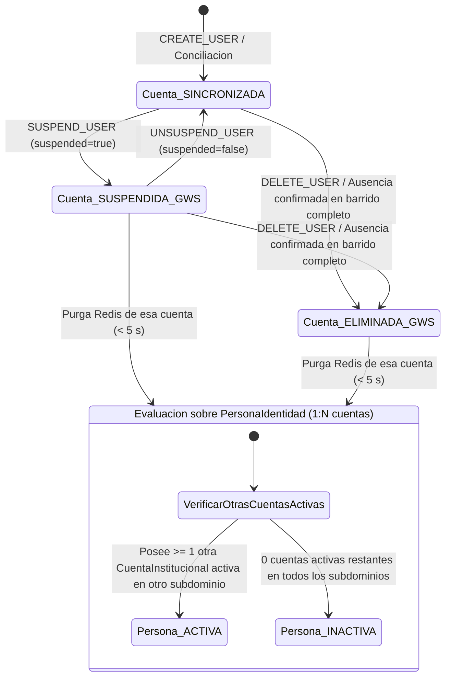
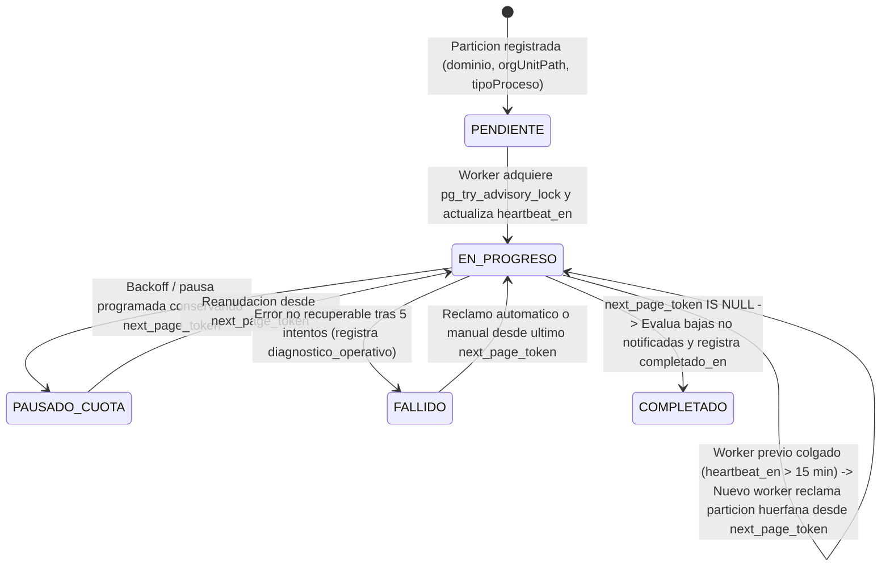

# Data Model: Sincronizador de Identidades en Solo Lectura y Conciliación Masiva desde Google Workspace

**Feature**: `002-sincronizador-conciliacion-gws` | **Date**: 2026-10-20 | **Spec**: [spec.md](file:///C:/Users/anarvaez/Documents/Projects/MINEDEC/SSO/Desarrollo/minedec-sso/specs/002-sincronizador-conciliacion-gws/spec.md) | **Research**: [research.md](file:///C:/Users/anarvaez/Documents/Projects/MINEDEC/SSO/Desarrollo/minedec-sso/specs/002-sincronizador-conciliacion-gws/research.md) | **DBML Etapa 1**: [etapa-1-identidad-pip-auditoria.dbml](file:///C:/Users/anarvaez/Documents/Projects/MINEDEC/SSO/Desarrollo/minedec-sso/docs/esquemas-bd/etapa-1-identidad-pip-auditoria.dbml) | **DDL Previo**: [001_init_pip_identity_schema.sql](file:///C:/Users/anarvaez/Documents/Projects/MINEDEC/SSO/Desarrollo/microservicios/pip-identity-service/migrations/001_init_pip_identity_schema.sql)

---

## 1. Visión General de Almacenamiento (Extensión 3FN del PIP para Sincronización y Conciliación)

La Feature `002-sincronizador-conciliacion-gws` extiende de manera no destructiva el esquema relacional en **Tercera Forma Normal (3FN) pura** del **Policy Information Point (PIP)** creado en la Feature `001-modelo-identidades-perfil` mediante la migración estática `../microservicios/pip-identity-service/migrations/003_sync_reconciliation_schema.sql`:

1. **Tablas Operativas de Sincronización, Punto de Control y Resiliencia en AlloyDB for PostgreSQL 16**:
   - **`checkpoint_conciliacion` (`CheckpointConciliacion`)**: Persiste de forma transaccional el progreso página por página (`next_page_token` de lotes de 500 cuentas) de la carga inicial (`CARGA_INICIAL`), la conciliación nocturna masiva (`CONCILIACION_DIARIA`) y el barrido delta (`BARRIDO_DELTA`), particionado por `(dominio, org_unit_path, tipo_proceso)`. Incluye la llave de bloqueo consultivo (`lock_advisory_key` para `pg_try_advisory_lock`) y la marca de latido (`heartbeat_en`) con umbral de expiración de `15 minutos` para reclamar automáticamente particiones huérfanas sin reiniciar desde cero (`FR-007`, `FR-008`, `SC-004`).
   - **`evento_sincronizacion_procesado` (`EventoSincronizacionProcesado`)**: Registro persistente de deduplicación e idempotencia por `id_evento_externo` (`id.uniqueQualifier:id.time:userKey`) para garantizar `0` duplicados y `0` escrituras obsoletas ante entregas repetidas o fuera de orden desde Cloud Pub/Sub y Cloud Tasks (`FR-003`).
   - **`registro_fallo_sincronizacion` (`RegistroFalloSincronizacion` — Bandeja `DLQ`)**: Almacena los eventos que agotaron los `5` reintentos con retroceso exponencial (`FR-012`, `FR-013`), junto con su diagnóstico operativo en lenguaje natural en español (`FR-014`) y su estado de reprocesamiento controlado con validación de obsolescencia contra `cuenta_institucional.ultima_sincronizacion_en` (`RESUELTO_POR_OBSOLESCENCIA` vs `RESUELTO_REPROCESADO`).
2. **Extensión de `cuenta_institucional` y `auditoria_evento` (3FN)**:
   - Se incorpora en `cuenta_institucional` la columna `hash_payload_gws CHAR(64) NULL` (huella `SHA-256` canónica del perfil y de los 21 atributos `MINEDEC_Perfil` en Google Workspace) para omitir escrituras redundantes cuando los datos no han cambiado (`FR-007`, `SC-007`).
   - Se amplía la restricción `CHECK` de `cuenta_institucional.estado_sincronizacion` para admitir `'ELIMINADA_GWS'` (además de `'SINCRONIZADA'`, `'REGISTRO_CALIENTE'`, `'SUSPENDIDA_GWS'`, `'VIGENCIA_VENCIDA'`, `'BLOQUEADA_ANOMALIA'`), permitiendo distinguir cuentas suspendidas temporalmente de cuentas eliminadas en el directorio externo (`FR-002`, `FR-007`, `FR-010`).
   - Se amplían los valores permitidos en `auditoria_evento` (`tipo_evento` y `origen_canal`) manteniendo intacto el trigger `trg_enforce_auditoria_append_only` y el encadenamiento `SHA-256` con `pg_advisory_xact_lock(2026022001)`.
3. **Coordinación de Cuota (`<= 28 req/s`), Histéresis y Caché L2 en Memorystore for Redis**:
   - Gobernanza distribuida del techo del **70 % de cuota (`<= 28 req/s`)** mediante cubo de tokens atómico en Redis (`minedec:sync:ratelimit:*`), conmutador de modo lote con histéresis (`>= 100` o `> 10 s` activa `MODO_LOTE_LIST_500`; `< 20` restaura `MODO_INDIVIDUAL_GET`) e invalidación reactiva de sesiones/autorizaciones en **`< 5 segundos`** (`TTL <= 300 s`).

---

## 2. Diagrama Entidad-Relación (AlloyDB for PostgreSQL 16 — Extensión Feature 002)

```mermaid
erDiagram
    DOMINIO_INSTITUCIONAL ||--o{ CUENTA_INSTITUCIONAL : "clasifica (dominio)"
    DOMINIO_INSTITUCIONAL ||--o{ CHECKPOINT_CONCILIACION : "particiona (dominio)"
    PERSONA_IDENTIDAD ||--o{ CUENTA_INSTITUCIONAL : "posee (1:N)"
    PERSONA_IDENTIDAD ||--o{ ANOMALIA_IDENTIDAD : "registra (0:N)"
    CUENTA_INSTITUCIONAL ||--o{ ANOMALIA_IDENTIDAD : "origina (0:N)"
    PERSONA_IDENTIDAD ||--o{ AUDITORIA_EVENTO : "actor (actor_id_interno)"

    CHECKPOINT_CONCILIACION {
        uuid checkpoint_id PK "DEFAULT gen_random_uuid()"
        varchar dominio FK "VARCHAR(120) NOT NULL REFERENCES dominio_institucional(dominio)"
        varchar org_unit_path "VARCHAR(512) NOT NULL DEFAULT '/'"
        varchar tipo_proceso "CARGA_INICIAL | CONCILIACION_DIARIA | BARRIDO_DELTA"
        text next_page_token "TEXT NULL (token de reanudacion GWS)"
        bigint cuentas_procesadas "BIGINT NOT NULL DEFAULT 0"
        bigint cuentas_actualizadas "BIGINT NOT NULL DEFAULT 0"
        bigint cuentas_omitidas_hash "BIGINT NOT NULL DEFAULT 0"
        bigint cuentas_baja_detectadas "BIGINT NOT NULL DEFAULT 0"
        bigint anomalias_abiertas "BIGINT NOT NULL DEFAULT 0"
        varchar estado_ejecucion "PENDIENTE | EN_PROGRESO | PAUSADO_CUOTA | COMPLETADO | FALLIDO"
        varchar worker_instancia_id "VARCHAR(128) NULL"
        bigint lock_advisory_key "BIGINT NOT NULL (llave pg_try_advisory_lock)"
        timestamptz heartbeat_en "TIMESTAMPTZ NOT NULL DEFAULT NOW()"
        timestamptz iniciado_en "TIMESTAMPTZ NOT NULL DEFAULT NOW()"
        timestamptz actualizado_en "TIMESTAMPTZ NOT NULL DEFAULT NOW()"
        timestamptz completado_en "TIMESTAMPTZ NULL"
        varchar ultimo_error_codigo "VARCHAR(64) NULL"
        text diagnostico_operativo "TEXT NULL (lenguaje natural espanol)"
    }

    EVENTO_SINCRONIZACION_PROCESADO {
        varchar id_evento_externo PK "VARCHAR(128) id.uniqueQualifier:id.time:userKey"
        varchar tipo_evento "CREATE_USER | CHANGE_USER | SUSPEND_USER | UNSUSPEND_USER | DELETE_USER | REGISTRO_CALIENTE_RECONCILE | BARRIDO_DELTA_2MIN"
        varchar google_sub_id "VARCHAR(64) NULL"
        varchar email_principal "VARCHAR(254) NULL"
        varchar dominio "VARCHAR(120) NULL"
        timestamptz timestamp_evento_gws "TIMESTAMPTZ NOT NULL"
        varchar modo_despacho "INDIVIDUAL_GET | LOTE_LIST_500 | OMITIDO_DUPLICADO | OMITIDO_OBSOLETO"
        varchar resultado "APLICADO | SIN_CAMBIOS_HASH | ANOMALIA_REGISTRADA | DUPLICADO_IGNORADO | OBSOLETO_IGNORADO"
        timestamptz procesado_en "TIMESTAMPTZ NOT NULL DEFAULT NOW()"
    }

    REGISTRO_FALLO_SINCRONIZACION {
        uuid dlq_id PK "DEFAULT gen_random_uuid()"
        varchar id_evento_externo UK "VARCHAR(128) NOT NULL UNIQUE"
        varchar tipo_evento "VARCHAR(40) NOT NULL"
        varchar google_sub_id "VARCHAR(64) NULL"
        varchar email_principal "VARCHAR(254) NULL"
        varchar dominio "VARCHAR(120) NULL"
        varchar org_unit_path "VARCHAR(512) NULL"
        timestamptz timestamp_evento_gws "TIMESTAMPTZ NOT NULL"
        jsonb payload_original "JSONB NOT NULL"
        integer intentos_realizados "INTEGER NOT NULL DEFAULT 5"
        varchar codigo_error "VARCHAR(64) NOT NULL"
        text detalle_error_tecnico "TEXT NOT NULL"
        text diagnostico_lenguaje_natural "TEXT NOT NULL"
        text accion_recomendada "TEXT NOT NULL"
        varchar estado_dlq "PENDIENTE_REVISION | EN_REPROCESAMIENTO | RESUELTO_REPROCESADO | RESUELTO_POR_OBSOLESCENCIA | DESCARTADO_MANUAL"
        varchar resuelto_por_identificacion "VARCHAR(64) NULL"
        text motivo_resolucion "TEXT NULL"
        timestamptz creado_en "TIMESTAMPTZ NOT NULL DEFAULT NOW()"
        timestamptz actualizado_en "TIMESTAMPTZ NOT NULL DEFAULT NOW()"
        timestamptz resuelto_en "TIMESTAMPTZ NULL"
    }

    CUENTA_INSTITUCIONAL {
        uuid cuenta_id PK
        uuid id_interno FK
        varchar google_sub_id UK
        varchar email_principal UK
        varchar dominio FK
        varchar org_unit_path
        boolean suspended_en_gws
        char hash_payload_gws "CHAR(64) NULL (SHA-256 canonico GWS + 21 atributos)"
        varchar estado_sincronizacion "SINCRONIZADA | REGISTRO_CALIENTE | SUSPENDIDA_GWS | ELIMINADA_GWS | VIGENCIA_VENCIDA | BLOQUEADA_ANOMALIA"
        varchar origen_ultima_sincronizacion
        timestamptz ultima_sincronizacion_en
    }
```



---

## 3. Especificación de Tablas Nuevas y Extensiones (AlloyDB — Migración `003`)

### 3.1. `checkpoint_conciliacion` (`CheckpointConciliacion`)

Registro transaccional de avance y bloqueo por partición `(dominio, org_unit_path, tipo_proceso)` para carga inicial y conciliación masiva (`FR-007`, `FR-008`, `SC-001`, `SC-004`).

| Columna | Tipo PostgreSQL | Restricciones | Descripción |
|---------|-----------------|---------------|-------------|
| `checkpoint_id` | `UUID` | `PRIMARY KEY DEFAULT gen_random_uuid()` | Identificador único del punto de control |
| `dominio` | `VARCHAR(120)` | `NOT NULL REFERENCES dominio_institucional(dominio)` | Subdominio institucional de la partición (`educacion.gob.ec`, `docentes.educacion.gob.ec`, `estudiante.edu.ec`) |
| `org_unit_path` | `VARCHAR(512)` | `NOT NULL DEFAULT '/'` | Ruta de la unidad organizativa en Google Workspace (ej. `/`, `/Estudiantes/Zona09`) |
| `tipo_proceso` | `VARCHAR(32)` | `NOT NULL CHECK (tipo_proceso IN ('CARGA_INICIAL', 'CONCILIACION_DIARIA', 'BARRIDO_DELTA'))` | Modalidad del proceso de sincronización por lotes |
| `next_page_token` | `TEXT` | `NULL` | Último `nextPageToken` confirmado de Google Admin SDK (`NULL` al iniciar o completar) |
| `cuentas_procesadas` | `BIGINT` | `NOT NULL DEFAULT 0 CHECK (cuentas_procesadas >= 0)` | Total acumulado de cuentas leídas en la partición |
| `cuentas_actualizadas` | `BIGINT` | `NOT NULL DEFAULT 0 CHECK (cuentas_actualizadas >= 0)` | Total de cuentas insertadas o actualizadas en el PIP |
| `cuentas_omitidas_hash` | `BIGINT` | `NOT NULL DEFAULT 0 CHECK (cuentas_omitidas_hash >= 0)` | Cuentas omitidas porque `hash_payload_gws` no cambió (`SC-007`) |
| `cuentas_baja_detectadas` | `BIGINT` | `NOT NULL DEFAULT 0 CHECK (cuentas_baja_detectadas >= 0)` | Cuentas marcadas en baja lógica (`SUSPENDIDA_GWS` o `ELIMINADA_GWS`) |
| `anomalias_abiertas` | `BIGINT` | `NOT NULL DEFAULT 0 CHECK (anomalias_abiertas >= 0)` | Anomalías de identidad detectadas durante el recorrido de la partición |
| `estado_ejecucion` | `VARCHAR(24)` | `NOT NULL DEFAULT 'PENDIENTE' CHECK (estado_ejecucion IN ('PENDIENTE', 'EN_PROGRESO', 'PAUSADO_CUOTA', 'COMPLETADO', 'FALLIDO'))` | Estado operativo actual de la partición |
| `worker_instancia_id` | `VARCHAR(128)` | `NULL` | Identificador de la instancia de `../microservicios/conciliacion-job` (`sso-conciliacion-job`) que posee la partición |
| `lock_advisory_key` | `BIGINT` | `NOT NULL` | Llave entera determinista de 64 bits usada con `pg_try_advisory_lock(lock_advisory_key)` |
| `heartbeat_en` | `TIMESTAMPTZ` | `NOT NULL DEFAULT NOW()` | Marca de tiempo del último avance de página confirmado (expira tras `> 15 min` de inactividad) |
| `iniciado_en` | `TIMESTAMPTZ` | `NOT NULL DEFAULT NOW()` | Inicio del ciclo actual de la partición |
| `actualizado_en` | `TIMESTAMPTZ` | `NOT NULL DEFAULT NOW()` | Última actualización del registro |
| `completado_en` | `TIMESTAMPTZ` | `NULL` | Marca de tiempo de finalización exitosa (`estado_ejecucion = 'COMPLETADO'`) |
| `ultimo_error_codigo` | `VARCHAR(64)` | `NULL` | Código del último error o pausa (ej. `QUOTA_BACKOFF_PAUSED`, `ORPHAN_PARTITION_RECLAIMED`) |
| `diagnostico_operativo` | `TEXT` | `NULL` | Explicación en lenguaje natural en español sobre el estado o incidente de la partición (`FR-014`) |

- **Restricciones e Índices**:
  - `CONSTRAINT uq_checkpoint_particion UNIQUE (dominio, org_unit_path, tipo_proceso)`
  - `CREATE INDEX idx_checkpoint_estado_heartbeat ON checkpoint_conciliacion (estado_ejecucion, heartbeat_en);`
  - `CREATE INDEX idx_checkpoint_dominio_proceso ON checkpoint_conciliacion (dominio, tipo_proceso);`

---

### 3.2. `evento_sincronizacion_procesado` (`EventoSincronizacionProcesado`)

Tabla de deduplicación e idempotencia para eventos incrementales y prioritarios (`FR-003`, `SC-006`).

| Columna | Tipo PostgreSQL | Restricciones | Descripción |
|---------|-----------------|---------------|-------------|
| `id_evento_externo` | `VARCHAR(128)` | `PRIMARY KEY` | Identificador compuesto inmutable del evento (`uniqueQualifier:time:userKey`) |
| `tipo_evento` | `VARCHAR(40)` | `NOT NULL CHECK (tipo_evento IN ('CREATE_USER', 'CHANGE_USER', 'SUSPEND_USER', 'UNSUSPEND_USER', 'DELETE_USER', 'REGISTRO_CALIENTE_RECONCILE', 'BARRIDO_DELTA_2MIN'))` | Tipo de evento de directorio procesado |
| `google_sub_id` | `VARCHAR(64)` | `NULL` | `id` / `sub` inmutable de la cuenta en Google Workspace |
| `email_principal` | `VARCHAR(254)` | `NULL` | Correo institucional afectado en minúsculas |
| `dominio` | `VARCHAR(120)` | `NULL` | Subdominio institucional de la cuenta |
| `timestamp_evento_gws` | `TIMESTAMPTZ` | `NOT NULL` | Marca de tiempo original del evento en Google Workspace |
| `modo_despacho` | `VARCHAR(24)` | `NOT NULL CHECK (modo_despacho IN ('INDIVIDUAL_GET', 'LOTE_LIST_500', 'OMITIDO_DUPLICADO', 'OMITIDO_OBSOLETO'))` | Estrategia con la que se resolvió el evento (`FR-005`) |
| `resultado` | `VARCHAR(32)` | `NOT NULL CHECK (resultado IN ('APLICADO', 'SIN_CAMBIOS_HASH', 'ANOMALIA_REGISTRADA', 'DUPLICADO_IGNORADO', 'OBSOLETO_IGNORADO'))` | Resultado final del procesamiento |
| `procesado_en` | `TIMESTAMPTZ` | `NOT NULL DEFAULT NOW()` | Fecha/hora de procesamiento en Conecta MINEDEC |

- **Índices**:
  - `CREATE INDEX idx_evento_sync_sub_fecha ON evento_sincronizacion_procesado (google_sub_id, timestamp_evento_gws DESC) WHERE google_sub_id IS NOT NULL;`
  - `CREATE INDEX idx_evento_sync_procesado_en ON evento_sincronizacion_procesado (procesado_en DESC);`

---

### 3.3. `registro_fallo_sincronizacion` (`RegistroFalloSincronizacion` — Bandeja `DLQ`)

Persistencia operativa de la cola de mensajes fallidos (`Dead-Letter Queue`) tras agotar los `5` reintentos con retroceso exponencial (`FR-012`, `FR-013`, `FR-014`).

| Columna | Tipo PostgreSQL | Restricciones | Descripción |
|---------|-----------------|---------------|-------------|
| `dlq_id` | `UUID` | `PRIMARY KEY DEFAULT gen_random_uuid()` | Identificador único del registro en la bandeja `DLQ` |
| `id_evento_externo` | `VARCHAR(128)` | `NOT NULL UNIQUE` | Identificador del evento que agotó los reintentos |
| `tipo_evento` | `VARCHAR(40)` | `NOT NULL` | Tipo de evento (`CREATE_USER`, `CHANGE_USER`, `SUSPEND_USER`, `UNSUSPEND_USER`, `DELETE_USER`, `REGISTRO_CALIENTE_RECONCILE`) |
| `google_sub_id` | `VARCHAR(64)` | `NULL` | Identificador de cuenta en Google Workspace (si está disponible) |
| `email_principal` | `VARCHAR(254)` | `NULL` | Correo institucional afectado |
| `dominio` | `VARCHAR(120)` | `NULL` | Subdominio institucional |
| `org_unit_path` | `VARCHAR(512)` | `NULL` | Unidad organizativa asociada |
| `timestamp_evento_gws` | `TIMESTAMPTZ` | `NOT NULL` | Marca de tiempo original del evento fallido (usada para control de obsolescencia al reprocesar) |
| `payload_original` | `JSONB` | `NOT NULL` | Payload sanitizado del evento para trazabilidad y reprocesamiento |
| `intentos_realizados` | `INTEGER` | `NOT NULL DEFAULT 5 CHECK (intentos_realizados >= 1)` | Cantidad de intentos ejecutados antes de derivar a `DLQ` |
| `codigo_error` | `VARCHAR(64)` | `NOT NULL` | Código clasificado del fallo (`GWS_RATE_LIMIT_EXHAUSTED`, `GWS_UPSTREAM_5XX`, `PIP_DB_TRANSIENT_ERROR`, `INVALID_EVENT_PAYLOAD`) |
| `detalle_error_tecnico` | `TEXT` | `NOT NULL` | Detalle técnico sanitizado del último error |
| `diagnostico_lenguaje_natural` | `TEXT` | `NOT NULL` | Explicación en español claro para el Administrador sobre la causa e impacto (`FR-014`) |
| `accion_recomendada` | `TEXT` | `NOT NULL` | Pasos operativos recomendados en español para resolver el incidente (`FR-014`) |
| `estado_dlq` | `VARCHAR(32)` | `NOT NULL DEFAULT 'PENDIENTE_REVISION' CHECK (estado_dlq IN ('PENDIENTE_REVISION', 'EN_REPROCESAMIENTO', 'RESUELTO_REPROCESADO', 'RESUELTO_POR_OBSOLESCENCIA', 'DESCARTADO_MANUAL'))` | Estado en el ciclo de vida de la `DLQ` |
| `resuelto_por_identificacion` | `VARCHAR(64)` | `NULL` | Identificación del administrador o marcador `'SISTEMA_REPLAY_REGULADO'` |
| `motivo_resolucion` | `TEXT` | `NULL` | Justificación o explicación del resultado del reprocesamiento |
| `creado_en` | `TIMESTAMPTZ` | `NOT NULL DEFAULT NOW()` | Fecha de ingreso a la `DLQ` |
| `actualizado_en` | `TIMESTAMPTZ` | `NOT NULL DEFAULT NOW()` | Fecha de último cambio de estado |
| `resuelto_en` | `TIMESTAMPTZ` | `NULL` | Fecha de cierre (`RESUELTO_REPROCESADO`, `RESUELTO_POR_OBSOLESCENCIA` o `DESCARTADO_MANUAL`) |

- **Índices**:
  - `CREATE INDEX idx_dlq_estado_dominio_fecha ON registro_fallo_sincronizacion (estado_dlq, dominio, creado_en DESC);`
  - `CREATE INDEX idx_dlq_google_sub_id ON registro_fallo_sincronizacion (google_sub_id) WHERE google_sub_id IS NOT NULL;`

---

### 3.4. Extensiones sobre `cuenta_institucional` y `auditoria_evento`

1. **En `cuenta_institucional`**:
   - Columna `hash_payload_gws CHAR(64) NULL`: Almacena el hash `SHA-256` hexadecimal del perfil crudo normalizado proveniente de Google Workspace (`primaryEmail`, `name`, `suspended`, `orgUnitPath` + 21 atributos `MINEDEC_Perfil`). Permite que tanto los eventos incrementales como el Job de conciliación masiva omitan transacciones de escritura innecesarias cuando el hash no ha variado (`FR-007`, `SC-007`).
   - Ampliación de `estado_sincronizacion` (y transición explícita de `'REGISTRO_CALIENTE'` a `'SINCRONIZADA'` al ejecutar `reconcileOrMergeHotIdentity` en ambos caminos `PROMOTED_IN_PLACE` y `MERGED_INTO_EXISTING`):
     ```sql
     CHECK (estado_sincronizacion IN (
         'SINCRONIZADA',
         'REGISTRO_CALIENTE',
         'SUSPENDIDA_GWS',
         'ELIMINADA_GWS',
         'VIGENCIA_VENCIDA',
         'BLOQUEADA_ANOMALIA'
     ))
     ```
   - Ampliación de `cuenta_institucional_tipo_usuario_check` para admitir tanto las poblaciones base como las homologadas (`'ESTUDIANTE'`, `'DOCENTE'`, `'ADMINISTRATIVO'`, `'EXTERNO'`, `'DOCENTE_ADMINISTRATIVO'`, `'CIUDADANO_EXTERNO'`).
2. **En `auditoria_evento`**:
   - Ampliación de `tipo_evento` para incluir: `'IDENTIDAD_ELIMINADA'`, `'PERSONA_DESACTIVADA'`, `'CONCILIACION_PARTICION_COMPLETADA'`, `'CONCILIACION_PARTICION_RECLAMADA'`, `'EVENTO_DLQ_REGISTRADO'`, `'EVENTO_DLQ_REPROCESADO'`.
   - Ampliación de `origen_canal` para incluir: `'SYNC_INCREMENTAL'` y `'SYNC_BATCH_JOB'` (además de `'PIP_INGEST'`, `'LOGIN_JIT'`, `'PAP_ADMIN'`).
   - Eliminación de la FK rígida `auditoria_evento_actor_id_interno_fkey` (`ALTER TABLE auditoria_evento DROP CONSTRAINT IF EXISTS auditoria_evento_actor_id_interno_fkey`): dado que `auditoria_evento` es estrictamente inmutable (`append-only` protegido por `trg_enforce_auditoria_append_only`), la fusión `MERGED_INTO_EXISTING` de un registro en caliente hacia una `persona_identidad` preexistente debe poder eliminar la fila provisional huérfana sin requerir un `UPDATE/SET NULL` sobre `auditoria_evento`.
3. **Purga Canónica en Caché L2 (`RedisPubSubCacheInvalidatorAdapter`)**:
   - La invalidación por eventos de sincronización o baja purga simultáneamente los prefijos canónicos del PIP (`minedec:pip:persona:{id_interno}`, `minedec:pip:gid:{google_sub_id}`, `minedec:pip:email:{email}`, `minedec:pip:ident:{tipo}:{numero}`) y los prefijos del sincronizador (`pip:identity:*`), publicando el mensaje de revocación en el tópico Pub/Sub `sso.identity.revoked`.

---

## 4. Estructura de Coordinación de Cuotas, Histéresis y Deduplicación en Memorystore for Redis

Además de las proyecciones de identidad `minedec:pip:*` (`TTL <= 300 s`), la Feature 002 introduce las siguientes llaves operativas en Redis:

| Patrón de Clave Redis | Estructura | TTL | Propósito |
|-----------------------|------------|-----|-----------|
| `minedec:sync:quota:batch_active` | `STRING` (`JSON` con `jobExecutionId`, `activePartitions`, `allocatedRps: 20`) | `EX 60` (renovable cada página) | Indica a `../microservicios/sincronizador` (`sso-sincronizador`) que hay un Job de conciliación masiva activo para ajustar el reparto dinámico (`20 req/s` batch + `8 req/s` tiempo real = `28 req/s`) (`FR-004`, `SC-003`) |
| `minedec:sync:ratelimit:global:sec:{epochSec}` | `INTEGER` (contador atómico por segundo) | `EX 5` | Garantiza que la suma total de llamadas salientes a Google Admin SDK nunca supere **`28 req/s`** (techo duro del 70 %) |
| `minedec:sync:ratelimit:lane:{lane}:{epochSec}` | `INTEGER` (`lane` en `priority_hot_reg`, `incremental`, `batch_job`) | `EX 5` | Garantiza las reservas por carril (`<= 5 req/s` `REGISTRO_CALIENTE`, `<= 23 req/s` incremental sin batch o `<= 3..8 req/s` con batch, y `<= 20 req/s` para `batch_job`) |
| `minedec:sync:dispatch_mode` | `STRING` (`INDIVIDUAL_GET` \| `LOTE_LIST_500`) | `EX 300` | Estado actual del conmutador con histéresis (`>= 100` pendientes o `> 10 s` activa `LOTE_LIST_500`; `< 20` restaura `INDIVIDUAL_GET`) (`FR-005`) |
| `minedec:sync:dedup:{idEventoExterno}` | `STRING` (`1`) | `EX 300` | Filtro rápido L2 de deduplicación antes de consultar `evento_sincronizacion_procesado` en AlloyDB (`FR-003`) |

---

## 5. Máquinas de Estado Clave

### 5.1. Baja Lógica Diferenciada en Dos Niveles (`FR-002`, `FR-007`, `FR-010`)



- **Regla inversa (Desactivación de `PersonaIdentidad`)**: Si un Administrador de Seguridad o proceso de bloqueo desactiva directamente la `PersonaIdentidad` (`estado_persona = 'INACTIVA'` o `'BLOQUEADA_ANOMALIA'`), el sistema desactiva en cascada lógica **todas** sus filas en `cuenta_institucional` en todos los subdominios y purga todas sus sesiones/autorizaciones en Redis en `< 5 segundos`.

### 5.2. Punto de Control y Recuperación de Particiones Huérfanas (`FR-008`, `SC-004`)


