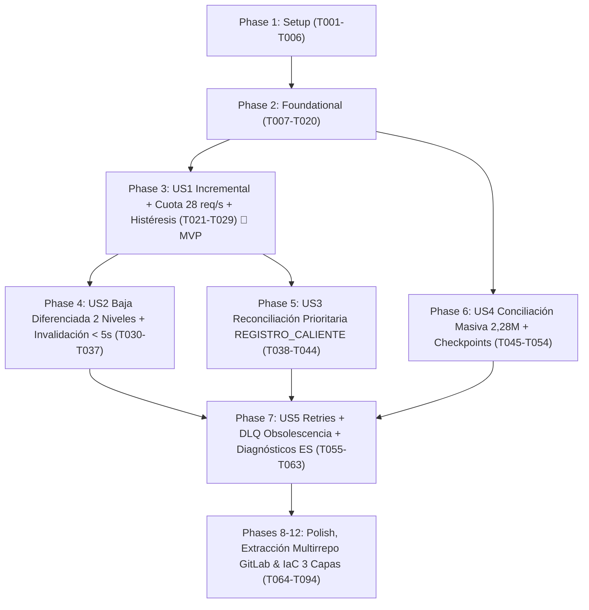

# Tasks: Sincronizador de Identidades (`sso-sincronizador`, Solo Lectura) y Conciliación Masiva (`sso-conciliacion-job`) desde Google Workspace

**Input**: Documentos de diseño desde `/specs/002-sincronizador-conciliacion-gws/`
**Prerequisites**: [plan.md](file:///C:/Users/anarvaez/Documents/Projects/MINEDEC/SSO/Desarrollo/minedec-sso/specs/002-sincronizador-conciliacion-gws/plan.md) (requerido), [spec.md](file:///C:/Users/anarvaez/Documents/Projects/MINEDEC/SSO/Desarrollo/minedec-sso/specs/002-sincronizador-conciliacion-gws/spec.md) (requerido para historias de usuario), [research.md](file:///C:/Users/anarvaez/Documents/Projects/MINEDEC/SSO/Desarrollo/minedec-sso/specs/002-sincronizador-conciliacion-gws/research.md), [data-model.md](file:///C:/Users/anarvaez/Documents/Projects/MINEDEC/SSO/Desarrollo/minedec-sso/specs/002-sincronizador-conciliacion-gws/data-model.md), [contracts/sync-reconciliation-api.openapi.yaml](file:///C:/Users/anarvaez/Documents/Projects/MINEDEC/SSO/Desarrollo/minedec-sso/specs/002-sincronizador-conciliacion-gws/contracts/sync-reconciliation-api.openapi.yaml), [quickstart.md](file:///C:/Users/anarvaez/Documents/Projects/MINEDEC/SSO/Desarrollo/minedec-sso/specs/002-sincronizador-conciliacion-gws/quickstart.md)

**Tests**: **OBLIGATORIOS** por mandato constitucional (Principios IV y XIII: cobertura automatizada `>= 70%` en `Jest + Supertest`, suite de conformidad de cuota `<= 28 req/s`, invalidación de caché `<= 300 s`, conciliación de `REGISTRO_CALIENTE` `< 10 s` p95, reanudación de checkpoints con `pg_try_advisory_lock` y obsolescencia de `DLQ`).

**Organization**: Las tareas están agrupadas por historia de usuario (`US1` a `US5`) para permitir la implementación, prueba e integración independiente de cada incremento funcional en la arquitectura multirrepositorio de GitLab (`git.sitimapa.co`).

## Format: `[ID] [P?] [Story] Descripción con ruta exacta de archivo`

- **[P]**: Puede ejecutarse en paralelo (archivos distintos, sin dependencias bloqueantes en curso).
- **[Story]**: Etiqueta de trazabilidad a la historia de usuario (`[US1]`, `[US2]`, `[US3]`, `[US4]`, `[US5]`).
- Todas las tareas incluyen las rutas exactas de los archivos a crear o modificar.

## Path Conventions

- **Repositorios Independientes de Paquete y Microservicios (`c2-sso/microservicios/*`, mapeados localmente en `../microservicios/<servicio>`)**:
  - Paquete transversal DRY (`@minedec/shared` publicado en GitLab NPM Package Registry): `../microservicios/shared/src/`
  - Microservicio Sincronizador (`sso-sincronizador` en Cloud Run Service, cuenta `sa-sso-sync`): `../microservicios/sincronizador/src/`, `../microservicios/sincronizador/tests/`, `../microservicios/sincronizador/.gitlab-ci.yml`
  - Job de Conciliación Masiva (`sso-conciliacion-job` en Cloud Run Job, cuenta `sa-sso-sync-job`): `../microservicios/conciliacion-job/src/`, `../microservicios/conciliacion-job/tests/`, `../microservicios/conciliacion-job/.gitlab-ci.yml`
  - Servicio PIP de Identidad (integración `REGISTRO_CALIENTE` y migraciones DDL): `../microservicios/pip-identity-service/src/`, `../microservicios/pip-identity-service/migrations/`
  - Esquemas DBML canónicos en el repositorio de gobierno (`minedec-sso`): `docs/esquemas-bd/`
- **Repositorio Central de Infraestructura en 3 Capas (`c2-sso/devops/iac-terraform`, mapeado en `../iac-terraform`, rama sincronizada `spec/002-sincronizador-conciliacion-gws`)**:
  - Capa 1 (Módulos reutilizables): `../iac-terraform/modulos/`
  - Capa 2 (Plantillas por stack sin `host`): `../iac-terraform/plantillas/{devops,data,apps}/`
  - Capa 3 (Despliegues por ambiente): `../iac-terraform/despliegues/{des,pre,pro}/{devops,data,apps}/` para `mec-003-sso-des`, `mec-003-sso-pre` y `mec-003-sso-pro` sobre la Shared VPC (`mec-003-sha-net-des`, `mec-003-sha-net-pre`, `mec-003-sha-net-pro-511014`), empaquetados con `../iac-terraform/scripts/bundle.sh` e invocados en Google Cloud Infrastructure Manager mediante `sa-infra-manager@mec-003-sso-<amb>.iam.gserviceaccount.com` desde `../iac-terraform/.gitlab-ci.yml`.

---

## Phase 1: Setup (Independent Repositories `sincronizador` & `conciliacion-job`)

**Purpose**: Inicializar los repositorios independientes `../microservicios/sincronizador` (`@minedec/sincronizador`) y `../microservicios/conciliacion-job` (`@minedec/conciliacion-job`) en TypeScript 5.8+ (`Node.js 22 LTS`), registrando el consumo de `@minedec/shared` desde el GitLab NPM Package Registry, las dependencias de GCP (`@google-cloud/pubsub`, `@google-cloud/tasks`) y las fronteras de Arquitectura Hexagonal en ESLint y Jest.

- [X] T001 Configurar las dependencias `@google-cloud/pubsub`, `@google-cloud/tasks` y `@minedec/shared` junto con `.npmrc` (apuntando al GitLab NPM Package Registry `https://git.sitimapa.co/api/v4/projects/<PROJECT_ID>/packages/npm/`) en `../microservicios/sincronizador/package.json` y `../microservicios/conciliacion-job/package.json`
- [X] T002 [P] Crear el manifiesto y configuración TypeScript estricta (`strict: true`, `moduleResolution: "NodeNext"`) del microservicio Sincronizador (`@minedec/sincronizador`) en `../microservicios/sincronizador/package.json` y `../microservicios/sincronizador/tsconfig.json`
- [X] T003 [P] Crear el manifiesto y configuración TypeScript estricta (`strict: true`, `moduleResolution: "NodeNext"`) del Job de Conciliación Masiva (`@minedec/conciliacion-job`) en `../microservicios/conciliacion-job/package.json` y `../microservicios/conciliacion-job/tsconfig.json`
- [X] T004 [P] Configurar las exportaciones públicas y tipos compartidos de sincronización en `../microservicios/shared/package.json` y `../microservicios/shared/tsconfig.json`
- [X] T005 [P] Configurar las reglas de arquitectura de `eslint.config.mjs` para exigir que `src/domain/**` y `src/application/**` permanezcan 100% libres de decoradores `@injectable()`/`@inject()` y de SDKs de infraestructura en `../microservicios/sincronizador/eslint.config.mjs` y `../microservicios/conciliacion-job/eslint.config.mjs`
- [X] T006 [P] Configurar `Jest` con umbrales de cobertura obligatorios `>= 70%` en `../microservicios/sincronizador/jest.config.ts` y `../microservicios/conciliacion-job/jest.config.ts`

---

## Phase 2: Foundational (Blocking Prerequisites)

**Purpose**: Infraestructura base de datos relacional (`003_sync_reconciliation_schema.sql`), calculador determinista de huella `hash_payload_gws`, gobernador distribuido de cuota (`<= 28 req/s`) con histéresis en Redis, cliente Google Workspace de **solo lectura** mediante `IAM Credentials API signJwt` (`0` llaves JSON, `sa-sso-sync` / `sa-sso-sync-job` -> `sa-workspace-reader`), bloqueos consultivos (`pg_try_advisory_lock`), generador de diagnósticos en español y modelos/puertos de dominio.

**⚠️ CRITICAL**: Ninguna historia de usuario puede comenzar hasta completar esta fase.

- [X] T007 Crear la migración DDL estática con los enums `tipo_proceso_conciliacion_enum`, `estado_particion_conciliacion_enum`, `modo_ingesta_sincronizacion_enum`, `estado_fallo_dlq_enum`, las tablas `checkpoint_conciliacion`, `evento_sincronizacion_procesado`, `registro_fallo_sincronizacion`, la ampliación de `cuenta_institucional` (`hash_payload_gws`, `'ELIMINADA_GWS'`) y los nuevos códigos de `auditoria_evento` en `../microservicios/pip-identity-service/migrations/003_sync_reconciliation_schema.sql`
- [X] T008 [P] Actualizar los esquemas DBML canónicos para reflejar las tablas `checkpoint_conciliacion`, `evento_sincronizacion_procesado`, `registro_fallo_sincronizacion` y la columna `hash_payload_gws` de `cuenta_institucional` en `docs/esquemas-bd/etapa-1-identidad-pip-auditoria.dbml` y `docs/esquemas-bd/00-esquema-maestro-completo.dbml`
- [X] T009 [P] Implementar el calculador determinista de huella `SHA-256` (`hashPayloadGws`) sobre atributos canónicos de Google Workspace (`id`, `primaryEmail`, `suspended`, `archived`, `orgUnitPath`, `name.fullName`, `customSchemas.MINEDEC_Perfil`) en `../microservicios/shared/src/domain/gws-payload-hasher.ts`
- [X] T010 [P] Implementar el gobernador distribuido de cuota en Redis (`<= 28 req/s` agregado = 70% de `2.400 req/min`, con reserva de `<= 5 req/s` para `REGISTRO_CALIENTE`, `<= 23 req/s` para flujo incremental normal, reducción a `<= 8 req/s` con bandera `minedec:sync:quota:batch_active` activa y máquina de estados con histéresis `INDIVIDUAL_GET` <-> `LOTE_LIST_500`) en `../microservicios/shared/src/cache/sync-quota-governor.ts`
- [X] T011 [P] Implementar el gestor de bloqueo consultivo de particiones en AlloyDB (`pg_try_advisory_lock(lock_advisory_key)`, `pg_advisory_unlock(lock_advisory_key)` y derivación determinista `int8` desde `SHA-256(dominio || ':' || org_unit_path || ':' || tipo_proceso)`) en `../microservicios/shared/src/db/partition-advisory-lock.ts`
- [X] T012 [P] Implementar el constructor estandarizado de diagnósticos explicativos en lenguaje natural en español (estructura obligatoria de 4 partes: `componenteAfectado`, `impactoOperativo`, `mitigacionActiva`, `accionRecomendada`, además de `resumenEjecutivo`) en `../microservicios/shared/src/observability/sync-diagnostic-builder.ts`
- [X] T013 [P] Exportar los módulos transversales `gws-payload-hasher`, `sync-quota-governor`, `partition-advisory-lock` y `sync-diagnostic-builder` en el barril público `../microservicios/shared/src/index.ts`
- [X] T014 [P] Definir las entidades de dominio (`EventoSincronizacionGws`, `CheckpointConciliacion`, `RegistroFalloSincronizacion`, `ResultadoSincronizacionCuenta`, `DiagnosticoOperativoSync`) libres de decoradores en `../microservicios/sincronizador/src/domain/entities/sync-entities.ts`
- [X] T015 [P] Definir los puertos de dominio (`IGoogleDirectoryReadOnlyPort`, `ISyncIdentityRepositoryPort`, `ICheckpointRepositoryPort`, `IDlqRepositoryPort`, `ISyncCacheInvalidatorPort`, `ISyncTaskDispatcherPort`) libres de decoradores en `../microservicios/sincronizador/src/domain/ports/sync-ports.ts`
- [X] T016 [P] Implementar los esquemas de validación `zod` para eventos Pub/Sub push, payloads de Cloud Tasks, peticiones administrativas (`trigger`, `deactivate`, `dlq/replay`), respuestas de diagnósticos y lectura del perfil `customSchemas.MINEDEC_Perfil` en `../microservicios/sincronizador/src/infrastructure/http/schemas/sync-api.schemas.ts`
- [X] T017 Implementar el adaptador de **solo lectura** de Google Workspace Admin SDK Directory API (`users.get`, `users.list` con `projection=full` y `customFieldMask=MINEDEC_Perfil`) utilizando exclusivamente `IAM Credentials API signJwt` (`sa-sso-sync` / `sa-sso-sync-job` -> `sa-workspace-reader` con scope `https://www.googleapis.com/auth/admin.directory.user.readonly`, `0` llaves JSON y bloqueo estático/runtime de métodos de escritura) en `../microservicios/sincronizador/src/infrastructure/gws/gws-directory-readonly.adapter.ts`
- [X] T018 [P] Implementar los repositorios SQL parametrizados (`$1, $2`) de deduplicación (`evento_sincronizacion_procesado`), checkpoints (`checkpoint_conciliacion`) y bandeja `DLQ` (`registro_fallo_sincronizacion`) en `../microservicios/sincronizador/src/infrastructure/persistence/alloydb-sync-state.repository.ts`
- [X] T019 [P] Implementar el adaptador de despacho hacia las colas de Cloud Tasks (`sso-sync-priority-hot-reg` y `sso-sync-incremental`) con propagación de `trace_id` y token OIDC de `sa-sso-sync` en `../microservicios/sincronizador/src/infrastructure/messaging/cloud-tasks-dispatcher.adapter.ts`
- [X] T020 Configurar los Composition Roots de `InversifyJS` (`decorate(injectable(), ...)` / `toDynamicValue()` exclusivamente fuera de `domain/` y `application/`) para ambos servicios en `../microservicios/sincronizador/src/container.ts` y `../microservicios/conciliacion-job/src/container.ts`

**Checkpoint**: Base de datos, gobernador de cuotas `28 req/s`, cliente GWS `readonly` sin llaves JSON, bloqueos consultivos y contenedores DI listos.

---

## Phase 3: User Story 1 - Sincronización Incremental Casi en Tiempo Real con Protección de Cuotas y Conmutación a Lotes (Priority: P1) 🎯 MVP

**Goal**: Recibir notificaciones de cambios desde Google Cloud Identity / Workspace vía Cloud Pub/Sub (`POST /internal/v1/sync/events/pubsub-push` desde `sso-gws-directory-events`), deduplicar por `id_evento_externo`, procesar actualizaciones incrementales (`POST /internal/v1/sync/tasks/incremental`) y barridos delta cada 2 minutos (`POST /internal/v1/sync/tasks/delta-sweep`) respetando el techo duro de `<= 28 req/s`, omitiendo escrituras redundantes cuando `hash_payload_gws` no cambia, y conmutando automáticamente entre `INDIVIDUAL_GET` y `LOTE_LIST_500` con histéresis (`>= 100` pendientes o `> 10 s` activa lotes; `< 20` pendientes restaura individual).

**Independent Test**: Enviar ráfagas de 100 a 500 eventos Pub/Sub push (incluyendo duplicados y eventos de alta simultánea) contra el servicio en pruebas unitarias e integración; verificar deduplicación `100%`, tasa hacia GWS `<= 28 req/s`, activación de `LOTE_LIST_500` al superar 100 pendientes, retorno a `INDIVIDUAL_GET` al bajar de 20 pendientes y omisión de `UPDATE` cuando `hash_payload_gws` coincide.

### Tests for User Story 1 (MANDATORY >= 70% Coverage) ⚠️

- [X] T021 [P] [US1] Crear pruebas unitarias del gobernador de cuota (`<= 28 req/s`, reparto `5 req/s` + `23 req/s`), máquina de histéresis (`>= 100` o `> 10 s` -> `LOTE_LIST_500`; `< 20` -> `INDIVIDUAL_GET`) y cálculo de `hashPayloadGws` en `../microservicios/sincronizador/tests/unit/sync-quota-hysteresis.spec.ts`
- [X] T022 [P] [US1] Crear pruebas unitarias del caso de uso de sincronización incremental (deduplicación en Redis L2 y `evento_sincronizacion_procesado`, omisión por `hash_payload_gws` idéntico, rechazo de dominios inactivos en `dominio_institucional` y auditoría encadenada) en `../microservicios/sincronizador/tests/unit/incremental-sync.use-case.spec.ts`
- [X] T023 [P] [US1] Crear pruebas de contrato e integración con `Supertest` para `POST /internal/v1/sync/events/pubsub-push`, `POST /internal/v1/sync/tasks/incremental` y `POST /internal/v1/sync/tasks/delta-sweep` en `../microservicios/sincronizador/tests/integration/sincronizador-incremental.integration.spec.ts`

### Implementation for User Story 1

- [X] T024 [US1] Implementar el caso de uso `ProcessPubSubEventUseCase` (validación de sobre Pub/Sub, verificación de dominio activo en `dominio_institucional`, deduplicación rápida en Redis L2 + tabla `evento_sincronizacion_procesado`, evaluación de histéresis y encolado en Cloud Tasks `sso-sync-incremental`) en `../microservicios/sincronizador/src/application/use-cases/process-pubsub-event.use-case.ts`
- [X] T025 [US1] Implementar el caso de uso `ExecuteIncrementalSyncUseCase` (consumo de cuota en `sync-quota-governor`, consulta `INDIVIDUAL_GET` o agrupación `LOTE_LIST_500`, normalización de `CEDULA`/`PASAPORTE`/`CODIGO_MINEDEC` y RUC de 13 dígitos Persona Natural -> primeros 10 dígitos como `CEDULA`, comparación de `hash_payload_gws`, upsert transaccional en `persona_identidad`/`cuenta_institucional`/`perfil_atributo_usuario` y registro en `auditoria_evento`) en `../microservicios/sincronizador/src/application/use-cases/execute-incremental-sync.use-case.ts`
- [X] T026 [US1] Implementar el caso de uso `ExecuteDeltaSweepUseCase` (barrido incremental cada 2 minutos por dominios activos en `dominio_institucional` para recuperar eventos no entregados por Pub/Sub) en `../microservicios/sincronizador/src/application/use-cases/execute-delta-sweep.use-case.ts`
- [X] T027 [US1] Implementar el repositorio de escritura transaccional de sincronización sobre `persona_identidad`, `cuenta_institucional` (con `hash_payload_gws`), `perfil_atributo_usuario` y `auditoria_evento` en `../microservicios/sincronizador/src/infrastructure/persistence/alloydb-sync-identity.repository.ts`
- [X] T028 [US1] Implementar el controlador Express 5 para los endpoints internos `POST /internal/v1/sync/events/pubsub-push`, `POST /internal/v1/sync/tasks/incremental` y `POST /internal/v1/sync/tasks/delta-sweep` con verificación de token OIDC de `sa-sso-sync` en `../microservicios/sincronizador/src/infrastructure/http/controllers/internal-sync.controller.ts`
- [X] T029 [US1] Crear la aplicación HTTP Express 5 (`app.ts`) y el punto de entrada (`main.ts`) del servicio `../microservicios/sincronizador` con middlewares de seguridad (`helmet`, correlación `trace_id`, manejo de errores RFC 7807) en `../microservicios/sincronizador/src/infrastructure/http/app.ts` y `../microservicios/sincronizador/src/main.ts`

**Checkpoint**: User Story 1 (MVP) funcional y verificable de forma independiente.

---

## Phase 4: User Story 2 - Propagación Inmediata de Suspensiones, Bajas y Cambios de Contexto con Invalidación de Caché y Baja Lógica Diferenciada (Priority: P1)

**Goal**: Propagar suspensiones (`suspended=true`), archivados (`archived=true`), eliminaciones (`USER_DELETED`) y cambios de contexto organizacional (`orgUnitPath` / `MINEDEC_Perfil`) hacia AlloyDB, invalidando de inmediato la caché L2 en Memorystore Redis (`minedec:pip:identity:*` y `minedec:pdp:authz:*`) y publicando en Pub/Sub (`sso-cache-invalidation`) en `< 5 s` p95 (`<= 300 s` límite duro), aplicando la regla de **Baja Lógica Diferenciada en Dos Niveles**:
1. La baja/suspensión de una `CuentaInstitucional` solo marca esa cuenta (`SUSPENDIDA_GWS` o `ELIMINADA_GWS`) y revoca únicamente sus sesiones/accesos asociados sin afectar otras cuentas activas de la misma `PersonaIdentidad`; solo si quedan `0` cuentas activas, `PersonaIdentidad.estado_persona` pasa a `INACTIVA`.
2. La desactivación directa de la `PersonaIdentidad` (`POST /api/v1/admin/sync/persons/{idInterno}/deactivate`) desactiva la identidad maestra (`INACTIVA`), suspende todas sus cuentas institucionales vinculadas y purga en cascada todos sus accesos y cachés.

**Independent Test**: (a) Persona con 2 cuentas activas: suspender 1 cuenta en GWS -> verificar que la cuenta 1 pasa a `SUSPENDIDA_GWS`, la cuenta 2 sigue `ACTIVA`, la `PersonaIdentidad` sigue `ACTIVA` y solo se invalida la caché de la cuenta 1 en `< 5 s`. (b) Suspender la segunda cuenta -> verificar que `PersonaIdentidad` pasa a `INACTIVA`. (c) Invocar `POST /api/v1/admin/sync/persons/{idInterno}/deactivate` sobre una persona con 2 cuentas activas -> verificar que la persona y ambas cuentas quedan desactivadas e invalidadas en Redis en cascada.

### Tests for User Story 2 (MANDATORY >= 70% Coverage) ⚠️

- [X] T030 [P] [US2] Crear pruebas unitarias de la regla de Baja Lógica Diferenciada en Dos Niveles (baja aislada de `CuentaInstitucional` con otra cuenta activa vs. última cuenta activa -> `PersonaIdentidad = INACTIVA`, y baja en cascada de `PersonaIdentidad` -> desactivación de todas sus cuentas) en `../microservicios/sincronizador/tests/unit/two-level-deactivation.use-case.spec.ts`
- [X] T031 [P] [US2] Crear pruebas de integración para la invalidación inmediata de caché Redis (`< 5 s` p95 nominal y garantía `<= 300 s` por TTL) y el endpoint `POST /api/v1/admin/sync/persons/{idInterno}/deactivate` en `../microservicios/sincronizador/tests/integration/cache-invalidation-deactivation.integration.spec.ts`

### Implementation for User Story 2

- [X] T032 [US2] Implementar el adaptador de invalidación de caché L2 en Memorystore Redis y publicación en el tópico Pub/Sub `sso-cache-invalidation` (soportando purga granular por `CuentaInstitucional` y purga total en cascada por `PersonaIdentidad`) en `../microservicios/sincronizador/src/infrastructure/cache/redis-pubsub-cache-invalidator.adapter.ts`
- [X] T033 [US2] Implementar el servicio de dominio/aplicación de Baja Lógica Diferenciada en Dos Niveles para eventos de suspensión/baja de cuenta desde GWS (`CUENTA_SUSPENDIDA_GWS`, `CUENTA_ELIMINADA_GWS`, `CUENTA_REACTIVADA_GWS`, evaluación de conteo de cuentas activas restantes y transición condicional de `PersonaIdentidad`) en `../microservicios/sincronizador/src/application/use-cases/handle-account-lifecycle-change.use-case.ts`
- [X] T034 [US2] Implementar el caso de uso `DeactivatePersonCascadeUseCase` para la desactivación directa de `PersonaIdentidad` (`estado_persona = 'INACTIVA'`, desactivación en cascada de todas sus filas en `cuenta_institucional`, purga global en Redis y registro en `auditoria_evento` con `PERSONA_DESACTIVADA_CASCADA`) en `../microservicios/sincronizador/src/application/use-cases/deactivate-person-cascade.use-case.ts`
- [X] T035 [US2] Integrar `HandleAccountLifecycleChangeUseCase` y la invalidación inmediata de caché dentro del flujo incremental cuando cambian `suspended`, `archived`, `USER_DELETED`, `orgUnitPath` o `customSchemas.MINEDEC_Perfil` en `../microservicios/sincronizador/src/application/use-cases/execute-incremental-sync.use-case.ts`
- [X] T036 [US2] Exponer el endpoint administrativo `POST /api/v1/admin/sync/persons/{idInterno}/deactivate` en `../microservicios/sincronizador/src/infrastructure/http/controllers/admin-sync.controller.ts`
- [X] T037 [US2] Registrar las rutas administrativas `/api/v1/admin/sync/*` y la vinculación de `DeactivatePersonCascadeUseCase` e `ISyncCacheInvalidatorPort` en `../microservicios/sincronizador/src/infrastructure/http/app.ts` y `../microservicios/sincronizador/src/container.ts`

**Checkpoint**: User Stories 1 y 2 operativas: sincronización incremental y revocación/baja diferenciada en dos niveles con invalidación `< 5 s`.

---

## Phase 5: User Story 3 - Reconciliación Prioritaria de Identidades Provisionales Creadas en Caliente (`REGISTRO_CALIENTE`) (Priority: P1)

**Goal**: Reconciliar en carril prioritario (`sso-sync-priority-hot-reg`, cuota reservada `<= 5 req/s`, SLA `< 10 s` p95 y `< 15 s` p99) las cuentas creadas en caliente durante el primer login OIDC (`origen_creacion = 'REGISTRO_CALIENTE'`, `estado_persona = 'PENDIENTE_CONCILIACION'`), ejecutando:
- **Promoción In-Place** a `ACTIVA` cuando el documento oficial (`CEDULA`/`PASAPORTE`/`CODIGO_MINEDEC`) no existe previamente en `persona_identidad`.
- **Fusión / Re-vinculación Atómica** cuando el documento oficial ya pertenece a una `PersonaIdentidad` consolidada existente (reasignando `cuenta_institucional.id_interno`, eliminando el registro provisional huérfano dentro de la misma transacción y auditando `REGISTRO_CALIENTE_UNIFICADO`).
- **Caso borde sin documento válido**: si la cuenta en GWS carece de `customSchemas.MINEDEC_Perfil` válido, mantener `PENDIENTE_CONCILIACION` con motivo `SIN_IDENTIFICACION_VALIDA` y auditar la anomalía para acceso mínimo restringido.

**Independent Test**: Crear una identidad provisional (`REGISTRO_CALIENTE` con placeholder `HOT-...`), invocar `POST /internal/v1/sync/tasks/priority-hot-registration`: (1) con una cédula nueva -> verificar promoción a `ACTIVA` en `< 10 s`; (2) con una cédula que ya existe en otra `PersonaIdentidad` -> verificar re-vinculación de la cuenta a la persona existente, eliminación de la fila provisional huérfana y evento `REGISTRO_CALIENTE_UNIFICADO`; (3) sin `MINEDEC_Perfil` -> verificar que permanece en `PENDIENTE_CONCILIACION` (`SIN_IDENTIFICACION_VALIDA`).

### Tests for User Story 3 (MANDATORY >= 70% Coverage) ⚠️

- [X] T038 [P] [US3] Crear pruebas unitarias de `ReconcileHotRegistrationUseCase` cubriendo promoción in-place, fusión atómica con `PersonaIdentidad` existente (eliminación de provisional huérfano) y caso borde `SIN_IDENTIFICACION_VALIDA` en `../microservicios/sincronizador/tests/unit/reconcile-hot-registration.use-case.spec.ts`
- [X] T039 [P] [US3] Crear pruebas de integración para `POST /internal/v1/sync/tasks/priority-hot-registration` verificando uso del carril reservado (`<= 5 req/s`), latencia `< 10 s` p95 y consistencia referencial en `../microservicios/sincronizador/tests/integration/hot-registration-reconciliation.integration.spec.ts`

### Implementation for User Story 3

- [X] T040 [US3] Implementar el caso de uso `ReconcileHotRegistrationUseCase` (consumo de cuota reservada `<= 5 req/s`, consulta prioritaria a GWS, promoción in-place o fusión/re-vinculación transaccional con `PersonaIdentidad` existente, manejo de `SIN_IDENTIFICACION_VALIDA`, invalidación de caché Redis y auditoría `REGISTRO_CALIENTE_CONCILIADO` / `REGISTRO_CALIENTE_UNIFICADO`) en `../microservicios/sincronizador/src/application/use-cases/reconcile-hot-registration.use-case.ts`
- [X] T041 [US3] Implementar la operación transaccional `reconcileOrMergeHotIdentity` (con bloqueo `SELECT ... FOR UPDATE`, reasignación de llaves foráneas de `cuenta_institucional` y `perfil_atributo_usuario` y borrado del registro provisional huérfano) en `../microservicios/sincronizador/src/infrastructure/persistence/alloydb-sync-identity.repository.ts`
- [X] T042 [US3] Exponer el endpoint interno `POST /internal/v1/sync/tasks/priority-hot-registration` en `../microservicios/sincronizador/src/infrastructure/http/controllers/internal-sync.controller.ts`
- [X] T043 [US3] Integrar el disparo asíncrono inmediato hacia la cola prioritaria `sso-sync-priority-hot-reg` al finalizar el aprovisionamiento en caliente (`HotRegistrationUseCase`) en `../microservicios/pip-identity-service/src/application/use-cases/hot-registration.use-case.ts`
- [X] T044 [US3] Registrar `ReconcileHotRegistrationUseCase` en el Composition Root `../microservicios/sincronizador/src/container.ts`

**Checkpoint**: User Stories 1, 2 y 3 (todas las historias P1) completas y verificadas.

---

## Phase 6: User Story 4 - Carga Inicial y Conciliación Nocturna Masiva Particionada con Puntos de Control (Priority: P2)

**Goal**: Ejecutar la carga inicial (`CARGA_INICIAL`) y la conciliación nocturna (`CONCILIACION_NOCTURNA`) para `~2,28 millones` de cuentas en el Cloud Run Job aislado `../microservicios/conciliacion-job` (`sso-conciliacion-job`), particionando por `(dominio, org_unit_path, tipo_proceso)` sobre los dominios activos en `dominio_institucional` (`D-21`), usando lotes de `500` cuentas con tope dedicado `<= 20 req/s` (activando `minedec:sync:quota:batch_active` para reservar `>= 8 req/s` al tráfico en tiempo real), omitiendo escrituras cuando `hash_payload_gws` no cambió, guardando `next_page_token` en `checkpoint_conciliacion` al cierre de cada página, garantizando exclusión mutua con `pg_try_advisory_lock(lock_advisory_key)` y recuperando particiones huérfanas con `heartbeat_en > 15 minutos`, además de exponer `GET /api/v1/admin/sync/checkpoints` y `POST /api/v1/admin/sync/partitions/trigger` (`409 Conflict` si está en ejecución activa).

**Independent Test**: Ejecutar el motor de conciliación sobre un dominio con múltiples páginas de 500 cuentas, simular fallo abrupto en la página 3, relanzar el job y comprobar que reanuda desde el `next_page_token` de la página 3 sin reprocesar las páginas 1 y 2, que un segundo worker concurrente sobre la misma partición es bloqueado por `pg_try_advisory_lock` (`409 Conflict`), que una partición con `heartbeat_en > 15 min` es recuperada automáticamente, y que las cuentas con `hash_payload_gws` idéntico se contabilizan como `total_omitidos_sin_cambios` sin ejecutar `UPDATE`.

### Tests for User Story 4 (MANDATORY >= 70% Coverage) ⚠️

- [X] T045 [P] [US4] Crear pruebas unitarias del motor de conciliación masiva por partición (adquisición de `pg_try_advisory_lock`, rescate de partición huérfana `heartbeat_en > 15 min`, paginación de 500 registros a `<= 20 req/s`, omisión por `hash_payload_gws` y guardado de `next_page_token`) en `../microservicios/conciliacion-job/tests/unit/partition-reconciliation.use-case.spec.ts`
- [X] T046 [P] [US4] Crear pruebas de integración para la reanudación de checkpoints en `../microservicios/conciliacion-job` y los endpoints `GET /api/v1/admin/sync/checkpoints` y `POST /api/v1/admin/sync/partitions/trigger` (incluyendo rechazo `409 Conflict` cuando la partición está activa) en `../microservicios/conciliacion-job/tests/integration/batch-reconciliation-checkpoints.integration.spec.ts`

### Implementation for User Story 4

- [X] T047 [P] [US4] Definir las entidades y puertos del Job de Conciliación Masiva (`ConfiguracionParticionJob`, `ResultadoEjecucionParticion`, `IBatchReconciliationRunnerPort`) libres de decoradores en `../microservicios/conciliacion-job/src/domain/batch-reconciliation.types.ts`
- [X] T048 [US4] Implementar el caso de uso `RunPartitionReconciliationUseCase` (consulta de dominios activos en `dominio_institucional`, bloqueo `pg_try_advisory_lock(lock_advisory_key)`, verificación de `heartbeat_en > 15 min`, activación de bandera Redis `minedec:sync:quota:batch_active`, paginación `users.list(maxResults=500)` a `<= 20 req/s`, comparación en bloque de `hash_payload_gws`, upsert por lotes, persistencia de `next_page_token` y contadores por página, y auditoría `CONCILIACION_PARTICION_INICIADA`/`CONCILIACION_PARTICION_COMPLETADA`) en `../microservicios/conciliacion-job/src/application/use-cases/run-partition-reconciliation.use-case.ts`
- [X] T049 [US4] Implementar el repositorio de escritura masiva por lotes (`UNNEST` / parámetros posicionales seguros `$1..$n`) y actualización transaccional de `checkpoint_conciliacion` y `heartbeat_en` en `../microservicios/conciliacion-job/src/infrastructure/persistence/alloydb-batch-reconciliation.repository.ts`
- [X] T050 [US4] Implementar el punto de entrada CLI/Cloud Run Job (`main.ts`) que lee las variables de entorno de partición (`SYNC_DOMINIO`, `SYNC_ORG_UNIT_PATH`, `SYNC_TIPO_PROCESO`, `SYNC_FORZAR_REINICIO`), gestiona señales `SIGTERM`/`SIGINT` liberando el `pg_advisory_unlock` y ejecuta la conciliación en `../microservicios/conciliacion-job/src/main.ts`
- [X] T051 [US4] Implementar los casos de uso administrativos `ListReconciliationCheckpointsUseCase` y `TriggerPartitionReconciliationUseCase` (con verificación de bloqueo activo y `heartbeat_en <= 15 min` para devolver `409 Conflict` con diagnóstico en español) en `../microservicios/sincronizador/src/application/use-cases/manage-reconciliation-partitions.use-case.ts`
- [X] T052 [US4] Exponer los endpoints `GET /api/v1/admin/sync/checkpoints` y `POST /api/v1/admin/sync/partitions/trigger` en `../microservicios/sincronizador/src/infrastructure/http/controllers/admin-sync.controller.ts`
- [X] T053 [US4] Vincular `RunPartitionReconciliationUseCase` y `AlloyDbBatchReconciliationRepository` en `../microservicios/conciliacion-job/src/container.ts`
- [X] T054 [US4] Vincular `ListReconciliationCheckpointsUseCase` y `TriggerPartitionReconciliationUseCase` en `../microservicios/sincronizador/src/container.ts`

**Checkpoint**: User Story 4 completa: conciliación masiva de 2,28M de cuentas con checkpoints transaccionales, omisión por hash y bloqueo consultivo.

---

## Phase 7: User Story 5 - Resiliencia con Reintentos Exponenciales, Bandeja `DLQ`, Reprocesamiento Controlado y Diagnósticos en Lenguaje Natural (Priority: P2)

**Goal**: Aplicar retroceso exponencial con variación aleatoria `(2^n) segundos + jitter (0..1000 ms)` (`n = 0..4`, máx. 5 intentos) respetando la cabecera `Retry-After` ante errores `429`/`503` de Google Workspace; derivar eventos que agotan los 5 intentos o sufren errores de datos no recuperables a `registro_fallo_sincronizacion` (`DLQ` / `sso-sync-dlq`) con diagnóstico explicativo en español (4 partes: componente afectado, impacto operativo, mitigación activa y remediación); permitir listar (`GET /api/v1/admin/sync/dlq`) y reprocesar (`POST /api/v1/admin/sync/dlq/replay`) bajo el techo `<= 28 req/s` descartando como `RESUELTO_POR_OBSOLESCENCIA` cualquier evento cuyo `timestamp_evento_gws < cuenta_institucional.ultima_sincronizacion_en`; y exponer `GET /internal/v1/sync/health/detailed`.

**Independent Test**: (1) Simular respuestas `429 Too Many Requests` con y sin `Retry-After` -> verificar tiempos de espera `(2^n)s + jitter` y derivación a `DLQ` tras 5 intentos fallidos con las 4 partes del diagnóstico en español. (2) Invocar `POST /api/v1/admin/sync/dlq/replay` sobre dos registros en `DLQ`: uno vigente (se reprocesa a `RESUELTO_REPROCESADO`) y otro más antiguo que `ultima_sincronizacion_en` (se marca `RESUELTO_POR_OBSOLESCENCIA` sin sobrescribir la cuenta). (3) Consultar `GET /internal/v1/sync/health/detailed` -> verificar presupuesto de cuota, modo `INDIVIDUAL_GET`/`LOTE_LIST_500` y resumen en español.

### Tests for User Story 5 (MANDATORY >= 70% Coverage) ⚠️

- [X] T055 [P] [US5] Crear pruebas unitarias de la política de reintentos exponenciales `(2^n)s + jitter (0..1000 ms)` con respeto a `Retry-After`, derivación a `DLQ`, protección de obsolescencia (`RESUELTO_POR_OBSOLESCENCIA`) y estructura de 4 partes del diagnóstico en español en `../microservicios/sincronizador/tests/unit/dlq-retry-diagnostics.use-case.spec.ts`
- [X] T056 [P] [US5] Crear pruebas de integración para `GET /api/v1/admin/sync/dlq`, `POST /api/v1/admin/sync/dlq/replay` y `GET /internal/v1/sync/health/detailed` en `../microservicios/sincronizador/tests/integration/dlq-replay-and-health.integration.spec.ts`

### Implementation for User Story 5

- [X] T057 [P] [US5] Implementar la política de retroceso exponencial `(2^n) segundos + jitter (0..1000 ms)` (`n = 0..4`, máx. 5 intentos) con lectura prioritaria de cabecera HTTP `Retry-After` en `../microservicios/shared/src/resilience/exponential-backoff-policy.ts` y exportarla en `../microservicios/shared/src/index.ts`
- [X] T058 [US5] Integrar la política de retroceso exponencial y la captura hacia `registro_fallo_sincronizacion` (`DLQ`) con generación automática del diagnóstico en español de 4 partes (`SyncDiagnosticBuilder`) y auditoría `EVENTO_DERIVADO_DLQ` en `../microservicios/sincronizador/src/application/use-cases/record-sync-failure-dlq.use-case.ts`
- [X] T059 [US5] Implementar los casos de uso `ListDlqFailuresUseCase` y `ReplayDlqFailuresUseCase` (reprocesamiento regulado por el gobernador `<= 28 req/s`, validación de obsolescencia comparando `timestamp_evento_gws` contra `cuenta_institucional.ultima_sincronizacion_en` para marcar `RESUELTO_POR_OBSOLESCENCIA` + auditoría `DLQ_DESCARTADO_OBSOLESCENCIA`, o re-ejecución hacia `RESUELTO_REPROCESADO` + auditoría `DLQ_REPROCESADO_EXITOSO`) en `../microservicios/sincronizador/src/application/use-cases/manage-dlq-replay.use-case.ts`
- [X] T060 [US5] Implementar el caso de uso `GetDetailedSyncHealthUseCase` (estado de presupuesto `28 req/s`, modo `INDIVIDUAL_GET`/`LOTE_LIST_500`, cola pendiente, atraso p95, conteo `DLQ`, particiones activas/huérfanas y diagnóstico ejecutivo en español) en `../microservicios/sincronizador/src/application/use-cases/get-detailed-sync-health.use-case.ts`
- [X] T061 [US5] Exponer los endpoints `GET /api/v1/admin/sync/dlq` y `POST /api/v1/admin/sync/dlq/replay` en `../microservicios/sincronizador/src/infrastructure/http/controllers/admin-sync.controller.ts`
- [X] T062 [US5] Exponer el endpoint de observabilidad `GET /internal/v1/sync/health/detailed` en `../microservicios/sincronizador/src/infrastructure/http/controllers/internal-sync.controller.ts`
- [X] T063 [US5] Vincular `RecordSyncFailureDlqUseCase`, `ListDlqFailuresUseCase`, `ReplayDlqFailuresUseCase` y `GetDetailedSyncHealthUseCase` en `../microservicios/sincronizador/src/container.ts`

**Checkpoint**: Todas las historias de usuario (`US1` a `US5`) están implementadas y probadas independientemente.

---

## Phase 8: Polish & Cross-Cutting Concerns (Docker, GitLab CI/CD, 3-Layer Terraform IaC & Conformance Verification)

**Purpose**: Empaquetado seguro de contenedores (`node:22-alpine` non-root), pipelines `.gitlab-ci.yml` en cada repositorio, aprovisionamiento declarativo Terraform HCL (`1.5.7`) en el repositorio central `../iac-terraform` (rama sincronizada `spec/002-sincronizador-conciliacion-gws`) sobre la Shared VPC (`mec-003-sha-net-des`, `mec-003-sha-net-pre`, `mec-003-sha-net-pro-511014`) y validación integral de conformidad arquitectónica y de contrato OpenAPI 3.1.

- [X] T064 [P] Crear el `Dockerfile` multi-etapa endurecido (`node:22-alpine`, usuario sin privilegios `USER node`, sin secretos embebidos) para el servicio `../microservicios/sincronizador` en `../microservicios/sincronizador/Dockerfile`
- [X] T065 [P] Crear el `Dockerfile` multi-etapa endurecido (`node:22-alpine`, usuario sin privilegios `USER node`, sin secretos embebidos) para el job `../microservicios/conciliacion-job` en `../microservicios/conciliacion-job/Dockerfile`
- [X] T066 Configurar los pipelines de Integración Continua en GitLab para compilar, auditar (`ESLint`, `npm audit`), ejecutar pruebas (`>= 70%` cobertura) y publicar las imágenes `sso-sincronizador:$CI_COMMIT_SHA` y `sso-conciliacion-job:$CI_COMMIT_SHA` en Artifact Registry (`sso-containers`) en `../microservicios/sincronizador/.gitlab-ci.yml` y `../microservicios/conciliacion-job/.gitlab-ci.yml`
- [X] T067 [P] Actualizar las definiciones Terraform de IAM en el repositorio de infraestructura para declarar `sa-sso-sync`, `sa-sso-sync-job` y `sa-workspace-reader` con permiso `roles/iam.serviceAccountTokenCreator` (`signJwt` sin llaves JSON) y mínimo privilegio en `../iac-terraform/modulos/iam/` y `../iac-terraform/plantillas/devops/`
- [X] T068 [P] Crear el módulo Terraform de Cloud Pub/Sub (`sso-gws-directory-events`, `sso-sync-dlq`) y Cloud Tasks (`sso-sync-priority-hot-reg` a `5 dispatches/s` y `sso-sync-incremental` a `23 dispatches/s`) en `../iac-terraform/modulos/pubsub_cloud_tasks_sync/main.tf`, `../iac-terraform/modulos/pubsub_cloud_tasks_sync/variables.tf` y `../iac-terraform/modulos/pubsub_cloud_tasks_sync/outputs.tf`
- [X] T069 [P] Crear los módulos Terraform de Cloud Run (`sso-sincronizador` y `sso-conciliacion-job` con Direct VPC Egress hacia la Shared VPC `mec-003-sha-net-des`/`pre`/`pro-511014`), Cloud Scheduler (barrido delta cada 2 min y conciliación nocturna) y Cloud Monitoring (alertas explicativas en español) en `../iac-terraform/modulos/cloud_run_sincronizador/main.tf`, `../iac-terraform/modulos/cloud_run_conciliacion_job/main.tf` y `../iac-terraform/modulos/monitoring/main.tf`
- [X] T070 Integrar los módulos `pubsub_cloud_tasks_sync`, `cloud_run_sincronizador`, `cloud_run_conciliacion_job` y `monitoring` en la plantilla de aplicaciones `../iac-terraform/plantillas/apps/main.tf`, `../iac-terraform/plantillas/apps/variables.tf` y `../iac-terraform/plantillas/apps/outputs.tf`
- [X] T071 [P] Actualizar las pruebas de alineación de esquema SQL/DBML para validar `003_sync_reconciliation_schema.sql` contra `docs/esquemas-bd/etapa-1-identidad-pip-auditoria.dbml` en `../microservicios/pip-identity-service/tests/unit/sql-schema-alignment.spec.ts`
- [X] T072 [P] Actualizar las pruebas de resolución de los contenedores de Inyección de Dependencias (`../microservicios/sincronizador/src/container.ts` y `../microservicios/conciliacion-job/src/container.ts`) y pureza de `domain/` y `application/` en `../microservicios/sincronizador/tests/unit/container-wiring.spec.ts`
- [X] T073 [P] Actualizar las pruebas de conformidad DevSecOps e IaC (verificación de `Dockerfile`s non-root, ausencia de llaves JSON, validación del contrato `specs/002-sincronizador-conciliacion-gws/contracts/sync-reconciliation-api.openapi.yaml` y módulos Terraform en `../iac-terraform`) en `../microservicios/sincronizador/tests/unit/devops-iac-alignment.spec.ts`
- [X] T074 Ejecutar la validación integral de compilación TypeScript (`npm run build`), linter (`npm run lint`) y suite completa de pruebas con cobertura (`npm test -- --coverage` >= 70%) conforme a `specs/002-sincronizador-conciliacion-gws/quickstart.md`

---

## Phase 9: Convergence (Empaquetado Infrastructure Manager, IAM Mínimo Privilegio y OIDC Tokens)

- [X] T075 Empaquetar los despliegues Terraform mediante `../iac-terraform/scripts/bundle.sh` excluyendo `.terraform` y `.terraform.lock.hcl` antes de invocar `gcloud infra-manager deployments apply` y `gcloud infra-manager previews create` con `--local-source="."` y `--tf-version-constraint="1.5.7"` en `../iac-terraform/.gitlab-ci.yml` per Constitution IV.3 / plan: Infrastructure Manager
- [X] T076 Otorgar `roles/run.invoker` de mínimo privilegio por recurso (`google_cloud_run_v2_service_iam_member` para `sa-sso-sync` y `sa-sso-core` en `../iac-terraform/modulos/cloud_run_sincronizador/main.tf` y `google_cloud_run_v2_job_iam_member` para `sa-sso-sync-job` en `../iac-terraform/modulos/cloud_run_conciliacion_job/main.tf`) y actualizar la URI del `google_cloud_scheduler_job` al endpoint oficial Cloud Run v2 API (`https://run.googleapis.com/v2/projects/.../locations/.../jobs/...:run` con `body = base64encode("{}")`) en `../iac-terraform/modulos/cloud_run_conciliacion_job/main.tf` per Constitution IX / FR-012
- [X] T077 Configurar el `Dockerfile` multi-etapa autónomo de cada microservicio consumiendo `@minedec/shared` desde el GitLab NPM Package Registry antes de `npm ci` y compilando `npm run build` en `../microservicios/pip-identity-service/Dockerfile`, `../microservicios/sincronizador/Dockerfile` y `../microservicios/conciliacion-job/Dockerfile` per Constitution IV.2, XVII
- [X] T078 Adjuntar el bloque `oidcToken: { serviceAccountEmail, audience }` (`sa-sso-sync`) en las tareas HTTP despachadas hacia Cloud Run privado cuando se configure `serviceAccountEmail` en `../microservicios/sincronizador/src/infrastructure/messaging/cloud-tasks-dispatcher.adapter.ts`, `../microservicios/sincronizador/src/container.ts` y `../microservicios/sincronizador/tests/unit/sincronizador-adapters.spec.ts` per Constitution IX / FR-001
- [X] T079 Unificar el puerto por defecto a `8080` y enlazar explícitamente `0.0.0.0` en `app.listen(port, '0.0.0.0', ...)` en `../microservicios/sincronizador/src/main.ts` y `../microservicios/pip-identity-service/src/index.ts` per plan: Cloud Run Service
- [X] T080 Parametrizar con prefijo `sso-` y sufijo `-${var.environment}` los tópicos Pub/Sub y colas Cloud Tasks en `../iac-terraform/modulos/pubsub_cloud_tasks_sync/variables.tf` y consolidar las referencias en `../iac-terraform/plantillas/apps/main.tf` per plan: IaC 3 capas
- [X] T081 Estandarizar `versions.tf` (`required_version = "1.5.7"`, `hashicorp/google ~> 5.0`), añadir `description` a todos los outputs en `../iac-terraform/modulos/*` y `../iac-terraform/plantillas/*` per Constitution IV.3
- [X] T082 Documentar la tabla de fuentes oficiales de Google Cloud / Workspace verificadas mediante `retrieving-developer-knowledge` (`documents/...`) en `specs/001-modelo-identidades-perfil/research.md` y `specs/002-sincronizador-conciliacion-gws/research.md` per Constitution Governance / AGENTS.md

---

## Phase 10: Convergence (Observabilidad Distribuida OpenTelemetry y Alertas SRE)

- [X] T083 Parametrizar `componentName` y autodetectar los metadatos de plataforma de ejecución (`GKE_AUTOPILOT` vía `K8S_POD_NAME`/`K8S_NAMESPACE`, `CLOUD_RUN_SERVICE` vía `K_SERVICE`/`K_REVISION`/`K_CONFIGURATION` y `CLOUD_RUN_JOB` vía `CLOUD_RUN_JOB`/`CLOUD_RUN_EXECUTION`/`CLOUD_RUN_TASK_INDEX`/`CLOUD_RUN_TASK_ATTEMPT`) en `PinoStructuredLogger` y `createStructuredLogger` en `../microservicios/shared/src/observability/logger.ts` per Constitution XV.2
- [X] T084 Propagar el contexto de traza distribuida OpenTelemetry (`traceparent: 00-<traceId>-<spanId>-<flags>`, `X-Cloud-Trace-Context: <traceId>/<spanIdDecimal>;o=1`, `X-Trace-Id` y `X-Span-Id`) extremo a extremo entre Express (`extractOrCreateOtelSpanContext` en `../microservicios/sincronizador/src/infrastructure/http/app.ts`), los adaptadores de Cloud Tasks (`../microservicios/sincronizador/src/infrastructure/messaging/cloud-tasks-dispatcher.adapter.ts` y `../microservicios/pip-identity-service/src/infrastructure/messaging/cloud-tasks-priority-sync.adapter.ts`) y `withOtelSpan('conciliacion-job.run', ...)` en `../microservicios/conciliacion-job/src/main.ts` per Constitution XV.2
- [X] T085 Implementar el middleware centralizado de errores `syncErrorHandler` y el registro estructurado de fallos (`logger.error` con `traceId`, `spanId`, `httpMethod`, `httpPath` y `diagnosticoAdministrador` en español) en `../microservicios/sincronizador/src/infrastructure/http/app.ts` y `../microservicios/sincronizador/src/infrastructure/http/controllers/internal-sync.controller.ts`, añadiendo las pruebas de trazabilidad y errores en `../microservicios/sincronizador/tests/unit/sync/observability-trace-error.spec.ts` per FR-015
- [X] T086 Actualizar el filtro `pip_alloydb_outage_events` para cubrir tanto `k8s_container` (GKE) como `cloud_run_revision` / `cloud_run_job` (Cloud Run) y declarar las políticas de alerta SRE de Cloud Run Service (`5xx` y latencia `p99` para `sso-sincronizador`) y Cloud Run Job (`run_googleapis_com:job_completed_execution_count{result="failed"}` con `duration = "0s"` para `sso-conciliacion-job`) con etiqueta `created-with-google-skill = "cloud-run-alert-configuration"` en `../iac-terraform/modulos/monitoring/main.tf` y `../iac-terraform/modulos/monitoring/variables.tf` per FR-015

---

## Phase 11: Convergence (Cero Telemetría de Latencia en Node.js)

- [X] T087 Eliminar el arreglo en memoria de latencias (`resolveLatenciesMs` con `push`, `shift` y `sort`), los métodos `recordResolveLatencyMs` / `recordCacheInvalidationLatency`, los campos `resolveP95LatencyMs` / `resolveMaxLatencyMs` (reemplazándolos por el contador `resolveCount` vía `recordResolveRequest()` / `recordCacheInvalidation()`) en `../microservicios/shared/src/observability/metrics.ts`, y remover la medición por petición `performance.now() - startPerf` y el campo `latenciaMs` de `DatabaseHealthStatus` en `../microservicios/shared/src/db/postgres-client.ts` per Constitution V.4 / XIII
- [X] T088 Eliminar el cálculo de duración por petición (`performance.now() - startMs`, `startDb`, `startRedis`, `latenciaMs` y `redisLatencyMs`) en `../microservicios/pip-identity-service/src/application/resolve-identity.usecase.ts` y `../microservicios/pip-identity-service/src/index.ts`, invocando únicamente el contador `this.metrics.recordResolveRequest()` per Constitution V.4 / XIII
- [X] T089 Eliminar el cálculo de duración por petición (`Date.now() - startedAt`) y los campos `latenciaTotalMs`, `latencyMs`, `invalidationLatencyMs` y `latenciaInvalidacionMs` en `../microservicios/sincronizador/src/domain/entities/sync-entities.ts`, `../microservicios/sincronizador/src/domain/ports/sync-ports.ts`, `../microservicios/sincronizador/src/infrastructure/cache/redis-pubsub-cache-invalidator.adapter.ts`, `../microservicios/sincronizador/src/application/use-cases/execute-incremental-sync.use-case.ts`, `../microservicios/sincronizador/src/application/use-cases/reconcile-hot-registration.use-case.ts`, `../microservicios/sincronizador/src/application/use-cases/handle-account-lifecycle-change.use-case.ts` y `../microservicios/sincronizador/src/application/use-cases/deactivate-person-cascade.use-case.ts` per Constitution V.4 / XIII
- [X] T090 Eliminar las propiedades `latenciaTotalMs` y `latenciaMs` de los esquemas de respuesta en los contratos OpenAPI 3.1 `specs/002-sincronizador-conciliacion-gws/contracts/sync-reconciliation-api.openapi.yaml` (`ResultadoSincronizacionCuenta`) y `specs/001-modelo-identidades-perfil/contracts/identity-profile-internal-api.openapi.yaml` (`PipDetailedHealthResponse`) per Constitution V.4 / XIII / FR-015
- [X] T091 Actualizar las pruebas unitarias e integración afectadas por la eliminación de `latencyMs`, `latenciaTotalMs` y `recordResolveLatencyMs` en `../microservicios/sincronizador/tests/` y `../microservicios/pip-identity-service/tests/` y alinear `specs/002-sincronizador-conciliacion-gws/spec.md`, `specs/002-sincronizador-conciliacion-gws/plan.md`, `specs/001-modelo-identidades-perfil/spec.md`, `specs/001-modelo-identidades-perfil/plan.md` y `AGENTS.md` con la Constitución v2.11.0 (`RNF-REN-01..06`, Principio V.4 y Principio XIII)

---

## Phase 12: Convergence (Extracción Física Multirrepositorio en GitLab, `.gitlab-ci.yml` y Despliegue sobre Shared VPC)

**Purpose**: Extraer físicamente los servicios `sincronizador` y `conciliacion-job` hacia sus repositorios Git independientes (`../microservicios/sincronizador` y `../microservicios/conciliacion-job`), configurar sus pipelines `.gitlab-ci.yml` consumiendo `@minedec/shared` desde el GitLab NPM Package Registry, y completar la integración de sus módulos Cloud Run, Pub/Sub y Cloud Tasks con nomenclatura `sso-*` (`sa-sso-sync`, `sa-sso-sync-job`, `sa-workspace-reader`) en `../iac-terraform` sobre la Shared VPC (`mec-003-sha-net-des`, `mec-003-sha-net-pre`, `mec-003-sha-net-pro-511014`).

- [X] T092 Migrar físicamente el servicio `sincronizador` y sus pruebas hacia el repositorio independiente `../microservicios/sincronizador/` (`src/`, `tests/`, `package.json` con `@minedec/shared`, `.npmrc`, `tsconfig.json`, `jest.config.ts`, `eslint.config.mjs`, `Dockerfile` `node:22-alpine` non-root) y crear su pipeline `../microservicios/sincronizador/.gitlab-ci.yml` ejecutado con `gitlab-runner@gitlab-servinformacion.iam.gserviceaccount.com` que publique `sso-sincronizador:$CI_COMMIT_SHA` en `sso-containers` per Constitution IV.2, XVII, XVIII
- [X] T093 Migrar físicamente el job `conciliacion-job` y sus pruebas hacia el repositorio independiente `../microservicios/conciliacion-job/` (`src/`, `tests/`, `package.json` con `@minedec/shared`, `.npmrc`, `tsconfig.json`, `jest.config.ts`, `eslint.config.mjs`, `Dockerfile` `node:22-alpine` non-root) y crear su pipeline `../microservicios/conciliacion-job/.gitlab-ci.yml` ejecutado con `gitlab-runner@gitlab-servinformacion.iam.gserviceaccount.com` que publique `sso-conciliacion-job:$CI_COMMIT_SHA` en `sso-containers` per Constitution IV.2, XVII, XVIII
- [X] T094 Copiar y sincronizar los módulos Terraform `cloud_run_sincronizador`, `cloud_run_conciliacion_job`, `pubsub_cloud_tasks_sync` y `monitoring` con nomenclatura `sso-*` (`sa-sso-sync`, `sa-sso-sync-job`, `sa-workspace-reader`) y Direct VPC Egress hacia las subredes de la Shared VPC (`mec-003-sha-net-des`, `mec-003-sha-net-pre`, `mec-003-sha-net-pro-511014` para `mec-003-sso-des`, `mec-003-sso-pre`, `mec-003-sso-pro`) en `../iac-terraform/modulos/`, `../iac-terraform/plantillas/{devops,apps}/` y `../iac-terraform/despliegues/{des,pre,pro}/{devops,apps}/` per Constitution IV.3, IX, XVIII

---

## Dependencies & Execution Order

### Phase Dependencies

- **Phase 1: Setup (`T001`–`T006`)**: Sin dependencias previas; inicializa los repositorios independientes `../microservicios/sincronizador` y `../microservicios/conciliacion-job`.
- **Phase 2: Foundational (`T007`–`T020`)**: Depende de Phase 1; **BLOQUEA** todas las historias de usuario (`US1` a `US5`).
- **Phase 3: User Story 1 (`T021`–`T029`, P1 🎯 MVP)**: Depende de Phase 2. Construye el motor incremental, el gobernador `28 req/s` con histéresis y el barrido delta.
- **Phase 4: User Story 2 (`T030`–`T037`, P1)**: Depende de Phase 2 y extiende el flujo incremental de `US1` con la invalidación inmediata de caché (`< 5 s` p95 / `<= 300 s` límite duro) y la Baja Lógica Diferenciada en Dos Niveles.
- **Phase 5: User Story 3 (`T038`–`T044`, P1)**: Depende de Phase 2 (puede ejecutarse en paralelo con `US2` una vez listo el repositorio base `T027`).
- **Phase 6: User Story 4 (`T045`–`T054`, P2)**: Depende de Phase 2; el motor de `../microservicios/conciliacion-job` (`T047`–`T050`, `T053`) puede desarrollarse en paralelo con `US2` y `US3`.
- **Phase 7: User Story 5 (`T055`–`T063`, P2)**: Depende de Phase 2 y envuelve los flujos de `US1`–`US4` con retroceso exponencial, `DLQ` con protección de obsolescencia y diagnósticos en español.
- **Phases 8–12: Polish & Convergence (`T064`–`T094`)**: Dependen de la finalización de las historias de usuario objetivo.

### User Story Dependencies

---

## Implementation Strategy

### MVP First (User Story 1 + User Story 2 + User Story 3 — Núcleo P1 Tiempo Real)

1. Completar **Phase 1: Setup** (`T001`–`T006`).
2. Completar **Phase 2: Foundational** (`T007`–`T020`).
3. Completar **Phase 3: User Story 1** (`T021`–`T029`) y validar la ingesta incremental, deduplicación, cuota `<= 28 req/s` e histéresis de lotes.
4. Completar **Phase 4: User Story 2** (`T030`–`T037`) y validar la invalidación de caché `< 5 s` (`<= 300 s` límite duro) y la Baja Lógica Diferenciada en Dos Niveles.
5. Completar **Phase 5: User Story 3** (`T038`–`T044`) y validar la reconciliación prioritaria `< 10 s` p95 de `REGISTRO_CALIENTE`.

### Incremental Delivery (Conciliación Masiva, Resiliencia Operativa P2 y Convergencia Multirrepo)

6. Completar **Phase 6: User Story 4** (`T045`–`T054`) para habilitar la carga inicial y conciliación nocturna particionada de `~2,28 millones` de cuentas con checkpoints y `pg_try_advisory_lock`.
7. Completar **Phase 7: User Story 5** (`T055`–`T063`) para habilitar retroceso exponencial con `Retry-After`, bandeja `DLQ` con protección de obsolescencia y diagnósticos explicativos en español.
8. Completar **Phases 8 a 12** (`T064`–`T094`) para cerrar contenedores `Dockerfile`, pipelines `.gitlab-ci.yml` en `../microservicios/sincronizador` y `../microservicios/conciliacion-job`, módulos Terraform en `../iac-terraform` sobre Shared VPC y verificación de cobertura `>= 70%`.
