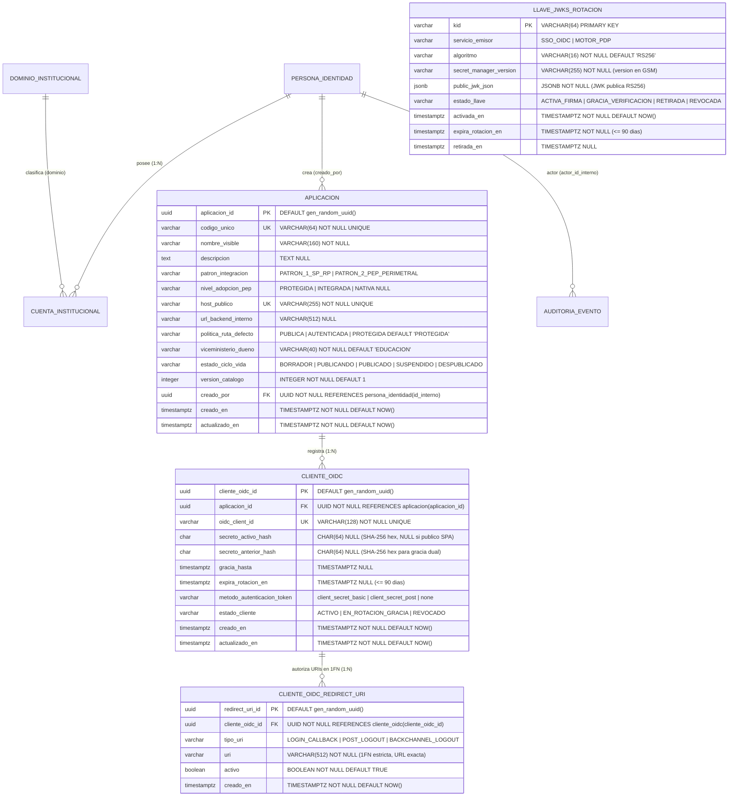

# Data Model: Servicio Intermediario Central de Inicio de Sesión Único (Identity Broker OIDC)

**Feature**: `003-sso-oidc-intermediario` | **Date**: 2026-10-22 | **Spec**: [spec.md](file:///C:/Users/anarvaez/Documents/Projects/MINEDEC/SSO/Desarrollo/minedec-sso/specs/003-sso-oidc-intermediario/spec.md) | **Research**: [research.md](file:///C:/Users/anarvaez/Documents/Projects/MINEDEC/SSO/Desarrollo/minedec-sso/specs/003-sso-oidc-intermediario/research.md) | **DBML Etapa 2**: [etapa-2-autorizacion-pdp-pap-rbac-abac.dbml](file:///C:/Users/anarvaez/Documents/Projects/MINEDEC/SSO/Desarrollo/minedec-sso/docs/esquemas-bd/etapa-2-autorizacion-pdp-pap-rbac-abac.dbml) | **DBML Etapa 3**: [etapa-3-seguridad-m2m-jwks-publicador.dbml](file:///C:/Users/anarvaez/Documents/Projects/MINEDEC/SSO/Desarrollo/minedec-sso/docs/esquemas-bd/etapa-3-seguridad-m2m-jwks-publicador.dbml)

---

## 1. Visión General de Almacenamiento (Esquema 1FN/3FN/BCNF en AlloyDB y Estado Efímero en Memorystore for Redis)

La Feature `003-sso-oidc-intermediario` extiende de forma no destructiva el esquema relacional en **Tercera Forma Normal (3FN) y Forma Normal de Boyce-Codd (BCNF)** en **AlloyDB for PostgreSQL 16** mediante la migración estática `../microservicios/pip-identity-service/migrations/004_sso_oidc_broker_schema.sql`, alineada 1:1 con los esquemas canónicos de las Etapas 2 y 3, y define la estructura de claves efímeras en **Memorystore for Redis**:

1. **Tablas Relacionales en AlloyDB for PostgreSQL 16 (`../microservicios/pip-identity-service/migrations/004_sso_oidc_broker_schema.sql`)**:
   - **`aplicacion` (`Aplicacion`)**: Entidad maestra de activos tecnológicos integrados en Conecta MINEDEC (`PATRON_1_SP_RP` o `PATRON_2_PEP_PERIMETRAL`), requerida como llave foránea de integridad referencial para `cliente_oidc`.
   - **`cliente_oidc` (`ClienteOidc`, `DA-11`)**: Registro de clientes OAuth 2.0 / OIDC por aplicación o PEP perimetral (`oidc_client_id`), con secretos almacenados exclusivamente como hashes `SHA-256` (`secreto_activo_hash` y `secreto_anterior_hash`), ventana de gracia dual (`gracia_hasta`), rotación obligatoria `<= 90 días` (`expira_rotacion_en`) y método de autenticación en el endpoint de token (`client_secret_basic`, `client_secret_post` o `none`).
   - **`cliente_oidc_redirect_uri` (`ClienteOidcRedirectUri`, `DA-11`)**: Catálogo normalizado en **1FN/3FN estricta** (cero arreglos multivaluados) de URIs exactas permitidas por cliente OIDC (`LOGIN_CALLBACK`, `POST_LOGOUT` y `BACKCHANNEL_LOGOUT`), eliminando el límite duro de 100 `redirect_uris` de Google Cloud (`FR-002`, `FR-003`, `FR-011`, `SC-001`, `SC-005`).
   - **`llave_jwks_rotacion` (`LlaveJwksRotacion`)**: Metadatos de rotación criptográfica `RS256` (`<= 90 días`) segregados por `servicio_emisor` (`SSO_OIDC` vs. `MOTOR_PDP`), con estados canónicos `'ACTIVA_FIRMA'`, `'GRACIA_VERIFICACION'`, `'RETIRADA'` y `'REVOCADA'`, apuntando a la versión en Google Secret Manager (`secret_manager_version`) sin almacenar jamás llaves privadas en base de datos (`FR-013`, `SC-006`, `Clarificación Q3`).
   - **Extensión de `dominio_institucional` y `auditoria_evento`**: Asegura la presencia de los subdominios institucionales activos (`educacion.gob.ec`, `estudiantes.educacion.gob.ec`, `estudiante.edu.ec`, `docentes.educacion.gob.ec`, `deporte.gob.ec`, `cultura.gob.ec`) y amplía las restricciones `CHECK` de `auditoria_evento` para los eventos de federación, emisión de `id_token`, cierre de sesión (SLO), rechazo PKCE/URI/replay y rotación/revocación JWKS desde el canal `'SSO_OIDC_BROKER'` (`FR-002`, `FR-014`).
2. **Almacenamiento Efímero en Memorystore for Redis (`TTL <= 300 s` / `<= 60 s`)**:
   - **Sesiones Centrales (`SesionCentralOidc`) e Índices por Cuenta/Persona**: Mantiene las sesiones SSO activas (`minedec:oidc:session:{sessionId}`), la marca de revalidación contra el PIP cada `<= 300 segundos` (`minedec:oidc:reval:{sessionId}`), y los conjuntos de indexación (`minedec:oidc:account_sessions:{cuentaId}` y `minedec:oidc:person_sessions:{idInterno}`) para purga instantánea (`< 5 s`) vía Pub/Sub (`FR-010`, `FR-011`, `FR-012`, `SC-004`).
   - **Códigos de Autorización de Uso Único (`CodigoAutorizacionEfimero`, `TTL <= 60 s`)**: Persiste el código OIDC efímero junto con `code_challenge` (`S256`), `nonce`, `redirect_uri` y bandera atómica `consumedAt` que bloquea cualquier intento de reutilización (`FR-004`, `FR-009`, `SC-005`).

---

## 2. Diagrama Entidad-Relación (AlloyDB for PostgreSQL 16 — Extensión Feature 003)

---

## 3. Especificación de Tablas Nuevas y Extensiones (AlloyDB — Migración `004`)

### 3.1. `aplicacion` (`Aplicacion` — Base de Integración Etapa 2/3)

Tabla maestra de activos tecnológicos protegidos por Conecta MINEDEC (`etapa-2-autorizacion-pdp-pap-rbac-abac.dbml`), creada con `CREATE TABLE IF NOT EXISTS` para soportar la integridad referencial de `cliente_oidc`.

| Columna | Tipo PostgreSQL | Restricciones | Descripción |
|---------|-----------------|---------------|-------------|
| `aplicacion_id` | `UUID` | `PRIMARY KEY DEFAULT gen_random_uuid()` | Identificador técnico único de la aplicación |
| `codigo_unico` | `VARCHAR(64)` | `NOT NULL UNIQUE` | Slug institucional inmutable (ej. `sso-academico`, `pep-perimetral-apigee`) |
| `nombre_visible` | `VARCHAR(160)` | `NOT NULL` | Nombre institucional visible |
| `descripcion` | `TEXT` | `NULL` | Descripción funcional del sistema |
| `patron_integracion` | `VARCHAR(32)` | `NOT NULL CHECK (patron_integracion IN ('PATRON_1_SP_RP', 'PATRON_2_PEP_PERIMETRAL'))` | Patrón arquitectónico de integración (`D-02` / `DA-11`) |
| `nivel_adopcion_pep` | `VARCHAR(24)` | `NULL CHECK (nivel_adopcion_pep IS NULL OR nivel_adopcion_pep IN ('PROTEGIDA', 'INTEGRADA', 'NATIVA'))` | Nivel de adopción frente al PEP |
| `host_publico` | `VARCHAR(255)` | `NOT NULL UNIQUE` | FQDN público expuesto en Cloud Load Balancing / Apigee X |
| `url_backend_interno` | `VARCHAR(512)` | `NULL` | URL privada del backend interno (cuando aplica Patrón 2) |
| `politica_ruta_defecto` | `VARCHAR(24)` | `NOT NULL DEFAULT 'PROTEGIDA' CHECK (politica_ruta_defecto IN ('PUBLICA', 'AUTENTICADA', 'PROTEGIDA'))` | Postura `fail-close` por defecto (`RF-AU-09`) |
| `viceministerio_dueno` | `VARCHAR(40)` | `NOT NULL DEFAULT 'EDUCACION'` | Viceministerio o unidad propietaria |
| `estado_ciclo_vida` | `VARCHAR(24)` | `NOT NULL DEFAULT 'BORRADOR' CHECK (estado_ciclo_vida IN ('BORRADOR', 'PUBLICANDO', 'PUBLICADO', 'SUSPENDIDO', 'DESPUBLICADO'))` | Estado operativo del activo |
| `version_catalogo` | `INTEGER` | `NOT NULL DEFAULT 1 CHECK (version_catalogo >= 1)` | Versión incremental del catálogo |
| `creado_por` | `UUID` | `NOT NULL REFERENCES persona_identidad(id_interno)` | Persona que registró el activo |
| `creado_en` | `TIMESTAMPTZ` | `NOT NULL DEFAULT NOW()` | Fecha de creación |
| `actualizado_en` | `TIMESTAMPTZ` | `NOT NULL DEFAULT NOW()` | Última actualización |

---

### 3.2. `cliente_oidc` (`ClienteOidc` — `DA-11`, `FR-003`, `FR-004`, `FR-005`)

Representa cada cliente OIDC registrado en `sso-oidc` (aplicación del Patrón 1 o PEP del Patrón 2) al que se emiten `id_token` con `aud = oidc_client_id` exclusivo (`FR-009`, `SC-002`).

| Columna | Tipo PostgreSQL | Restricciones | Descripción |
|---------|-----------------|---------------|-------------|
| `cliente_oidc_id` | `UUID` | `PRIMARY KEY DEFAULT gen_random_uuid()` | Identificador interno del cliente OIDC |
| `aplicacion_id` | `UUID` | `NOT NULL REFERENCES aplicacion(aplicacion_id) ON DELETE RESTRICT` | Aplicación o PEP al que pertenece el cliente |
| `oidc_client_id` | `VARCHAR(128)` | `NOT NULL UNIQUE` | `client_id` OIDC público enviado en `/authorize` y `/token` y usado como `aud` exclusivo en el `id_token` |
| `secreto_activo_hash` | `CHAR(64)` | `NULL CHECK (secreto_activo_hash IS NULL OR secreto_activo_hash ~ '^[0-9a-f]{64}$')` | Hash `SHA-256` hex del `client_secret` activo (`NULL` únicamente si `metodo_autenticacion_token = 'none'`) |
| `secreto_anterior_hash` | `CHAR(64)` | `NULL CHECK (secreto_anterior_hash IS NULL OR secreto_anterior_hash ~ '^[0-9a-f]{64}$')` | Hash `SHA-256` hex del secreto anterior durante ventana de gracia dual |
| `gracia_hasta` | `TIMESTAMPTZ` | `NULL` | Fecha límite hasta la cual se acepta `secreto_anterior_hash` cuando `estado_cliente = 'EN_ROTACION_GRACIA'` |
| `expira_rotacion_en` | `TIMESTAMPTZ` | `NULL` | Fecha máxima de rotación obligatoria (`<= 90 días` para clientes confidenciales, `Principio IX`) |
| `metodo_autenticacion_token` | `VARCHAR(32)` | `NOT NULL DEFAULT 'client_secret_basic' CHECK (metodo_autenticacion_token IN ('client_secret_basic', 'client_secret_post', 'none'))` | Método de autenticación en `POST /token` (todos exigen PKCE `S256` en `/authorize`) |
| `estado_cliente` | `VARCHAR(24)` | `NOT NULL DEFAULT 'ACTIVO' CHECK (estado_cliente IN ('ACTIVO', 'EN_ROTACION_GRACIA', 'REVOCADO'))` | Estado operativo del cliente OIDC |
| `creado_en` | `TIMESTAMPTZ` | `NOT NULL DEFAULT NOW()` | Fecha de creación |
| `actualizado_en` | `TIMESTAMPTZ` | `NOT NULL DEFAULT NOW()` | Última actualización |

- **Restricciones de Integridad**:
  - `CONSTRAINT chk_cliente_oidc_secreto_confidencial CHECK ((metodo_autenticacion_token = 'none' AND secreto_activo_hash IS NULL) OR (metodo_autenticacion_token IN ('client_secret_basic', 'client_secret_post') AND secreto_activo_hash IS NOT NULL AND expira_rotacion_en IS NOT NULL))`
  - `CONSTRAINT chk_cliente_oidc_gracia_coherente CHECK ((estado_cliente = 'EN_ROTACION_GRACIA' AND secreto_anterior_hash IS NOT NULL AND gracia_hasta IS NOT NULL) OR (estado_cliente IN ('ACTIVO', 'REVOCADO')))`
  - `CREATE INDEX idx_cliente_oidc_aplicacion_estado ON cliente_oidc (aplicacion_id, estado_cliente);`

---

### 3.3. `cliente_oidc_redirect_uri` (`ClienteOidcRedirectUri` — `1FN/3FN`, `FR-002`, `FR-003`, `FR-011`, `SC-001`, `SC-005`)

Normalización en **1FN/3FN** de las URLs autorizadas por cliente OIDC, eliminando arreglos multivaluados y superando el límite de 100 URIs de Google Cloud.

| Columna | Tipo PostgreSQL | Restricciones | Descripción |
|---------|-----------------|---------------|-------------|
| `redirect_uri_id` | `UUID` | `PRIMARY KEY DEFAULT gen_random_uuid()` | Identificador único de la fila URI |
| `cliente_oidc_id` | `UUID` | `NOT NULL REFERENCES cliente_oidc(cliente_oidc_id) ON DELETE CASCADE` | Cliente OIDC propietario de la URI |
| `tipo_uri` | `VARCHAR(24)` | `NOT NULL DEFAULT 'LOGIN_CALLBACK' CHECK (tipo_uri IN ('LOGIN_CALLBACK', 'POST_LOGOUT', 'BACKCHANNEL_LOGOUT'))` | Propósito de la URI: retorno de login (`LOGIN_CALLBACK`), redirección post-logout (`POST_LOGOUT`) o webhook OIDC Back-Channel Logout (`BACKCHANNEL_LOGOUT`) |
| `uri` | `VARCHAR(512)` | `NOT NULL CHECK (uri ~ '^https://[^\\s]+$' OR uri ~ '^http://(localhost|127\\.0\\.0\\.1)(:[0-9]+)?(/[^\\s]*)?$')` | URL exacta autorizada (HTTPS obligatorio en ambientes productivos; `localhost` permitido solo en desarrollo/pruebas locales, sin comodines `*`) |
| `activo` | `BOOLEAN` | `NOT NULL DEFAULT TRUE` | Indica si la URI está habilitada para validación exacta |
| `creado_en` | `TIMESTAMPTZ` | `NOT NULL DEFAULT NOW()` | Fecha de registro |

- **Restricciones e Índices**:
  - `CONSTRAINT uq_cliente_oidc_tipo_uri UNIQUE (cliente_oidc_id, tipo_uri, uri)`
  - `CREATE INDEX idx_cliente_oidc_redirect_lookup ON cliente_oidc_redirect_uri (cliente_oidc_id, tipo_uri, activo);`

---

### 3.4. `llave_jwks_rotacion` (`LlaveJwksRotacion` — `FR-013`, `SC-006`, `Clarificación Q3`)

Metadatos de las llaves asimétricas `RS256` segregadas por `servicio_emisor` (`SSO_OIDC` vs. `MOTOR_PDP`). Las llaves privadas residen 100 % en Google Secret Manager (`Principio IX`).

| Columna | Tipo PostgreSQL | Restricciones | Descripción |
|---------|-----------------|---------------|-------------|
| `kid` | `VARCHAR(64)` | `PRIMARY KEY` | Identificador único de la llave (`Key ID`) incluido en la cabecera JWS y publicado en `GET /jwks` |
| `servicio_emisor` | `VARCHAR(24)` | `NOT NULL DEFAULT 'SSO_OIDC' CHECK (servicio_emisor IN ('SSO_OIDC', 'MOTOR_PDP'))` | Emisor propietario del par de llaves (`SSO_OIDC` para `id_token` y `logout_token`; `MOTOR_PDP` para tokens M2M y `X-Minedec-Assertion`) |
| `algoritmo` | `VARCHAR(16)` | `NOT NULL DEFAULT 'RS256' CHECK (algoritmo = 'RS256')` | Algoritmo de firma asimétrica (`RS256` obligatorio) |
| `secret_manager_version` | `VARCHAR(255)` | `NOT NULL` | Ruta de la versión de la llave privada en Google Secret Manager (`projects/*/secrets/*/versions/*`) |
| `public_jwk_json` | `JSONB` | `NOT NULL` | Representación JWK pública (`kty: RSA`, `use: sig`, `alg: RS256`, `kid`, `n`, `e`) sin componentes privados (`d`, `p`, `q`) |
| `estado_llave` | `VARCHAR(24)` | `NOT NULL CHECK (estado_llave IN ('ACTIVA_FIRMA', 'GRACIA_VERIFICACION', 'RETIRADA', 'REVOCADA'))` | Estado del ciclo de vida criptográfico (`ACTIVA_FIRMA` firma y verifica; `GRACIA_VERIFICACION` solo verifica; `RETIRADA` y `REVOCADA` excluidas de `/jwks`) |
| `activada_en` | `TIMESTAMPTZ` | `NOT NULL DEFAULT NOW()` | Fecha de activación de la llave |
| `expira_rotacion_en` | `TIMESTAMPTZ` | `NOT NULL CHECK (expira_rotacion_en <= activada_en + INTERVAL '90 days')` | Fecha límite de rotación obligatoria (`<= 90 días` desde `activada_en`) |
| `retirada_en` | `TIMESTAMPTZ` | `NULL` | Fecha en que la llave pasó a `RETIRADA` o `REVOCADA` |

- **Restricciones e Índices**:
  - `CREATE UNIQUE INDEX uq_llave_jwks_activa_por_emisor ON llave_jwks_rotacion (servicio_emisor) WHERE estado_llave = 'ACTIVA_FIRMA';`
  - `CREATE INDEX idx_llave_jwks_emisor_estado ON llave_jwks_rotacion (servicio_emisor, estado_llave);`

---

### 3.5. Extensión de `dominio_institucional` y `auditoria_evento`

- **`dominio_institucional`**:
  - Se garantiza en semilla/migración el soporte de los 4 subdominios institucionales requeridos por la Feature 003 (`educacion.gob.ec`, `estudiantes.educacion.gob.ec` junto con `estudiante.edu.ec` y `docentes.educacion.gob.ec`, más `deporte.gob.ec` y `cultura.gob.ec`).
- **`auditoria_evento` (`append-only` con cadena `SHA-256`)**:
  - Se amplía `chk_auditoria_tipo_evento` para incluir:
    - `'OIDC_AUTHORIZE_INICIADO'`
    - `'OIDC_FEDERACION_GOOGLE_EXITOSA'`
    - `'OIDC_ID_TOKEN_EMITIDO'`
    - `'OIDC_REGISTRO_CALIENTE_PENDIENTE_BLOQUEADO'`
    - `'OIDC_RECHAZO_SEGURIDAD'` (PKCE inválido, `redirect_uri` no registrada, `code` reutilizado, dominio `hd` externo, cuenta suspendida)
    - `'OIDC_SLO_EJECUTADO'`
    - `'OIDC_SESION_REVOCADA_PUBSUB'`
    - `'OIDC_JWKS_ROTADO'`
    - `'OIDC_JWKS_REVOCADO_EMERGENCIA'`
  - Se amplía `chk_auditoria_origen_canal` para admitir `'SSO_OIDC_BROKER'`.

---

## 4. Estructura de Claves en Memorystore for Redis (`sso-oidc` — `DA-11`)

| Clave Redis | Tipo | TTL | Propósito |
|-------------|------|-----|-----------|
| `minedec:oidc:session:{sessionId}` | `HASH` / `STRING (JSON)` | `<= 28800 s` (8 h máx, sujeta a revalidación cada `300 s`) | Sesión central SSO (`SesionCentralOidc`): `sessionId`, `idInterno`, `cuentaId`, `googleSubId`, `emailPrincipal`, `dominio`, `tipoIdentificacion`, `numeroIdentificacion`, `nombreCompleto`, `participatingClientIds[]`, `createdAt`, `lastPipValidatedAt` |
| `minedec:oidc:reval:{sessionId}` | `STRING` | `<= 300 s` (5 min estricto) | Llave testigo de revalidación contra el PIP. Si expiró, el próximo `/authorize` revalida obligatoriamente el estado de la cuenta y persona en el PIP (`RF-GI-06`, `RF-AUT-06`, `PI-07`) |
| `minedec:oidc:account_sessions:{cuentaId}` | `SET` | `<= 28800 s` | Conjunto de `sessionId` y `code` activos pertenecientes a una `CuentaInstitucional` específica para purga selectiva inmediata (`< 5 s`) ante `SUSPEND_USER` / `DELETE_USER` |
| `minedec:oidc:person_sessions:{idInterno}` | `SET` | `<= 28800 s` | Conjunto de `sessionId` activos de todas las cuentas de una `PersonaIdentidad` para purga global en cascada (`< 5 s`) ante baja de la persona raíz |
| `minedec:oidc:adapter:AuthorizationCode:{codeId}` | `HASH` | `<= 60 s` | Código de autorización OIDC efímero (`CodigoAutorizacionEfimero`): `clientId`, `redirectUri`, `codeChallenge`, `codeChallengeMethod ('S256')`, `nonce`, `sessionId`, `idInterno`, `cuentaId`, `consumedAt` (uso único atómico) |
| `minedec:oidc:google_state:{state}` | `STRING (JSON)` | `<= 300 s` | Estado efímero de correlación entre `GET /authorize` de la aplicación y `GET /callback` de Google (`clientId`, `redirectUri`, `clientState`, `clientNonce`, `codeChallenge`, `googleNonce`, `googleCodeVerifier`, `traceId`) |
| `minedec:oidc:client:{oidcClientId}` | `STRING (JSON)` | `<= 300 s` | Caché L2 de metadatos de `cliente_oidc` y su lista 1FN de `cliente_oidc_redirect_uri` activas |
| `minedec:oidc:jwks:SSO_OIDC` | `STRING (JSON)` | `<= 300 s` | Caché L2 del documento público `GET /jwks` (`ACTIVA_FIRMA` + `GRACIA_VERIFICACION` de `servicio_emisor = 'SSO_OIDC'`), invalidada inmediatamente ante rotación o revocación |
