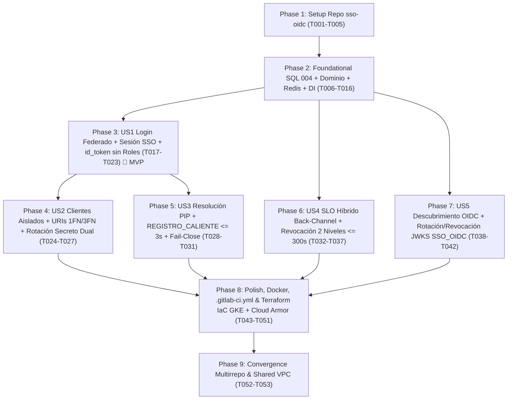

# Tasks: Servicio Intermediario Central de Inicio de Sesión Único (Identity Broker OIDC — DA-11)

**Input**: Documentos de diseño desde `/specs/003-sso-oidc-intermediario/`
**Prerequisites**: [plan.md](file:///C:/Users/anarvaez/Documents/Projects/MINEDEC/SSO/Desarrollo/minedec-sso/specs/003-sso-oidc-intermediario/plan.md) (requerido), [spec.md](file:///C:/Users/anarvaez/Documents/Projects/MINEDEC/SSO/Desarrollo/minedec-sso/specs/003-sso-oidc-intermediario/spec.md) (requerido para historias de usuario), [research.md](file:///C:/Users/anarvaez/Documents/Projects/MINEDEC/SSO/Desarrollo/minedec-sso/specs/003-sso-oidc-intermediario/research.md), [data-model.md](file:///C:/Users/anarvaez/Documents/Projects/MINEDEC/SSO/Desarrollo/minedec-sso/specs/003-sso-oidc-intermediario/data-model.md), [contracts/sso-oidc-api.openapi.yaml](file:///C:/Users/anarvaez/Documents/Projects/MINEDEC/SSO/Desarrollo/minedec-sso/specs/003-sso-oidc-intermediario/contracts/sso-oidc-api.openapi.yaml), [quickstart.md](file:///C:/Users/anarvaez/Documents/Projects/MINEDEC/SSO/Desarrollo/minedec-sso/specs/003-sso-oidc-intermediario/quickstart.md)

**Tests**: **OBLIGATORIOS** por mandato constitucional (Principios IV, V, XIII y XVIII de la Constitución v2.11.0: cobertura automatizada `>= 70%` en `Jest + Supertest`, validación de `Authorization Code + PKCE S256`, catálogo `cliente_oidc_redirect_uri` en 1FN/3FN sin tope de 100 URIs de GCP, emisión de `id_token` `RS256` con `aud` exclusivo y `0` reclamos de roles, espera local acotada `<= 3 s` en `REGISTRO_CALIENTE` con `fail-close`, SLO híbrido con `logout_token` + expiración `<= 300 s`, prueba de aceptación del SLA de revocación `<= 300 s` `PI-07` y rotación/revocación JWKS segregada por `servicio_emisor = 'SSO_OIDC'`).

**Organization**: Las tareas están agrupadas por historia de usuario (`US1` a `US5`) para permitir la implementación, prueba e integración independiente de cada incremento funcional.

## Format: `[ID] [P?] [Story] Descripción con ruta exacta de archivo`

- **[P]**: Puede ejecutarse en paralelo (archivos distintos, sin dependencias bloqueantes en curso).
- **[Story]**: Etiqueta de trazabilidad a la historia de usuario (`[US1]`, `[US2]`, `[US3]`, `[US4]`, `[US5]`).
- Todas las tareas incluyen las rutas exactas de los archivos a crear o modificar en la arquitectura multirrepositorio en GitLab (`git.sitimapa.co`).

## Path Conventions

- **Repositorio de Gobernanza y Especificaciones (`minedec-sso` - este repo, rama `spec/003-sso-oidc-intermediario`)**:
  - Artefactos Spec Kit: `specs/003-sso-oidc-intermediario/`
  - Esquemas DBML actualizados: `docs/esquemas-bd/`
- **Repositorios Independientes de Paquete y Microservicios (`c2-sso/microservicios/*`, mapeados en `../microservicios/*`)**:
  - Paquete transversal DRY (`@minedec/shared`, publicado en GitLab NPM Package Registry): `../microservicios/shared/src/`
  - Microservicio Intermediario OIDC Central (`sso-oidc` en GKE Autopilot con `sa-sso-core`): `../microservicios/sso-oidc/src/`, `../microservicios/sso-oidc/tests/` y `../microservicios/sso-oidc/.gitlab-ci.yml`
  - Migraciones SQL estáticas (AlloyDB PostgreSQL 16): `../microservicios/pip-identity-service/migrations/`
- **Repositorio Central de Infraestructura (`c2-sso/devops/iac-terraform`, mapeado en `../iac-terraform`, 3 capas sobre Shared VPC `mec-003-sha-net-des`, `mec-003-sha-net-pre`, `mec-003-sha-net-pro-511014` para `mec-003-sso-des`, `mec-003-sso-pre`, `mec-003-sso-pro`)**:
  - Módulos reutilizables (Capa 1): `../iac-terraform/modulos/`
  - Plantillas de stacks (Capa 2): `../iac-terraform/plantillas/{devops,data,apps}/`
  - Despliegues por ambiente (Capa 3): `../iac-terraform/despliegues/{des,pre,pro}/{devops,data,apps}/`

---

## Phase 1: Setup (Shared Package `@minedec/shared` & Independent Repository `../microservicios/sso-oidc`)

**Purpose**: Inicializar el repositorio independiente `../microservicios/sso-oidc` en TypeScript 5.8+ (`Node.js 22 LTS`), registrar la dependencia certificada `oidc-provider` (`DA-11`) y el paquete versionado `@minedec/shared` desde el GitLab NPM Package Registry, y configurar las fronteras de Arquitectura Hexagonal, InversifyJS y prohibición de cálculo de latencia en ESLint y Jest.

- [X] T001 Configurar el manifiesto del paquete `@minedec/sso-oidc`, los scripts `build`, `lint`, `test` y `test:coverage`, y las dependencias (`oidc-provider`, `@minedec/shared`) en `../microservicios/sso-oidc/package.json` y `../microservicios/sso-oidc/.npmrc`
- [X] T002 [P] Crear la configuración TypeScript estricta (`strict: true`, `NodeNext`) del servicio Intermediario OIDC en `../microservicios/sso-oidc/tsconfig.json`
- [X] T003 [P] Configurar las exportaciones de tipos y utilidades transversales de `@minedec/shared` para consumo de `sso-oidc` en `../microservicios/shared/package.json` y `../microservicios/shared/tsconfig.json`
- [X] T004 [P] Configurar las reglas arquitectónicas de ESLint para exigir que `../microservicios/sso-oidc/src/domain/**` y `../microservicios/sso-oidc/src/application/**` permanezcan 100% libres de decoradores (`@injectable()` / `@inject()`) y de SDKs de infraestructura en `../microservicios/sso-oidc/eslint.config.mjs`
- [X] T005 [P] Configurar `Jest` para el repositorio independiente `@minedec/sso-oidc` manteniendo el umbral de cobertura `>= 70%` en `../microservicios/sso-oidc/jest.config.ts`

---

## Phase 2: Foundational (Blocking Prerequisites)

**Purpose**: Migración DDL estática (`004_sso_oidc_broker_schema.sql`) en 1FN/3FN/BCNF, alineación de esquemas DBML, extensión transversal de `@minedec/shared` (`../microservicios/shared`), entidades y servicios puros de dominio (PKCE `S256`, coincidencia exacta de URIs, secretos `SHA-256` en tiempo constante, constructor de `id_token` libre de roles), adaptador distribuido en Memorystore for Redis, repositorio parametrizado en AlloyDB y Composition Root de `InversifyJS`.

**⚠️ CRITICAL**: Ninguna historia de usuario puede comenzar hasta completar esta fase.

- [X] T006 Crear la migración DDL estática con las tablas `aplicacion`, `cliente_oidc`, `cliente_oidc_redirect_uri` (1FN/3FN con `LOGIN_CALLBACK`, `POST_LOGOUT`, `BACKCHANNEL_LOGOUT`), `llave_jwks_rotacion` (segregada por `servicio_emisor` `'SSO_OIDC' | 'MOTOR_PDP'` y estados `'ACTIVA_FIRMA' | 'GRACIA_VERIFICACION' | 'RETIRADA' | 'REVOCADA'`), semilla de los 4 subdominios institucionales en `dominio_institucional` y ampliación de `auditoria_evento` (`'SSO_OIDC_BROKER'`) en `../microservicios/pip-identity-service/migrations/004_sso_oidc_broker_schema.sql`
- [X] T007 [P] Actualizar los esquemas DBML canónicos para reflejar `BACKCHANNEL_LOGOUT` en `cliente_oidc_redirect_uri` y `servicio_emisor` + `REVOCADA` en `llave_jwks_rotacion` en `docs/esquemas-bd/etapa-2-autorizacion-pdp-pap-rbac-abac.dbml`, `docs/esquemas-bd/etapa-3-seguridad-m2m-jwks-publicador.dbml` y `docs/esquemas-bd/00-esquema-maestro-completo.dbml`
- [X] T008 [P] Extender la lista blanca de identificadores SQL (`aplicacion`, `cliente_oidc`, `cliente_oidc_redirect_uri`, `llave_jwks_rotacion`), los códigos de auditoría inmutable del canal `'SSO_OIDC_BROKER'` y la redacción Zero-Secret (`code`, `code_verifier`, `id_token`, `logout_token`, `client_secret`) en `../microservicios/shared/src/db/postgres-client.ts`, `../microservicios/shared/src/audit/audit-event-writer.ts` y `../microservicios/shared/src/observability/logger.ts`
- [X] T009 [P] Definir las entidades de dominio (`AplicacionOidc`, `ClienteOidc`, `ClienteOidcRedirectUri`, `SesionCentralOidc`, `CodigoAutorizacionEfimero`, `LlaveJwksRotacion`, `CorrelacionFederacionGoogle`, `ResultadoResolucionPipOidc`) 100% libres de decoradores en `../microservicios/sso-oidc/src/domain/entities/oidc-broker.entities.ts`
- [X] T010 [P] Implementar los servicios puros de dominio (`PkceS256Validator`, `ExactRedirectUriValidator`, `ConstantTimeClientSecretVerifier`, `MinedecIdTokenClaimsBuilder` con bloqueo estricto de reclamos de roles/permisos y `BackchannelLogoutTokenBuilder`) 100% libres de decoradores en `../microservicios/sso-oidc/src/domain/services/oidc-security.services.ts`
- [X] T011 [P] Definir los puertos segregados de dominio (`IOidcClientRepositoryPort`, `IOidcSessionStorePort`, `IGoogleIdpFederationPort`, `IPipIdentityResolverPort`, `IJwksKeyStorePort`, `IBackchannelLogoutDispatcherPort`) 100% libres de decoradores en `../microservicios/sso-oidc/src/domain/ports/oidc-broker.ports.ts`
- [X] T012 [P] Implementar los esquemas `zod` de validación runtime para `/authorize`, `/callback`, `/token`, `/logout`, `/internal/v1/oidc/events/identity-revoked`, `/internal/v1/oidc/jwks/*` y `MinedecIdTokenClaims` (`additionalProperties: false` prohibiendo roles/permisos) en `../microservicios/sso-oidc/src/infrastructure/http/schemas/sso-oidc.schemas.ts`
- [X] T013 [P] Implementar el adaptador distribuido en Memorystore for Redis para sesiones centrales (`minedec:oidc:session:*`), llave testigo de revalidación (`minedec:oidc:reval:*` con `TTL <= 300 s`), índices por cuenta/persona (`minedec:oidc:account_sessions:*` y `minedec:oidc:person_sessions:*`), estado OAuth hacia Google (`minedec:oidc:google_state:*`) y consumo atómico de uso único de `AuthorizationCode` (`TTL <= 60 s`) junto con el adaptador de `oidc-provider` en `../microservicios/sso-oidc/src/infrastructure/oidc-provider/redis-oidc-store.adapter.ts`
- [X] T014 [P] Implementar el repositorio PostgreSQL 100% parametrizado (`$1, $2` + caché L2 en Redis `TTL <= 300 s`) para consultar `aplicacion`, `cliente_oidc`, `cliente_oidc_redirect_uri` (1FN/3FN sin tope de 100 URIs) y subdominios activos en `dominio_institucional` en `../microservicios/sso-oidc/src/infrastructure/persistence/alloydb-oidc-client.repository.ts`
- [X] T015 [P] Implementar el middleware centralizado `oidcErrorHandler` con respuestas diagnósticas en español (`OidcSecurityErrorResponse` / `OAuthTokenErrorResponse`), protección contra *path traversal* (`%2F`, `%5C`, `..`) y cero cálculo de latencia por petición en `../microservicios/sso-oidc/src/infrastructure/http/middlewares/oidc-error-handler.middleware.ts`
- [X] T016 Configurar el Composition Root de `InversifyJS` (`decorate(injectable(), ...)` / `toDynamicValue()` exclusivamente en `container.ts`, manteniendo `domain/` y `application/` sin decoradores) en `../microservicios/sso-oidc/src/container.ts`

**Checkpoint**: Esquema SQL `004`, entidades/servicios de dominio, almacén Redis de sesiones/códigos efímeros, repositorio 1FN/3FN de clientes y contenedor DI listos.

---

## Phase 3: User Story 1 - Inicio de Sesión Único Federado con Audiencia Exclusiva por Aplicación (Priority: P1) 🎯 MVP

**Goal**: Autenticar por única vez a docentes, directivos, administrativos y estudiantes de los 4 subdominios institucionales (`@educacion.gob.ec`, `@estudiantes.educacion.gob.ec`, `@deporte.gob.ec`, `@cultura.gob.ec`) a través del único cliente OAuth 2.0 registrado ante Google Cloud Identity (`D-01`, `DA-11`), mantener la sesión central SSO en Redis (con revalidación obligatoria cada `<= 300 s`), permitir el ingreso silencioso a múltiples aplicaciones registradas sin reintroducir credenciales, y emitir en `POST /token` tras canjear un código de un solo uso (`TTL <= 60 s`) un `id_token` firmado con `RS256` cuya audiencia (`aud`) sea exclusivamente el `client_id` de la aplicación solicitante y que incluya `(tipo_identificacion, numero_identificacion)` sin incluir jamás roles ni permisos.

**Independent Test**: Registrar dos aplicaciones distintas (`App A` y `App B`), ejecutar el flujo `GET /authorize` (con `PKCE S256`) -> `GET /callback` -> `POST /token` para `App A` verificando que el `id_token` tiene `aud = client_app_a`, `numero_identificacion` válido y `0` roles; luego invocar `GET /authorize` desde `App B` con la cookie de sesión central activa y verificar emisión silenciosa de nuevo código e `id_token` con `aud = client_app_b` sin redirigir a Google, rechazando cualquier intento de reutilizar el `code` o presentar el `id_token` de `App A` ante `App B`.

### Tests for User Story 1 (MANDATORY >= 70% Coverage) ⚠️

- [X] T017 [P] [US1] Crear pruebas unitarias de `PkceS256Validator`, `MinedecIdTokenClaimsBuilder` (audiencia exclusiva `aud = oidc_client_id`, inclusión de `tipo_identificacion`/`numero_identificacion` y bloqueo de reclamos de roles/permisos) y detección de reúso de código de autorización (`<= 60 s`) con revocación de sesión en `../microservicios/sso-oidc/tests/unit/oidc/oidc-federation-and-token.spec.ts`
- [X] T018 [P] [US1] Crear pruebas de integración con `Supertest` para el flujo completo de inicio de sesión federado (`GET /authorize` -> `GET /callback` -> `POST /token`), inicio de sesión único silencioso en una segunda aplicación con `aud` independiente, revalidación de sesión tras `300 s` y rechazo por reúso de `code` en `../microservicios/sso-oidc/tests/integration/oidc/sso-federated-login.integration.spec.ts`

### Implementation for User Story 1

- [X] T019 [US1] Implementar el adaptador `GoogleCloudIdentityRelyingPartyAdapter` (único cliente OAuth 2.0 ante `https://accounts.google.com`, lectura de credenciales desde Google Secret Manager con `sa-sso-core`, construcción de URL de autorización con PKCE/nonce/state, canje de código en Google y verificación criptográfica del `id_token` de Google con `jose` validando `iss`, `aud`, `exp`, `email_verified` y reclamo `hd`) en `../microservicios/sso-oidc/src/infrastructure/google-idp/google-cloud-identity-rp.adapter.ts`
- [X] T020 [US1] Implementar el caso de uso `StartOidcAuthorizationUseCase` (`GET /authorize`: validación de `client_id` + `redirect_uri` exacta + `PKCE S256`, verificación de sesión central activa en Redis y llave testigo de revalidación `<= 300 s` contra el PIP, emisión de código efímero en SSO silencioso o redirección al proveedor primario Google) en `../microservicios/sso-oidc/src/application/start-oidc-authorization.usecase.ts`
- [X] T021 [US1] Implementar el caso de uso `ExchangeAuthorizationCodeUseCase` (`POST /token`: consumo atómico de uso único del `code` con `TTL <= 60 s`, revocación inmediata de artefactos/sesión ante intento de reúso + auditoría `OIDC_RECHAZO_SEGURIDAD`, verificación de `code_verifier` `S256`, autenticación de cliente y emisión de `id_token` firmado con `RS256` con `aud` exclusivo y `0` reclamos de roles) en `../microservicios/sso-oidc/src/application/exchange-authorization-code.usecase.ts`
- [X] T022 [US1] Implementar el controlador Express 5 para los endpoints `GET /authorize`, `GET /callback` y `POST /token` (con cabeceras `Cache-Control: no-store`, cookies `HttpOnly; Secure; SameSite=Lax` y propagación W3C `traceparent` / `X-Trace-Id`) en `../microservicios/sso-oidc/src/infrastructure/http/controllers/oidc-auth-token.controller.ts`
- [X] T023 [US1] Crear la aplicación HTTP Express 5 (`app.ts`) y el punto de entrada (`index.ts`) de `../microservicios/sso-oidc` con `helmet` de nivel A (`HSTS`, `CSP`, `X-Frame-Options: DENY`, `X-Content-Type-Options: nosniff`), sondas `/healthz` y `/readyz` y cero telemetría de latencia en Node.js en `../microservicios/sso-oidc/src/infrastructure/http/app.ts` y `../microservicios/sso-oidc/src/index.ts`

**Checkpoint**: User Story 1 (MVP) funcional y verificable de forma independiente.

---

## Phase 4: User Story 2 - Aislamiento de Clientes por Aplicación y Registro Normalizado de Direcciones de Retorno sin Límites de Plataforma (Priority: P1)

**Goal**: Garantizar que cada aplicación institucional (Patrón 1 y PEP del Patrón 2) opere con su propio `oidc_client_id`, soporte más de 250 `redirect_uris` normalizadas en 1FN/3FN (`cliente_oidc_redirect_uri`) superando el límite de 100 URIs de GCP, valide coincidencia exacta carácter por carácter sin redirigir jamás a URIs no registradas, autentique clientes confidenciales mediante hashes `SHA-256` en tiempo constante con soporte de rotación periódica (`<= 90 días`) en ventana de gracia dual (`secreto_activo_hash` y `secreto_anterior_hash` hasta `gracia_hasta`), y bloquee de inmediato (`fail-close`) aplicaciones en estado `SUSPENDIDO`/`DESPUBLICADO` o clientes en estado `REVOCADO`.

**Independent Test**: Dar de alta un cliente con `>= 250` filas en `cliente_oidc_redirect_uri`, verificar que cualquier URI exacta activa funciona, que una URI con variación de 1 carácter es bloqueada con `HTTP 400` sin redirigir, que en estado `EN_ROTACION_GRACIA` (`<= 90 días`) funcionan tanto el secreto activo como el secreto anterior en `POST /token` y al vencer `gracia_hasta` el secreto anterior es rechazado, y que al pasar la aplicación a `SUSPENDIDO` o el cliente a `REVOCADO` se rechazan tanto `/authorize` como `/token`.

### Tests for User Story 2 (MANDATORY >= 70% Coverage) ⚠️

- [X] T024 [P] [US2] Crear pruebas unitarias de validación exacta de URIs en 1FN (`>= 250` URIs sin límite de 100 de GCP, prohibición de comodines y bloqueo de *Open Redirect*), rotación dual de `client_secret` (`SHA-256` con `timingSafeEqual` antes y después de `gracia_hasta`) y bloqueo de aplicaciones `SUSPENDIDO`/`DESPUBLICADO` o clientes `REVOCADO` en `../microservicios/sso-oidc/tests/unit/oidc/client-isolation-and-uris.spec.ts`
- [X] T025 [P] [US2] Crear pruebas de integración con `Supertest` verificando operación con catálogo de `>= 250` `redirect_uris`, canje de código en ventana de gracia dual de `client_secret` y denegación `fail-close` cuando la aplicación o el cliente pasan a estado inactivo/revocado en `../microservicios/sso-oidc/tests/integration/oidc/client-isolation-rotation.integration.spec.ts`

### Implementation for User Story 2

- [X] T026 [US2] Implementar la verificación de credenciales de cliente (`client_secret_basic`, `client_secret_post` y `none`) con comparación `SHA-256` en tiempo constante sobre `secreto_activo_hash` y `secreto_anterior_hash` (validando `estado_cliente = 'EN_ROTACION_GRACIA'`, `NOW() <= gracia_hasta` y vigencia `expira_rotacion_en <= 90 días`) en `../microservicios/sso-oidc/src/domain/services/oidc-security.services.ts` y `../microservicios/sso-oidc/src/application/exchange-authorization-code.usecase.ts`
- [X] T027 [US2] Implementar la compuerta de estado de ciclo de vida (`aplicacion.estado_ciclo_vida === 'PUBLICADO'` y `cliente_oidc.estado_cliente IN ('ACTIVO', 'EN_ROTACION_GRACIA')`) y la validación estricta carácter por carácter de `redirect_uri` en 1FN (`LOGIN_CALLBACK`, `POST_LOGOUT`, `BACKCHANNEL_LOGOUT`) con auditoría de rechazos en `../microservicios/sso-oidc/src/infrastructure/persistence/alloydb-oidc-client.repository.ts` y `../microservicios/sso-oidc/src/application/start-oidc-authorization.usecase.ts`

**Checkpoint**: User Stories 1 y 2 operativas: federación OIDC y aislamiento total de clientes/URIs en 1FN/3FN con rotación dual de secretos.

---

## Phase 5: User Story 3 - Resolución de Identidad con Soporte de Registro en Caliente (`REGISTRO_CALIENTE`) y Bloqueo de Cuentas Inactivas (Priority: P1)

**Goal**: Durante `GET /callback`, consultar exclusivamente al Repositorio Central de Identidades (PIP) realizando **0 llamadas al directorio administrativo externo (`Google Admin SDK`)**, denegar de inmediato (`fail-close`) cuentas en estado `SUSPENDIDA_GWS`, `ELIMINADA_GWS`, `INACTIVA`, `VIGENCIA_VENCIDA`, `BLOQUEADA_ANOMALIA` o de dominios no autorizados, y cuando una cuenta recién creada entre en `REGISTRO_CALIENTE` / `PENDIENTE_IDENTIFICACION`, disparar la reconciliación prioritaria en segundo plano (`sso-sync-priority-hot-reg`) y ejecutar una **espera local acotada de hasta `3 segundos`** contra el PIP local/caché: si consolida `numero_identificacion` dentro de los `3 s`, emitir la sesión y el código normalmente; si al agotar la ventana persiste en `PENDIENTE_IDENTIFICACION`, retener la emisión (`fail-close` con `HTTP 403` y mensaje informativo en español con opción de reintento).

**Independent Test**: Simular el callback desde Google Cloud Identity para: (1) cuenta activa con cédula consolidada (`302` con `code`), (2) cuenta nueva en `REGISTRO_CALIENTE` cuyo `numero_identificacion` se hidrata en `1,2 s` (`302` con `code` en el mismo intento y `0` llamadas a Admin SDK desde `sso-oidc`), (3) cuenta nueva que tras `3 s` sigue en `PENDIENTE_IDENTIFICACION` (`403 IDENTIDAD_PENDIENTE_SINCRONIZACION` sin emitir `code` ni sesión), y (4) cuenta `SUSPENDIDA_GWS` o `@gmail.com` (`403` denegado y auditado).

### Tests for User Story 3 (MANDATORY >= 70% Coverage) ⚠️

- [X] T028 [P] [US3] Crear pruebas unitarias de `HandleGoogleIdpCallbackUseCase` y `PipIdentityResolverAdapter` verificando resolución con `0` llamadas a Google Admin SDK, espera local acotada (`<= 3.000 ms` con sondeo cada `500 ms`) en `REGISTRO_CALIENTE`, retención `fail-close` si persiste en `PENDIENTE_IDENTIFICACION` y rechazo de cuentas `SUSPENDIDA_GWS`/`ELIMINADA_GWS`/`VIGENCIA_VENCIDA`/`BLOQUEADA_ANOMALIA` en `../microservicios/sso-oidc/tests/unit/oidc/hot-registration-and-pip-resolution.spec.ts`
- [X] T029 [P] [US3] Crear pruebas de integración con `Supertest` para `GET /callback` cubriendo hidratación exitosa en `<= 3 s`, bloqueo `fail-close` (`HTTP 403`) tras agotar los `3 s` sin `numero_identificacion` y bloqueo de cuentas suspendidas o de dominios externos en `../microservicios/sso-oidc/tests/integration/oidc/callback-hot-registration.integration.spec.ts`

### Implementation for User Story 3

- [X] T030 [US3] Implementar el adaptador `PipIdentityResolverAdapter` (consulta local a caché L2 Redis / AlloyDB del PIP con `0` llamadas a Google Admin SDK, disparo del aprovisionamiento `REGISTRO_CALIENTE` + cola prioritaria `sso-sync-priority-hot-reg` y bucle de reintento local acotado de hasta `3.000 ms` con intervalos de `500 ms` verificando la consolidación de `numero_identificacion`) en `../microservicios/sso-oidc/src/infrastructure/pip/pip-identity-resolver.adapter.ts`
- [X] T031 [US3] Implementar el caso de uso `HandleGoogleIdpCallbackUseCase` (`GET /callback`: validación del estado correlacionado de Google, verificación de dominio institucional activo en `dominio_institucional`, invocación a `IPipIdentityResolverPort`, aplicación estricta de `fail-close` ante estados inactivos/suspendidos o `PENDIENTE_IDENTIFICACION` tras `3 s`, creación de sesión central en Redis y auditoría inmutable) en `../microservicios/sso-oidc/src/application/handle-google-idp-callback.usecase.ts`

**Checkpoint**: User Stories 1, 2 y 3 operativas: flujo OIDC completo con resolución PIP, `REGISTRO_CALIENTE` acotado a `<= 3 s` y postura `fail-close`.

---

## Phase 6: User Story 4 - Cierre de Sesión Único (SLO) y Revocación Inmediata ante Bajas (`<= 300 s`) (Priority: P1)

**Goal**: Implementar el Cierre de Sesión Único (`GET/POST /logout`, `RF-AUT-06`) en un esquema híbrido de dos capas: (1) purga inmediata de la sesión central y códigos efímeros en Redis + despacho asíncrono por canal trasero (*OIDC Back-Channel Logout 1.0*) de un `logout_token` firmado con `RS256` hacia todas las aplicaciones participantes (y el PEP) con dirección `BACKCHANNEL_LOGOUT` activa + redirección validada a `POST_LOGOUT`, y (2) techo duro universal de expiración/revalidación en `<= 300 segundos`; además de procesar los eventos de baja/suspensión (`POST /internal/v1/oidc/events/identity-revoked`) aplicando **revocación diferenciada en dos niveles** (`CUENTA_INSTITUCIONAL` purga solo las sesiones de esa cuenta preservando otras cuentas activas de la misma persona según `RF-GI-07`; `PERSONA_IDENTIDAD` purga en cascada todas las sesiones de todas sus cuentas en `< 5 s` nominal y `<= 300 s` límite duro absoluto `PI-07`).

**Independent Test**: (a) Iniciar sesión en 2 aplicaciones con `BACKCHANNEL_LOGOUT` registrado, ejecutar `POST /logout` y verificar destrucción inmediata en Redis, envío de `logout_token` firmado con `RS256` a ambas aplicaciones y redirección a `POST_LOGOUT`. (b) Persona con 2 cuentas activas (`@educacion.gob.ec` y `@cultura.gob.ec`): enviar evento `identity-revoked` con `alcanceRevocacion = 'CUENTA_INSTITUCIONAL'` para la primera cuenta y comprobar que sus sesiones se purgan en `< 5 s` mientras la sesión de la segunda cuenta sigue activa; luego enviar `alcanceRevocacion = 'PERSONA_IDENTIDAD'` y comprobar purga total en cascada y cumplimiento del SLA `<= 300 s` (`PI-07`).

### Tests for User Story 4 (MANDATORY >= 70% Coverage) ⚠️

- [X] T032 [P] [US4] Crear pruebas unitarias de `ExecuteSingleLogoutUseCase` (purga inmediata en Redis, firma y estructura de `logout_token` según *OIDC Back-Channel Logout 1.0* sin reclamo `nonce` y validación de `post_logout_redirect_uri`) y de `RevokeIdentitySessionsUseCase` (revocación selectiva por `CUENTA_INSTITUCIONAL` vs. revocación en cascada por `PERSONA_IDENTIDAD`) en `../microservicios/sso-oidc/tests/unit/oidc/slo-and-session-revocation.spec.ts`
- [X] T033 [P] [US4] Crear pruebas de integración y de aceptación del SLA de revocación `<= 300 s` (`PI-07`) para `GET/POST /logout` y `POST /internal/v1/oidc/events/identity-revoked` (incluyendo coexistencia de múltiples cuentas por persona `RF-GI-07` y aislamiento ante fallos de webhooks externos) en `../microservicios/sso-oidc/tests/integration/oidc/slo-and-revocation-sla.integration.spec.ts`

### Implementation for User Story 4

- [X] T034 [US4] Implementar el adaptador `HttpBackchannelLogoutDispatcherAdapter` (generación de `logout_token` JWS `RS256` con `iss`, `sub`, `aud`, `iat`, `jti`, `sid` y `events: { "http://schemas.openid.net/specs/openid-connect-backchannel-logout-1_0.html": {} }`, y envío HTTP `POST application/x-www-form-urlencoded` en paralelo con timeout no bloqueante de `3.000 ms`) en `../microservicios/sso-oidc/src/infrastructure/crypto/http-backchannel-logout.adapter.ts`
- [X] T035 [US4] Implementar el caso de uso `ExecuteSingleLogoutUseCase` (`GET/POST /logout`: validación de `id_token_hint` y coincidencia exacta de `post_logout_redirect_uri` contra URIs `POST_LOGOUT` activas en 1FN, destrucción inmediata de la sesión central y códigos en Redis, despacho asíncrono de Back-Channel Logout y registro de `OIDC_SLO_EJECUTADO`) en `../microservicios/sso-oidc/src/application/execute-single-logout.usecase.ts`
- [X] T036 [US4] Implementar el caso de uso `RevokeIdentitySessionsUseCase` (`POST /internal/v1/oidc/events/identity-revoked`: purga selectiva en `minedec:oidc:account_sessions:{cuentaId}` para `CUENTA_INSTITUCIONAL` o purga global en cascada en `minedec:oidc:person_sessions:{idInterno}` para `PERSONA_IDENTIDAD`, notificación Back-Channel Logout y registro de `OIDC_SESION_REVOCADA_PUBSUB`) en `../microservicios/sso-oidc/src/application/revoke-identity-sessions.usecase.ts`
- [X] T037 [US4] Implementar el controlador Express 5 para `GET /logout`, `POST /logout` y `POST /internal/v1/oidc/events/identity-revoked` y registrar sus rutas en `../microservicios/sso-oidc/src/infrastructure/http/controllers/oidc-logout-revocation.controller.ts` y `../microservicios/sso-oidc/src/infrastructure/http/app.ts`

**Checkpoint**: Todas las historias de prioridad P1 (`US1` a `US4`) están completas y verificadas de forma independiente.

---

## Phase 7: User Story 5 - Descubrimiento Estándar y Rotación de Llaves de Firma sin Interrupción del Servicio (Priority: P2)

**Goal**: Publicar el documento estándar de descubrimiento (`GET /.well-known/openid-configuration`) y el conjunto de claves públicas (`GET /jwks`) exponiendo únicamente las llaves con `servicio_emisor = 'SSO_OIDC'` y `estado_llave IN ('ACTIVA_FIRMA', 'GRACIA_VERIFICACION')` (sin mezclar jamás llaves de `'MOTOR_PDP'`), soportando rotación periódica (`<= 90 días`) con ventana de gracia dual (`POST /internal/v1/oidc/jwks/rotate`) sin interrumpir la verificación de comprobantes en vuelo, y revocación inmediata de emergencia (`< 1 hora`, efectiva en `< 5 s`) ante compromiso criptográfico (`POST /internal/v1/oidc/jwks/{kid}/revoke`).

**Independent Test**: Consultar `/.well-known/openid-configuration` y `/jwks`, insertar una llave de `MOTOR_PDP` y comprobar que no aparece en `/jwks` de `sso-oidc`; ejecutar `POST /internal/v1/oidc/jwks/rotate` para promover un nuevo `kid` a `ACTIVA_FIRMA` pasando el anterior a `GRACIA_VERIFICACION` y verificar que los `id_token` emitidos antes de la rotación siguen siendo verificables y los nuevos se firman con el nuevo `kid`; luego ejecutar `POST /internal/v1/oidc/jwks/{kid}/revoke` con `targetState = 'REVOCADA'` y verificar su desaparición inmediata de `/jwks`.

### Tests for User Story 5 (MANDATORY >= 70% Coverage) ⚠️

- [X] T038 [P] [US5] Crear pruebas unitarias de `ManageJwksKeysUseCase` y `AlloyDbAndSecretManagerJwksAdapter` verificando segregación por `servicio_emisor = 'SSO_OIDC'`, rotación dual (`ACTIVA_FIRMA` -> `GRACIA_VERIFICACION`) y retiro inmediato de `/jwks` al pasar a `RETIRADA` o `REVOCADA` en `../microservicios/sso-oidc/tests/unit/oidc/jwks-rotation-and-discovery.spec.ts`
- [X] T039 [P] [US5] Crear pruebas de integración con `Supertest` para `GET /.well-known/openid-configuration`, `GET /jwks`, `POST /internal/v1/oidc/jwks/rotate` y `POST /internal/v1/oidc/jwks/{kid}/revoke` en `../microservicios/sso-oidc/tests/integration/oidc/discovery-and-jwks-rotation.integration.spec.ts`

### Implementation for User Story 5

- [X] T040 [US5] Implementar el adaptador `AlloyDbAndSecretManagerJwksAdapter` (consultas SQL 100% parametrizadas sobre `llave_jwks_rotacion` filtrando `servicio_emisor = 'SSO_OIDC'`, carga de llaves privadas `RS256` desde Google Secret Manager con `sa-sso-core` sin guardar material privado en AlloyDB y caché L2 `minedec:oidc:jwks:SSO_OIDC` con invalidación inmediata) en `../microservicios/sso-oidc/src/infrastructure/crypto/alloydb-secretmanager-jwks.adapter.ts`
- [X] T041 [US5] Implementar el caso de uso `ManageJwksKeysUseCase` (construcción de metadatos OpenID Discovery 1.0, publicación de `/jwks` exclusivamente con llaves `ACTIVA_FIRMA` y `GRACIA_VERIFICACION` de `SSO_OIDC`, transición transaccional de rotación dual `<= 90 días` y revocación de emergencia `< 1 h` con auditoría `OIDC_JWKS_ROTADO` / `OIDC_JWKS_REVOCADO_EMERGENCIA`) en `../microservicios/sso-oidc/src/application/manage-jwks-keys.usecase.ts`
- [X] T042 [US5] Implementar el controlador Express 5 para `GET /.well-known/openid-configuration`, `GET /jwks`, `POST /internal/v1/oidc/jwks/rotate` y `POST /internal/v1/oidc/jwks/{kid}/revoke` y vincular todos los componentes en `../microservicios/sso-oidc/src/infrastructure/http/controllers/oidc-discovery-jwks.controller.ts`, `../microservicios/sso-oidc/src/infrastructure/http/app.ts` y `../microservicios/sso-oidc/src/container.ts`

**Checkpoint**: Todas las historias de usuario (`US1` a `US5`) están implementadas y probadas independientemente.

---

## Phase 8: Polish & Cross-Cutting Concerns (Docker, GitLab CI/CD `.gitlab-ci.yml`, 3-Layer Terraform IaC & Conformance Verification)

**Purpose**: Empaquetado seguro de contenedor (`node:22-alpine` non-root), definición del pipeline `.gitlab-ci.yml` en `../microservicios/sso-oidc` (ejecutado por `gitlab-runner@gitlab-servinformacion.iam.gserviceaccount.com`), aprovisionamiento declarativo Terraform HCL (`1.5.7`) en el repositorio central `../iac-terraform` (desplegando `sso-oidc` en GKE Autopilot con `sa-sso-core` detrás de External Application Load Balancer + Cloud Armor WAF `sso-oidc-waf-policy` **sin Cloud IAP delante** conforme a `DA-11` sobre la Shared VPC `mec-003-sha-net-des`, `mec-003-sha-net-pre`, `mec-003-sha-net-pro-511014`) y validación integral de conformidad arquitectónica, paridad SQL/DBML y cobertura `>= 70%`.

- [X] T043 [P] Crear el `Dockerfile` multi-etapa endurecido (`node:22-alpine`, usuario sin privilegios `USER node`, instalación de `@minedec/shared` desde el GitLab NPM Package Registry y compilación de `sso-oidc`, sin secretos embebidos) en `../microservicios/sso-oidc/Dockerfile`
- [X] T044 Crear el pipeline de Integración Continua en GitLab para compilar, auditar (`ESLint`, `npm audit`), ejecutar pruebas (`>= 70%` cobertura) y publicar la imagen `sso-oidc:$CI_COMMIT_SHA` en Artifact Registry (`sso-containers`) mediante `gitlab-runner@gitlab-servinformacion.iam.gserviceaccount.com` en `../microservicios/sso-oidc/.gitlab-ci.yml`
- [X] T045 [P] Sincronizar la rama `spec/003-sso-oidc-intermediario` en el repositorio `../iac-terraform` y crear el módulo Terraform de GKE Autopilot para `sso-oidc` con `Deployment`, `Service`, `BackendConfig` (política WAF de Google Cloud Armor `sso-oidc-waf-policy`), `FrontendConfig` (TLS/HTTPS) e `Ingress` público en `https://login.sso.<dominio>` **sin Cloud IAP delante** (`DA-11`) en `../iac-terraform/modulos/gke_sso_oidc_service/main.tf`, `../iac-terraform/modulos/gke_sso_oidc_service/variables.tf` y `../iac-terraform/modulos/gke_sso_oidc_service/outputs.tf`
- [X] T046 [P] Extender los módulos Terraform de `secret_manager` (secretos del cliente OAuth único de Google y llaves privadas JWKS `RS256` de `sso-oidc`), `pubsub_cloud_tasks_sync` (suscripción push hacia `/internal/v1/oidc/events/identity-revoked`), `monitoring` (alertas SRE de disponibilidad 5xx, latencia p95/p99 en External ALB y rotación JWKS) e `iam` (Workload Identity `sa-sso-core` para el ServiceAccount K8s de `sso-oidc`) en `../iac-terraform/modulos/secret_manager/main.tf`, `../iac-terraform/modulos/pubsub_cloud_tasks_sync/main.tf`, `../iac-terraform/modulos/monitoring/main.tf` y `../iac-terraform/modulos/iam/main.tf`
- [X] T047 Integrar el módulo `gke_sso_oidc_service` en la plantilla de aplicaciones y en los despliegues por ambiente (`mec-003-sso-des`, `mec-003-sso-pre`, `mec-003-sso-pro` sobre la Shared VPC `mec-003-sha-net-des`, `mec-003-sha-net-pre`, `mec-003-sha-net-pro-511014`) y actualizar la suite de pruebas `.tftest.hcl` (`command = plan` con `mock_provider`) en `../iac-terraform/plantillas/apps/main.tf`, `../iac-terraform/plantillas/apps/variables.tf`, `../iac-terraform/plantillas/apps/outputs.tf`, `../iac-terraform/despliegues/des/apps/terraform.tfvars` y `../iac-terraform/plantillas/apps/tests/apps.tftest.hcl`
- [X] T048 [P] Actualizar las pruebas de paridad 1:1 SQL/DBML para validar `../microservicios/pip-identity-service/migrations/004_sso_oidc_broker_schema.sql` contra `docs/esquemas-bd/etapa-2-autorizacion-pdp-pap-rbac-abac.dbml`, `docs/esquemas-bd/etapa-3-seguridad-m2m-jwks-publicador.dbml` y `docs/esquemas-bd/00-esquema-maestro-completo.dbml` en `../microservicios/pip-identity-service/tests/unit/sql-schema-alignment.spec.ts`
- [X] T049 [P] Actualizar las pruebas de resolución del contenedor de Inyección de Dependencias (`../microservicios/sso-oidc/src/container.ts`), pureza hexagonal de `domain/` y `application/` y prohibición de cálculo de latencia en Node.js en `../microservicios/sso-oidc/tests/unit/container-wiring.spec.ts`
- [X] T050 [P] Actualizar las pruebas de conformidad DevSecOps e IaC (verificación de `../microservicios/sso-oidc/Dockerfile` non-root, `../microservicios/sso-oidc/.gitlab-ci.yml`, contrato `specs/003-sso-oidc-intermediario/contracts/sso-oidc-api.openapi.yaml` y módulo Terraform `gke_sso_oidc_service` con Cloud Armor `sso-oidc-waf-policy` y sin IAP) en `../microservicios/sso-oidc/tests/unit/devops-iac-alignment.spec.ts`
- [X] T051 Ejecutar la validación integral de compilación TypeScript (`npm run build`), linter (`npm run lint`) y suite completa de pruebas con cobertura (`npm run test:coverage` `>= 70%`) en `../microservicios/sso-oidc` conforme a `specs/003-sso-oidc-intermediario/quickstart.md`

---

## Phase 9: Convergence (Extracción Física Multirrepositorio en GitLab, `.gitlab-ci.yml` y Despliegue GKE sobre Shared VPC)

**Purpose**: Completar la migración física del servicio `sso-oidc` hacia su repositorio independiente `../microservicios/sso-oidc` y la migración del módulo `gke_sso_oidc_service` hacia la arquitectura de 3 capas en `../iac-terraform`.

- [X] T052 Migrar físicamente el código fuente y las pruebas de `sso-oidc` hacia el repositorio independiente `../microservicios/sso-oidc/` (`src/`, `tests/`, `package.json` consumiendo `@minedec/shared`, `.npmrc`, `tsconfig.json`, `jest.config.ts`, `eslint.config.mjs`, `Dockerfile` `node:22-alpine` non-root) y crear `../microservicios/sso-oidc/.gitlab-ci.yml` ejecutado por `gitlab-runner@gitlab-servinformacion.iam.gserviceaccount.com`
- [X] T053 Copiar e integrar el módulo Terraform `gke_sso_oidc_service` (External Application Load Balancer + Cloud Armor WAF `sso-oidc-waf-policy` sin IAP y Workload Identity `sa-sso-core`) dentro de `../iac-terraform/modulos/gke_sso_oidc_service/` y `../iac-terraform/plantillas/apps/main.tf` para los proyectos `mec-003-sso-des`, `mec-003-sso-pre` y `mec-003-sso-pro` sobre la Shared VPC (`mec-003-sha-net-des`, `mec-003-sha-net-pre`, `mec-003-sha-net-pro-511014`)

---

## Dependencies & Execution Order

### Phase Dependencies

- **Phase 1: Setup (`T001`–`T005`)**: Sin dependencias previas; inicializa el repositorio independiente `../microservicios/sso-oidc`.
- **Phase 2: Foundational (`T006`–`T016`)**: Depende de Phase 1; **BLOQUEA** todas las historias de usuario (`US1` a `US5`).
- **Phase 3: User Story 1 (`T017`–`T023`, P1 🎯 MVP)**: Depende de Phase 2. Construye el flujo central de inicio de sesión único federado (`GET /authorize`, `GET /callback`, `POST /token`), uso único de `code` (`<= 60 s`) y emisión de `id_token` `RS256` con audiencia exclusiva y cero roles.
- **Phase 4: User Story 2 (`T024`–`T027`, P1)**: Depende de Phase 2 y extiende `US1` con el aislamiento de clientes por estado de ciclo de vida, catálogo 1FN/3FN sin tope de 100 URIs y rotación dual de secretos (`<= 90 días`).
- **Phase 5: User Story 3 (`T028`–`T031`, P1)**: Depende de Phase 2 y completa la resolución de identidad en `GET /callback` con soporte de `REGISTRO_CALIENTE` acotado a `<= 3 s` (`0` llamadas a Google Admin SDK) y bloqueo `fail-close`.
- **Phase 6: User Story 4 (`T032`–`T037`, P1)**: Depende de Phase 2 (puede desarrollarse en paralelo con `US2` y `US3`); implementa el SLO híbrido de dos capas (`GET/POST /logout` + `logout_token` Back-Channel) y la revocación diferenciada en dos niveles (`<= 300 s`, `PI-07`).
- **Phase 7: User Story 5 (`T038`–`T042`, P2)**: Depende de Phase 2 (puede desarrollarse en paralelo con `US2`–`US4`); implementa `GET /.well-known/openid-configuration`, `GET /jwks` segregado por `servicio_emisor = 'SSO_OIDC'` y la rotación/revocación de llaves `RS256`.
- **Phase 8: Polish & Cross-Cutting (`T043`–`T051`)**: Depende de la finalización de las historias de usuario `US1`–`US5`.
- **Phase 9: Convergence (`T052`–`T053`)**: Materializa la extracción física hacia `../microservicios/sso-oidc` y `../iac-terraform`.

### User Story Dependencies



### Parallel Opportunities

- **Setup (Phase 1)**: `T002`, `T003`, `T004` y `T005` pueden ejecutarse en paralelo tras `T001`.
- **Foundational (Phase 2)**: `T007`, `T008`, `T009`, `T010`, `T011`, `T012`, `T013`, `T014` y `T015` operan sobre archivos independientes y pueden ejecutarse en paralelo tras `T006`.
- **Pruebas por Historia (`US1`–`US5`)**: Todas las tareas de pruebas unitarias e integración marcadas con `[P]` (`T017`/`T018`, `T024`/`T025`, `T028`/`T029`, `T032`/`T033`, `T038`/`T039`) pueden escribirse en paralelo antes de la implementación de su fase.
- **Desarrollo Paralelo de Historias**: Una vez completadas `Phase 2` y `US1`, las fases `US2`/`US3`, `US4` (SLO y revocación) y `US5` (Descubrimiento y JWKS) pueden implementarse en paralelo en archivos de casos de uso y controladores separados.
- **Polish & IaC (Phase 8)**: `T043`, `T045`, `T046`, `T048`, `T049` y `T050` son completamente paralelizables.

---

## Parallel Example: User Story 1 (MVP)

```bash
# Ejecutar en paralelo la creación de pruebas unitarias e integración de US1:
Task: "T017 [P] [US1] Crear pruebas unitarias de PkceS256Validator, MinedecIdTokenClaimsBuilder y detección de reúso de código en ../microservicios/sso-oidc/tests/unit/oidc/oidc-federation-and-token.spec.ts"
Task: "T018 [P] [US1] Crear pruebas de integración con Supertest para el flujo completo de inicio de sesión federado en ../microservicios/sso-oidc/tests/integration/oidc/sso-federated-login.integration.spec.ts"
```

---

## Implementation Strategy

### MVP First (User Story 1 + User Story 2 + User Story 3 + User Story 4 — Núcleo P1 OIDC Broker & Seguridad de Sesión)

1. Completar **Phase 1: Setup** (`T001`–`T005`).
2. Completar **Phase 2: Foundational** (`T006`–`T016`).
3. Completar **Phase 3: User Story 1** (`T017`–`T023`) y validar el inicio de sesión único federado, la sesión central en Redis y la emisión de `id_token` `RS256` con `aud` exclusivo y cero roles.
4. Completar **Phase 4: User Story 2** (`T024`–`T027`) y validar el catálogo normalizado `cliente_oidc_redirect_uri` en 1FN/3FN (`>= 250` URIs) y la rotación dual de secretos (`<= 90 días`).
5. Completar **Phase 5: User Story 3** (`T028`–`T031`) y validar la resolución PIP con espera local acotada (`<= 3 s`, `0` llamadas a Admin SDK) en `REGISTRO_CALIENTE` y postura `fail-close`.
6. Completar **Phase 6: User Story 4** (`T032`–`T037`) y validar el SLO híbrido (`logout_token` Back-Channel + `<= 300 s`) y el SLA de revocación `<= 300 s` (`PI-07`).

### Incremental Delivery (Descubrimiento/Rotación JWKS P2, Empaquetado DevSecOps / IaC y Convergencia Multirrepo)

7. Completar **Phase 7: User Story 5** (`T038`–`T042`) para habilitar `/.well-known/openid-configuration`, `/jwks` segregado por `servicio_emisor = 'SSO_OIDC'` y la rotación/revocación de emergencia de llaves `RS256`.
8. Completar **Phase 8: Polish & Cross-Cutting** (`T043`–`T051`) y **Phase 9: Convergence** (`T052`–`T053`) para empaquetar el contenedor `node:22-alpine` non-root, configurar `.gitlab-ci.yml` en `../microservicios/sso-oidc`, sincronizar el módulo Terraform `gke_sso_oidc_service` en `../iac-terraform` sobre la Shared VPC y verificar `>= 70%` de cobertura total.
