# Data Model: Motor de Autorización Central (`motor-pdp`)

**Feature**: `004-motor-pdp-autorizacion`  
**Date**: 2026-10-23  
**Status**: Approved  
**Source DBML**: `docs/esquemas-bd/00-esquema-maestro-completo.dbml`, `docs/esquemas-bd/etapa-1-identidad-pip-auditoria.dbml`, `docs/esquemas-bd/etapa-2-autorizacion-pdp-pap-rbac-abac.dbml` y `docs/esquemas-bd/etapa-3-seguridad-m2m-jwks-publicador.dbml`  
**Migraciones Base (`../microservicios/pip-identity-service/migrations/`)**: `001_init_pip_identity_schema.sql`, `002_seed_minedec_catalogs.sql`, `003_sync_reconciliation_schema.sql`, `004_sso_oidc_broker_schema.sql` (+ nueva migración `005_motor_pdp_authorization_schema.sql`)

---

## 1. Esquema Relacional en AlloyDB for PostgreSQL 16 (1FN / 3FN + Aislamiento Multi-Aplicación por FK Compuesta)

El modelo de datos respeta estrictamente la separación en 3 niveles de **Etapa 1** (`persona_identidad` + `cuenta_institucional` + `asignacion_contexto` implementada en `migrations/001` y `003`) e implementa en **Etapa 2** el aislamiento multi-aplicación mediante índices únicos compuestos `(aplicacion_id, ...)` y claves foráneas compuestas en las tablas puente (`ruta_permiso_requerido`, `rol_permiso`, `perfil_rol`, `grupo_logico_rol`, `grupo_logico_perfil`, `usuario_rol_aplicacion`), impidiendo a nivel de motor PostgreSQL cruzar roles, perfiles, permisos, rutas o grupos lógicos entre diferentes aplicaciones.

```mermaid
erDiagram
    persona_identidad ||--o{ cuenta_institucional : "posee (1:N subdominios)"
    persona_identidad ||--o{ asignacion_contexto : "tiene sedes/contextos"
    cuenta_institucional ||--o{ asignacion_contexto : "contextualiza (FK compuesta)"
    persona_identidad ||--o{ anomalia_identidad : "registra"
    cuenta_institucional ||--o{ anomalia_identidad : "registra"

    aplicacion ||--o{ administrador_aplicativo : "delega"
    aplicacion ||--o{ ruta_catalogo : "posee"
    aplicacion ||--o{ permiso_atomico : "define"
    aplicacion ||--o{ rol : "define"
    aplicacion ||--o{ perfil : "define"
    aplicacion ||--o{ grupo_logico : "configura"
    aplicacion ||--o| credencial_m2m : "autentica (Patron 1)"
    aplicacion ||--|| cliente_oidc : "asocia (1:1)"
    aplicacion ||--o{ usuario_rol_aplicacion : "asigna"

    ruta_catalogo ||--o{ ruta_permiso_requerido : "exige"
    permiso_atomico ||--o{ ruta_permiso_requerido : "es_requerido_por"

    rol ||--o{ rol_permiso : "contiene (con CRUD)"
    permiso_atomico ||--o{ rol_permiso : "pertenece_a"

    perfil ||--o{ perfil_rol : "agrupa"
    rol ||--o{ perfil_rol : "integra"

    grupo_logico ||--o{ grupo_logico_rol : "otorga rol"
    rol ||--o{ grupo_logico_rol : "es_otorgado_por"
    grupo_logico ||--o{ grupo_logico_perfil : "otorga perfil"
    perfil ||--o{ grupo_logico_perfil : "es_otorgado_por"

    persona_identidad ||--o{ usuario_rol_aplicacion : "recibe (id_interno)"
    cuenta_institucional ||--o{ usuario_rol_aplicacion : "acota cuenta (FK compuesta)"
    rol ||--o{ usuario_rol_aplicacion : "es_asignado_a (XOR perfil)"
    perfil ||--o{ usuario_rol_aplicacion : "es_asignado_a (XOR rol)"
```



---

## 2. Tablas de Etapa 1 Consultadas por `motor-pdp` (Ya Creadas en `migrations/001` y `003`)

> [!IMPORTANT]
> En la base de datos real (`migrations/001_init_pip_identity_schema.sql`), `persona_identidad` almacena **únicamente** la raíz civil/demográfica de la persona natural. Los atributos poblacionales RBAC/ABAC (`tipo_usuario`, `subtipo_usuario`, `cargo_funcion`, `grado_curso`, `nivel_academico_derivado`, `docente_multisede`, `fecha_inicio_vigencia`, `fecha_fin_vigencia`, `suspended_en_gws`, `estado_sincronizacion`) residen en **`cuenta_institucional`**, y los atributos territoriales/organizacionales y multisede (`viceministerio`, `nivel_estructura`, `codigo_zona`, `codigo_distrito`, `codigo_circuito`, `codigo_amie`, `codigo_dependencia_admin`) residen en **`asignacion_contexto`**.

### 2.1 Consulta de Resolución de Expediente ante *Cache Miss* L2
Cuando `motor-pdp` no encuentra el expediente en Redis (`pip:identity:email:{email}`), ejecuta una consulta parametrizada (`$1 = LOWER(email_autenticado)`) uniendo:
1. **`cuenta_institucional c`** (`WHERE LOWER(c.email_principal) = $1`): obtiene `cuenta_id`, `id_interno`, `google_sub_id`, `email_principal`, `dominio`, `tipo_usuario`, `subtipo_usuario`, `cargo_funcion`, `grado_curso`, `nivel_academico_derivado`, `docente_multisede`, `fecha_inicio_vigencia`, `fecha_fin_vigencia`, `suspended_en_gws`, `estado_sincronizacion`.
2. **`persona_identidad p`** (`INNER JOIN persona_identidad p ON p.id_interno = c.id_interno`): obtiene `tipo_identificacion`, `numero_identificacion`, `nombre_completo`, `estado_persona`.
3. **`asignacion_contexto ac`** (`WHERE ac.id_interno = c.id_interno AND (ac.cuenta_id IS NULL OR ac.cuenta_id = c.cuenta_id) AND ac.activo = TRUE`): obtiene la sede primaria (`es_sede_primaria = TRUE`) y construye el arreglo consolidado `amies_asignados[]` (incluyendo sedes adicionales si `docente_multisede = TRUE`).
4. **`anomalia_identidad an`** (`WHERE (an.cuenta_id = c.cuenta_id OR an.id_interno = c.id_interno) AND an.estado_anomalia IN ('ABIERTA', 'EN_REVISION', 'LISTA_PARA_CERRAR')`): verifica si existen anomalías activas con `efecto_acceso = 'BLOQUEANTE'` o `'RESTRINGIDA'`.

---

## 3. Entidades de Etapa 2 y 3 en AlloyDB (`migrations/004` + `migrations/005`)

### 3.1 Tabla `aplicacion` (Creada en `migrations/004`, extendida en `migrations/005`)
Representa el activo tecnológico registrado y gobernado en la plataforma. En `migrations/005` se añade la columna `modo_sombra` (`ALTER TABLE aplicacion ADD COLUMN IF NOT EXISTS modo_sombra BOOLEAN NOT NULL DEFAULT false`).

| Campo | Tipo | Nulable | Descripción / Restricción |
| :--- | :--- | :--- | :--- |
| `aplicacion_id` | `uuid` | NO | Clave primaria técnica inmutable (`DEFAULT gen_random_uuid()`). |
| `codigo_unico` | `varchar(64)` | NO | Slug institucional inmutable (ej. `sso-academico`). `UNIQUE`. |
| `nombre_visible` | `varchar(160)` | NO | Nombre legible de la aplicación. |
| `descripcion` | `text` | SÍ | Descripción funcional del aplicativo. |
| `patron_integracion`| `varchar(32)`| NO | `CHECK`: `PATRON_1_SP_RP` o `PATRON_2_PEP_PERIMETRAL`. |
| `nivel_adopcion_pep`| `varchar(24)`| SÍ | `CHECK`: `PROTEGIDA`, `INTEGRADA`, `NATIVA` (`NULL` si es Patrón 1). |
| `host_publico` | `varchar(255)` | NO | FQDN público expuesto. `UNIQUE`. |
| `url_backend_interno` | `varchar(512)` | SÍ | URL interna del backend cuando es Patrón 2. |
| `politica_ruta_defecto` | `varchar(24)` | NO | `CHECK`: `PUBLICA`, `AUTENTICADA`, `PROTEGIDA` (`DEFAULT 'PROTEGIDA'`). |
| `modo_sombra` | `boolean` | NO | `DEFAULT false`. Agregado en `migrations/005`: si es `true` a nivel de aplicación (o en la ruta evaluada), los rechazos retornan `decision_efectiva = PERMIT` con `modo_sombra = true` y auditan `PDP_EVALUACION_SHADOW_PERMIT`. |
| `viceministerio_dueno` | `varchar(40)` | NO | `DEFAULT 'EDUCACION'`. `CHECK`: `EDUCACION`, `DEPORTE`, `CULTURA`, `GESTION_EDUCATIVA`, `TRANSVERSAL`. |
| `estado_ciclo_vida`| `varchar(24)` | NO | `CHECK`: `BORRADOR`, `PUBLICANDO`, `PUBLICADO`, `SUSPENDIDO`, `DESPUBLICADO`. |
| `version_catalogo` | `integer` | NO | Contador incremental (`>= 1`) para invalidación de caché L2. |
| `creado_por` | `uuid` | NO | FK a `persona_identidad(id_interno)`. |
| `creado_en` | `timestamptz` | NO | `DEFAULT now()`. |
| `actualizado_en` | `timestamptz` | NO | `DEFAULT now()`. |

### 3.2 Tabla `administrador_aplicativo` (Nueva en `migrations/005`)
Gobierno centralizado y delegado para los 3 roles de la Consola PAP (**Superadministrador de Seguridad Informática**, **Administrador de Aplicativo** y **Auditor**).

| Campo | Tipo | Nulable | Descripción / Restricción |
| :--- | :--- | :--- | :--- |
| `admin_app_id` | `uuid` | NO | Clave primaria (`DEFAULT gen_random_uuid()`). |
| `aplicacion_id` | `uuid` | SÍ | FK a `aplicacion(aplicacion_id)`. `NULL` para roles globales (`SUPERADMIN_SEGURIDAD`, `AUDITOR_GLOBAL`); `NOT NULL` para roles delegados por app (`ADMIN_PROPIETARIO`, `OPERADOR_POLITICAS`, `AUDITOR_APP`). |
| `id_interno` | `uuid` | NO | FK a `persona_identidad(id_interno)`. |
| `rol_consola` | `varchar(32)` | NO | `CHECK`: `SUPERADMIN_SEGURIDAD`, `AUDITOR_GLOBAL`, `ADMIN_PROPIETARIO`, `OPERADOR_POLITICAS`, `AUDITOR_APP` (`DEFAULT 'ADMIN_PROPIETARIO'`). |
| `activo` | `boolean` | NO | `DEFAULT true`. |
| `asignado_por` | `uuid` | NO | FK a `persona_identidad(id_interno)`. |
| `creado_en` | `timestamptz` | NO | `DEFAULT now()`. |
| `actualizado_en` | `timestamptz` | NO | `DEFAULT now()`. |

- **Índices**: `uq_admin_consola_persona_ambito` `UNIQUE NULLS NOT DISTINCT (id_interno, rol_consola, aplicacion_id) WHERE activo = true` e `idx_admin_app_activo (aplicacion_id, activo)`.

### 3.3 Tabla `ruta_catalogo` (Nueva en `migrations/005`)
Catálogo declarativo 1FN/3FN de rutas protegidas y públicas por aplicación.

| Campo | Tipo | Nulable | Descripción / Restricción |
| :--- | :--- | :--- | :--- |
| `ruta_id` | `uuid` | NO | Clave primaria (`DEFAULT gen_random_uuid()`). |
| `aplicacion_id` | `uuid` | NO | FK a `aplicacion(aplicacion_id)`. `UNIQUE (aplicacion_id, ruta_id)` (`uq_ruta_app_id_compuesto`). |
| `patron_ruta` | `varchar(512)` | NO | Patrón normalizado sin `..` ni `%2F` (ej. `/api/v1/calificaciones/*`). |
| `metodo_http` | `varchar(10)` | NO | `CHECK`: `GET`, `POST`, `PUT`, `PATCH`, `DELETE`, `OPTIONS`, `HEAD`, `ALL` (`DEFAULT 'ALL'`). |
| `tipo_coincidencia` | `varchar(16)` | NO | `CHECK`: `EXACTA` (1), `PREFIJO` (2), `EXTENSION` (3). |
| `nivel_acceso` | `varchar(16)` | NO | `CHECK`: `PUBLICA`, `AUTENTICADA`, `PROTEGIDA`. |
| `modo_evaluacion_permisos` | `varchar(8)` | NO | `CHECK`: `ANY` (`DEFAULT 'ANY'`, OR lógico: basta poseer al menos uno de los permisos requeridos) o `ALL` (AND lógico: exige poseer todos los permisos requeridos). |
| `orden_especificidad` | `integer` | NO | Precedencia determinista (`DEFAULT 100`). |
| `modo_sombra` | `boolean` | NO | `DEFAULT false`. Override opcional por ruta: cuando es `true` (o `aplicacion.modo_sombra = true`), las denegaciones retornan `decision_efectiva = PERMIT` con `modo_sombra = true` y auditan `PDP_EVALUACION_SHADOW_PERMIT`. |
| `descripcion` | `varchar(255)` | SÍ | Descripción de la ruta. |
| `activo` | `boolean` | NO | `DEFAULT true`. |
| `creado_en` | `timestamptz` | NO | `DEFAULT now()`. |
| `actualizado_en` | `timestamptz` | NO | `DEFAULT now()`. |

### 3.4 Tablas `permiso_atomico`, `ruta_permiso_requerido`, `rol`, `rol_permiso`, `perfil` y `perfil_rol` (Nuevas en `migrations/005`)
- **`permiso_atomico`**: `(permiso_id, aplicacion_id, codigo_permiso, nombre_visible, descripcion, activo, creado_en, actualizado_en)` con clave única compuesta `uq_permiso_app_id_compuesto (aplicacion_id, permiso_id)` y `uq_permiso_app_codigo (aplicacion_id, codigo_permiso)`.
- **`ruta_permiso_requerido`**:
  - `(aplicacion_id, ruta_id, permiso_id, accion_crud_requerida, creado_en)`
  - `accion_crud_requerida varchar(16) NOT NULL DEFAULT 'LEER'` (`CHECK`: `'CREAR' | 'LEER' | 'EDITAR' | 'ELIMINAR' | 'CUALQUIERA'`).
  - Claves foráneas compuestas hacia `ruta_catalogo(aplicacion_id, ruta_id)` y `permiso_atomico(aplicacion_id, permiso_id)`.
- **`rol`**: `(rol_id, aplicacion_id, codigo_rol, nombre_visible, descripcion, es_rol_sistema, activo, creado_en, actualizado_en)` con clave única compuesta `uq_rol_app_id_compuesto (aplicacion_id, rol_id)` y `uq_rol_app_codigo (aplicacion_id, codigo_rol)`.
- **`rol_permiso`**:
  - `(aplicacion_id, rol_id, permiso_id, puede_crear, puede_leer, puede_editar, puede_eliminar, creado_en)`
  - `puede_crear boolean NOT NULL DEFAULT false`
  - `puede_leer boolean NOT NULL DEFAULT true`
  - `puede_editar boolean NOT NULL DEFAULT false`
  - `puede_eliminar boolean NOT NULL DEFAULT false`
  - `CHECK (puede_crear OR puede_leer OR puede_editar OR puede_eliminar)`: impide filas vacías donde las 4 capacidades estén en `false` (si el administrador desmarca las 4 capacidades, la fila se elimina de `rol_permiso`).
  - Cuando un usuario acumula múltiples roles (por múltiples grupos lógicos, perfiles o asignaciones directas), las capacidades CRUD de cada `codigo_permiso` se agregan de forma **aditiva (`bool_or`)**: una capacidad concedida en un rol nunca es anulada por estar en `false` en otro rol.
- **`perfil`** (`(perfil_id, aplicacion_id, codigo_perfil, nombre_visible, descripcion, activo, creado_en, actualizado_en)`) y **`perfil_rol`** (`(aplicacion_id, perfil_id, rol_id, creado_en)`): Agrupación reutilizable de roles (`RF-AUZ-04`) con aislamiento por FK compuesta dentro de la misma aplicación. Un `perfil` se otorga dinámicamente vía `grupo_logico_perfil` o nominalmente vía `usuario_rol_aplicacion.perfil_id` y el motor PDP lo expande a sus roles activos mediante `perfil_rol`.

### 3.5 Tablas `grupo_logico`, `grupo_logico_rol`, `grupo_logico_perfil` y `usuario_rol_aplicacion` (Nuevas en `migrations/005`)
- **`grupo_logico`**: `(grupo_logico_id, aplicacion_id, codigo_grupo, nombre_visible, descripcion, regla_cruce_abac_rbac jsonb, prioridad_evaluacion, activo, creado_por, creado_en, actualizado_en)`. Cuando el expediente de una persona satisface múltiples grupos lógicos activos, el motor aplica **unión aditiva/acumulativa** de todos los roles directos otorgados en `grupo_logico_rol` y de todos los roles derivados de los perfiles asociados en `grupo_logico_perfil` (`grupo_logico_perfil` -> `perfil_rol`).
- **`grupo_logico_rol`**: `(aplicacion_id, grupo_logico_id, rol_id, creado_en)` con FKs compuestas a `grupo_logico(aplicacion_id, grupo_logico_id)` y `rol(aplicacion_id, rol_id)`.
- **`grupo_logico_perfil`**: `(aplicacion_id, grupo_logico_id, perfil_id, creado_en)` con FKs compuestas a `grupo_logico(aplicacion_id, grupo_logico_id)` y `perfil(aplicacion_id, perfil_id)`.
- **`usuario_rol_aplicacion`**:
  - `(asignacion_rol_id, id_interno, cuenta_id, aplicacion_id, rol_id, perfil_id, codigo_zona_acotado, codigo_distrito_acotado, codigo_circuito_acotado, codigo_amie_acotado, fecha_inicio_vigencia, fecha_fin_vigencia, motivo_asignacion, activo, asignado_por, creado_en, actualizado_en)`
  - Permite asignar nominalmente un `rol_id` o un `perfil_id` (`CHECK ((rol_id IS NOT NULL AND perfil_id IS NULL) OR (rol_id IS NULL AND perfil_id IS NOT NULL))`).
  - Integridad de cuenta y persona: en `migrations/005` se añade `UNIQUE (cuenta_id, id_interno)` en `cuenta_institucional` (`uq_cuenta_id_persona_compuesto`) y la FK compuesta `(cuenta_id, id_interno) REFERENCES cuenta_institucional(cuenta_id, id_interno)` tanto en `usuario_rol_aplicacion` como en `asignacion_contexto`.
  - Integridad territorial y temporal: `codigo_amie_acotado` referencia a `catalogo_territorio_sede(codigo_amie)` y se aplica `CHECK (fecha_fin_vigencia IS NULL OR fecha_fin_vigencia >= fecha_inicio_vigencia)`.
  - Restricción única parcial `uq_usuario_rol_ambito_activo`: `UNIQUE NULLS NOT DISTINCT (id_interno, cuenta_id, aplicacion_id, rol_id, perfil_id, codigo_zona_acotado, codigo_distrito_acotado, codigo_circuito_acotado, codigo_amie_acotado) WHERE activo = true`.

### 3.6 Tabla `credencial_m2m` (Nueva en `migrations/005`) y `cliente_oidc` (Índice Único en `migrations/005`)
- En `cliente_oidc`: se añade el índice único `uq_cliente_oidc_aplicacion ON cliente_oidc (aplicacion_id)` para garantizar 1 cliente OIDC por aplicación (`DA-11`).
- En `credencial_m2m`:

| Campo | Tipo | Nulable | Descripción / Restricción |
| :--- | :--- | :--- | :--- |
| `credencial_id` | `uuid` | NO | Clave primaria (`DEFAULT gen_random_uuid()`). |
| `aplicacion_id` | `uuid` | SÍ | FK a `aplicacion(aplicacion_id)`. `NOT NULL` cuando `tipo_cliente = 'APLICACION_PATRON_1'`; `NULL` cuando `tipo_cliente = 'PEP_PATRON_2'`. |
| `tipo_cliente` | `varchar(24)` | NO | `CHECK`: `APLICACION_PATRON_1` (`DEFAULT`) o `PEP_PATRON_2`. |
| `client_id` | `varchar(128)` | NO | Identificador único M2M (`UNIQUE`). |
| `secreto_activo_hash` | `char(64)` | NO | Hash SHA-256 en hexadecimal del secreto vigente. |
| `secreto_anterior_hash`| `char(64)` | SÍ | Hash SHA-256 del secreto previo en periodo de gracia. |
| `gracia_hasta` | `timestamptz` | SÍ | Fecha límite para el secreto anterior. |
| `expira_rotacion_en` | `timestamptz` | NO | Límite constitucional de rotación `<= 90 días`. |
| `scopes_permitidos` | `varchar(255)` | NO | `DEFAULT 'pdp:evaluate'` (conforme a `DA-12`). |
| `estado_credencial` | `varchar(24)` | NO | `CHECK`: `ACTIVA`, `EN_ROTACION_GRACIA`, `REVOCADA`. |

### 3.7 Tabla `llave_jwks_rotacion` (Creada en `migrations/004`)
Almacena las llaves públicas RS256 segregadas por `servicio_emisor IN ('SSO_OIDC', 'MOTOR_PDP')` con índice único parcial `uq_llave_jwks_activa_por_emisor` (`WHERE estado_llave = 'ACTIVA_FIRMA'`).

---

## 4. Esquema del AST JSON de `regla_cruce_abac_rbac`

El campo `regla_cruce_abac_rbac` se valida en tiempo de ejecución mediante el esquema recursivo `zod` con límite de profundidad `<= 3` y `<= 20` predicados por regla:

```typescript
export type PolicyAstField =
  | 'tipo_usuario'
  | 'subtipo_usuario'
  | 'cargo_funcion'
  | 'grado_curso'
  | 'nivel_academico_derivado'
  | 'docente_multisede'
  | 'viceministerio'
  | 'nivel_estructura'
  | 'codigo_zona'
  | 'codigo_distrito'
  | 'codigo_circuito'
  | 'codigo_amie'
  | 'amies_asignados'
  | 'codigo_dependencia_admin'
  | 'regimen_escolar'
  | 'modalidad_educativa'
  | 'jornada';

export type PolicyAstNode =
  | { op: 'AND' | 'OR'; conditions: PolicyAstNode[] }
  | { op: 'NOT'; condition: PolicyAstNode }
  | {
      op: 'EQ' | 'NEQ' | 'IN' | 'CONTAINS';
      field: PolicyAstField;
      value: string | string[] | boolean;
    };
```

---

## 5. Proyecciones Key-Value en Memorystore for Redis (Caché L2, `TTL <= 300 s`, Cero RUC)

### 5.1 Bundle de Políticas de Aplicación
- **Clave Redis**: `minedec:pdp:bundle:{aplicacion_codigo}`
- **TTL**: `<= 300 segundos` (invalidable en `< 5 s` vía Pub/Sub con `UNLINK`).
- **Estructura**:
```json
{
  "aplicacion_id": "550e8400-e29b-41d4-a716-446655440000",
  "codigo_unico": "sso-academico",
  "patron_integracion": "PATRON_2_PEP_PERIMETRAL",
  "estado_ciclo_vida": "PUBLICADO",
  "version_catalogo": 3,
  "modo_sombra": false,
  "politica_ruta_defecto": "PROTEGIDA",
  "rutas_ordenadas": [
    {
      "ruta_id": "uuid-1",
      "patron_ruta": "/api/v1/calificaciones/registro",
      "metodo_http": "POST",
      "tipo_coincidencia": "EXACTA",
      "nivel_acceso": "PROTEGIDA",
      "modo_evaluacion_permisos": "ANY",
      "orden_especificidad": 10,
      "permisos_requeridos": [
        {
          "codigo_permiso": "CALIFICACIONES_ACTAS",
          "accion_crud_requerida": "CREAR"
        }
      ]
    }
  ],
  "grupos_logicos": [
    {
      "grupo_logico_id": "uuid-gl-1",
      "codigo_grupo": "GL_DOCENTES_AULA",
      "prioridad_evaluacion": 10,
      "regla_cruce_abac_rbac": {
        "op": "AND",
        "conditions": [
          { "op": "EQ", "field": "tipo_usuario", "value": "DOCENTE" },
          { "op": "EQ", "field": "cargo_funcion", "value": "DOCENTE_AULA" }
        ]
      },
      "roles_otorgados": ["DOCENTE_CALIFICADOR"]
    }
  ],
  "roles_mapa": {
    "DOCENTE_CALIFICADOR": [
      {
        "codigo_permiso": "CALIFICACIONES_ACTAS",
        "puede_crear": true,
        "puede_leer": true,
        "puede_editar": true,
        "puede_eliminar": false
      }
    ]
  }
}
```

### 5.2 Decisión Precalculada de Autorización (Persona x Cuenta x Aplicación)
- **Clave Redis**: `minedec:pdp:decision:{aplicacion_codigo}:{id_interno}:{cuenta_id}:{version_catalogo}`
- **TTL**: `min(300, segundos_hasta_fin_vigencia)`.
- **Invalidación reactiva Pub/Sub (`sso-cache-invalidation`)**: Al incluir `{id_interno}` en la clave y mantener el índice invertido `minedec:pdp:subject_decisions:{id_interno}`, cuando llega un evento de revocación/baja con `id_interno` (o `email_principal`), el suscriptor del PDP ejecuta `UNLINK` atómico sobre todas las decisiones cacheadas del usuario en `< 5 s`.
- **Estructura**:
```json
{
  "id_interno": "a1b2c3d4-e5f6-7890-abcd-ef1234567890",
  "cuenta_id": "b2c3d4e5-f6a7-8901-bcde-f12345678901",
  "tipo_identificacion": "CEDULA",
  "numero_identificacion": "1712345678",
  "roles_efectivos": ["DOCENTE_CALIFICADOR"],
  "permisos_efectivos": ["CALIFICACIONES_ACTAS"],
  "permisos_crud": {
    "CALIFICACIONES_ACTAS": {
      "puede_crear": true,
      "puede_leer": true,
      "puede_editar": true,
      "puede_eliminar": false
    }
  },
  "scoping_territorial": {
    "viceministerio": "EDUCACION",
    "nivel_estructura": "INSTITUCION_EDUCATIVA",
    "codigo_zona": "09",
    "codigo_distrito": "09D01",
    "codigo_circuito": "09D01C01",
    "codigo_amie": "09H00123",
    "amies_asignados": ["09H00123", "09H00456"]
  }
}
```

---

## 6. Arquitectura de Auditoría en 3 Capas sin Cuello de Botella en el Camino Crítico (`< 15 ms`)

Para cumplir simultáneamente el presupuesto de latencia p95 `< 15 ms` en `POST /api/v1/access/evaluation` (`RNF-REN-01..06`, `D-06`) y la inmutabilidad forense constitucional (Principio XV), los eventos de auditoría de `motor-pdp` se segregan en dos flujos:

1. **Eventos de Alta Frecuencia de Evaluación (`PDP_EVALUACION_PERMIT`, `PDP_EVALUACION_DENY`, `PDP_EVALUACION_SHADOW_PERMIT`)**:
   - **No ejecutan `INSERT` en `auditoria_evento` (AlloyDB)** en la ruta crítica, evitando serializar las miles de peticiones por segundo detrás del `pg_advisory_xact_lock(20260223)` de la cadena SHA-256 transaccional.
   - Se emiten de forma **asíncrona y no bloqueante (`setImmediate` / structured JSON log vía `pino`)** con firma de integridad individual `hash_evento_sha256` hacia **Cloud Logging Sink / Cloud Pub/Sub**, alimentando directamente la **Capa 2 (`bq_auditoria_analitica_append_only` en BigQuery)** y los lotes horarios/diarios en la **Capa 3 (`gcs_worm_archivo_forense` en Cloud Storage con Bucket Lock)**.
2. **Eventos Transaccionales de Seguridad, Credenciales y Control (`PDP_TOKEN_M2M_EMITIDO`, `PDP_TOKEN_M2M_RECHAZADO`, `PDP_CACHE_INVALIDADO_PUBSUB`, `PDP_RECHAZO_SEGURIDAD_RUTA`)**:
   - Se persisten en **`auditoria_evento` (Capa 1 AlloyDB)** con encadenamiento criptográfico `hash_evento_anterior_sha256 -> hash_evento_sha256` y se replican a BigQuery y GCS WORM.
