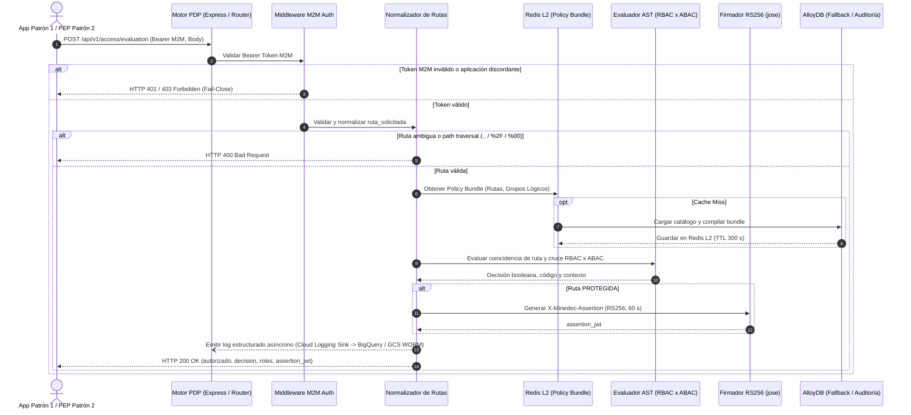

# Implementation Plan: Motor de Autorización Central (motor-pdp)

**Branch**: `spec/004-motor-pdp-autorizacion` | **Date**: 2026-10-26 | **Spec**: [spec.md](file:///C:/Users/anarvaez/Documents/Projects/MINEDEC/SSO/Desarrollo/minedec-sso/specs/004-motor-pdp-autorizacion/spec.md)

**Input**: Feature specification from `/specs/004-motor-pdp-autorizacion/spec.md`

**Note**: Este plan técnico ha sido actualizado mediante el flujo `/speckit-plan` en estricto apego a `.specify/memory/constitution.md` (Constitución MINEDEC v2.11.0), a la base de conocimiento OKF (`knowledge/index.md`, en especial `knowledge/arquitectura/contrato-autorizacion-pep-pdp.md`, `knowledge/dominio/modelo-autorizacion-rbac-abac.md`, `knowledge/dominio/matriz-atributos-gws-catalogos.md`, `knowledge/arquitectura/componentes-pdp-core.md`, `docs/decisiones/DA-12-endpoint-evaluacion-autorizacion.md` y `docs/decisiones/DA-11-intermediario-oidc.md`), y a la verificación autoritativa en Google Developer Knowledge (`retrieving-developer-knowledge`).

---

## Summary

Implementar el microservicio **Motor de Autorización Central (`motor-pdp`, C2.2)** del Sistema de Autenticación Centralizado SSO MINEDEC, actuando como el **Policy Decision Point (PDP)** de referencia nacional para resolver autorizaciones híbridas en tiempo real para aplicaciones del Patrón 1 (Nativas) y el PEP perimetral del Patrón 2 (Apigee X / Envoy Gateway).

El desarrollo se realiza bajo el modelo constitucional **v2.11.0 de repositorios independientes en GitLab (`git.sitimapa.co`) sincronizados en la rama `spec/004-motor-pdp-autorizacion`**:

1. **En los Repositorios de Aplicación (`../microservicios/shared`, `../microservicios/motor-pdp` y `minedec-sso`)**:
   - **`../microservicios/motor-pdp` (`c2-sso/microservicios/motor-pdp` en GKE Autopilot — `sa-sso-core`)**:
     - Consume el paquete transversal `@minedec/shared` desde el **GitLab NPM Package Registry** (`https://git.sitimapa.co/api/v4/projects/<PROJECT_ID>/packages/npm/`).
     - Expone `POST /api/v1/access/evaluation` (`DA-12`, `FR-001`, `FR-002`) con compatibilidad dual (`uuid_aplicacion` / `host_solicitado`), normalización perimetral de rutas (`%2F`, `%00`, `..` rechazados con `HTTP 400 Bad Request`), y evaluación híbrida RBAC × ABAC procesando los 21 atributos de la Matriz Maestra GWS (`FR-004`).
     - Emite respuestas estructuradas en `HTTP 200 OK` (`FR-005`) con códigos formales de decisión (`AUTHZ_PERMITTED`, `AUTHZ_PUBLIC_ROUTE`, `AUTHZ_AUTHENTICATED_ROUTE`, `AUTHZ_DENIED_POLICY`, `AUTHZ_USER_SUSPENDED`, `AUTHZ_OUTSIDE_VALIDITY_WINDOW`) y una aserción criptográfica firmada `X-Minedec-Assertion` (`RS256`, 60 s, `aud = uuid_aplicacion`, `FR-006`).
     - Expone `POST /api/v1/oauth/token` (`RFC 6749 §4.4`, `FR-007`) para autenticación M2M con rotación dual `<= 90 días` (`EN_ROTACION_GRACIA`, `FR-008`), comparando secretos en tiempo constante (`timingSafeEqual`) contra hashes SHA-256 en AlloyDB.
     - Publica `GET /api/v1/.well-known/jwks.json` (`FR-013`) exponiendo exclusivamente claves públicas `RS256` con `servicio_emisor = 'MOTOR_PDP'`.
     - Implementa **Modo Sombra (*Shadow Mode*)** (`FR-012`) para validar políticas en producción sin cortar tráfico.
     - Implementa **Caché L2 en Memorystore for Redis** (`TTL <= 300 s`, `FR-014`) e invalidación reactiva por Pub/Sub (`sso-pip-cache-invalidation`).
     - Aplica una **política estricta *Fail-Close*** (`DA-10`, `RNF-SEG-10`, `PI-06`, `FR-011`) con `HTTP 503` ante fallas, y **cero telemetría de latencia en Node.js** (`FR-016`, `RNF-REN-01..06`, `D-06`, Principio V.4 y Principio XIII).
     - **Pipeline CI/CD en GitLab (`.gitlab-ci.yml`)**: Ejecutado por el runner institucional con la cuenta de servicio adjunta `gitlab-runner@gitlab-servinformacion.iam.gserviceaccount.com` (autenticación por metadata server, cero llaves JSON), publicando imágenes inmutables en Artifact Registry (`sso-containers:$CI_COMMIT_SHA`).
   - **Migración DDL**: `migrations/005_motor_pdp_authorization_schema.sql` completando las tablas BCNF de la Etapa 2 y 3 (`aplicacion` con `modo_sombra`, `administrador_aplicativo` con roles globales y delegados, `ruta_catalogo` con `modo_evaluacion_permisos` y `modo_sombra`, `permiso_atomico`, `ruta_permiso_requerido` con `accion_crud_requerida`, `rol`, `rol_permiso` con capacidades CRUD `puede_crear`/`puede_leer`/`puede_editar`/`puede_eliminar`, `perfil` y `perfil_rol` (`RF-AUZ-04`), `grupo_logico`, `grupo_logico_rol`, `grupo_logico_perfil`, `usuario_rol_aplicacion` con soporte de `rol_id` o `perfil_id` mutuamente excluyentes, restricción única `uq_usuario_rol_ambito_activo` y referencia a `persona_identidad.id_interno`, `credencial_m2m` con `tipo_cliente` y scope por defecto `pdp:evaluate`, `cliente_oidc` con `uq_cliente_oidc_aplicacion` y `llave_jwks_rotacion`).

2. **En `iac-terraform` (`../iac-terraform`, `c2-sso/devops/iac-terraform`, rama `spec/004-motor-pdp-autorizacion`)**:
   - Estructurado en **3 capas (`modulos/`, `plantillas/`, `despliegues/{des,pre,pro}/{devops,data,apps}`)** con Terraform `1.5.7` (sin Terragrunt), empaquetado mediante `scripts/bundle.sh` y gobernado por **Google Cloud Infrastructure Manager (`config.googleapis.com` vía `sa-infra-manager@<project_id>.iam.gserviceaccount.com`)** desde el pipeline `.gitlab-ci.yml`.
   - Declara el módulo `modulos/gke_motor_pdp_service` (instanciado en `plantillas/apps/`) en GKE Autopilot con Workload Identity (`sa-sso-core`), Service de tipo LoadBalancer interno regional (`networking.gke.io/l4-regional-internal` con GKE subsetting) sobre la subred compartida, Liveness/Readiness probes (`/health`, `/ready`), y políticas de monitoreo en Cloud Monitoring.
   - Consume la **Red Compartida (Shared VPC)** institucional existente administrada por el equipo de redes en los proyectos host `mec-003-sha-net-des` (Desarrollo), `mec-003-sha-net-pre` (Preproducción) y `mec-003-sha-net-pro-511014` (Producción) desde los proyectos de servicio SSO (`mec-003-sso-des`, `mec-003-sso-pre`, `mec-003-sso-pro`), sin incluir un stack `host`, utilizando rutas relativas canónicas `projects/${var.host_project_id}/global/networks/${var.network_name}` y `projects/${var.host_project_id}/regions/${var.region}/subnetworks/${var.subnetwork_name}` para GKE Autopilot, Internal Load Balancer L4 de `motor-pdp`, Cloud Run Direct VPC Egress (`sincronizador` y `conciliacion-job`), AlloyDB y Memorystore for Redis.
   - Declara en `plantillas/devops/` el repositorio de Artifact Registry `sso-containers` (`immutable_tags = true`) y las cuentas de servicio estandarizadas (`sa-infra-manager`, `sa-sso-core`, `sa-sso-sync`, `sa-sso-sync-job`, `sa-sso-publicador`).

---

## Technical Context

**Language/Version**: TypeScript 5.8+ (`strict: true`) sobre Node.js 22 LTS en repositorios independientes (`../microservicios/shared/`, `../microservicios/pip-identity-service/`, `../microservicios/sincronizador/`, `../microservicios/conciliacion-job/`, `../microservicios/sso-oidc/`, y `../microservicios/motor-pdp/`; imagen base `node:22-alpine` multi-stage `non-root`); Arquitectura Hexagonal + principios **SOLID** + **DRY** (`@minedec/shared` publicado en GitLab NPM Package Registry) + **Inyección de Dependencias con `InversifyJS` en Composition Root (`container.ts`, sin decoradores en Dominio/Aplicación)**; **Terraform `1.5.7` (HCL puro, sin Terragrunt)** en el repositorio separado `../iac-terraform`.

**Primary Dependencies**: `@minedec/shared` (desde GitLab NPM Package Registry), Express 5 (100 % único framework HTTP), `inversify` (contenedor IoC configurado en `container.ts`), `zod` (100 % único validador de esquemas runtime y AST JSON de políticas), `jose` (firma y verificación JWS `RS256` de `assertion_jwt` y tokens M2M, y publicación JWKS), `pg` + `pg-format` (cliente AlloyDB con consultas parametrizadas `$1, $2` y lista blanca `safe_sql_identifier`), `ioredis` (Memorystore for Redis para caché L2 de bundles de políticas y decisiones precalculadas con `TTL <= 300 s`), `helmet` (cabeceras de seguridad HTTP), `@google-cloud/pubsub` (suscripción de revocaciones en tiempo real `sso-pip-cache-invalidation`), `@google-cloud/secret-manager` (resolución de llaves privadas JWKS), `pino` (logging estructurado JSON compatible con Cloud Logging + OpenTelemetry W3C traceparent y redacción Zero-Secret).

**Storage**: AlloyDB for PostgreSQL 16 (tablas existentes de Etapa 1 `persona_identidad` + `cuenta_institucional` + `asignacion_contexto` + `anomalia_identidad` para el expediente PIP, más tablas BCNF de Etapa 2 y 3: activos con `modo_sombra`, `administrador_aplicativo` con roles globales y delegados, catálogo de rutas 1FN con `modo_evaluacion_permisos` `ANY`/`ALL` y `modo_sombra`, permisos atómicos, `ruta_permiso_requerido` con `accion_crud_requerida`, roles y `rol_permiso` con capacidades CRUD `puede_crear`/`puede_leer`/`puede_editar`/`puede_eliminar`, perfiles `perfil` y `perfil_rol`, grupos lógicos con AST JSON `regla_cruce_abac_rbac` vinculados a `grupo_logico_rol` y `grupo_logico_perfil`, `usuario_rol_aplicacion` con `rol_id`/`perfil_id` y restricción única de ámbito activo, `credencial_m2m` con `tipo_cliente` y hashes SHA-256, `llave_jwks_rotacion` con `servicio_emisor = 'MOTOR_PDP'`, y `auditoria_evento` append-only para eventos de control/seguridad/M2M), Memorystore for Redis (Standard Tier HA, proyecciones L2 `minedec:pdp:bundle:{aplicacion_codigo}` y `minedec:pdp:decision:{aplicacion_codigo}:{id_interno}:{cuenta_id}:{version_catalogo}` sin campos de RUC ni latencia y con `TTL <= 300 s`), Google Secret Manager (llaves privadas `RS256`), Cloud Storage (bundles Terraform y estado gestionado por Infrastructure Manager más archivo forense WORM), Cloud Logging y BigQuery (auditoría analítica append-only de evaluaciones en streaming sin bloqueo de base de datos).

**Testing**: Jest + Supertest (100 % único runner unitario e integración con cobertura `>= 70 %`), verificando:
- Autenticación M2M `POST /api/v1/oauth/token` con rotación dual `<= 90 días` y comparación `timingSafeEqual`.
- Evaluación de autorización en tiempo real `POST /api/v1/access/evaluation` con cruce híbrido RBAC × ABAC.
- Normalización perimetral de rutas y rechazo inmediato de *path traversal* (`400 Bad Request`).
- Firma asimétrica `RS256` y verificación de `X-Minedec-Assertion` con JWKS local.
- Comportamiento en Modo Sombra (*Shadow Mode*) con auditoría de decisiones proyectadas.
- Límite duro de revocación `<= 300 s` y purga reactiva vía Pub/Sub (`< 5 s`).
- Postura estricta *Fail-Close* (`HTTP 503`) ante cortes simulados de dependencias.
- Paridad SQL/DBML (`sql-schema-alignment.spec.ts`) y validación estática de Terraform (`devops-iac-alignment.spec.ts`).

**Target Platform**: Google Cloud Platform — Proyectos de Servicio SSO: `mec-003-sso-des` (Desarrollo), `mec-003-sso-pre` (Preproducción) y `mec-003-sso-pro` (Producción), conectados a los Proyectos Host de Red Compartida (Shared VPC): `mec-003-sha-net-des`, `mec-003-sha-net-pre` y `mec-003-sha-net-pro-511014` — GKE Autopilot (`../microservicios/motor-pdp` con Workload Identity `sa-sso-core` detrás de Internal Load Balancer privado L4 `networking.gke.io/l4-regional-internal`), Memorystore for Redis (Standard Tier HA), AlloyDB for PostgreSQL 16, Secret Manager, Cloud Pub/Sub (`sso-pip-cache-invalidation`), Artifact Registry (`sso-containers`), y Google Cloud Infrastructure Manager (`config.googleapis.com` vía `sa-infra-manager@<project_id>.iam.gserviceaccount.com` invocado desde `.gitlab-ci.yml` con `gitlab-runner@gitlab-servinformacion.iam.gserviceaccount.com`).

**Project Type**: Plataforma central de autorización y gestión de accesos SSO (Subcomponente C2.2) bajo modelo **multirrepositorio en GitLab (`git.sitimapa.co`)**:
1. `minedec-sso`: Repositorio de gobernanza Spec Kit, esquemas DBML, migraciones SQL y contratos OpenAPI.
2. `../microservicios/shared` (`c2-sso/microservicios/shared`): Paquete transversal `@minedec/shared` publicado en GitLab NPM Package Registry.
3. `../microservicios/motor-pdp` (`c2-sso/microservicios/motor-pdp`): Servicio Motor PDP en GKE Autopilot con su `Dockerfile` y `.gitlab-ci.yml`.
4. `../iac-terraform` (`c2-sso/devops/iac-terraform`): Infraestructura declarativa en 3 capas (`modulos/`, `plantillas/`, `despliegues/{des,pre,pro}/{devops,data,apps}`) con Terraform `1.5.7` y `scripts/bundle.sh`.

**SSO Repo**:
- **Código de Aplicación**: `../microservicios/motor-pdp` y `../microservicios/shared` (rama sincronizada `spec/004-motor-pdp-autorizacion`).
- **Infraestructura Declarativa**: `../iac-terraform` (`c2-sso/devops/iac-terraform`, rama sincronizada `spec/004-motor-pdp-autorizacion`).

**Performance Goals**:
- Evaluación de autorización en tiempo real de alta velocidad sostenida por caché L2 en Memorystore Redis (`TTL <= 300 s`).
- Cero cálculo de latencia por petición (`Date.now() - startedAt`, `latenciaMs`) en el código Node.js (`RNF-REN-01..06`, `D-06`, Principio V.4 y Principio XIII); medición delegada a GKE Envoy, Internal Load Balancer y Cloud Trace.
- Límite duro absoluto de revocación de permisos e identidades en **`<= 300 segundos`** (`RF-GI-06`, `RF-AUT-06`, `PI-07`).
- Rotación periódica de credenciales M2M y claves JWKS cada `<= 90 días` sin interrupción de servicio (*zero downtime*).

**Constraints**:
- La evaluación se publica en `POST /api/v1/access/evaluation` (`DA-12`), reemplazando la ruta obsoleta `/api/v1/authorize`.
- Aislamiento estricto de credenciales M2M (`credencial_m2m` en AlloyDB) respecto a credenciales de inicio de sesión de usuario en Google Cloud (`DA-11`).
- Segregación criptográfica en `llave_jwks_rotacion`: `servicio_emisor = 'MOTOR_PDP'` para no mezclar llaves con `SSO_OIDC`.
- Postura estricta *Fail-Close*: ante contingencias o fallas internas se responde con `503 Service Unavailable` y se deniega cualquier acceso no comprobable.
- Cero secretos o llaves privadas en código o bases de datos; uso exclusivo de Secret Manager y hashes SHA-256 (`Principio IX`).
- Prohibido incluir archivos `.tf` de infraestructura GCP dentro de los repositorios de aplicación o utilizar `cloudbuild.yaml` (`Principios IV y XVIII`).

**Scale/Scope**: Universo nacional educativo de **~2,28 millones de identidades** (~2,1 millones de estudiantes y ~180.000 funcionarios), decenas de aplicaciones ministeriales conectadas vía Patrón 1 y PEP perimetral Patrón 2.

---

## Constitution Check

*GATE: Verified and passed after Phase 1 design against Constitución MINEDEC v2.11.0.*

- [x] Language/Version coincide con el stack ratificado en `.specify/memory/constitution.md` v2.11.0 (TypeScript 5.8+ `strict: true` sobre Node.js 22 LTS en repositorios independientes consumiendo `@minedec/shared` desde GitLab NPM Package Registry y Terraform HCL `1.5.7` sin Terragrunt en `../iac-terraform`; sin improvisar otro lenguaje)
- [x] Stack ratificado resuelto: sin `[PLACEHOLDER]` pendiente en Language/Version, Primary Dependencies (`@minedec/shared`, `Express 5`, `inversify`, `zod`, `jose`, `pg` + `pg-format`, `ioredis`, `helmet`, `pino`), Storage, Testing (`Jest + Supertest`), Target Platform (`mec-003-sso-{des,pre,pro}` sobre Shared VPC `mec-003-sha-net-{des,pre,pro-511014}`), Project Type, OIDC Issuer (`https://pdp.sso.<dominio>` como emisor de aserciones y tokens M2M), SSO Repo (`../microservicios/motor-pdp` + `../microservicios/shared` + `../iac-terraform`)
- [x] Separación multirrepositorio en GitLab (`git.sitimapa.co`, Principios IV y XVIII): `../microservicios/motor-pdp` contiene exclusivamente código, pruebas, `Dockerfile` y `.gitlab-ci.yml` ejecutado con `gitlab-runner@gitlab-servinformacion.iam.gserviceaccount.com` (cero archivos `.tf` y cero `cloudbuild.yaml`); `../iac-terraform` contiene exclusivamente Terraform HCL (`1.5.7`) en 3 capas (`modulos/`, `plantillas/`, `despliegues/{des,pre,pro}/{devops,data,apps}`) con `scripts/bundle.sh` y `sa-infra-manager` en la rama sincronizada `spec/004-motor-pdp-autorizacion`
- [x] Microservicios o jobs desacoplados; `../microservicios/motor-pdp` opera como PDP puro consumiendo AlloyDB for PostgreSQL 16 y Memorystore Redis
- [x] Pruebas unitarias/integración mapeadas; cobertura prevista ≥ 70 % con Jest + Supertest (definidas en `quickstart.md` y exigidas en `.gitlab-ci.yml`)
- [x] Flujos E2E de usuario crítico identificados si hay UI (N/A: `motor-pdp` es una API de backend/evaluación; sus flujos se prueban mediante integración HTTP con Supertest)
- [x] OpenAPI o contrato de datos actualizable en `contracts/` (`specs/004-motor-pdp-autorizacion/contracts/motor-pdp-api.openapi.yaml`)
- [x] Spec y este plan: cuerpo en español; IDs FR-/SC- y User Story sin traducir
- [x] SSO: Motor PDP central para evaluación de acceso y emisión de tokens M2M, desacoplado del inicio de sesión OIDC interactivo
- [x] OKF/knowledge citado (`knowledge/arquitectura/contrato-autorizacion-pep-pdp.md`, `knowledge/dominio/modelo-autorizacion-rbac-abac.md`, `knowledge/dominio/matriz-atributos-gws-catalogos.md`, `knowledge/arquitectura/componentes-pdp-core.md`, `docs/decisiones/DA-12-endpoint-evaluacion-autorizacion.md`, `docs/decisiones/DA-11-intermediario-oidc.md`); nada de LOEI inventada
- [x] Si hay reglas LOEI / pedagógicas / de movimiento: Motor de reglas RBAC x ABAC mediante AST JSON tipado con `zod`; si no aplica Drools, N/A
- [x] Si hay mapa interactivo: MapLibre; si no hay mapa, MapLibre N/A (N/A)
- [x] Identidad de servicio: cuenta dedicada de mínimo privilegio (`sa-sso-core` con Workload Identity en GKE Autopilot, cero llaves JSON); llaves privadas `RS256` en Secret Manager (`Principio IX`)
- [x] Observabilidad de aplicación: logs estructurados JSON con `pino` + OpenTelemetry (`GKE_AUTOPILOT`, `traceparent` + `X-Minedec-Request-Id`), y **cero cálculo de latencia por petición en Node.js (`RNF-REN-01..06`, `D-06`, Principio V.4 y Principio XIII)**
- [x] Verificación documental obligatoria en Google Developer Knowledge (`Principio V.13` — `retrieving-developer-knowledge`): recursos `documents/docs.cloud.google.com/memorystore/docs/redis/high-availability-for-memorystore-for-redis`, `documents/docs.cloud.google.com/memorystore/docs/cluster/ha-and-replicas`, `documents/docs.cloud.google.com/secret-manager/docs/secret-rotation`, `documents/docs.cloud.google.com/secret-manager/docs/rotation-recommendations`, `documents/docs.cloud.google.com/kubernetes-engine/docs/how-to/internal-load-balancing`, `documents/docs.cloud.google.com/kubernetes-engine/docs/how-to/cluster-shared-vpc`, `documents/docs.cloud.google.com/run/docs/configuring/shared-vpc-direct-vpc`, `documents/docs.cloud.google.com/alloydb/docs/about-private-services-access`, `documents/docs.cloud.google.com/alloydb/docs/cluster-create`, `documents/docs.cloud.google.com/config-connector/docs/reference/resource-docs/alloydb/alloydbcluster`, `documents/docs.cloud.google.com/memorystore/docs/redis/establish-connection`, `documents/docs.cloud.google.com/memorystore/docs/redis/networking`, `documents/docs.cloud.google.com/infrastructure-manager/docs/configure-service-account`, `documents/docs.cloud.google.com/infrastructure-manager/docs/access-control`, `documents/docs.cloud.google.com/infrastructure-manager/docs/deploy-resources`, `documents/docs.cloud.google.com/sdk/gcloud/reference/infra-manager/deployments/apply`, y `documents/docs.cloud.google.com/sdk/gcloud/reference/infra-manager/previews/create` verificados y citados en `research.md`
- [x] No implementar Security Command Center ni landing zone org-level

---

## Project Structure

### Documentation (this feature)

```text
specs/004-motor-pdp-autorizacion/
├── spec.md              # Requerimientos funcionales y de negocio (DA-12)
├── plan.md              # Este plan de implementación técnico (Constitución v2.11.0)
├── research.md          # Decisiones de arquitectura y referencias Google Developer Knowledge
├── data-model.md        # Esquema relacional BCNF en AlloyDB y proyecciones Redis L2
├── quickstart.md        # Escenarios de prueba y comandos de validación extremo a extremo
├── contracts/
│   └── motor-pdp-api.openapi.yaml # Contrato formal OpenAPI 3.1 del motor PDP
└── checklists/
    └── requirements.md  # Checklist de validación de calidad
```

### Source Code Architecture (`../microservicios/motor-pdp/` y `../iac-terraform/`)

```text
../microservicios/motor-pdp/          # c2-sso/microservicios/motor-pdp (GKE Autopilot — sa-sso-core)
├── .gitlab-ci.yml                    # Pipeline CI en GitLab (gitlab-runner@gitlab-servinformacion.iam.gserviceaccount.com -> sso-containers:$CI_COMMIT_SHA)
├── Dockerfile
├── jest.config.ts
├── package.json                      # Consume @minedec/shared desde GitLab NPM Package Registry
├── tsconfig.json
├── src/
│   ├── main.ts
│   ├── app.ts
│   ├── types.ts
│   ├── container.ts                  # Composition Root IoC (InversifyJS sin decoradores en domain/app)
│   ├── domain/                       # Entidades, errores, puertos y servicios de dominio puros
│   │   ├── entities/
│   │   │   └── pdp-domain.entities.ts
│   │   ├── errors/
│   │   │   └── pdp-domain.errors.ts
│   │   ├── ports/
│   │   │   └── pdp.ports.ts
│   │   └── services/
│   │       ├── rbac-abac-evaluator.service.ts
│   │       └── route-normalizer-matcher.service.ts
│   ├── application/                  # Casos de uso (100 % libres de decoradores e infraestructura)
│   │   └── use-cases/
│   │       ├── evaluate-access.use-case.ts
│   │       ├── issue-m2m-token.use-case.ts
│   │       └── manage-pdp-jwks.use-case.ts
│   └── infrastructure/               # Adaptadores y drivers
│       ├── audit/
│       │   └── pdp-audit.adapter.ts
│       ├── cache/
│       │   └── ioredis-pdp-l2-cache.adapter.ts
│       ├── crypto/
│       │   └── jose-pdp-assertion-signer.adapter.ts
│       ├── database/
│       │   └── repositories/
│       │       ├── alloydb-policy-bundle.repository.ts
│       │       ├── alloydb-identity-authorization.repository.ts
│       │       ├── alloydb-m2m-credential.repository.ts
│       │       └── alloydb-pdp-jwks-key.repository.ts
│       ├── http/
│       │   ├── controllers/
│       │   │   ├── access-evaluation.controller.ts
│       │   │   ├── oauth-token.controller.ts
│       │   │   └── pdp-jwks.controller.ts
│       │   ├── middlewares/
│       │   │   ├── m2m-bearer-auth.middleware.ts
│       │   │   └── pdp-error-and-trace.middleware.ts
│       │   └── schemas/
│       │       └── pdp-zod.schemas.ts
│       └── messaging/
│           └── pubsub-pdp-cache-invalidation.subscriber.ts
└── tests/
    ├── unit/
    │   ├── rbac-abac-evaluator.service.spec.ts
    │   ├── issue-m2m-token.use-case.spec.ts
    │   ├── route-normalizer-matcher.service.spec.ts
    │   └── container-wiring.spec.ts
    └── integration/
        ├── access-evaluation.controller.spec.ts
        ├── oauth-token.controller.spec.ts
        ├── cache-invalidation-and-failclose.spec.ts
        ├── shadow-mode-evaluation.spec.ts
        └── pdp-jwks-rotation.controller.spec.ts
```

---

## Flujo de Evaluación de Autorización (Diagrama Mermaid)



---

## Fases de Implementación (Hacia `/speckit-tasks`)

1. **Fase 1: Esquema de Base de Datos y Dependencias**:
   - Configurar el repositorio independiente `../microservicios/motor-pdp` (`package.json` consumiendo `@minedec/shared` desde el GitLab NPM Package Registry, `tsconfig.json` y `.gitlab-ci.yml`).
   - Generar migración DDL `migrations/005_motor_pdp_authorization_schema.sql` con las tablas BCNF de la Etapa 2 y 3.
   - Implementar pruebas de alineación esquema-código (`sql-schema-alignment.spec.ts`).
2. **Fase 2: Infraestructura Criptográfica y Autenticación M2M**:
   - Repositorio y servicio de llaves JWKS `RS256` para `MOTOR_PDP` (`alloydb-pdp-jwks-key.repository.ts` y `jose-pdp-assertion-signer.adapter.ts`).
   - Endpoint `GET /api/v1/.well-known/jwks.json` y endpoints internos de rotación/revocación (`/internal/v1/pdp/jwks/rotate` y `/internal/v1/pdp/jwks/{kid}/revoke`).
   - Endpoint `POST /api/v1/oauth/token` con rotación dual `<= 90 días` y comparación `timingSafeEqual`.
3. **Fase 3: Motor de Normalización de Rutas y Evaluación RBAC × ABAC**:
   - `route-normalizer-matcher.service.ts` con rechazo determinista de secuencias maliciosas (`400 Bad Request`).
   - Algoritmo de especificidad jerárquica (Exacta > Prefijo > Extensión > Defecto).
   - `rbac-abac-evaluator.service.ts` con cruce multidimensional de los 21 atributos GWS y unión aditiva `bool_or`.
   - Soporte de **Modo Sombra (*Shadow Mode*)**.
4. **Fase 4: Caché L2 en Redis, Inyección de Dependencias y Endpoint de Evaluación**:
   - Adaptador `ioredis-pdp-l2-cache.adapter.ts` con `TTL <= 300 s` y suscriptor de revocaciones Pub/Sub (`pubsub-pdp-cache-invalidation.subscriber.ts` sobre `sso-pip-cache-invalidation`).
   - Endpoint `POST /api/v1/access/evaluation` (`DA-12`) con compatibilidad dual (`uuid_aplicacion` / `host_solicitado`).
   - Generación de `X-Minedec-Assertion` (`RS256`, 60 s, `aud = uuid_aplicacion`).
   - Middleware y manejador global de errores (`pdp-error-and-trace.middleware.ts`) con política estricta **Fail-Close (`HTTP 503`)**.
   - Prohibición estricta de cálculo de latencia en Node.js.
5. **Fase 5: Infraestructura Declarativa en 3 Capas (`../iac-terraform` / `c2-sso/devops/iac-terraform`)**:
   - Módulo `modulos/gke_motor_pdp_service` instanciado en `plantillas/apps/` (Deployment GKE Autopilot, Internal Load Balancer L4 regional `networking.gke.io/l4-regional-internal`, probes, Workload Identity `sa-sso-core`).
   - Consumo de la **Red Compartida (Shared VPC)** existente administrada por el equipo de redes en los proyectos host `mec-003-sha-net-des` (Desarrollo), `mec-003-sha-net-pre` (Preproducción) y `mec-003-sha-net-pro-511014` (Producción) desde los proyectos de servicio SSO (`mec-003-sso-des`, `mec-003-sso-pre`, `mec-003-sso-pro`), sin stack `host` en `../iac-terraform`, conectando las referencias canónicas `projects/${var.host_project_id}/global/networks/${var.network_name}` y `projects/${var.host_project_id}/regions/${var.region}/subnetworks/${var.subnetwork_name}` hacia `alloydb`, `redis`, `cloud_run_sincronizador`, `cloud_run_conciliacion_job`, `gke_pip_service`, `gke_sso_oidc_service` y `gke_motor_pdp_service`.
   - Declaración en `plantillas/devops/` del repositorio de Artifact Registry `sso-containers` (`immutable_tags = true`) y de las cuentas de servicio estandarizadas (`sa-infra-manager`, `sa-sso-core`, `sa-sso-sync`, `sa-sso-sync-job`, `sa-sso-publicador`).
   - Configuración del pipeline `.gitlab-ci.yml` en `../iac-terraform` ejecutado por el runner institucional (`gitlab-runner@gitlab-servinformacion.iam.gserviceaccount.com`, autenticación por metadata server, cero llaves JSON) que empaqueta cada stack (`despliegues/{des,pre,pro}/{devops,data,apps}`) mediante `scripts/bundle.sh` e invoca **Google Cloud Infrastructure Manager (`config.googleapis.com`)** con `--local-source="."`, `--tf-version-constraint="1.5.7"` y `--service-account="projects/${PROJECT_ID}/serviceAccounts/sa-infra-manager@${PROJECT_ID}.iam.gserviceaccount.com"`.
   - Controles declarativos y de gobernanza en `../iac-terraform` (Decisión 10): `backup_window = "21600s"` (formato `google.protobuf.Duration`) en `modulos/alloydb/main.tf`; validación regex `^projects/[^/]+/global/networks/[^/]+$` en `modulos/alloydb/variables.tf`; restricción obligatoria `resource.type` en todas las condiciones `condition_matched_log` y `google_logging_metric` (`sso_sync_dlq_pending_events_${var.environment}`) en `modulos/monitoring/main.tf`; imágenes bootstrap oficiales de Cloud Run en `plantillas/apps/variables.tf`; y gatekeeper de destrucción (`allow-destroy`) en Merge Requests de GitLab dentro de `.gitlab-ci.yml`.
   - Pruebas `.tftest.hcl` y validación estática de infraestructura (`devops-iac-alignment.spec.ts`).
6. **Fase 6: Suite Completa de Pruebas y Cobertura (≥ 70 %)**:
   - Pruebas unitarias de evaluador AST, normalizador de rutas, tokens M2M y cableado IoC.
   - Pruebas de integración HTTP de `POST /api/v1/access/evaluation`, `POST /api/v1/oauth/token` y JWKS con Supertest.
   - Prueba automatizada de aceptación del límite duro de revocación `<= 300 s`.
