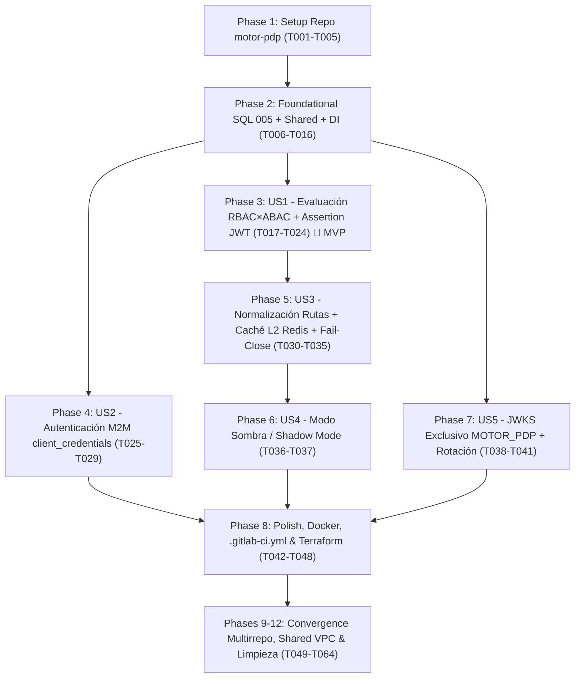

# Tasks: Motor de Autorización Central (`motor-pdp`)

**Input**: Documentos de diseño en `/specs/004-motor-pdp-autorizacion/` ([plan.md](file:///C:/Users/anarvaez/Documents/Projects/MINEDEC/SSO/Desarrollo/minedec-sso/specs/004-motor-pdp-autorizacion/plan.md), [spec.md](file:///C:/Users/anarvaez/Documents/Projects/MINEDEC/SSO/Desarrollo/minedec-sso/specs/004-motor-pdp-autorizacion/spec.md), [research.md](file:///C:/Users/anarvaez/Documents/Projects/MINEDEC/SSO/Desarrollo/minedec-sso/specs/004-motor-pdp-autorizacion/research.md), [data-model.md](file:///C:/Users/anarvaez/Documents/Projects/MINEDEC/SSO/Desarrollo/minedec-sso/specs/004-motor-pdp-autorizacion/data-model.md), [contracts/motor-pdp-api.openapi.yaml](file:///C:/Users/anarvaez/Documents/Projects/MINEDEC/SSO/Desarrollo/minedec-sso/specs/004-motor-pdp-autorizacion/contracts/motor-pdp-api.openapi.yaml), [quickstart.md](file:///C:/Users/anarvaez/Documents/Projects/MINEDEC/SSO/Desarrollo/minedec-sso/specs/004-motor-pdp-autorizacion/quickstart.md)) y base de conocimiento OKF (`knowledge/index.md`)
**Prerequisites**: `plan.md` (requerido), `spec.md` (requerido para historias de usuario), `research.md`, `data-model.md`, `contracts/motor-pdp-api.openapi.yaml`, `quickstart.md`

**Tests**: Las pruebas automatizadas unitarias e integración (`Jest + Supertest`) y la suite de conformidad del SLA de revocación (`<= 300 s`, propagación reactiva `< 5 s`) son **obligatorias** por la Constitución MINEDEC v2.11.0 (`cobertura >= 70 %` en líneas, funciones, ramas y sentencias) y por `SC-001` a `SC-005` de `spec.md`.

**Organization**: Las tareas están agrupadas por fases (Setup, Fundacional, Historias de Usuario `US1` a `US5` en orden de prioridad `P1` -> `P2`, Polish/Cross-Cutting y Convergencia Multirrepo) para permitir implementación y validación independiente de cada incremento.

## Format: `[ID] [P?] [Story] Description`

- **[P]**: Puede ejecutarse en paralelo (archivos distintos, sin dependencias bloqueantes en progreso).
- **[Story]**: Etiqueta de historia de usuario a la que pertenece la tarea (`[US1]` a `[US5]`). Las fases Setup, Fundacional, Polish y Convergence no llevan etiqueta `[USX]`.
- Incluye rutas de archivo exactas en cada descripción para la arquitectura multirrepositorio en GitLab (`git.sitimapa.co`).

## Path Conventions

- **Repositorio de Gobernanza y Especificaciones (`minedec-sso` — este repositorio)**:
  - `specs/004-motor-pdp-autorizacion/` (artefactos Spec Kit y contratos OpenAPI 3.1)
  - `docs/esquemas-bd/` (esquemas DBML 3FN/BCNF)
- **Repositorios Independientes de Paquete y Microservicios (`c2-sso/microservicios/*`, mapeados en `../microservicios/*`)**:
  - `../microservicios/shared/src/` (paquete transversal DRY `@minedec/shared` publicado en GitLab NPM Package Registry: allowlist SQL de `005`, códigos de auditoría del PDP, redacción Zero-Secret)
  - `../microservicios/motor-pdp/src/` (microservicio Motor de Autorización Central en Arquitectura Hexagonal pura, desplegado en GKE Autopilot con `sa-sso-core`)
  - `../microservicios/motor-pdp/tests/` (pruebas unitarias, integración Supertest y aceptación SLA de revocación)
  - `../microservicios/pip-identity-service/migrations/` (migraciones SQL estáticas numeradas para AlloyDB PostgreSQL 16)
- **Repositorio Central de Infraestructura (`c2-sso/devops/iac-terraform`, mapeado en `../iac-terraform`)**:
  - `../iac-terraform/modulos/` (Capa 1: módulos reutilizables `gke_motor_pdp_service`, `alloydb`, `redis`, `iam`, `monitoring`, `secret_manager`, etc.)
  - `../iac-terraform/plantillas/{devops,data,apps}/` (Capa 2: composición de stacks por capa consumiendo la Shared VPC existente)
  - `../iac-terraform/despliegues/{des,pre,pro}/{devops,data,apps}/` (Capa 3: valores `.tfvars` por ambiente para los proyectos de servicio `mec-003-sso-des`, `mec-003-sso-pre`, `mec-003-sso-pro` sobre los proyectos host de Shared VPC `mec-003-sha-net-des`, `mec-003-sha-net-pre`, `mec-003-sha-net-pro-511014`)
  - `../iac-terraform/scripts/bundle.sh` y `../iac-terraform/.gitlab-ci.yml` (empaquetado de artefacto inmutable e invocación de Google Cloud Infrastructure Manager mediante `sa-infra-manager`)

---

## Phase 1: Setup (Shared Package `@minedec/shared` & Independent Repository `../microservicios/motor-pdp`)

**Purpose**: Inicializar el repositorio independiente `@minedec/motor-pdp` en `../microservicios/motor-pdp` sobre Node.js 22 LTS + TypeScript 5.8 (`strict: true`), configurar el consumo de `@minedec/shared` desde el GitLab NPM Package Registry, `tsconfig` y scripts de compilación, linting y pruebas.

- [X] T001 Configurar los scripts `build`, `test`, `test:coverage` y `lint` en `../microservicios/motor-pdp/package.json` y el registro privado `@minedec:registry` en `../microservicios/motor-pdp/.npmrc`
- [X] T002 Crear el manifiesto del paquete `@minedec/motor-pdp` con dependencias (`express`, `inversify`, `zod`, `jose`, `pg`, `pg-format`, `ioredis`, `helmet`, `@google-cloud/pubsub`, `@google-cloud/secret-manager`, `pino`, `@minedec/shared`) en `../microservicios/motor-pdp/package.json`
- [X] T003 [P] Crear la configuración del compilador TypeScript (`strict: true`, `moduleResolution: "NodeNext"`) en `../microservicios/motor-pdp/tsconfig.json`
- [X] T004 [P] Crear la configuración de Jest con umbrales de cobertura obligatorios (`>= 70 %` en branches, functions, lines y statements) en `../microservicios/motor-pdp/jest.config.ts`
- [X] T005 [P] Configurar `../microservicios/motor-pdp/eslint.config.mjs` para incluir `src/**/*.ts` y `tests/**/*.ts` con reglas SAST y frontera hexagonal (`domain/` y `application/` libres de decoradores e infraestructura)

---

## Phase 2: Foundational (Blocking Prerequisites)

**Purpose**: Esquema de base de datos relacional (`migrations/005`), ampliación transversal en `../microservicios/shared`, modelos y puertos de dominio 100 % puros (cero decoradores `@injectable`/`@inject`), esquemas `zod`, repositorios base e InversifyJS Composition Root.

**⚠️ CRITICAL**: Ninguna historia de usuario puede comenzar hasta completar esta fase.

- [X] T006 Crear la migración SQL transaccional `../microservicios/pip-identity-service/migrations/005_motor_pdp_authorization_schema.sql` con las 12 tablas de la Etapa 2 (`administrador_aplicativo`, `ruta_catalogo`, `permiso_atomico`, `ruta_permiso_requerido`, `rol`, `rol_permiso`, `perfil`, `perfil_rol`, `grupo_logico`, `grupo_logico_rol`, `grupo_logico_perfil`, `usuario_rol_aplicacion` con XOR `chk_ura_rol_o_perfil_exclusivo` y acotamiento `codigo_zona_acotado`/`codigo_distrito_acotado`/`codigo_circuito_acotado`/`codigo_amie_acotado`), la tabla `credencial_m2m` de la Etapa 3 (`tipo_cliente IN ('APLICACION_PATRON_1', 'PEP_PATRON_2')`, `secreto_activo_hash`, `secreto_anterior_hash`, `gracia_hasta`, `expira_rotacion_en`, `estado_credencial IN ('ACTIVA', 'EN_ROTACION_GRACIA', 'REVOCADA')`, `scopes_permitidos DEFAULT 'pdp:evaluate'`), la columna `aplicacion.modo_sombra BOOLEAN NOT NULL DEFAULT false`, los índices únicos `uq_cuenta_id_persona_compuesto` y `uq_cliente_oidc_aplicacion`, y las FKs compuestas `(cuenta_id, id_interno)` hacia `cuenta_institucional`
- [X] T007 [P] Actualizar la lista blanca cerrada `ALLOWED_PIP_SQL_IDENTIFIERS` con las 13 tablas nuevas y sus columnas de `005_motor_pdp_authorization_schema.sql` en `../microservicios/shared/src/security/sql-identifier-allowlist.ts`
- [X] T008 [P] Ampliar los códigos de evento de auditoría (`PDP_EVALUACION_PERMIT`, `PDP_EVALUACION_DENY`, `PDP_EVALUACION_SHADOW_PERMIT`, `PDP_RECHAZO_SEGURIDAD_RUTA`, `PDP_TOKEN_M2M_EMITIDO`, `PDP_TOKEN_M2M_RECHAZADO`, `PDP_CACHE_INVALIDADO_PUBSUB`, `PDP_JWKS_ROTADO`) y rutas de redacción Zero-Secret (`client_secret`, `authorization`, `assertion_jwt`, `X-Minedec-Assertion`) en `../microservicios/shared/src/audit/audit-event.schema.ts` y `../microservicios/shared/src/logging/pino-logger.ts`
- [X] T009 [P] Crear las entidades y objetos de valor puros del dominio (`DecisionCode` con `AUTHZ_PERMITTED`, `AUTHZ_PUBLIC_ROUTE`, `AUTHZ_AUTHENTICATED_ROUTE`, `AUTHZ_DENIED_POLICY`, `AUTHZ_USER_SUSPENDED`, `AUTHZ_OUTSIDE_VALIDITY_WINDOW`, `AUTHZ_PERMITTED_SHADOW_MODE`; `CrudPermissions`, `AccessDecision`, `ApplicationPolicyBundle`, `RouteCatalogEntry`, `LogicalGroupRule`, `IdentityAuthorizationContext`, `M2mClientCredential`, `PdpSigningKeyRecord`) sin decoradores en `../microservicios/motor-pdp/src/domain/entities/pdp-domain.entities.ts`
- [X] T010 [P] Crear la jerarquía de errores de dominio del PDP (`PdpSecurityRejectionError`, `PdpFailCloseUnavailableError`, `PdpUnauthorizedM2mError`, `PdpForbiddenM2mScopeError`, `PdpInvalidSchemaError`, `PdpApplicationNotFoundError`) en `../microservicios/motor-pdp/src/domain/errors/pdp-domain.errors.ts`
- [X] T011 [P] Definir los puertos de salida e interfaces de dominio (`PolicyBundleRepositoryPort`, `IdentityAuthorizationRepositoryPort`, `M2mCredentialRepositoryPort`, `PdpJwksKeyRepositoryPort`, `PdpL2CachePort`, `PdpAssertionSignerPort`, `PdpAuditPort`) en `../microservicios/motor-pdp/src/domain/ports/pdp.ports.ts`
- [X] T012 [P] Definir los símbolos de inyección de dependencias (`TYPES`) para el contenedor en `../microservicios/motor-pdp/src/types.ts`
- [X] T013 [P] Implementar los esquemas de validación `zod` de runtime (`MotorPdpEnvSchema`, `EvaluationRequestSchema` con soporte de `email_autenticado` opcional en rutas `PUBLICA` y compatibilidad `uuid_aplicacion`/`host_solicitado`, `OAuthTokenRequestSchema`, `JwksRotateRequestSchema`, y `PolicyAstNodeSchema` recursivo para `regla_cruce_abac_rbac` con operadores lógicos `AND`/`OR`/`NOT` y comparadores `EQ`, `NEQ`, `IN`, `CONTAINS`) en `../microservicios/motor-pdp/src/infrastructure/http/schemas/pdp-zod.schemas.ts`
- [X] T014 Implementar el adaptador de auditoría de 3 capas sin bloqueo transaccional (`AlloyDbAndStreamingPdpAuditAdapter`: emisión asíncrona en streaming JSON hacia Cloud Logging Sink -> BigQuery `bq_auditoria_analitica_append_only` y GCS WORM `gcs_worm_archivo_forense` para decisiones de evaluación de alta frecuencia, e inserción parametrizada con encadenamiento SHA-256 en `auditoria_evento` de AlloyDB para eventos de seguridad, control y tokens M2M) en `../microservicios/motor-pdp/src/infrastructure/audit/pdp-audit.adapter.ts`
- [X] T015 [P] Implementar el middleware HTTP de trazabilidad (`W3C traceparent` y `X-Minedec-Request-Id`), cabeceras de seguridad nivel A (`helmet`) y manejador global de errores *Fail-Close* (`HTTP 400`, `401`, `403`, `404`, `503 Service Unavailable`, cero cálculo de latencia en Node.js) en `../microservicios/motor-pdp/src/infrastructure/http/middlewares/pdp-error-and-trace.middleware.ts`
- [X] T016 Configurar el Composition Root de `InversifyJS` (`createMotorPdpContainer` usando `toDynamicValue` sin decoradores en `domain/` ni `application/`) y la factoría Express 5 (`createMotorPdpApp` con `GET /health`, `GET /ready` y `GET /healthz`) en `../microservicios/motor-pdp/src/container.ts`, `../microservicios/motor-pdp/src/app.ts` y `../microservicios/motor-pdp/src/main.ts`

**Checkpoint**: Fundación lista — esquemas SQL `005`, tipos compartidos en `@minedec/shared`, puertos puros, validación `zod`, auditoría 3 capas y contenedor InversifyJS operativos.

---

## Phase 3: User Story 1 - Evaluación de Autorización en Tiempo Real para Aplicaciones y PEP (Priority: P1) 🎯 MVP

**Goal**: Evaluar peticiones `POST /api/v1/access/evaluation` (`DA-12`) resolviendo la aplicación por `uuid_aplicacion` o `host_solicitado`, cruzando identidad y los 21 atributos institucionales de Google Workspace en `cuenta_institucional` (`RF-GI-02`), membresía automática en `grupo_logico` (`regla_cruce_abac_rbac` AST JSON), expansión de `rol` y `perfil` (`grupo_logico_rol`, `grupo_logico_perfil`, `perfil_rol`), excepciones nominales en `usuario_rol_aplicacion` (con vigencia temporal `fecha_inicio_vigencia`/`fecha_fin_vigencia`, XOR `rol_id`/`perfil_id` y acotamiento `codigo_zona_acotado`/`codigo_distrito_acotado`/`codigo_circuito_acotado`/`codigo_amie_acotado`), unión aditiva `bool_or` de capacidades CRUD (`puede_crear`, `puede_leer`, `puede_editar`, `puede_eliminar`), `modo_evaluacion_permisos` (`ANY` / `ALL`) y emisión del JWT efímero `assertion_jwt` (`X-Minedec-Assertion`, `RS256`, `TTL = 60 s`, `aud = uuid_aplicacion`).

**Independent Test**: Invocar `POST /api/v1/access/evaluation` con un Bearer token M2M válido para usuarios con cuentas `ACTIVA` vs `SUSPENDIDA`/`INACTIVA`, asignaciones directas y por grupo lógico/perfil con coexistencia de múltiples roles, verificando decisiones (`autorizado: true` con `AUTHZ_PERMITTED` / `AUTHZ_AUTHENTICATED_ROUTE`, unión booleana `permisos_crud`, `roles`, `permisos`, `contexto_territorial`, `assertion_jwt` verificable con `aud = uuid_aplicacion` y `cabeceras_inyectadas`, y denegaciones `autorizado: false` con `AUTHZ_USER_SUSPENDED`, `AUTHZ_OUTSIDE_VALIDITY_WINDOW` y `AUTHZ_DENIED_POLICY`).

### Tests for User Story 1 ⚠️

- [X] T017 [P] [US1] Crear pruebas unitarias del evaluador puro RBAC × ABAC (`RbacAbacEvaluatorService`: evaluación recursiva del AST `regla_cruce_abac_rbac`, expansión de roles/perfiles, intersección territorial `codigo_zona_acotado`/`codigo_distrito_acotado`/`codigo_circuito_acotado`/`codigo_amie_acotado`, ventana de vigencia `fecha_inicio_vigencia`/`fecha_fin_vigencia` -> `AUTHZ_OUTSIDE_VALIDITY_WINDOW`, unión aditiva `bool_or` de `puede_crear`/`puede_leer`/`puede_editar`/`puede_eliminar`, y modos `ANY` vs `ALL`) en `../microservicios/motor-pdp/tests/unit/rbac-abac-evaluator.service.spec.ts`
- [X] T018 [P] [US1] Crear pruebas de integración HTTP (`Supertest`) para `POST /api/v1/access/evaluation` (escenarios `AUTHZ_PERMITTED`, `AUTHZ_AUTHENTICATED_ROUTE`, `AUTHZ_USER_SUSPENDED`, `AUTHZ_OUTSIDE_VALIDITY_WINDOW`, `AUTHZ_DENIED_POLICY`, resolución por `uuid_aplicacion` y `host_solicitado`, y verificación criptográfica de `assertion_jwt` y `cabeceras_inyectadas`) en `../microservicios/motor-pdp/tests/integration/access-evaluation.controller.spec.ts`

### Implementation for User Story 1

- [X] T019 [P] [US1] Implementar el servicio de dominio puro `RbacAbacEvaluatorService` (evaluación del AST JSON `regla_cruce_abac_rbac` sobre los 21 atributos GWS + asignaciones territoriales, expansión de `grupo_logico` -> `rol`/`perfil` + `usuario_rol_aplicacion` vigente, unión aditiva `bool_or` de banderas CRUD y evaluación de `ruta_permiso_requerido` según `modo_evaluacion_permisos` `ANY`/`ALL`) en `../microservicios/motor-pdp/src/domain/services/rbac-abac-evaluator.service.ts`
- [X] T020 [P] [US1] Implementar el repositorio AlloyDB de paquetes de políticas de aplicación (`AlloyDbPolicyBundleRepository`: carga 100 % parametrizada de `aplicacion`, `ruta_catalogo`, `ruta_permiso_requerido`, `rol`, `rol_permiso`, `perfil`, `perfil_rol`, `grupo_logico`, `grupo_logico_rol` y `grupo_logico_perfil` por `aplicacion_id`, `codigo` o `url_base`/`host_solicitado`) en `../microservicios/motor-pdp/src/infrastructure/database/repositories/alloydb-policy-bundle.repository.ts`
- [X] T021 [P] [US1] Implementar el repositorio AlloyDB de contexto de identidad y autorización (`AlloyDbIdentityAuthorizationRepository`: consulta 100 % parametrizada de `persona_identidad`, `cuenta_institucional` con sus 21 atributos GWS y `estado_cuenta`, `asignacion_contexto` activa y `usuario_rol_aplicacion` con sus columnas de vigencia `fecha_inicio_vigencia` y `fecha_fin_vigencia`) en `../microservicios/motor-pdp/src/infrastructure/database/repositories/alloydb-identity-authorization.repository.ts`
- [X] T022 [US1] Implementar el firmador criptográfico `JosePdpAssertionSignerAdapter` (`jose` RS256 con llaves `servicio_emisor = 'MOTOR_PDP'`, emisión de `assertion_jwt` con `TTL = 60 s`, `iss`, `sub = id_interno`, `aud = uuid_aplicacion`, `email`, `tipo_identificacion`, `numero_identificacion`, `roles`, `permisos`, `permisos_crud`, `contexto_territorial` y constructor de `cabeceras_inyectadas` `X-Minedec-*`) en `../microservicios/motor-pdp/src/infrastructure/crypto/jose-pdp-assertion-signer.adapter.ts`
- [X] T023 [US1] Implementar el caso de uso `EvaluateAccessUseCase` (orquestación de resolución de aplicación, verificación de `estado_persona === 'ACTIVA'` y `estado_cuenta === 'ACTIVA'` -> `AUTHZ_USER_SUSPENDED`, invocación del motor RBAC × ABAC, firma de `assertion_jwt` y registro en auditoría) en `../microservicios/motor-pdp/src/application/use-cases/evaluate-access.use-case.ts`
- [X] T024 [US1] Implementar el controlador HTTP `AccessEvaluationController` (`POST /api/v1/access/evaluation`) y el middleware de autenticación Bearer M2M (`requireM2mBearerToken` validando `scope` `pdp:evaluate` y correspondencia de `tipo_cliente` `APLICACION_PATRON_1` vs `PEP_PATRON_2`) en `../microservicios/motor-pdp/src/infrastructure/http/controllers/access-evaluation.controller.ts` y `../microservicios/motor-pdp/src/infrastructure/http/middlewares/m2m-bearer-auth.middleware.ts`

**Checkpoint**: User Story 1 (MVP) funcional y verificable de forma independiente en `POST /api/v1/access/evaluation`.

---

## Phase 4: User Story 2 - Autenticación Máquina a Máquina (`client_credentials`) para Consumo del PDP (Priority: P1)

**Goal**: Implementar el endpoint `POST /api/v1/oauth/token` (`grant_type=client_credentials`, `RFC 6749 §4.4`) validando `client_id` y `client_secret` (en `Authorization: Basic` o cuerpo `application/x-www-form-urlencoded` / `application/json`) contra `credencial_m2m` en AlloyDB usando comparación SHA-256 en tiempo constante (`crypto.timingSafeEqual`), soportando ventana de gracia dual de rotación (`ACTIVA` y `EN_ROTACION_GRACIA` con `gracia_hasta >= NOW()` y `expira_rotacion_en >= NOW()`, `<= 90 días`), clientes `APLICACION_PATRON_1` y `PEP_PATRON_2`, y emitiendo un `access_token` JWT `RS256` (`TTL = 3600 s`, `scope = "pdp:evaluate"`).

**Independent Test**: Invocar `POST /api/v1/oauth/token` con credenciales activas, credenciales en rotación con `secreto_anterior_hash` dentro y fuera de `gracia_hasta`, y credenciales revocadas/inválidas, comprobando respuestas `200 OK` (`RFC 6749`) y `401 Unauthorized` (`invalid_client`).

### Tests for User Story 2 ⚠️

- [X] T025 [P] [US2] Crear pruebas unitarias de `IssueM2mTokenUseCase` (comparación SHA-256 con `crypto.timingSafeEqual`, soporte de `secreto_activo_hash` primario y `secreto_anterior_hash` durante `EN_ROTACION_GRACIA` antes de `gracia_hasta`, rechazo por expiración `expira_rotacion_en` o `estado_credencial = 'REVOCADA'`, y perfiles `APLICACION_PATRON_1` vs `PEP_PATRON_2`) en `../microservicios/motor-pdp/tests/unit/issue-m2m-token.use-case.spec.ts`
- [X] T026 [P] [US2] Crear pruebas de integración HTTP (`Supertest`) para `POST /api/v1/oauth/token` (autenticación `Basic` y `form-urlencoded`, emisión de JWT `RS256` con `scope: "pdp:evaluate"`, rechazo `401 invalid_client` y `400 unsupported_grant_type`) en `../microservicios/motor-pdp/tests/integration/oauth-token.controller.spec.ts`

### Implementation for User Story 2

- [X] T027 [P] [US2] Implementar el repositorio AlloyDB `AlloyDbM2mCredentialRepository` (búsqueda parametrizada en `credencial_m2m` por `client_id`, verificación de `expira_rotacion_en` `<= 90 días` y actualización asíncrona de `ultimo_acceso_en`) en `../microservicios/motor-pdp/src/infrastructure/database/repositories/alloydb-m2m-credential.repository.ts`
- [X] T028 [US2] Implementar el caso de uso `IssueM2mTokenUseCase` (validación SHA-256 en tiempo constante con `crypto.timingSafeEqual` sobre `secreto_activo_hash` y `secreto_anterior_hash` en ventana de gracia, validación de `scopes_permitidos`, firma de JWT M2M `RS256` con `expires_in: 3600` y auditoría `PDP_TOKEN_M2M_EMITIDO` / `PDP_TOKEN_M2M_RECHAZADO` en AlloyDB) en `../microservicios/motor-pdp/src/application/use-cases/issue-m2m-token.use-case.ts`
- [X] T029 [US2] Implementar el controlador HTTP `OAuthTokenController` (`POST /api/v1/oauth/token` con soporte de cabeceras `Authorization: Basic` y cuerpos `application/x-www-form-urlencoded` / `application/json`, cabeceras `Cache-Control: no-store` y `Pragma: no-cache`) en `../microservicios/motor-pdp/src/infrastructure/http/controllers/oauth-token.controller.ts`

**Checkpoint**: User Stories 1 y 2 integradas — clientes Patrón 1 y PEP Patrón 2 pueden obtener su token M2M y consumir `/api/v1/access/evaluation`.

---

## Phase 5: User Story 3 - Normalización de Rutas, Caché L2 (`<= 300 s`) e Invalidación Reactiva Fail-Close (Priority: P1)

**Goal**: Blindar el motor contra evasión de rutas (`%2F`, `%2f`, `%00`, `..`, `%5C`, doble codificación) rechazando con `400 Bad Request` y auditando en `auditoria_evento`, resolver rutas con precedencia determinista (`1. EXACTA` > `2. PREFIJO` de mayor longitud > `3. EXTENSION` > `aplicacion.politica_ruta_defecto`), soportar acceso anónimo en rutas `PUBLICA` (`AUTHZ_PUBLIC_ROUTE` sin exigir `email_autenticado`), almacenar bundles y decisiones precalculadas en Memorystore for Redis con `TTL <= 300 s` (`minedec:pdp:bundle:{aplicacion_codigo}` y `minedec:pdp:decision:{aplicacion_codigo}:{id_interno}:{cuenta_id}:{version_catalogo}`), invalidar reactivamente en `< 5 s` vía Cloud Pub/Sub y aplicar postura estricta *Fail-Close* (`HTTP 503 Service Unavailable`) ante caída de Redis + AlloyDB.

**Independent Test**: Enviar peticiones con secuencias `%2F`/`..`/`%00` (esperando `400`, `SC-002`), evaluar rutas `PUBLICA` sin `email_autenticado` (esperando `200 AUTHZ_PUBLIC_ROUTE`), verificar hit/miss en Redis L2 con `TTL <= 300 s`, publicar un evento de revocación en Pub/Sub comprobando purga en `< 5 s` (`SC-003`), y simular caída de datos comprobando respuesta `503 AUTHZ_SERVICE_UNAVAILABLE_FAIL_CLOSE` (`SC-005`).

### Tests for User Story 3 ⚠️

- [X] T030 [P] [US3] Crear pruebas unitarias del normalizador y clasificador de rutas (`RouteNormalizerAndMatcherService`: rechazo de `%2F`, `%00`, `..`, `%5C`, colapso de `//`, remoción de barra final y precedencia determinista `EXACTA` > `PREFIJO` más específico > `EXTENSION` > `politica_ruta_defecto`) en `../microservicios/motor-pdp/tests/unit/route-normalizer-matcher.service.spec.ts`
- [X] T031 [P] [US3] Crear prueba de aceptación automatizada del SLA de revocación (`<= 300 s` por TTL duro en Redis y `< 5 s` por invalidación reactiva Pub/Sub de `minedec:pdp:bundle:*` y `minedec:pdp:decision:*`) y comportamiento *Fail-Close* (`HTTP 503`) en `../microservicios/motor-pdp/tests/integration/cache-invalidation-and-failclose.spec.ts`

### Implementation for User Story 3

- [X] T032 [P] [US3] Implementar el servicio de dominio puro `RouteNormalizerAndMatcherService` (inspección de URI cruda contra `%2F`/`%00`/`..`/`%5C`, normalización canónica, resolución por orden `EXACTA` > `PREFIJO` de mayor longitud de segmentos > `EXTENSION` > `politica_ruta_defecto`, y soporte de `tipo_acceso = 'PUBLICA'` con `AUTHZ_PUBLIC_ROUTE`) en `../microservicios/motor-pdp/src/domain/services/route-normalizer-matcher.service.ts`
- [X] T033 [P] [US3] Implementar el adaptador de caché L2 en Memorystore for Redis (`IoRedisPdpL2CacheAdapter`: gestión de claves `minedec:pdp:bundle:{aplicacion_codigo}` y `minedec:pdp:decision:{aplicacion_codigo}:{id_interno}:{cuenta_id}:{version_catalogo}` con `TTL` estricto `<= 300 s`, invalidación selectiva por usuario/aplicación/versión de catálogo y cero campos de RUC o latencia) en `../microservicios/motor-pdp/src/infrastructure/cache/ioredis-pdp-l2-cache.adapter.ts`
- [X] T034 [US3] Implementar el suscriptor reactivo de invalidación de caché (`PubSubPdpCacheInvalidationSubscriber`: escucha de eventos de revocación de identidad y cambios de catálogo de políticas desde Cloud Pub/Sub / Redis Pub/Sub `sso-cache-invalidation`, purga inmediata en `< 5 s` y auditoría `PDP_CACHE_INVALIDADO_PUBSUB`) en `../microservicios/motor-pdp/src/infrastructure/messaging/pubsub-pdp-cache-invalidation.subscriber.ts`
- [X] T035 [US3] Integrar la normalización perimetral de rutas, la consulta/escritura de caché L2 Redis (`TTL <= 300 s`), el flujo de rutas `PUBLICA` sin `email_autenticado` y la guardia *Fail-Close* (`PdpFailCloseUnavailableError` -> `HTTP 503`) dentro de `EvaluateAccessUseCase` en `../microservicios/motor-pdp/src/application/use-cases/evaluate-access.use-case.ts`

**Checkpoint**: User Stories 1, 2 y 3 completas — motor blindado contra path traversal, con caché L2 `<= 300 s`, invalidación reactiva `< 5 s` y postura *Fail-Close* verificada.

---

## Phase 6: User Story 4 - Evaluación en Modo Sombra (*Shadow Mode*) para Integración Progresiva (Priority: P2)

**Goal**: Permitir que una aplicación (`aplicacion.modo_sombra = true`) o una ruta individual (`ruta_catalogo.modo_sombra = true`, que prevalece como override sobre `aplicacion.modo_sombra = false`) opere en Modo Sombra: cuando la evaluación real de políticas resulte en denegación (`AUTHZ_DENIED_POLICY`), devolver `200 OK` con `autorizado: true`, `codigo_decision: "AUTHZ_PERMITTED_SHADOW_MODE"`, `metadatos_depuracion: { modo_sombra_activo: true, decision_proyectada: "AUTHZ_DENIED_POLICY", reglas_evaluadas }` y registrar asíncronamente en streaming la discrepancia (`PDP_EVALUACION_SHADOW_PERMIT`), manteniendo denegación estricta (`autorizado: false`, `AUTHZ_USER_SUSPENDED`) ante identidades suspendidas o violaciones de seguridad (`HTTP 400`).

**Independent Test**: Evaluar una petición sin permisos sobre una aplicación o ruta con `modo_sombra = true` verificando que responde `200 OK` con `autorizado: true`, `codigo_decision: "AUTHZ_PERMITTED_SHADOW_MODE"`, `decision_proyectada: "AUTHZ_DENIED_POLICY"` y evento de auditoría `PDP_EVALUACION_SHADOW_PERMIT`; repetir con una cuenta `SUSPENDIDA` verificando que el Modo Sombra NO permite el paso y responde `autorizado: false` con `AUTHZ_USER_SUSPENDED`.

### Tests for User Story 4 ⚠️

- [X] T036 [P] [US4] Crear pruebas unitarias y de integración del Modo Sombra (`aplicacion.modo_sombra` y override `ruta_catalogo.modo_sombra`, retorno de `AUTHZ_PERMITTED_SHADOW_MODE` con `metadatos_depuracion.decision_proyectada = "AUTHZ_DENIED_POLICY"`, emisión de `PDP_EVALUACION_SHADOW_PERMIT`, y denegación estricta `AUTHZ_USER_SUSPENDED` cuando la identidad está `SUSPENDIDA`) en `../microservicios/motor-pdp/tests/integration/shadow-mode-evaluation.spec.ts`

### Implementation for User Story 4

- [X] T037 [US4] Implementar la lógica de resolución jerárquica de Modo Sombra (`aplicacion.modo_sombra || ruta_catalogo.modo_sombra`), generación de `metadatos_depuracion` (`modo_sombra_activo`, `decision_proyectada`, `reglas_evaluadas`) y emisión del evento de auditoría en streaming `PDP_EVALUACION_SHADOW_PERMIT` en `../microservicios/motor-pdp/src/domain/services/rbac-abac-evaluator.service.ts` y `../microservicios/motor-pdp/src/application/use-cases/evaluate-access.use-case.ts`

**Checkpoint**: User Story 4 funcional — las aplicaciones en transición pueden auditar discrepancias de autorización en producción sin interrumpir el servicio.

---

## Phase 7: User Story 5 - Publicación y Rotación de Llaves Públicas JWKS Exclusivas del PDP (Priority: P2)

**Goal**: Publicar el endpoint `GET /api/v1/.well-known/jwks.json` exponiendo únicamente las llaves públicas `RS256` con `servicio_emisor = 'MOTOR_PDP'` y `estado_llave IN ('ACTIVA_FIRMA', 'GRACIA_VERIFICACION')` desde la tabla `llave_jwks_rotacion` (sin exponer jamás llaves privadas ni mezclar llaves de `SSO_OIDC`), e implementar los endpoints administrativos internos `POST /internal/v1/pdp/jwks/rotate` (rotación dual `<= 90 días` en Secret Manager + AlloyDB) y `POST /internal/v1/pdp/jwks/{kid}/revoke` (revocación de emergencia `< 1 h` ante compromiso).

**Independent Test**: Consultar `GET /api/v1/.well-known/jwks.json` comprobando que solo aparecen llaves de `MOTOR_PDP` sin material privado (`d`, `p`, `q`); ejecutar `POST /internal/v1/pdp/jwks/rotate` comprobando que la llave nueva pasa a `ACTIVA_FIRMA` y la anterior a `GRACIA_VERIFICACION` verificando aserciones en vuelo; ejecutar `POST /internal/v1/pdp/jwks/{kid}/revoke` comprobando que la llave revocada desaparece inmediatamente del JWKS.

### Tests for User Story 5 ⚠️

- [X] T038 [P] [US5] Crear pruebas unitarias y de integración (`Supertest`) para `GET /api/v1/.well-known/jwks.json`, `POST /internal/v1/pdp/jwks/rotate` y `POST /internal/v1/pdp/jwks/{kid}/revoke` (aislamiento criptográfico `servicio_emisor = 'MOTOR_PDP'` vs `'SSO_OIDC'`, ausencia de componentes privados RSA, ventana de gracia dual y revocación inmediata `< 1 h`) en `../microservicios/motor-pdp/tests/integration/pdp-jwks-rotation.controller.spec.ts`

### Implementation for User Story 5

- [X] T039 [P] [US5] Implementar el repositorio AlloyDB y adaptador de Secret Manager para llaves JWKS del PDP (`AlloyDbPdpJwksKeyRepository`: filtro estricto `servicio_emisor = 'MOTOR_PDP'`, transición transaccional `ACTIVA_FIRMA` -> `GRACIA_VERIFICACION` y `REVOCADA`, y resolución de `secret_manager_version_name` con `sa-sso-core`) en `../microservicios/motor-pdp/src/infrastructure/database/repositories/alloydb-pdp-jwks-key.repository.ts`
- [X] T040 [US5] Implementar los casos de uso `GetPdpJwksUseCase`, `RotatePdpJwksKeyUseCase` y `RevokePdpJwksKeyUseCase` (con registro en `auditoria_evento` código `PDP_JWKS_ROTADO`) en `../microservicios/motor-pdp/src/application/use-cases/manage-pdp-jwks.use-case.ts`
- [X] T041 [US5] Implementar el controlador HTTP `PdpJwksController` (`GET /api/v1/.well-known/jwks.json`, `POST /internal/v1/pdp/jwks/rotate` y `POST /internal/v1/pdp/jwks/{kid}/revoke`) y registrar todas las rutas en `../microservicios/motor-pdp/src/infrastructure/http/controllers/pdp-jwks.controller.ts` y `../microservicios/motor-pdp/src/app.ts`

**Checkpoint**: Las 5 historias de usuario (`US1` a `US5`) están implementadas e integradas en `../microservicios/motor-pdp`.

---

## Phase 8: Polish & Cross-Cutting Concerns

**Purpose**: Contenedorización segura (`Dockerfile` `non-root`), pipeline CI/CD en GitLab (`../microservicios/motor-pdp/.gitlab-ci.yml`), aprovisionamiento de infraestructura GKE Autopilot + Internal Load Balancer en el repositorio central `../iac-terraform` sobre la Shared VPC, y validación integral de alineación SQL, fronteras de arquitectura y cobertura `>= 70 %`.

- [X] T042 [P] Crear el `../microservicios/motor-pdp/Dockerfile` multi-stage sobre `node:22-alpine` con ejecución `USER node` (`non-root`) e instalación de `@minedec/shared` desde el GitLab NPM Package Registry
- [X] T043 [P] Crear `../microservicios/motor-pdp/.gitlab-ci.yml` ejecutado por `gitlab-runner@gitlab-servinformacion.iam.gserviceaccount.com` para las etapas de compilación, SAST (`ESLint`), SCA (`npm audit`), pruebas unitarias/integración con cobertura `>= 70 %`, construcción de imagen Docker y publicación en Artifact Registry (`sso-containers`) con `motor-pdp:$CI_COMMIT_SHA`
- [X] T044 [P] Crear el módulo Terraform `gke_motor_pdp_service` (Deployment en GKE Autopilot con Workload Identity `sa-sso-core`, `PodDisruptionBudget`, `HorizontalPodAutoscaler` y Service `LoadBalancer` privado sobre la Shared VPC con `networking.gke.io/load-balancer-type: "Internal"` y GKE subsetting `networking.gke.io/l4-regional-internal`) en `../iac-terraform/modulos/gke_motor_pdp_service/main.tf`, `../iac-terraform/modulos/gke_motor_pdp_service/variables.tf` y `../iac-terraform/modulos/gke_motor_pdp_service/outputs.tf`
- [X] T045 [P] Integrar el módulo `gke_motor_pdp_service`, el tópico/suscripción Pub/Sub de invalidación reactiva del PDP (`sso-cache-invalidation`) y los secretos en Secret Manager (`pdp-jwks-private-key`, `pdp-m2m-pepper`) en `../iac-terraform/plantillas/apps/main.tf`, `../iac-terraform/plantillas/apps/variables.tf`, `../iac-terraform/plantillas/apps/outputs.tf` y `../iac-terraform/despliegues/des/apps/terraform.tfvars`
- [X] T046 [P] Crear pruebas de cableado del Composition Root (`container-wiring.spec.ts`) y verificación de fronteras de Arquitectura Hexagonal (cero decoradores `@injectable`/`@inject` en `domain/` y `application/`, cero cálculos `Date.now() - startedAt`, cero referencias a `RUC`) en `../microservicios/motor-pdp/tests/unit/container-wiring.spec.ts`
- [X] T047 Actualizar las pruebas transversales de alineación de esquema SQL vs DBML (`../microservicios/pip-identity-service/tests/unit/sql-schema-alignment.spec.ts`) e infraestructura DevSecOps (`../microservicios/motor-pdp/tests/unit/devops-iac-alignment.spec.ts`) para verificar las 13 tablas de `../microservicios/pip-identity-service/migrations/005_motor_pdp_authorization_schema.sql` y el servicio `motor-pdp`
- [X] T048 Ejecutar validación final de compilación, linter SAST, suite completa de pruebas (`npm test`) verificando cobertura `>= 70 %` en `../microservicios/motor-pdp` y los escenarios de `specs/004-motor-pdp-autorizacion/quickstart.md`

---

## Phase 9: Convergence (Integración de Red Compartida Institucional Shared VPC y IAM `sa-infra-manager`)

- [X] T049 Configurar en `../iac-terraform/plantillas/data/main.tf` y `../iac-terraform/plantillas/apps/main.tf` el consumo de la Red Compartida (Shared VPC) existente en los proyectos host (`mec-003-sha-net-des`, `mec-003-sha-net-pre`, `mec-003-sha-net-pro-511014`) mediante referencias `projects/${var.host_project_id}/global/networks/${var.shared_vpc_name}` y `projects/${var.host_project_id}/regions/${var.region}/subnetworks/${var.shared_subnet_name}` sin crear redes VPC dedicadas en los proyectos de servicio (`mec-003-sso-des`, `mec-003-sso-pre`, `mec-003-sso-pro`) per Constitution IV y XVIII
- [X] T050 Declarar en `../iac-terraform/plantillas/devops/main.tf` y `../iac-terraform/modulos/iam/main.tf` los bindings IAM de mínimo privilegio para `sa-infra-manager@${var.project_id}.iam.gserviceaccount.com` y las cuentas de servicio de ejecución (`sa-sso-core`, `sa-sso-sync`, `sa-sso-sync-job`, `sa-sso-publicador`) junto con el permiso `roles/iam.serviceAccountUser` y `roles/config.Admin` para `gitlab-runner@gitlab-servinformacion.iam.gserviceaccount.com` per Constitution XVIII
- [X] T051 Parametrizar las variables de proyecto de servicio y proyecto host de Shared VPC en `../iac-terraform/despliegues/des/{devops,data,apps}/terraform.tfvars`, `../iac-terraform/despliegues/pre/{devops,data,apps}/terraform.tfvars` y `../iac-terraform/despliegues/pro/{devops,data,apps}/terraform.tfvars` conectando `alloydb`, `redis`, `cloud_run_sincronizador`, `cloud_run_conciliacion_job`, `gke_sso_oidc_service` y `gke_motor_pdp_service` a la Shared VPC
- [X] T052 Actualizar las suites nativas `.tftest.hcl` en `../iac-terraform/plantillas/{devops,data,apps}/tests/` y las pruebas de alineación `../microservicios/motor-pdp/tests/unit/devops-iac-alignment.spec.ts` para verificar el consumo de la Shared VPC y los bindings de `sa-infra-manager` y `sa-sso-core`

---

## Phase 10: Convergence (Empaquetado `scripts/bundle.sh` y Pipeline `.gitlab-ci.yml` de Infraestructura)

- [X] T053 Crear e integrar el script de empaquetado `../iac-terraform/scripts/bundle.sh` que ensambla en un directorio temporal `build/<ambiente>/<stack>` la plantilla `plantillas/<stack>/*.tf`, los módulos `modulos/*` y el archivo `despliegues/<ambiente>/<stack>/terraform.tfvars` (`auto.tfvars`) para ejecución hermética con `--local-source="."` y `--tf-version-constraint="1.5.7"` en Google Cloud Infrastructure Manager
- [X] T054 Configurar el pipeline declarativo `../iac-terraform/.gitlab-ci.yml` ejecutado por `gitlab-runner@gitlab-servinformacion.iam.gserviceaccount.com` (autenticación vía metadata server sin llaves JSON) para invocar `gcloud infra-manager previews create` en Merge Requests y `gcloud infra-manager deployments apply` al fusionar a la rama principal usando `--service-account="projects/${PROJECT_ID}/serviceAccounts/sa-infra-manager@${PROJECT_ID}.iam.gserviceaccount.com"` sobre los stacks `devops`, `data` y `apps`
- [X] T055 Integrar el módulo de Artifact Registry (`sso-containers`) dentro del stack `../iac-terraform/plantillas/devops/main.tf` y exponer sus outputs en `../iac-terraform/plantillas/devops/outputs.tf`
- [X] T056 Actualizar las pruebas de alineación `../microservicios/motor-pdp/tests/unit/devops-iac-alignment.spec.ts` para verificar la estructura de 3 capas (`modulos/`, `plantillas/`, `despliegues/`), `scripts/bundle.sh` y el pipeline `../iac-terraform/.gitlab-ci.yml` con `sa-infra-manager`

---

## Phase 11: Convergence (Gobernanza GitLab MR Destroy Gatekeeper y Endurecimiento de Módulos Terraform `1.5.7`)

- [X] T057 Incorporar en `../iac-terraform/.gitlab-ci.yml` el control de gobernanza de cambios destructivos (*Destroy Gatekeeper*) que inspecciona el resultado del preview de Infrastructure Manager (`gcloud infra-manager previews export`), contabiliza recursos marcados para `destroy` y bloquea el Merge Request (`Fail-Close`) a menos que sea autorizado explícitamente
- [X] T058 Validar en `../iac-terraform/modulos/alloydb/main.tf` el formato `google.protobuf.Duration` (`backup_window = "21600s"`) y en `../iac-terraform/modulos/monitoring/main.tf` las restricciones obligatorias `resource.type="k8s_container"` / `resource.type="cloud_run_revision"` en todas las condiciones `condition_matched_log` junto con `google_logging_metric.sync_dlq_pending_events`
- [X] T059 Declarar en `../iac-terraform/plantillas/apps/main.tf` las dependencias explícitas de IAM y Secret Manager antes de desplegar los servicios de Cloud Run y GKE Autopilot, actualizando las imágenes bootstrap por defecto en `../iac-terraform/plantillas/apps/variables.tf`
- [X] T060 Actualizar `../microservicios/motor-pdp/tests/unit/devops-iac-alignment.spec.ts` para verificar automatizadamente los controles de `T057`–`T059` (`backup_window = "21600s"`, `resource.type` en alertas basadas en logs y gobernanza de Infrastructure Manager en `.gitlab-ci.yml`)
- [X] T061 Añadir validación regex `^projects/[^/]+/global/networks/[^/]+$` para la referencia a la Shared VPC (`projects/<host_project_id>/global/networks/<shared_vpc>`) en `../iac-terraform/modulos/alloydb/variables.tf` y `../iac-terraform/modulos/redis/variables.tf`

---

## Phase 12: Convergence (Extracción Física Multirrepositorio en GitLab, `.gitlab-ci.yml` y Limpieza de Monorepo Legado)

**Purpose**: Completar la migración física de `motor-pdp` hacia `../microservicios/motor-pdp`, integrar el módulo `gke_motor_pdp_service` en `../iac-terraform` y limpiar los directorios legados del antiguo monorepo en `minedec-sso`.

- [X] T062 Migrar físicamente el código fuente y las pruebas de `motor-pdp` hacia el repositorio independiente `../microservicios/motor-pdp/` (`src/`, `tests/`, `package.json` con `@minedec/shared`, `.npmrc`, `tsconfig.json`, `jest.config.ts`, `eslint.config.mjs`, `Dockerfile` `node:22-alpine` non-root) y crear `../microservicios/motor-pdp/.gitlab-ci.yml` ejecutado por `gitlab-runner@gitlab-servinformacion.iam.gserviceaccount.com`
- [X] T063 Copiar e integrar el módulo Terraform `gke_motor_pdp_service` (Internal Load Balancer sobre la Shared VPC y Workload Identity `sa-sso-core`) y los secretos del PDP en `../iac-terraform/modulos/gke_motor_pdp_service/` y `../iac-terraform/plantillas/apps/main.tf` para los proyectos `mec-003-sso-des`, `mec-003-sso-pre` y `mec-003-sso-pro` sobre la Shared VPC (`mec-003-sha-net-des`, `mec-003-sha-net-pre`, `mec-003-sha-net-pro-511014`)
- [X] T064 Eliminar del repositorio de gobernanza `minedec-sso` los directorios y archivos legados del antiguo monorepo (`backend/`, `migrations/`, `tests/`, `cloudbuild.yaml`, `cloudbuild-pr.yaml`, `tsconfig.base.json`, `jest.config.ts`) una vez verificada la compilación y cobertura `>= 70 %` en cada repositorio independiente `../microservicios/{shared,pip-identity-service,sincronizador,conciliacion-job,sso-oidc,motor-pdp}`

---

## Dependencies & Execution Order

### Phase Dependencies

- **Phase 1: Setup (`T001`–`T005`)**: Sin dependencias previas — inicializa el repositorio independiente `../microservicios/motor-pdp`.
- **Phase 2: Foundational (`T006`–`T016`)**: Depende de Phase 1 — **BLOQUEA** todas las historias de usuario (`US1` a `US5`).
- **Phase 3: User Story 1 (`T017`–`T024`, P1 🎯 MVP)**: Depende de Phase 2. Construye el núcleo de evaluación RBAC × ABAC y el endpoint `POST /api/v1/access/evaluation`.
- **Phase 4: User Story 2 (`T025`–`T029`, P1)**: Depende de Phase 2. Puede desarrollarse en paralelo con `US1` y se integra con el middleware Bearer M2M de `US1`.
- **Phase 5: User Story 3 (`T030`–`T035`, P1)**: Depende de Phase 2 y extiende `EvaluateAccessUseCase` (`US1`) con normalización perimetral de rutas, caché L2 Redis (`<= 300 s`), invalidación reactiva Pub/Sub (`< 5 s`) y guardia *Fail-Close* (`HTTP 503`).
- **Phase 6: User Story 4 (`T036`–`T037`, P2)**: Depende de `US1` y `US3`. Añade evaluación no disruptiva en Modo Sombra (`aplicacion.modo_sombra` y `ruta_catalogo.modo_sombra`).
- **Phase 7: User Story 5 (`T038`–`T041`, P2)**: Depende de Phase 2 y complementa `US1`/`US2` exponiendo el catálogo JWKS exclusivo de `MOTOR_PDP` y sus endpoints de rotación/revocación.
- **Phase 8: Polish & Cross-Cutting (`T042`–`T048`)**: Depende de completar las historias de usuario `US1`–`US5`.
- **Phases 9–12: Convergence (`T049`–`T064`)**: Materializan la integración en 3 capas en `../iac-terraform` sobre la Shared VPC, la extracción física en `../microservicios/motor-pdp` y la limpieza del monorepo legado en `minedec-sso`.

### User Story Dependencies



### Parallel Opportunities

- **Setup**: `T003`, `T004` y `T005` pueden ejecutarse en paralelo tras `T001` y `T002`.
- **Foundational**: `T007`, `T008`, `T009`, `T010`, `T011`, `T012`, `T013` y `T015` tocan archivos independientes y pueden ejecutarse en paralelo.
- **User Story 1**: `T017` y `T018` (pruebas) en paralelo; `T019` (`RbacAbacEvaluatorService`), `T020` (`AlloyDbPolicyBundleRepository`) y `T021` (`AlloyDbIdentityAuthorizationRepository`) en paralelo.
- **Entre Historias**: Una vez completada la Fase 2, `US1` (`POST /api/v1/access/evaluation`), `US2` (`POST /api/v1/oauth/token`) y `US5` (`GET /api/v1/.well-known/jwks.json`) pueden desarrollarse en paralelo por distintos desarrolladores o agentes.
- **Polish & IaC**: `T042` (`Dockerfile`), `T043` (`.gitlab-ci.yml`), `T044`/`T045` (Terraform en `../iac-terraform`) y `T046` (`container-wiring.spec.ts`) pueden ejecutarse en paralelo.

---

## Parallel Example: User Story 1 (MVP)

```bash
# Lanzar pruebas unitarias e integración de US1 en paralelo:
Task: "T017 [P] [US1] Crear pruebas unitarias del evaluador puro RBAC × ABAC en ../microservicios/motor-pdp/tests/unit/rbac-abac-evaluator.service.spec.ts"
Task: "T018 [P] [US1] Crear pruebas de integración HTTP (Supertest) para POST /api/v1/access/evaluation en ../microservicios/motor-pdp/tests/integration/access-evaluation.controller.spec.ts"

# Lanzar servicio de dominio y repositorios AlloyDB de US1 en paralelo:
Task: "T019 [P] [US1] Implementar RbacAbacEvaluatorService en ../microservicios/motor-pdp/src/domain/services/rbac-abac-evaluator.service.ts"
Task: "T020 [P] [US1] Implementar AlloyDbPolicyBundleRepository en ../microservicios/motor-pdp/src/infrastructure/database/repositories/alloydb-policy-bundle.repository.ts"
Task: "T021 [P] [US1] Implementar AlloyDbIdentityAuthorizationRepository en ../microservicios/motor-pdp/src/infrastructure/database/repositories/alloydb-identity-authorization.repository.ts"
```

---

## Implementation Strategy

### MVP First (User Story 1 + User Story 2 Core)

1. Completar **Phase 1: Setup** (`T001`–`T005`).
2. Completar **Phase 2: Foundational** (`T006`–`T016`), incluyendo `../microservicios/pip-identity-service/migrations/005_motor_pdp_authorization_schema.sql`.
3. Completar **Phase 3: User Story 1** (`T017`–`T024`) para habilitar la evaluación híbrida RBAC × ABAC y la emisión de `X-Minedec-Assertion`.
4. **STOP & VALIDATE**: Ejecutar las pruebas de `US1` verificando decisiones `PERMIT` y `DENY`, unión aditiva CRUD (`bool_or`) y firma `RS256` del `assertion_jwt`.

### Incremental Delivery

1. **Setup + Foundational** → Base de datos (`005`), puertos puros, validación `zod` y contenedor InversifyJS listos.
2. **Add US1 (Evaluación RBAC × ABAC)** → Motor de decisión funcional con aserción JWT firmada (MVP).
3. **Add US2 (Autenticación M2M `client_credentials`)** → Emisión de tokens M2M con rotación en ventana de gracia `<= 90 días`.
4. **Add US3 (Normalización de Rutas + Caché L2 Redis `<= 300 s` + Fail-Close)** → Blindaje OWASP, invalidación reactiva `< 5 s` y resiliencia *Fail-Close*.
5. **Add US4 (Modo Sombra)** → Adopción progresiva sin bloqueo para aplicaciones en migración.
6. **Add US5 (JWKS Exclusivo del PDP)** → Verificación distribuida de firmas y rotación/revocación `< 1 h`.
7. **Polish, IaC & Convergence** → Contenedor `non-root`, CI/CD en `.gitlab-ci.yml`, módulo Terraform en `../iac-terraform` sobre la Shared VPC, extracción física en `../microservicios/motor-pdp` y cobertura `>= 70 %`.

---

## Notes

- `[P]` indica tareas que operan sobre archivos distintos sin dependencias en progreso.
- `[US1]`..`[US5]` trazan cada tarea directamente con las historias de usuario de `specs/004-motor-pdp-autorizacion/spec.md`.
- `domain/` y `application/` deben permanecer **100 % libres de decoradores** (`@injectable`, `@inject`) y de dependencias de infraestructura (`pg`, `ioredis`, `express`).
- **Prohibido** calcular o retornar campos de duración/latencia en Node.js (`Date.now() - startedAt`) o modelar `RUC`.
